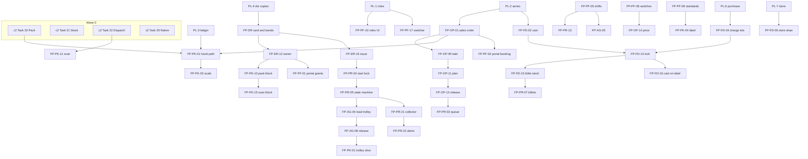

# ORRN floor parity — integration plan

Date: 2026-10-24. Status: plan. Worktree `wt/FP` at `08a3ead` (branch `wt/FP`, off `redesign/c2`). Do not cut over prod from this branch.

Master list: `docs/superpowers/specs/2026-10-24-orrn-fp-feature-list.md` (128 FP IDs). Module contracts: the seven `2026-10-24-orrn-fp-*-design.md` specs. Existing work: `docs/superpowers/plans/2026-10-03-orrn-plant-modules.md` (PL-n, all checkboxes still open) and `docs/superpowers/plans/2026-10-03-orrn-c2-redesign.md` (Tasks 20–22 and 29 are the cutover gate; they are not done).

This plan merges what ORRN already has or already planned with what the 2026-10-24 competitive report says a plant buyer expects. Wording is ORRN's. Where a spec and an older plan disagree, the resolution in §2 is the one to build.

Effort words, from the report: S ≤ 1 week, M 2–3 weeks, L 4–8 weeks, one engineer with assist. A wave's calendar is the sum of its slices, not the sum of every FP ID in parallel.

---

## 1. Merge matrix

Keep = existing ORRN code or an open PL task, with the path or id. Adopt = an idea we take, restated as an ORRN capability. Change = a planned behaviour this plan replaces. Drop = do not build.

### Die room

| | What |
|---|---|
| Keep | Prod section CRUD: `packages/db/src/schema/catalog.ts`, `packages/server/src/routers/die.ts`, `/dies` and `/dies/$id`. Unique `(company, series, section code)`, including the soft-deleted clash message. Grams per 12 ft. c2 `die_instance` allocate-on-insert, `die_weight_reading`, `nitriding_log` mass balance, `proposeTier` + `die_rerank`, `drift.suggestFirst`. Permissions `die.card`, `die.reading`, `die.rerank`, `die.create` / `die.update` / `die.import` via `masters.publish`. PL-4, PL-W5. FTR letters stay; meaning unconfirmed. `thickness_mm` stays. |
| Adopt | Several bands under one section (FP-DR-03). Percent drift and plant colours beside in/above/below (FP-DR-06). Die card files and press PDF (FP-DR-07, FP-DR-13). Band lift on the same approval as a tier change, code unchanged (FP-DR-10). Customer owner on the section and the copy, enforced in planning, pack, press, and dispatch (FP-DR-12). Alloy and temper as text defaults (FP-DR-14). Issue row as the only way to `in_use` (FP-DR-16). Die maker as its own master, not a scrap vendor (FP-DR-11, Next). |
| Change | PL-4 rank-only `proposeTier` gains an optional lift onto another band of the same section. `dieInstance.update` must refuse `in_use` and `at_maker`. `suggestFirst` must return an available in-band copy, not one already `in_use`. Nitriding-out sets `at_nitriding`; the log alone does not. Copy code stays `{sectionCode}-{seqNo}`. Do not switch the stored code to a slash. |
| Drop | Unmerged drawing-URL branch (`origin/feat/fourcubes-ops-scan-drawings`). Auto-convert of CDR/DWG. Auto-issue of the suggested copy. A second die-number series. Extrusion ratio and corrector columns (unmapped; not in the spec). Catalogue leads. |

### Orders and planning

| | What |
|---|---|
| Keep | PL-8 shape: `sales_order`, `sales_order_line`, status `booking` / `confirmed` / `dispatching` / `closed`, baki = ordered − dispatched, never negative, `dispatch_overdraw`, doc type `so` → `SO-{seq}` on the financial year. `order.manage` (office, manager). `bundle.sales_order_line_id` column (unenforced text today). Analytics `openOrders` stays null until PL-8. Length stored in mm (`MM_PER_FOOT = 304.8`). |
| Adopt | Line pins a copy or a tier, and snapshots alloy and temper (FP-OP-02). Pieces or kg, either way, one formula (FP-OP-03). Weight basis: latest reading or band start, both stored, later reading does not move baki unless office refreshes (FP-OP-04). Leftover stays on the PO (FP-OP-07). `bundle_transfer` (FP-OP-08). Plant stock (FP-OP-09). Ready-stock prompt (FP-OP-10). Press plan grouped by die, 24-hour window, urgent, hand-off to a queued run (FP-OP-11–13, Next). Price behind a switch (FP-OP-14, Next). Other party's open lines as a warning, not a block (FP-OP-15). Late orders on Today, 15 days, balance not percent (FP-OP-18). |
| Change | PL-8 line (section, cut, pcs, kg, finish text) gains copy, tier, alloy, temper, weight basis, rate. Produced stays packed bundles. Pressed, aged, packed, in stock are extra columns; they do not redefine baki. Add status `cancelled`. Portal create is `booking` only and cannot pin a copy. |
| Drop | In-house customer setting. A second document to hold leftover. `press_queue_job` and `press_queue_cut`. `die_instance.customer_id` and approval kind `die_cross_party`. A percent-complete strip. Tax, invoice number, and e-way on the order. |

### Press

| | What |
|---|---|
| Keep | PL-9 tables as the seed: `press_run`, `press_downtime`, `press_run_line`, `reason_code`. Permission `press.run` (press, supervisor). P2 typed-first, `source` typed / telemetry / import. Nothing writes the PLC (digest). PL-W4 / PL-N4 are the screen tasks; this plan changes what they show. |
| Adopt | Press line master (FP-PR-01). Queue from a released plan (FP-PR-02). Large-type station (FP-PR-03). Die-issue gate (FP-PR-04). Forward-only states (FP-PR-05). Server clock (FP-PR-06). Billets by cast and length (FP-PR-07). Server recovery (FP-PR-11). Relief without resetting the timer (FP-PR-13). Drawing button (FP-PR-14). Pressed on the order, baki unchanged (FP-PR-16). 17-column report and daily summary (FP-PR-17, FP-PR-18). Offline outbox (FP-PR-19, Next). Time and reopen approvals; short book is a reason (FP-PR-20). Collector and threshold alerts (FP-PR-21, FP-PR-22, Later). |
| Change | PL-9 start must not set `in_use` and must not start from a typed copy with no issue. QC is a gate on the run, not a skippable `qc_entry`. No `press_billet_overdraw` approval. Negative billet stock is refused. `reports.production` becomes the run list plus the daily summary; downtime Pareto stays on the summary, not a second axis on the run table. |
| Drop | A separate press theme package. A "Die ready" flag that is not `die_issued`. Client-sent recovery. Writing set-points to the PLC. |

### Foundry

| | What |
|---|---|
| Keep | PL-2 cast series (`formatCastCode`, `K31`). Permissions `cast.enter`, `cast.close`. Approval kind `cast_close` (approvers owner, admin, manager, foundry) — add the applier, do not rename the kind. Location `BILLET`, ledger kind `billet`. `prepareStoreDraws` purpose `melt`. PL-6 lots and PL-7 store as the charge sources. Nine return streams (PL-5 seed). Review Focus 4 (tail outside 3% warns, never silently passes). |
| Adopt | Furnace master with capacity (FP-FD-01). Campaign cast, many melts (FP-FD-02, FP-FD-03). Charge from OK lots and return streams (FP-FD-04, FP-FD-05). Store draws plus LDO inches, not litres (FP-FD-06). Several output lines (FP-FD-07). Computed burn (FP-FD-08). Alloy limits and nine-element pass/fail (FP-FD-09, FP-FD-10). Spectro file as evidence, typed numbers as the record (FP-FD-11). Lock posts stock (FP-FD-13). Close is a second step (FP-FD-14). Billet stock by cast (FP-FD-15). Cast on the label (FP-FD-16). Trace, certificate, yield (Next). Cost hook (Later, no rupee document until asked). |
| Change | PL-5 posts on melt create. This plan posts on lock. A draft moves nothing. `settings.castSeriesStart` continues a book; typing `K31` when the series would issue `K32` is refused. Lot cancel must refuse when a locked melt input cites the lot, not merely when some other lot could cover the grade balance. |
| Drop | A typed gross that replaces the lots. PDF parsing in this phase. A spectro verdict the office can mark passed. Chemistry on the public QR. A finance module. |

### Ageing

| | What |
|---|---|
| Keep | PL-9 `ageing_batch` / `ageing_row` as the seed. Permission `ageing.enter` (press, supervisor). No ledger posting for load, start, temperature, hardness, release, hold, or rework (P16). Gas end ≥ gas start. PL-N4 is the native task; routes stay under More. |
| Adopt | Oven and trolley masters, separate from the load (FP-AG-01, FP-AG-02). Cycle recipe snapshotted on start (FP-AG-03). Load from logged press lines (FP-AG-04). Temperature log (FP-AG-06). Hardness samples and pass/fail (FP-AG-07). Release before pack can see the line (FP-AG-08). Server remaining (FP-AG-09). Report (FP-AG-10). Holds and rework that keep the first cycle (FP-AG-11, FP-AG-12). Trace on the bundle (FP-AG-13). `ageing_override` (FP-AG-14). Pieces on the order via `ageing.forOrder` only (FP-AG-15). Collector temperature (FP-AG-17, Later). |
| Change | PL-9 one-shot `ageing.create` becomes load, start, log, take out, release. One `tempC` becomes the set-point snapshot; actuals are rows. Shift is `shift_id`, not a free string and not "A". Batch number is `AG-{seq}` on the financial year, not a date smashed into an id. |
| Drop | A WIP ledger posting to close the gap between press and pack. A second shift code on the oven screen. Pack writing `scrap_pcs` or `rework_pcs`. Scanning a trolley (trolleys have no QR in this spec). |

### Pack, stock and dispatch

| | What |
|---|---|
| Keep | Prod pack, stock, dispatch, packing list, label print. c2 `bundleHold`, `addBundlesBySerial`, `resolve`, PL-3 ledger, PL-2 `doc_series`, PL-8 dispatch header and PL v2 columns. `dispatch.reserve` for bundles already on a dispatch. `dispatch_overdraw`. Spool TCP 9100. Public QR payload stays number and section. Gate rule Q4 (a): packer and operator scan; supervisor or office completes. |
| Adopt | Trolley as a pack source, with a hand path that still works (FP-PK-01). Scale through orrn-spool; typed weight needs a reason (FP-PK-02). kg/12 ft chip (FP-PK-03). Label variables: cast, sales order, BIS, CM/L (FP-PK-04). Branding snapshot (FP-PK-05). Per-party bundle numbers (FP-PK-07). Stock by length (FP-PK-08). Transfer (FP-PK-09). Owned-die block (FP-PK-10). Scan screen, vehicle, capacity warning (FP-PK-11, FP-PK-12). PL revision lock, section sort, hollow/solid summary, combine (FP-PK-13). Pack rejects (FP-PK-14). Scan reasons including wrong customer (FP-PK-15). Stock-age screen (FP-PK-16, Later). |
| Change | c2 `packingList.regenerate` deletes and renumbers. Replace with a new revision that keeps the sent copy. First issue takes the PL number; revisions do not. `allocateDocNumbers` gains an optional customer scope; callers with no scope stay on the company series. After the first locked melt, `requireCastOnBundle` defaults on. |
| Drop | Bluetooth as a Now dependency (FP-PK-06 is Later). A transfer document number. A second stock figure for length grouping. Booking leftover to a customer called FourCubes. Phone RS-232 as the scale path; the reader is in orrn-spool. |

### Platform

| | What |
|---|---|
| Keep | c2 13 roles, invite, last-owner guard, TOTP, impersonation, `company.switch`, `modules[]` (empty means all on), `company.updateSettings` keys already written (`lengthUnit`, `timezone`, `bundleNumbering`, `plSeries`, `dcTolerancePct`). `dashboard.today`. `en` + `hi` parity tests. Guide index. `settings.update` is owner and admin only. C2 settings tabs: Company, Team, Printing, Data — extend that route, do not add `/settings/shifts` as a second IA. |
| Adopt | Shifts JSON and production day (FP-PF-05). Commercial switches enforced on the server (FP-PF-06). Module check on mutations (FP-PF-07). No IP bypass (FP-PF-08). BIS pairs (FP-PF-09). Team screen on the existing stub (FP-PF-10). Device register and minimum build, one app id (FP-PF-11). Backup export and restore drill (FP-PF-12). Gujarati (FP-PF-13). Guides slug, support contact, release notes (FP-PF-14). Today per role on the production day (FP-PF-15). Audit viewer (FP-PF-16, Next). Plant switcher UI (FP-PF-17, Next). Party portal as a booking login (FP-PF-01–04, Next). Station PIN (FP-PF-18, Later). |
| Change | `dashboard.today`, packed-today, and the press daily summary use `productionDayWindow` once shifts are saved. Until then, midnight. Do not change `monthStartMs`, FY rollover, or bundle month letters. `modules[]` must be read by mutations, not only by nav. |
| Drop | IP/CIDR OTP skip, DDNS login bypass, router heartbeat key on the company form. Per-client app flavors. Google sign-in. A fourteenth `CompanyRole` for the party. In-house customer setting. An S3 path the plant types. Seat cap. Public store listing (internal track or signed APK is enough for Now). Audit-pruning cron (forbidden unless explicitly requested). |

### Already planned, not an FP ID, still in the merge

| Keep | Do not fold into an FP row |
|---|---|
| PL-1 roles and approvals | Done on c2 server. Web inbox is PL-W2, shared by every new kind. |
| PL-2 document series | Engine for SO, cast, PL, AG, DM, cert, party bundle scope. |
| PL-3 ledger and locations | Every stock write. |
| PL-6 purchase, PL-7 store | Screens PL-W2, PL-W6. Report N4. |
| PL-10 count | PL-W8, PL-N2. |
| PL-12 legacy import | FCMS cutover. Required before parallel run ends. |
| PL-A1 analytics, Task AN-2 charts | Today, stock, dispatch. Not a new library. |
| Spool | Labels, queue, retry, label AI. Heartbeat call is N12, not a new product. |
| c2 Tasks 20, 21, 22, 29 | Prod parity for pack, stock, dispatch, native. Wave 0. |

---

## 2. Cross-spec contracts and contradictions

Each item is a clash between two specs, or between a spec and PL / c2. The resolution is what to build.

### Shared names to use

| Topic | Name to use |
|---|---|
| Section owner | `die.owner_customer_id`. Copy owner `die_instance.owner_customer_id`. Null on the copy inherits the section. A copy cannot opt out to plant-owned while the section has an owner. |
| Effective owner | Copy column if set, else section column, else none. |
| Owner exception | Approval kind `die_owner_override`. Subject is a die copy id only. Meta: `attemptedCustomerId`, `purpose` (`plan`, `pack`, or `dispatch`). Approvers: owner, admin, manager. Requester cannot approve. No apply hook. |
| Profile | `die.profileKind`: `hollow`, `solid`, `semi`. Not `profileType`. |
| Standards | `company.settings.standards`: solid, hollow, and optional semi, each `{ standard, cml }`. Semi falls back to solid when blank. Pack snapshots the resolved pair. Reprint does not re-read settings. |
| Shifts | `company.settings.shifts[]`: `{ id, name, seq, startMin, endMin }`. `id` is a uuid. `seq` 1 starts the production day. Not a table. Press and ageing store `shift_id` = `id`. |
| Press run status | `queued`, `die_issued`, `running`, `stopped`, `counting`, `logged`, `voided`. No "ready". |
| Die copy status | `available`, `in_use`, `at_nitriding`, `at_maker`, `retired`. |
| Die issue status | `issued`, `returned`, `cancelled`. No document number. |
| Ageing batch status | `loading`, `in_oven`, `out`, `released`, `held`, `closed`, `void`. |
| Ageing row status | `pending`, `held`, `released`, `closed`, `void`. |
| Sales order status | `booking`, `confirmed`, `dispatching`, `closed`, `cancelled`. |
| Plant stock | `sales_order_line_id` null and the latest `bundle_transfer.to_sales_order_line_id` null. Legacy null with no transfer is unassigned, not plant stock. |
| Baki | `max(0, ordered − dispatched)` in kg and pcs. Pressed does not move it. |
| Idempotency | Existing `mutation` table (`company_id`, `device_id`, `client_mutation_id`). No second store. |
| Pack permission | `bundle.pack` ≡ `bundle.create`. New pack mutations use `bundle.pack`. |

### Contradictions

**C1. Owner column names.** Orders asked for `die_instance.customer_id` and kind `die_cross_party`. Die room refused. **Resolution:** `owner_customer_id` on both tables. Kind `die_owner_override`. Orders spec already accepted this. Build the die-room names.

**C2. Copy opt-out.** "Effective owner is the copy if set" can be read as a null copy meaning plant-owned. Die room says null inherits, and a copy cannot opt out while the section is owned. **Resolution:** inherit-only. To put a plant-owned copy under an owned section, clear the section owner or split the section. Say so on the form.

**C3. `profileType` vs `profileKind`.** Pack asked for `profileType`. **Resolution:** column is `profileKind`. Pack reads it. Do not add a second column.

**C4. Override subject.** Pack and orders both considered a section-id fallback. **Resolution:** subject is the copy id only. No copy selected: "Pick the die copy". Owned section with no copies: "This section has no copies". Never write the approval against the section id.

**C5. Who may request the override.** Die room allows `order.manage`, `press.run`, `bundle.pack`, `dispatch.create`. Release is `order.plan`, so a planner could not request the exception the release blocks on. **Resolution:** also allow `order.plan`, purpose `plan`. Approvers unchanged.

**C6. Who owns `die_issue` and `die.drawing_key`.** Press asked to own both. **Resolution:** die room owns the table, the column, and `die.issue` (die_room only). Press owns `press_line` and the status enum. Issue sets `press_run.die_instance_id` and moves `queued` to `die_issued` in that batch. Cancel before start reverses both. Start refuses unless `die_issued`. Null drawing is an empty button, not a start block.

**C7. Queue tables.** An earlier orders note asked for a queue-cut copy. **Resolution:** no `press_queue_job`, no `press_queue_cut`. `press_plan_line` is what the press reads. `plans.release` is the only insert of a `queued` run. `die_instance_id` is null until issue. `preferred_die_instance_id` is a hint.

**C8. Plant stock vs a null line.** Pack's feature sentence says plant stock is a null line after a transfer. Orders says a legacy null line with no transfer is unassigned. **Resolution:** both conditions. Null line alone is unassigned. Plant stock requires a `bundle_transfer` with a null destination. Unassigned bundles cannot be scanned onto a dispatch until a transfer assigns them.

**C9. Two meanings of Hold.** Orders FP-OP-17 links available bundles to a line and leaves them `available`. Pack's stock screen said Hold opens a draft dispatch and calls `dispatch.reserve`. **Resolution:** two buttons. "Put on sales order" is `orders.hold` (FP-OP-17). "Hold on dispatch" is `dispatch.reserve` after the bundles are on that dispatch. Do not use one label for both.

**C10. Who writes `scrap_pcs`.** FP-PK-14 depends on `scrap_pcs` and the user story says pack hands pieces back as scrap. Ageing says pack must not write the column. **Resolution:** pack calls `ageing.discardRemaining`, which is the only writer of `scrap_pcs`. Pack-time rejects (pieces that leave the trolley and are not a bundle) go through `drawAgeingRow` and increment `packed_pcs`, not `scrap_pcs`. Weighed reject kg is pack's `pack_reject` ledger row at plant scrap. Discard-remaining writes no pack ledger row; if those pieces were weighed, the plant-scrap posting is still pack's.

**C11. `packed_pcs` meaning.** Easy to read as "pieces on a bundle". **Resolution:** it is every piece that left the trolley through pack, including rejects. Remaining is loaded pieces minus packed, scrap, and rework, computed on the server. Ageing does not write `packed_pcs`. Bundle void restores it in the same batch as the ledger reversal.

**C12. `ageing.split`.** **Resolution:** company setting, default off. While off, pack refuses a cut that would change piece count. A shorter cut of the same pieces sets `bundle.recut` and does not change the row. Both specs agree. Do not default it on.

**C13. Ageing number.** The competitor used a date-coded id. PL-9 did not name a series. **Resolution:** doc type `ageing`, financial year, `AG-{seq}`. Not a date smashed into an id.

**C14. Shift string vs id.** P16 said shift A/B/C or day/night as text. Floor screens in the demo used "A". Platform, press, and ageing now store an id. **Resolution:** JSON shape in FP-PF-05. `seq` is not printed as a name. Default pair offered on the empty settings screen, not written until Save: Day 08:00–20:00 (`seq` 1), Night 20:00–08:00. Until saved, Today uses midnight. One to four shifts, no gap, no overlap, union 24 hours. Touching endpoints are not an overlap. Deleting a shift that a press run cites is refused. Rename does not change ids.

**C15. Production day vs calendar month.** A run at 00:30 belongs to the previous production day if shift 1 starts at 08:00, and to the calendar month of that instant. **Resolution:** `productionDayWindow` for Today, packed-today, and the press summary. `monthStartMs`, FY rollover, and bundle month letters stay on calendar midnight. Do not move a 02:00 bundle into the previous month.

**C16. `dashboard.today` midnight.** c2 uses calendar midnight. Platform moves the window when shifts exist. **Resolution:** switch that query when shifts are saved. Do not change it in Wave 0, before the shifts setting ships.

**C17. `produced` vs `pressed`.** PL-8 produced = bundles linked to the line. Orders FP-OP-05 also shows pressed, aged, packed, in stock. Press FP-PR-16 says pressed does not move baki. **Resolution:** keep the names. `producedG` stays non-void linked bundles. `pressedG` is logged good kg. `bakiG` = max(0, ordered − dispatched). Do not rename. Do not let a press log reduce balance.

**C18. Melt posts on create vs on lock.** PL-5 posts when the melt is created. FP-FD-13 posts on lock so a 12-hour sheet can be corrected. **Resolution:** adopt FP-FD-13. Drafts do not move stock. Lock is one `atomicBatch`: document, ledger, store draws, audit. A failed spectro requires a reason, not a block on physics.

**C19. `cast_close` applier.** Kind exists. Nothing opens it. Approvers include foundry, who do not hold `cast.close`. **Resolution:** `casts.close` opens the approval when the tail rule fails. Applier sets `closed` on approve, same shape as `die_rerank`. Requester cannot decide, owner included. A foundry user who did not request the close may approve. They cannot press Close. Reject returns the cast to `open`.

**C20. Two alloy concepts.** Die room stores alloy and temper as text. Foundry has an alloy-limits master. Ageing recipes key alloy and temper. Orders snapshot the text. **Resolution:** do not unify onto one id in this phase. `die.alloy` / `die.temper` and the order-line snapshot are the commercial grade (text). Foundry `alloy` is the chemistry grade (limits, ppm). Cast stores the foundry alloy. Ageing recipe matches the cast's alloy when `cast_id` is set, and snapshots the text it used. A later id link is out of scope until the owner asks.

**C21. Weight basis vs band switch.** Orders default to the latest reading, else band start, and show both. Platform `dieBands` off hides the band and the band-start basis. The competitor collapsed a range to one stored weight. **Resolution:** stored min/max grams never collapse. Off hides the band and the band-start basis in order entry. On, both figures stay on the line. A later reading does not move baki unless office refreshes.

**C22. Die required vs press copy.** `dieRequiredOnSalesOrder` default on means confirm needs a copy or a tier. Press must not have the planner lock the copy. **Resolution:** the flag binds the sales-order line only. It does not set `press_run.die_instance_id`. The pin is copied to `preferred_die_instance_id` for the die room.

**C23. Price visibility.** **Resolution:** `priceOnSalesOrder` default off. `order.price` is office, manager, accountant. Portal never holds it. Floor roles never see the rate. Value uses weighed kg. Missing rate is "missing", not zero. No tax document.

**C24. Packing list regenerate.** c2 deletes and renumbers. Narration said the list never changes. **Resolution:** FP-PK-13. New revision, sent copy kept, same PL number. First issue takes `nextDocNumber` for type `pl`. Cut the narration line until this ships (N12).

**C25. Bundle numbers.** PL-2 is company + type + period. The buyer needs per party: monthly, 1 April, or never. **Resolution:** FP-PK-07. Same engine, optional customer scope. No policy: `party_no` equals the company serial. Changing a policy does not renumber existing bundles. Company `bundleNumbering` plant vs legacy stays.

**C26. In-house customer.** The competitor mapped leftover to a customer. Platform spec drops the setting. Orders uses plant stock. **Resolution:** no in-house customer setting. No customer row named FourCubes for stock.

**C27. Second factor.** The competitor skipped email OTP on plant IPs and showed a router key. **Resolution:** FP-PF-08. Do not add the fields. PIN stays FP-PF-18, Later. Do not reopen P11 inside the Now settings work.

**C28. App identity.** The competitor shipped per-client flavors. **Resolution:** one id `in.orrn.app`. FP-PF-11. No white-label builds.

**C29. Portal is not a role.** Adding `customer` to `companyRoles` would grant legacy paths that say "all". **Resolution:** `customer_portal_user`, not a fourteenth role. Staff grant with `portal.manage` (office, manager, admin). A portal session may call `orders.create` and `orders.lines.add` only, forced source portal, status booking, customer fixed, no copy, no tier, no rate. A grant to see a section is `customer_portal_section`. It is not an owner override.

**C30. Two test certificates.** Foundry FP-FD-18 prints a cast sheet with the cast number and no series of its own. Platform FP-PF-04 gives the party a download with doc type `cert`. **Resolution:** two documents, two audiences. Staff cast sheet uses the cast number (FP-FD-18). Party download is a dispatch snapshot, doc type `cert`, frozen BIS pair, cites the casts on that dispatch's bundles (FP-PF-04). Neither carries rates or party-vs-FC kg. Neither is a tax document. The party file does not renumber the cast.

**C31. Backups out of scope.** Plant-modules §8 deferred anything beyond D1 Time Travel. Platform lifts that line for N11. **Resolution:** FP-PF-12 only. Plant box, PLC, GST calls, WhatsApp, Tally push stay out.

**C32. FP-PK-01 is Now and depends on ageing, which is Next.** **Resolution:** split the feature. Now slice is the hand path: typed pack, sales-order line, cast when required, label, ledger. Next slice is the trolley source (`drawAgeingRow`). c2 Task 20 must not wait for ovens.

**C33. Press and foundry are spec-Now; the report put them in Next (X1, X2) because each is L.** **Resolution:** product priority stays Now. Ship sequence is Wave 0, then the Now track in §4. If one engineer is on the account, foundry and press slip to the start of Next without a contract change. Do not mark them Later. Do not block the packing-bay pilot on a logged press week.

**C34. Owned-die priority.** Die room and pack mark the block Now. Planning release marks it Next, because the plan itself is Next. **Resolution:** columns and `assertDieAllowed` ship with the die room (Now). Pack and dispatch call it as soon as those screens can pick a copy (Now, with Task 20/22). `plans.release` calls it when planning ships (Next). One function in `packages/server/src/lib/dieOwner.ts`. Do not copy the query.

**C35. PL-9 sets `in_use` on start.** Die room says issue is the only writer. **Resolution:** C6. Delete the PL-9 side effect when the press router is written.

**C36. `suggestFirst` includes `in_use`.** Die room FP-DR-15 is the lightest available in-band copy, and it does not auto-issue. **Resolution:** filter to `available`, not at the maker, not at nitriding, not retired. Scoped to the section. Show it as text on the plan ("Die room would issue 12170-1"). It does not set the run's copy.

**C37. Public QR vs label.** Cast must print on the label (FP-FD-16, website promise). AGENTS.md says the public QR is number and section, no chemistry. **Resolution:** label prints the cast number. `resolve.publicBundle` does not grow a cast, a spectro, or a kg field.

**C38. QC router.** PL-9 planned `routers/qc.ts` beside the press router. Press makes QC a gate on the run. **Resolution:** no standalone QC document the operator can file without stopping the run. Reason rows can live in `qc_entry` as children of the counting step. Permission is `press.run`. Do not add a QC role.

**C39. Reason codes.** Press downtime, press rejects, ageing holds, and pack rejects all need codes. **Resolution:** one `reason_code` master (PL-9), with a kind so the press list and the oven list are not the same dropdown. Do not create four tables.

**C40. Masters draft vs publish.** Ageing ovens, trolleys, and recipes use `masters.draft` then `masters.publish`. Foundry furnaces and die sections use `masters.publish` only. **Resolution:** keep both actions. Do not force a draft step onto furnaces or sections. Do not add a third action.

**C41. Who flips commercial switches.** `settings.update` is owner and admin. Manager is filtered out of that legacy action. Office will want the price switch. **Resolution:** leave the holders. Office does not flip plant switches. Say so in the settings empty state. Do not widen `settings.update` in this plan.

**C42. Module list vs server.** Nav hides a module; mutations ignore `modules[]`. **Resolution:** FP-PF-07. Server refuses a mutation whose module is off. Empty list still means all on, so today's tenants do not lock themselves out. Allowed module keys must grow past `customers`, `dies`, `bundles`, `dispatches` as plant modules ship (press, foundry, ageing, orders, store).

**C43. Issue return while the run is open.** Press refuses return between die-in and die-out. After log, return is automatic unless the next queued run on that line is the same copy. Die room also has an explicit return. **Resolution:** both. Automatic return on log when the next job is a different copy. Die room return otherwise, refused while the run is between die-in and die-out. Return does not clear a finished run's `die_instance_id` and does not move status backward.

**C44. Scale path.** Digest mentioned RS-232 on the phone. FP-PK-02 puts the reader in orrn-spool. **Resolution:** spool at the packing bay. Phone serial is not this phase. Bluetooth printer is FP-PK-06, Later, and does not block N8.

**C45. Spectro file size.** FP-FD-11 stores up to 1 MB in D1. Platform backups are R2. **Resolution:** spectro evidence stays in D1 for this phase. Do not block melt lock on an R2 move. A later move is a storage change, not a new verdict.

**C46. Approval meta.** Approval list is readable by every role. Foundry already strips rates and vendor names from `cast_close` meta. **Resolution:** no rate, no kanta party kg, no vendor name in any new approval meta. `order_reallocate` may carry line ids, bundle ids, and kg.

**C47. Cross-customer move of an owned die.** Needs `order_reallocate` and may also need `die_owner_override`. **Resolution:** both gates. Neither substitutes for the other. Same-customer reallocate does not need `order_reallocate`. Plant stock does not need it. An owned die going to a different customer also needs the die override with purpose `dispatch` if the target is not the owner.

**C48. `reports.production` scope.** PL-11 named one production report. Press wants a 17-column run list and a daily summary. Ageing wants its own report. Foundry wants yield. **Resolution:** `reports.production` is the press pair (FP-PR-17, FP-PR-18). `reports.ageing` is FP-AG-10. `reports.foundryYield` is FP-FD-19. Do not merge them into one spreadsheet.

**C49. Native station vs web station.** PL-N4 bundles press, QC, ageing, and die readings on the phone. Press station is specified as an 11" web tablet. Ageing native is Later (FP-AG-16) and lives under More, not a new tab. **Resolution:** web tablet is the press station (FP-PR-03). Phone uses the same procedures, narrower. Ageing native does not ship in the press wave. Die readings on the phone can follow PL-N4 once the die card exists; they are not a second rule set.

**C50. Showcase claims the code contradicts.** Packing list "never changes", scan-block on a screen, print-node heartbeat, vendor rate chart, "daily use". **Resolution:** N12 before the next demo. Implement revision lock, scan-block screen, and the heartbeat call, or delete the narration line. Do not claim a rate chart. Do not claim daily use until the pilot says so.

---

## 3. Dependency graph

PL tasks are the existing plan. FP IDs hang off them. Arrows mean "must exist before". Wave 0 is a gate on screens, not on the c2 server modules that already exist.

Single-track order if one engineer is on FourCubes: Wave 0, then die room + orders core + pack hand path, then purchase and store screens, then foundry, then press, then ageing, then planning release, then portal. Two tracks may run die room and pack in parallel after Wave 0. They share `dieOwner.ts`, `profileKind`, and the label variables. Agree those names before either screen merges.

---

## 4. Waves

### Wave 0 — Protect prod, land c2

**Goal:** the day's packing and dispatch run on a c2 build beside prod, with no missing step. No new plant schema in this wave.

**FP IDs:** none required. Do not start the trolley slice of FP-PK-01, and do not start FP-FD or FP-PR here.

**Existing tasks:** c2 Task 20 (pack), Task 21 (stock), Task 22 (dispatch and scan), Task 29 (native). Task 19 Today and Task 24 printing may land if they do not slip the gate. Report N1.

**Schema:** none. A migration in this wave is forbidden unless a Task 20–22 bug cannot ship without one. Additive only.

**Routers:** mount the c2 scan-into-dispatch path that already exists. Do not add `orders.*` or `press.*`.

**Screens:** replace `RouteStub` on `/pack`, `/stock`, `/dispatch`, `/b/$serial`, and the native tabs, to prod parity plus scan. Old receipt URLs keep their redirects.

**Hardware:** none. The TSC on the LAN stays the printer. Do not install a scale reader yet.

**Data:** no FCMS import. No dual-write. Prod remains the book of record.

**FourCubes rollout:** no pilot station yet. One clerk and one packer watch a side-by-side day. Training is that day, not a course.

**Acceptance:** report N1. Same-day pack and dispatch with no missing step. Scanning the same bundle twice says it is already in this dispatch (c2 Review Focus 1). A 40-bundle session saves (Review Focus 2). A viewer cannot complete.

**Effort:** M–L.

**Also, no schema:** N12 narration pass. Delete or gate every showcase line the code does not do. The spool heartbeat call may ride along. A vendor rate chart may not.

### Now — Close the objections the buyer can see

Product-Now features that do not need a logged ageing cycle. Press and foundry are the second half, after the packing bay is safe. If the calendar slips, they start Next. The contracts do not change (C33).

**FP IDs**

- Platform: FP-PF-05, 06, 07, 08, 09, 10, 11, 12, 13, 14, 15.
- Die room: FP-DR-01 through 07, 09, 10, 12, 13, 14, 15, 16. FP-DR-08 is the contract only. History returns empty until press runs exist.
- Orders: FP-OP-01 through 10. Flags from FP-PF-06 may ship before the order screens.
- Pack: FP-PK-01 hand path, 02, 03, 04, 05, 07, 08, 09, 10, 11, 12, 13, 14 on the hand path, 15.
- Foundry: FP-FD-01 through 11, 13, 14, 15, 16.
- Press: FP-PR-01 through 18, 20. FP-PR-02 may show an empty queue until FP-OP-13. A supervisor does not get a "start from nothing" path. If the press must run before planning ships, the office creates a one-line plan and the die room issues against that run.

**Not in Now:** FP-OP-11 through 19, all of FP-AG, the trolley slice of FP-PK-01, FP-PK-06, FP-PK-16, FP-PF-01 through 04, 16, 17, 18, FP-FD-12, 17 through 20, FP-PR-19, 21, 22, FP-DR-11.

**Schema (additive)**

- Die: `die_band`, `profileKind`, alloy, temper, `owner_customer_id`, `drawing_key`, `wall_tenth_mm`, cavity count. Copy owner, `band_id`, card columns. `die_issue`, `die_file`.
- Orders: `sales_order`, `sales_order_line` (PL-8 plus copy, tier, alloy, temper, weight basis, rate). `bundle_transfer`. Customer bundle-number policy. `allocateDocNumbers` scope.
- Pack and dispatch: `transporter`, vehicle capacity and reason, packing-list revision, bundle snapshots for BIS, CM/L, logo, `party_no`, original sales-order line.
- Foundry: furnace, alloy limits, cast, melt, inputs, outputs, spectro, return streams, lock state.
- Press: `press_line`, `press_run`, `press_run_line`, `press_billet_use`, `press_downtime`, `reason_code`.
- Settings: shifts, `dieBands`, `priceOnSalesOrder`, `dieRequiredOnSalesOrder`, standards, `requireCastOnBundle`, `castSeriesStart`, drift colour percents.
- Approvals: `die_owner_override`. `cast_close` applier. `press_time`, `press_reopen`. `dispatch_overdraw` already exists.
- Actions to add now: `die.issue`, `order.price`. `order.plan` and `ageing.view` may be added now and used in Next.

**Routers:** die and die-instance extensions, `dieOwner.ts`, `salesOrder.ts`, `foundry.ts`, `press.ts`, settings extensions, receipt extensions, dispatch scan reasons, packing-list revision. Purchase and store routers exist. This wave adds their screens (PL-W2, PL-W6), not new verbs.

**Screens:** `/dies` and `/dies/copies/$copyId`. `/orders`, `/orders/new`, `/orders/$id`. `/pack` hand path. `/stock` by length. `/dispatch/$id` scan. PL revision view. `/settings` extra tabs. `/today`. `/casts` and `/casts/$id`. `/press`, `/press/lines/$id`, `/press/runs/$id`, `/press/report`. Native: Task 29 parity, plus Gujarati on pack, scan, dispatch, and stock. Press station is the web tablet, not a new native tab. Approvals inbox (PL-W2) must be up before the first tier change or cast close.

**Hardware:** scale reader in orrn-spool at the packing bay (serial or USB). Stable reading fills the bundle. Typed override stores a reason. No circuit change. TSC stays on TCP 9100. One 11" tablet the plant buys, browser to the station route, no PLC cable. Foundry uses the existing phone. Spectro is a photo or PDF plus typed ppm.

**Data migration:** PL-12 starts here and finishes before parallel run ends. Section CSV import. Copies are created in the die room unless FCMS has a stable oblique. Hyphen codes. Do not reuse a retired seq. `legacy_bundle_map` so old labels still scan. Those bundles are unassigned, not plant stock. PO string kept. `castSeriesStart` continues the book. Do not import competitor data.

**FourCubes rollout**

- Pilot station 1: packing bay. One packer, one week. Pieces typed, weight from the scale, label on the TSC, scan at the gate. FCMS remains the book until the clerk signs the parallel-run sheet.
- Pilot station 2: die room desk. Readings for a week on the copies that are running. Owner opens one card and sees the drift (report N3).
- Pilot station 3: one press tablet, after foundry can name a cast. Two weeks of logged runs, or an explicit slip to Next.
- Training: die room (card, issue, lift), office (sales order, leftover, plant stock), packer (pieces only, do not type the weight), gate (scan reasons), foundry (lock, do not edit after lock), press (cannot start until issued). Floor screens in Gujarati. Office may stay in English or Hindi.
- Parallel run: old labels scan through the legacy map. New bundles get plant numbers. Do not renumber the yard. Cutover day is when the clerk sends an ORRN packing list without editing it in Excel (report N7).

**Acceptance:** the 8 t / 6.7 t / 1.3 t case ends as PO balance, can be reallocated, and the PL can still show the original PO. Packing an owned die for another party is refused with the owner's name. Two party number policies roll on 1 Nov and 1 Apr in tests. A completed PL's first revision is still there after regenerate. Typed weights in a shift are under 5% and have a reason. A build below the minimum cannot open the floor. Restore of yesterday into a scratch plant succeeds once. Every new bundle after the first locked melt has a cast.

**Effort:** L for orders + die room + pack. L for foundry. L for press. Purchase and store screens M. Platform settings M. Do not schedule these as one 6-week block for one person.

### Next — Floor loop the Now wave did not close, then the party login

**FP IDs:** FP-OP-06, 11, 12, 13, 14, 15, 16, 17, 18, 19. FP-AG-01 through 15. Trolley slice of FP-PK-01. FP-DR-08 rows. FP-DR-11. FP-FD-12, 17, 18, 19. FP-PR-19. FP-PF-01, 02, 03, 04, 16, 17. FP-PK-16 only if the stock-age screen is a thin view on PL-A1. Otherwise it stays Later.

**Schema:** `press_plan`, `press_plan_die`, `press_plan_line`. Oven, trolley, recipe, ageing batch and row, temperature log, hardness samples. `bundle.ageing_row_id`. Approval kinds `ageing_override` and `order_reallocate`. Die maker and `die_maker_job` (`DM-{seq}`). `customer_portal_user`, `customer_portal_section`. Dispatch certificate snapshot, doc type `cert`. No new ledger location for the oven.

**Routers:** `pressPlan.ts`, `ageing.ts`. Portal procedures derive the customer from the portal user, never from the input. `reports.ageing`, `reports.foundryYield`. Spectro import is a watcher, idempotent on file hash, source `import`. It does not block typed entry.

**Screens:** `/orders/plan`, `/ageing`, `/ageing/$id`, ageing report, die maker panel, audit list, header plant switcher, portal routes outside the plant nav. Pack gains "from trolley". Native ageing stays out (FP-AG-16 is Later).

**Hardware:** none required. Oven temperatures are typed. The spectro watcher is a PC the plant already has. If it is not there, FP-FD-12 waits.

**Data:** no second import. Ageing starts empty. Open sales orders are the plan source. Portal grants are explicit rows, not every die the customer has ever bought.

**Rollout:** the planner prints the shift die list from ORRN instead of paper (report X4). The ageing operator releases a trolley. The packer takes pieces from it and the remaining count matches. One repeat party places a booking and sees baki, and cannot see another party's dies. Pull the WAN cable for 30 minutes on the press tablet: no lost run. Skew over 2 minutes needs a supervisor (FP-PR-19).

**Acceptance:** pack offers "from trolley" with pieces available. A batch header and its lines add up. A failed hardness does not appear in the pack list. The owner answers who voided a bundle in under a minute. A portal miss is "Not found", including a real row that belongs to another party.

**Effort:** planning M–L, ageing M, portal M, offline L, die maker S, audit viewer S.

### Later

**FP IDs:** FP-PR-21, FP-PR-22, FP-AG-16, FP-AG-17, FP-FD-20, FP-PK-06, FP-PF-18, and FP-PK-16 if it did not fit Next.

**Not an FP ID, still later:** GST invoice and e-way, Tally beyond the digest's CSV, push notifications (unmapped), LAN-first plant node, WhatsApp agent, public store listing, vendor rate chart, ingot receipt, extrusion-ratio columns.

**Hardware:** press cabin device, read-only, disk buffer, HTTPS ingest. The typed row stays the record until the owner accepts variance within 2% (Q-09). Nothing is written to the PLC. Bluetooth printer only for a plant with no packing computer. A scale circuit change is not the plan.

**Rollout:** not at FourCubes until the Now pilot has run a month. The collector is a second visit, not part of go-live.

**Effort:** each collector item is L. PIN is the deferred P11 design. Bluetooth is S once a model is chosen, and it is optional.

---

## 5. Risk register

| Risk | Why it is real | Mitigation |
|---|---|---|
| c2 cutover regresses live packing | Tasks 20–22 and 29 are not done. Old URLs redirect into stubs. Report §8.1. | Wave 0 is a gate. No FP schema before a side-by-side day passes. |
| One engineer, three L slices | Foundry, press, and orders are each L. The report's 0–6 week list does not fit beside them. | The buyer-visible half is the FourCubes promise. Foundry and press slip to the start of Next without a contract change if the calendar breaks. Say so before the slip. |
| Dual-write during parallel run | FCMS and ORRN both numbering bundles will split the yard. | Legacy map for old labels. New bundles only in ORRN after cutover day. No dual-write. |
| Showcase overclaim | Narration contradicts the code. One false line discounts the rest. | N12 in Wave 0. The feature list's "beyond" section is only what ships or already exists. |
| Die-issue and schedule disagree | The competitor showed ready on one screen and not issued on the other. | One row. Queue and station both read `press_run.status` and the issue id. No ready column. |
| Recovery typed to look better | The buyer suspects 80–85% sheets. | Server computes recovery. Client figure stripped. A short billet book is a reason, not a negative stock row. |
| Owned die bypassed at pack | The planning gate is Next. Pack is Now. A bundle can be packed without a plan. | Pack and dispatch call `assertDieAllowed` in Now. The planning gate is the same function later. |
| Plant stock confused with unassigned | Most of the yard has a null line today. | Unassigned stays unassigned until a transfer. The stock prompt labels the old PO string. It does not call it plant stock. |
| Shift window rewrites yesterday | Moving shift 1's start could rewrite packed kg. | The window changes from the next read. Stored documents are not rewritten. Month letters stay calendar. |
| Approval meta leaks rates | The approval list is readable by every role. | C46. No rates, no vendor names, no party kanta kg in meta. |
| Portal inherits a plant role | A customer role would pass legacy "all" checks. | C29. Separate table. A miss is "Not found". |
| Scale hardware slips | The competitor said 1.5 months and a circuit change. | Reader in orrn-spool. If the scale does not speak serial, typed weight with a reason still ships. Do not block labels on the reader. |
| Gujarati incomplete | Floor adoption fails if only chrome is translated. | Now scope is Today, pack, scan, dispatch, stock, and settings chrome. Plant words stay Latin: die, cast, PL, kanta, baki. |
| Press tablet offline | The competitor refuses to save. Ansh asked whether the press man will fill paper at shift end. | Now: online, server clock. Next: `mutation` outbox. Later: plant node. Do not promise the plant node at go-live. |
| FCMS import late | Parallel run cannot end if old labels do not scan. | PL-12 is in the Now wave, before cutover day. |
| Module flag hides nav and the server still writes | A bought-off module can still be called. | FP-PF-07 server check. Empty list means on. |
| Remote founder, no person in the plant | Report §8.1. The competitor offered a named person on site. | Pilot week on site for the packing bay and the die room. Written contact is FP-PF-14. The SLA itself is commercial and is not faked in the product. |

---

## 6. Preview pages and the real screens

Gallery: `/preview`, from `PREVIEW_MODULES` in `apps/web/src/features/preview/registry.ts`. Each module page is fixture-only. The frame says nothing is saved. Page agents own the module files. This plan does not edit them.

| Preview | Spec routes | Becomes | Wave | What must change |
|---|---|---|---|---|
| `/preview/die-room` | index, card, lift, maker | `/dies`, `/dies/copies/$copyId` | Now. Maker is Next. | Fixture copies become `die.list` / `dieInstance.get`. Lift calls `proposeTier` and waits on the approvals inbox. There is no "Approve as manager" button on the same screen. Drawing opens `drawing_key`, or an empty state. |
| `/preview/orders` | index, new, SO-12, plan | `/orders`, `/orders/new`, `/orders/$id`, `/orders/plan` | Now for list, new, and detail. Plan is Next. | Quote goes through `orders.quote`. The stock prompt is `orders.matchStock`. The plan screen is not in nav until FP-OP-11. Fixture numbers are not seed data. |
| `/preview/press` | index, console, report, summary | `/press`, `/press/runs/$id`, `/press/report`, Today tile | Now, after issue and a cast exist. | The lock banner reads `die_issued`, not a local flag. Recovery is the server figure. The summary uses the production day once shifts are saved. The run id is the route param. |
| `/preview/foundry` | index, cast, stock, certificate | `/casts`, `/casts/$id`, billet stock, staff certificate | Now for list, cast, and stock. Certificate is Next. | Lock is a mutation. The staff certificate is FP-FD-18, not the party `cert` download. |
| `/preview/ageing` | index, batch, report | `/ageing`, `/ageing/$id`, `/reports/ageing` | Next | Load calls `ageing.load`. Release is blocked on hardness and soak unless `ageing_override` is approved. Remaining pieces come from the server. |
| `/preview/floor` | index, dispatch, list, stock | `/pack`, `/dispatch/$id`, packing list, `/stock` | Now, except the trolley source. | The hand path ships on the real pack route in Now. "From trolley" is hidden until ageing release exists. The scale chip calls the spool reading. Scan calls `addBundlesBySerial`. Regenerate creates a revision. Transfer calls `orders.reallocate`. There is no transfer number. |
| `/preview/platform` | index, settings, portal, devices | `/today`, `/settings`, portal routes, devices | Now for Today, settings, and devices. Portal is Next. | The language toggle writes `orrn.locale`, including `gu`, and must have key parity. Shifts save through `company.updateSettings`. The portal is a separate session, not a role switch. The device gate calls `device.register`. |

**When a preview becomes a real screen**

- Delete the fixture drawer and the "Preview only" lines. Do not leave a second path that skips the server.
- Keep the `preview.*` route until nav points at the real route. Then remove that module from `PREVIEW_MODULES`, or leave it only if it is still labelled sample data. Do not let `/preview/press` and `/press` both look live.
- i18n keys the demo uses are the keys the real screen uses. Add `gu` in the Now language wave, not as a preview-only map.
- Every mutating control is `<Can>`. The preview's approve-as-manager control does not ship.
- Empty states in the specs are the real empty states. Do not replace them with a zero that looks like a recovery.
- `/preview` stays in More while any module is still a fixture. It is not a plant module in `company.modules`.

**Checks the orchestrator should run**

- Both files exist.
- The feature list contains every FP ID from the seven specs (128).
- This plan's §2 has a resolution for C1 through C50.
- No builds, tests, or commits were run for these two files.
