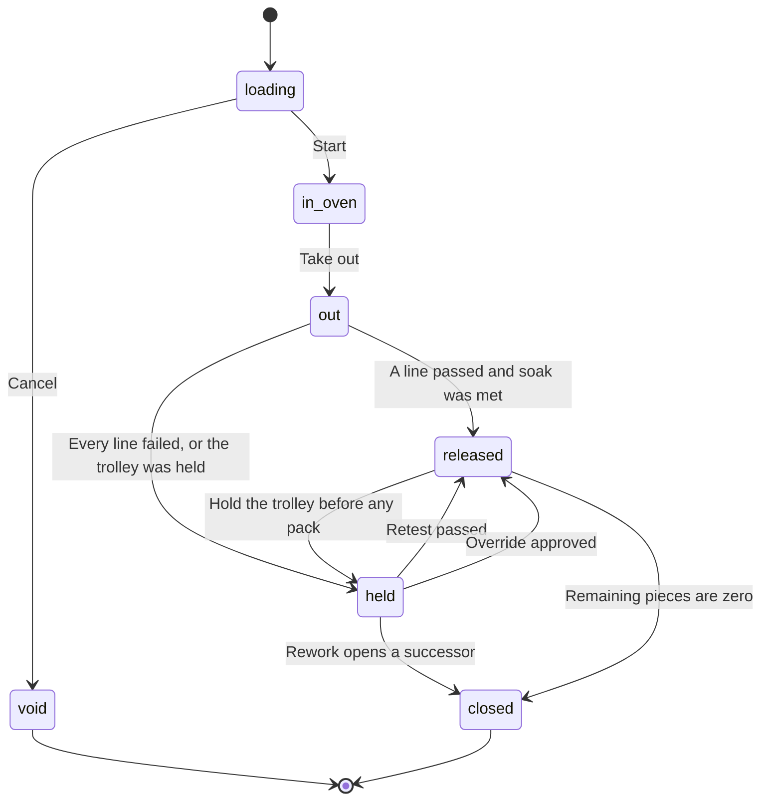

# Ageing — design (FP-AG)

> Real routes (W3-AG-W): `/ageing`, `/ageing/load`, `/ageing/batch/$id`, `/ageing/history`, `/reports/ageing`, `/masters/ovens`, `/masters/trolleys`, `/masters/recipes`. The `/preview/*` demos redirect to `/preview/coming-soon?module=ageing` and stay as redirects.

**Date:** 2026-10-24
**Module:** AG
**Preview slug:** `ageing`
**Status (2026-10-25):** web built (W3-AG-W) on contracts W3-AG-C and server W3-AG-S; native station built (W3-AG-N); a device screen for the collector is not built here.

Product word is **ageing** (એજિંગ), never the other spelling. A **trolley** is a new word: the painted rack that carries cut lengths from the press to the oven and then to pack. A **cycle recipe** is new: the temperature and soak for an alloy and temper. **Product hardness** is new: Webster or Brinell on the profile after the cycle. It is not the die copy's HV integer and not the nitriding hardness.

**Stock age** (`analytics.stockAgeing`, planned `reports.stockAgeing`) is days since pack in the yard. It is a different word. Do not reuse those procedures, buckets, or chart for the oven.

---

## 1. Context

### What FourCubes needs

FourCubes casts its own billets and tells customers that every bundle carries a cast number [FC-web:index.html:79,156]. The oven sits between the press and pack: cut lengths wait on a trolley, go into an oven on a cycle for the alloy and temper, get a hardness check, and only then may be packed. The office question the buyer asked on the call is "how much of this party's material is in ageing, and where" [T:L215][T:L279]. The recommendation that matches this gap is X3: an ageing batch (trolley, temperature, start and end, hardness) that feeds pack [competitive report §9.2].

The floor already has a gas meter on the oven, a shift, an in-time and an out-time, and a hardness figure per row of the load. That is the paper the digest records [digest §A.2 stage 11, line 1265]. Gas used is a process record. It does not move kilograms [digest ledger table, line 197].

### What the competitor demo showed

Cited as behaviour, not as names to copy.

- A trolley in a cycle: start time, a temperature (210.0°C), a shift mark, a batch number, and lines with die, cut length, pieces and kilograms, plus aged / packed / remaining pieces and a single hardness figure [S:1.09.20 AM].
- Three lines add up (145 + 21 + 102 = 268 pcs, 4,601 kg). The weak points: 50 pieces packed from a 21-piece line; 162.5 kg left on 0 pieces; packing progress 6% matches no figure [S:1.09.20 AM]. (Re-pass 2026-10-24: lines add up — do not use as a talking point.) A later pack chip showed 140 pieces available against an aged figure of 145 [S:1.10.31 AM].
- Hardness was a flat 3.0 on the header and on both lines [S:1.09.20 AM]. That reading is on the pixels; it is not a Webster number a 6063 temper would pass [verify_es §3.6]. The speaker said the figure appears because the cycle was complete [T:L340]. No sample count, no minimum, no fail.
- Pack could start from a finished trolley or by picking an order by hand. Pieces typed at pack reduced pieces left on the trolley. The speaker then said weight on the trolley was no longer needed [S:1.10.13 AM][T:L342-L345]. The packed length on that screen (18 ft) was not either aged length (12 ft and 24 ft) [S:1.10.13 AM].
- The completed-cycle report was described as showing which plan the extrusion was against, which order, which cast, how many pieces were in the trolley, and the hardness [T:L338-L340]. A cast-to-bundle trace was not opened. The batch id was on the pack source chip only [S:1.10.13 AM].
- No oven master, no reusable rack separate from the load, no temperature log, no soak time, no hold, and no rework were shown. "Where it is in the program" [T:L339] is too thin to call a recipe [transcript_features A8].
- The same station was on a tablet share [S:12.54.00 AM]–[S:1.10.38 AM] and as a phone launcher card [S:12.56.57 AM]. Whether a wide report fits a phone was contradicted [T:L234 vs L284].
- Shift on that screen was a single letter, while settings spoke Day and Night [S:1.09.20 AM][S:1.28.26 AM]. ORRN uses one shift list.

### What ORRN has today

| Piece | Where | Status |
|---|---|---|
| `ageing.enter` | `packages/server/src/lib/permissions.ts` (press, supervisor) | Key only. No router, no table [orrn_built §3] |
| `ageing_batch`, `ageing_row` | Plant-modules spec P16; plan PL-9; digest stage 11 | Planned, not migrated |
| `ageing.create({ shift, gasStart, gasEnd, tempC, inAt, outAt, rows })` | PL-9 | Planned. One shot create. No oven, no trolley, no recipe, no pack link. No ledger |
| Routes `/ageing`, `/ageing/:id` | Plant-modules spec §3 | Planned. No page |
| Native Ageing | PL-N4 | Built (W3-AG-N): under More, with the same procedures |
| Die HV, nitriding hardness | `dieInstance` on c2 | Built on the server. Die metal, not profile metal. Do not reuse |
| `analytics.stockAgeing` | c2 server | Yard age by pack date. Not this module |
| `bundle.cast_id`, `bundle.sales_order_line_id`, `bundle.die_instance_id` | `packages/db/src/schema/inventory.ts` | Columns exist, app-enforced, not written by an oven flow |
| Showcase line | narration "coming next" | Ageing oven is explicitly not live [orrn_roadmap §4] |

### What ORRN already plans to keep

Digest stage 11 fields: gas start and gas end (end ≥ start), temperature in °C, shift, in / out / total time, rows of cast, die, pieces, kilograms, hardness, and the customer PO carried on the row [digest lines 473-486]. P16 stores that as `ageing_batch` + `ageing_row`. PL-9 puts the create procedure on `routers/ageing.ts` and the tables, as first written, in `schema/press.ts`. Ledger effect is none [P16, digest line 197]. Permission stays `ageing.enter` for press and supervisor [spec P9]. The batch number is not in the P7 series list; this spec adds it.

Press, pack, and orders contracts this spec consumes (agreed with those specs, follow the written spec if a name differs):

- A press run is loadable only when its status is logged. `press_run_line.pcs`, `cut_length_mm`, `kg_g`, and the run's `cast_id` and `die_instance_id` do not change after that, except through `press.runs.reopen`. Reopen returns CONFLICT while any non-void `ageing_row` points at the run's lines, and does not clear the logged snapshot in that case.
- `shift_id` is `company.settings.shifts[].id`. Each shift is `{ id, name, seq, startMin, endMin }`. `seq` 1 is the production-day start, not a second code. `startMin` and `endMin` are minutes from local midnight, 0–1439, and may wrap (a night shift that crosses midnight). No second shift code on this screen.
- Pack passes `ageingRowId` into `bundle.createReceipt`. The same atomic batch increments `ageing_row.packed_pcs` and refuses a draw above server remaining. Bundle void restores those pieces. `bundle.ageing_row_id` is app-enforced text, same style as `cast_id`.
- A shorter cut of the same pieces sets `bundle.recut` and a different `length_mm`. Piece count stays 1:1. Ageing does not change the row's cut length for that case. A cut that would change piece count is refused by pack until `ageing.split` is on (default off).
- `sales_order_line.sectionId` (the section / `die` id), `cutLengthMm`, and the line id are stable. Customer PO is `sales_order.poNumber`, copied onto the row as text. The order's baki strip reads `ageing.forOrder`, not a second query.

---

## 2. Feature list

| ID | Feature | User story | ORRN today | ES reference (cite) | ORRN does it better by | Priority | Depends on | Status (2026-10-25) |
|---|---|---|---|---|---|---|---|---|
| FP-AG-01 | Ageing oven master | As a manager I can name each oven, its capacity, and whether it is in service, so a cycle cannot start on a dead oven. | New | No oven master was shown; a temperature sat on the trolley [S:1.09.20 AM] | One oven, one cycle. Out-of-service blocks start. Capacity is a warning, not a silent overload. Typed now, collector later (P2) | Next | `masters.draft`, `masters.publish` | Built (web, W3-AG-W): `/masters/ovens`, `/ageing` oven cards. Specs `ageing-masters`, `ageing`. Native: later. |
| FP-AG-02 | Trolley master | As the ageing operator I pick the painted rack number, and tomorrow the same rack can take a new load. | New | The rack number was the load itself; pack picked "trolley 1" [S:1.09.20 AM][S:1.10.13 AM][T:L341-L342] | Rack and load are different rows. A rack in a cycle cannot be loaded again. The number is the one painted on the steel | Next | FP-AG-01 | Built (web): `/masters/trolleys`, trolley cards free or loaded on the board. Specs `ageing-masters`, `ageing`. |
| FP-AG-03 | Cycle recipe | As a manager I publish the temperature, soak, and hardness band for each alloy and temper, so the floor does not invent the cycle. | New | No time-and-temperature program was shown. "Where in the program" was one spoken clause [T:L339] | The recipe is a master, snapshotted onto the batch, so a later edit does not rewrite history. Temper is a new field; alloy already lives on the cast | Next | `masters.publish`; cast alloy from FP-FD | Built (web): `/masters/recipes` (one active per alloy, temper and cycle; an active recipe is copied, not edited), the recipe shown at Start. Specs `ageing-masters`, `ageing`. |
| FP-AG-04 | Load a trolley from press-run lines | As the ageing operator I put logged cut lengths onto a trolley — die copy, cut length, pieces, sales order, cast — without retyping them. | Planned PL-9 (row has cast, die, pcs, kg, optional PO text; no press-run link) | Lines showed die, two cut lengths, pieces, a plan number and an order; the cast was described on the report, not on the load [S:1.09.20 AM][T:L338-L339] | Pieces cannot exceed what the press line still has. Kilograms are prorated from the line, not retyped. Header is the sum of the lines | Next | FP-AG-02, FP-PR (PL-9 logged runs), FP-OP for the optional sales-order line | Built (web): `/ageing/load`, logged press lines (alloy and temper checked by the server) or whole bundles, pieces default to all that is left, capacity warning. Spec `ageing`. |
| FP-AG-05 | Ageing batch | As the ageing operator I start a cycle on an oven with a recipe, a shift, a gas-meter start, and an in-time, and I take it out with a gas end and an out-time. | Planned PL-9 (`ageing.create` one-shot; `ageing.enter` key exists, no table) | Start time, °C, shift mark, batch number on the trolley [S:1.09.20 AM]. Gas meter was not on that screen | Gas end ≥ gas start [digest §8.6]. Number is `AG-{seq}` from the document series, not a date smashed into an id. Shift is the company shift, the same id as the press run | Next | FP-AG-01, FP-AG-03, FP-AG-04, PL-9 | Built (web): `/ageing/batch/$id` stage stepper, Start (oven, recipe copied and shown, shift, gas, in time), Take out, the board's stage timer. Spec `ageing`. |
| FP-AG-06 | Temperature log | As the ageing operator I record soak temperatures as the cycle runs, and I can see whether the oven held the recipe. | New (PL-9 has one `tempC`) | One temperature figure on the card, 210.0°C, no series [S:1.09.20 AM] | Each reading is a row (`typed` now, `telemetry` later). Soak starts when a reading is inside the recipe band, not when the door shuts. The set-point is the recipe snapshot, not a free number | Next | FP-AG-05 | Built (web): readings (typed, collector, simulated), the line against the recipe's band on the board and the batch, the soak verdict panel. Spec `ageing`. |
| FP-AG-07 | Product hardness | As the ageing operator I record Webster or Brinell samples per line, and the batch cannot release a line that fails the temper. | Planned PL-9 (optional hardness on the row; unit not specified [digest line 486]) | One hardness figure per line, 3.0, because the cycle was complete [S:1.09.20 AM][T:L340] | Sample count, method, and pass/fail against the recipe minimum. 3.0 cannot be typed as a pass. Die HV is a different field and is not shown here | Next | FP-AG-03, FP-AG-05 | Built (web): hardness sheet (method, samples, median), per-line result, retest of a held line. Spec `ageing`. |
| FP-AG-08 | Release to pack | As the ageing operator I release lines that passed, so pack sees only metal that finished the cycle. | New | Pack could start from a finished trolley and saw pieces available [S:1.10.13 AM][T:L342] | Release is a status, not "the screen was opened". A short soak or a failed line does not release. Held lines are absent from the pack list | Next | FP-AG-07, FP-PK pack source | Built (web): Release with the server's plan shown, held lines named with their reason, the pack screen's trolley picker lists released lines only. Specs `ageing`, `chain`. |
| FP-AG-09 | Remaining pieces | As a packer I take pieces off a released line, and the trolley shows what is left. Voiding the bundle puts the pieces back. | New | Typed pieces reduced pieces left; the speaker then dropped trolley weight [T:L344-L345]. Header and lines did not match [S:1.09.20 AM] | Server remaining is the control. Pieces, not kilograms. Scale weight lives on the bundle. A draw over remaining is rejected. The three totals (loaded, packed, remaining) always add up | Next | FP-AG-08, `bundle.pack` | Built (web): pieces left per line from the server, the pack screen takes pieces and rejects from the picked line. Spec `chain`. |
| FP-AG-10 | Ageing report | As the office I print or export a cycle: batch, oven, trolley, press run, sales order, customer PO, cast, pieces, hardness, pass or fail. | New (PL-11 `reports.production` does not name ageing) | A completed-cycle report with plan, order, cast, pieces in the trolley, hardness [T:L338-L340][S:1.09.20 AM] | One row per trolley line, totals that match the lines, CSV from `reports.read`. Not the yard stock-age chart | Next | FP-AG-05, PL-11 | Built (web): `/ageing/history`, `/reports/ageing` (days, oven, shift, status, totals by day or oven, CSV of every page, print). Spec `ageing`. |
| FP-AG-11 | Holds | As the ageing operator I hold a line or a whole trolley — soft hardness, surface, customer — so pack cannot take it. | New | No hold on the trolley was shown | A held line is invisible to pack. Reason comes from `reason_code`. Clearing a fail without a passing retest needs an override (FP-AG-14) | Next | FP-AG-05, reason-code master | Built (web): hold and clear a line or the trolley, reasons from the plant's `ageing_hold` list. Spec `ageing`. |
| FP-AG-12 | Rework | As a supervisor I send held pieces back for another cycle, on the same or another trolley, without losing the first cycle's record. | New | Not shown | The first batch stays. Pieces move as `rework_pcs`, not as scrap and not by shrinking `pcs`. The successor batch links `rework_of_batch_id` and uses a top-up recipe | Next | FP-AG-11, FP-AG-03 | Built (web): Age again (top-up recipe, other trolley), links both ways, undo while the successor is loading, void refused after. Spec `ageing`. |
| FP-AG-13 | Trace onto the bundle | As anyone with the bundle I can see the ageing batch, the press run, and the cast the pieces came from. | Planned columns only (`bundle.cast_id` unenforced [orrn_built §4]) | Batch id on the pack source chip [S:1.10.13 AM][T:L339]. Not carried onto a bundle as a trace | `bundle.ageing_row_id` plus the row's cast, press run, and sales-order line. The label already prints the cast [digest label example]; this makes the link true | Next | FP-AG-09, FP-FD, FP-PR | Built (web): the bundle page's Aged badge, batch link, trolley, oven, recipe, times and hardness; the void sheet says where the pieces go. Spec `ageing`. |
| FP-AG-14 | Override a short soak or a fail | As a manager I can approve a release the recipe would block, and the approval is a second person. | New (approval kinds exist; this kind does not) | The demo released a trolley whose header disagreed with its lines and whose hardness was 3.0 [S:1.09.20 AM] | Same approval pattern as a tier change: requester cannot approve their own request. The batch records who overrode and why | Next | `approval.decide` | Built (web): ask for approval from a held batch, the approvals sheet shows batch, recipe, soak and hardness, the supervisor releases again. Spec `ageing`. |
| FP-AG-15 | Pieces in ageing on the order | As the office I open a sales order and see pieces loaded, in the oven, held, released, packed, and still on the trolley, per line. | New | Spoken as operation tracking: into ageing, out of ageing, packed [T:L215][T:L279]. Not opened as its own report | `ageing.forOrder` is the only query the order strip uses. Figures are piece counts from the rows, so they cannot drift from the report | Next | FP-AG-04, FP-OP | Built (web): the order strip's Aged cell (kg on trolleys). Spec `chain`. |
| FP-AG-16 | Native ageing station | As the operator on the QC and ageing phone I load, start, log a temperature, record hardness, and release, with the same rules as the web. | Built PL-N4 (W3-AG-N) | Tablet share of the cycle and the pack source [S:12.54.00 AM]–[S:1.10.38 AM]; a phone launcher card [S:12.56.57 AM] | Same procedures, not a second rule set. Wide report stays on the web. Offline replay uses the existing `mutation` table when the phone is paired | Later | FP-AG-05, PL-N4 | Built (native, W3-AG-N): More, Ageing: `app/more/ageing/index.tsx` (board), `[id].tsx` (batch with the stage stepper, start, readings, take out, hardness, release, hold and clear, ask for approval) and `load.tsx`; Today tile; the bundle page's ageing line and void outcome. Age again, discard and void stay on the web ("Open on the web"). No backdated times, typed trolley lines or split on the phone. |
| FP-AG-17 | Collector temperature | As the plant I can have an edge device post the same temperature rows the operator types, marked `telemetry`. | Planned as typed-first (P2); Machine table is digest-only | A live collector was not shown; PLC data was described as not done [competitive report §2.9] | The log shape does not change. Typed readings remain valid. No PLC is required to run the oven screen | Later | FP-AG-06, digest Machine | Built on the server; the web shows collector readings as such (Source column). No device screen. |

Priority follows X3: the oven is Next, not in the 0–6 week list. Native station and the collector are Later.

---

## 3. Data model

All new tables follow plant-modules §4: `id` text uuid, `company_id`, `created_at`, `created_by`, `server_seq`. Writes are tenant-scoped, audited, and stay within 100 bound parameters. Integers only. Temperatures and hardness are stored ×10 (`1850` = 185.0°C, `90` = 9.0 Webster). Gas readings are thousandths of the oven's meter unit (`18420500` = 18420.500 m³). Kilograms are grams. Lengths are millimetres.

Schema file: `packages/db/src/schema/ageing.ts`. PL-9 named `schema/press.ts`; that file stays press-only. Table names are the planned names.

### `ageing_oven` — new

Digest Machine (press, furnace, oven, scale, PLC address) is not in plant-modules §4 and is not built. This master stands alone. `machine_id` is reserved, nullable, unused until that table exists.

| Column | Notes |
|---|---|
| `code` | Unique per company. Floor name, e.g. `OV-1` |
| `name` | Optional longer name |
| `capacity_g` | Warning threshold, grams. Not a hard block |
| `meter_unit` | `m3` by default. Display only; storage is always thousandths |
| `status` | `draft` \| `active` \| `out_of_service` |
| `machine_id` | Nullable text. No foreign key until Machine exists |
| `note` | |

### `trolley` — new

| Column | Notes |
|---|---|
| `code` | Unique per company. Painted number, e.g. `T-1` |
| `capacity_g` | Optional warning |
| `status` | `draft` \| `active` \| `out_of_service` |
| in use | Derived: a non-void batch in `loading` or `in_oven` holds the trolley. Not a stored flag |

### `ageing_recipe` — new

| Column | Notes |
|---|---|
| `alloy` | Text, same tokens as `cast.alloy` (`6063`, `6061`) |
| `temper` | Text. Suggested list `T4`, `T5`, `T6`, `T52`, `F`. New word |
| `kind` | `full` \| `top_up` |
| `target_temp_x10` | |
| `tolerance_x10` | Default 100 (±10.0°C) |
| `soak_min` | |
| `hardness_method` | `webster` \| `hb` |
| `hardness_min_x10` | Fail below this |
| `hardness_max_x10` | Warn above this. Not a fail |
| `sample_count` | Default 3 |
| `status` | `draft` \| `active` \| `archived` |

Unique on `(company_id, alloy, temper, kind)` among non-archived rows.

Suggested drafts, not published until a manager publishes them (open question 1, default taken):

| Alloy | Temper | Kind | °C | Soak | Webster min |
|---|---|---|---|---|---|
| 6063 | T5 | full | 185 | 240 min | 8.0 |
| 6063 | T6 | full | 185 | 360 min | 10.0 |
| 6061 | T6 | full | 175 | 480 min | 15.0 |
| 6063 | T5 | top_up | 185 | 60 min | 8.0 |
| 6063 | T6 | top_up | 185 | 60 min | 10.0 |
| 6061 | T6 | top_up | 175 | 60 min | 15.0 |

Tolerance ±10°C, 3 samples, max Webster 15.0 as a warning, on every suggested row. These are not a claim that FourCubes has signed the numbers.

### `ageing_batch` — as planned, changed

Planned shape (P16, PL-9, digest stage 11): shift, gas start, gas end, temperature, in, out, rows. Kept, with the types below.

| Column | vs plan |
|---|---|
| `number` | New. Document series `ageing`, prefix `AG`, financial-year period, format `AG-{seq}` (e.g. `AG-41`). Not a date-coded number |
| `status` | New. `loading` \| `in_oven` \| `out` \| `released` \| `held` \| `closed` \| `void` |
| `oven_id` | New. Required at start |
| `trolley_id` | New. Required at load. One open batch per trolley |
| `recipe_id` | New. Required at start |
| `alloy`, `temper`, `target_temp_x10`, `tolerance_x10`, `soak_min`, `hardness_method`, `hardness_min_x10`, `hardness_max_x10`, `sample_count` | New. Snapshot copied from the recipe at start |
| `shift_id` | Changed. Was a free `shift` string. Now the company shift id |
| `gas_start_milli`, `gas_end_milli` | Changed. Were unbounded numbers. Integer thousandths. End ≥ start |
| `temp_c_x10` | Changed. The set-point snapshot (same as `target_temp_x10`). Actuals live in the log. PL-9's single `tempC` is this column, not a substitute for the log |
| `in_at`, `out_at` | As planned. Server time by default |
| `soak_started_at` | New. Set by the first in-band temperature reading. Null until then |
| `rework_of_batch_id` | New. Nullable. The batch these pieces came back from |
| `disposition` | New. Null, or `rework`, or `scrapped`, set when the batch closes for that reason |
| `void_reason` | New. Required if status is `void` |
| `started_by`, `closed_by` | New |

Total time is `out_at − in_at`. Soak time is `out_at − soak_started_at`. Both computed. Not stored, so a corrected timestamp does not leave a stale minute count. The report prints both.

### `ageing_row` — as planned, changed

Planned: cast, die, pieces, kilograms, optional hardness, optional PO text.

| Column | vs plan |
|---|---|
| `batch_id` | As planned |
| `press_run_id`, `press_run_line_id` | New. Required unless `source = manual` |
| `source` | New. `press` \| `manual` |
| `die_id` | New. Section. Copied from the die copy's section, or from `sales_order_line.sectionId` when that line is set. Must match |
| `die_instance_id` | As planned (the die). Required |
| `cast_id` | As planned. Required for `source = press` (the run's cast). Optional on a manual row |
| `sales_order_id`, `sales_order_line_id` | New. Optional. The line's section and cut length must match the row |
| `customer_po` | Changed. Planned `poNumber` text. Copied from `sales_order.poNumber` when a line is set; otherwise the operator may type it. Snapshot, not a live join |
| `cut_length_mm` | New. From the press line. Not edited at pack |
| `pcs` | As planned. Loaded pieces. Immutable after start, except a split that moves pieces to a sibling row |
| `kg_g` | As planned. Prorated from the press line. Immutable except the same split |
| `packed_pcs` | New. Default 0. Pack increments this, 1:1, for every piece that leaves the trolley through pack: good pieces on a bundle and pack-time rejects. Ageing does not write it. It is not "pieces on a bundle" alone |
| `scrap_pcs` | New. Default 0. Written only by `ageing.discardRemaining`. Not a ledger posting by itself. Pack does not write this column |
| `rework_pcs` | New. Default 0. Pieces moved to a successor batch |
| `status` | New. `pending` \| `held` \| `released` \| `closed` \| `void` |
| `hold_reason_code_id`, `hold_note` | New |
| `hardness_method`, `hardness_reading_x10`, `hardness_pass` | Changed. Planned optional hardness integer becomes the summary of the samples (median of the deciding method, and pass/fail). Samples are the child table. Null until tested |

Remaining pieces are not a column. The server returns `remainingPcs = pcs − packed_pcs − scrap_pcs − rework_pcs`. Pack uses that number. A client must not subtract columns itself.

### `ageing_temp_log` — new

| Column | Notes |
|---|---|
| `batch_id` | |
| `at` | Timestamp |
| `temp_c_x10` | |
| `source` | `typed` \| `telemetry`. P2 |
| `note` | Optional |
| `created_by` | |

### `ageing_hardness` — new

| Column | Notes |
|---|---|
| `batch_id`, `row_id` | One line, not the whole trolley. A trolley-level figure is the worst line, computed, not stored |
| `method` | `webster` \| `hb` |
| `reading_x10` | |
| `pass` | Stored at insert against the batch snapshot. A later recipe edit does not rewrite it |
| `tested_by`, `tested_at` | |

### `bundle.ageing_row_id` — new column

App-enforced text, same as `cast_id` and `sales_order_line_id` (SQLite cannot add a foreign key to an existing column). Nullable. Written only by pack when the bundle is drawn from a row. Void does not clear it; the status event is the history. A same-piece shorter cut sets `bundle.recut` (pack owns that boolean) and stores the other length on `bundle.length_mm`. The row's `cut_length_mm` stays the aged length.

### Document series — new type

Add `ageing` to `docTypes` in `packages/db/src/schema/series.ts` and to `TYPE_PREFIX` in `packages/server/src/lib/docNumber.ts` as `AG`. Period is the financial year, same as `press_run` and `so`. Sequence never goes down and is never reused. The number is allocated in the same atomic batch as the batch insert.

### Reason codes — changed

`reason_code.kind` gains `ageing_hold`, `ageing_rework`, `ageing_scrap`. Seed, editable by masters:

- Hold: hardness low, hardness high, under soak, surface, bend, customer, other
- Rework: hardness low, under soak, other
- Scrap: bend, surface, short length, other

### Ledger

No stock-ledger row for load, start, temperature, hardness, release, hold, rework, or an oven scrap that was never weighed. That is the planned rule [P16, digest line 197]. Pieces between press finish and pack are not in the kilogram ledger. Do not invent a WIP location posting to close that gap. Location kind `wip` exists for other stages; the oven is not a stock location.

When the packer discards the rest of a line, pack calls `ageing.discardRemaining` in that same atomic batch. That procedure writes `scrap_pcs` only. If those pieces were weighed, the Plant Scrap ledger row is pack's posting, not ageing's. Pack-time rejects (pieces that leave the trolley but are not a bundle) increment `packed_pcs`, not `scrap_pcs`.

### What is not a table

- No second shift list.
- No date-coded batch number.
- No stored remaining-kilogram balance on the trolley. Theoretical kilograms still on the rack are `kg_g` prorated by remaining pieces, labelled theoretical. Packed kilograms are the sum of bundle scale weights. They are not required to match, and the screen must not subtract them into one "remaining kg".

---

## 4. Server

Router `packages/server/src/routers/ageing.ts`, mounted beside `qc` and `press`. Report query lives on `routers/reports.ts` so PL-11 stays the report door. Draw and restore live in `packages/server/src/lib/ageing.ts` and are called from `bundle.createReceipt` and bundle void, not exposed as their own procedures.

Every mutation writes an audit row through `auditInsert` (actor, and impersonator when staff are in the plant). Subject type `ageing_batch` or `ageing_row`. List and report queries are paginated and tenant-scoped.

### Permissions

Names match `permissions.ts`.

| Action | Who, besides owner | What it guards |
|---|---|---|
| `ageing.enter` | press, supervisor (exists) | Load, start, temperature, take out, hardness, release, hold, rework, scrap remainder, void. Implies view |
| `ageing.view` | New. press, supervisor, office, manager, admin | Board and batch read. Not the buttons |
| `reports.read` | Already includes supervisor, office, manager, admin, accountant, viewer | `reports.ageing` |
| `bundle.pack` | Already | Pack may read released rows with remaining pieces > 0, and may draw. No other ageing read |
| `masters.draft` | office, manager, admin | Save an oven, trolley, or recipe as `draft` |
| `masters.publish` | manager, admin | Publish or take out of service |
| `order.manage` | office, manager | `ageing.forOrder`, so the order screen does not need `ageing.view` |

Packer does not hold `ageing.enter` or `ageing.view`. The pack source list is part of pack's own query.

No new role. Digest station "QC and ageing" stays the press role plus supervisor [spec P9]. Open question 8, default taken.

### Approval

New kind `ageing_override` on `APPROVER_ROLES`: owner, admin, manager. The existing rule holds: the requester cannot approve their own request.

Raised by `ageing.release` when the soak is short of the snapshot, or when the operator asks to release a line whose hardness failed or has too few samples. Subject is the batch id. One pending request per batch. Approving does not itself release; the operator calls `ageing.release` again and the procedure sees the approved row. Rejecting leaves the batch where it was.

### Procedures

`ageing.ovens.list`, `ageing.ovens.get`, `ageing.trolleys.list`, `ageing.trolleys.get`, `ageing.recipes.list`, `ageing.recipes.get` — `ageing.view` or `masters.draft`. Floor lists return `active` only.

`ageing.ovens.save`, `ageing.trolleys.save`, `ageing.recipes.save` — `masters.draft` for a draft, `masters.publish` to activate, archive, or mark out of service. An active recipe's numbers are not edited in place; publish a new row and archive the old one, so snapshots stay honest.

`ageing.recipes.suggest` — returns the six suggested drafts. Does not write. `masters.draft` then saves the ones the office wants.

`ageing.list({ status?, ovenId?, trolleyId?, shiftId?, from?, to? })` — `ageing.view`. Status here is the board chip (in oven, out, released, held, closed), which is derived as in §6, not only the stored status.

`ageing.get({ id })` — `ageing.view`. Batch, rows with remaining, temperature log, hardness samples, approvals, successor batch id if any.

`ageing.availableLines({ dieId?, castId? })` — `ageing.enter`. Logged press-run lines where `line.pcs` exceeds the sum of `pcs` on non-void ageing rows for that line. Returns die copy, section, cut length, pieces left, kilograms left, cast, and the sales-order line if the press run has one.

`ageing.load({ trolleyId, rows: { pressRunLineId, pcs, salesOrderLineId? }[], manual?: { dieInstanceId, cutLengthMm, pcs, kgG, castId?, salesOrderLineId?, customerPo? }[] })` — `ageing.enter`. Creates the batch in `loading` if this trolley has none, and allocates `AG-{seq}`. Refuses a trolley that is out of service or already in a non-void unfinished batch. Refuses pieces above the line's remainder. Prorates `kg_g` by largest remainder so fully loaded lines sum back to the press line's kilograms. Manual rows require company setting `ageing.manualLoad` (default true). They are audited as `source: manual` and cannot carry a `press_run_line_id`.

`ageing.start({ batchId, ovenId, recipeId, shiftId, gasStartMilli, inAt? })` — `ageing.enter`. Requires at least one row, oven `active` and free, recipe `active`, shift id present in settings. Copies the recipe snapshot. Sets `in_at` to server now unless `inAt` is within the last 12 hours. Refuses a future time. All rows' casts must share the recipe alloy when `cast_id` is set. Moves the batch to `in_oven`.

`ageing.temp({ batchId, tempCX10, at?, note? })` — `ageing.enter`. Allowed in `in_oven`, and for 30 minutes after `out`. `source` is `typed`. If the reading is inside the snapshot band and `soak_started_at` is null, set it.

`ageing.out({ batchId, gasEndMilli, outAt? })` — `ageing.enter`. Requires at least one temperature reading, `gasEndMilli ≥ gas_start_milli`, `out_at` after `in_at`. Moves to `out`. Frees the oven. The trolley stays on this batch until the batch closes or is voided, so pack still names it, but a new load may not use it until then. See open question 6: default is the trolley is free to load again only after close or void, not at take-out. That matches "the rack is still full of hot metal".

`ageing.hardness({ rowId, method, readingsX10: number[] })` — `ageing.enter`. Batch must be `out`, `released`, or `held`. Inserts one sample row per reading, computes pass against the snapshot, refreshes the row summary (median, pass if every recipe-method sample is ≥ min and the sample count is met). A line that now passes and was held only for hardness returns to `pending` if the batch is still `out`, or to `released` if the batch was already released and the soak was met. It does not clear a hold whose reason was surface, bend, or customer.

`ageing.release({ batchId })` — `ageing.enter`. From `out` or `held`. Soak must be met (`soak_started_at` set and `out_at − soak_started_at ≥ soak_min`) unless an approved `ageing_override` exists. Each `pending` line with a passing summary becomes `released`. Each `pending` line that failed or is untested becomes `held` with reason hardness low (or under soak, if that was the block). If any line is `released`, batch status becomes `released`. If every non-void line is `held`, batch status becomes `held`. One atomic batch, one audit row.

`ageing.hold({ batchId?, rowId?, reasonCodeId, note? })` — `ageing.enter`. Whole trolley only when `packed_pcs` is 0 on every line; otherwise hold the named line. Held lines leave the pack list immediately.

`ageing.rework({ batchId, recipeId?, trolleyId? })` — `ageing.enter`. From `held`, or from `released` for lines that are still held. Opens a successor batch in `loading` on the chosen trolley (default: same trolley, which must not be in another unfinished batch). For each held line with remaining pieces > 0, sets `rework_pcs` so remaining becomes 0, and inserts a successor row with those pieces, the same press line, cast, die copy, cut length, and sales-order line, and `kg_g` prorated. Successor `rework_of_batch_id` points here. Original batch `disposition = rework` and status `closed` if no line still has remaining pieces; otherwise it stays `released` or `held` for what is left. Recipe on the successor is the top-up for that alloy and temper if `recipeId` is omitted.

`ageing.discardRemaining({ rowId, pcs, reasonCodeId })` — `ageing.enter`, and the call pack makes for "discard remaining". Increments `scrap_pcs`. Refuses pcs above remaining. No ledger row from this procedure. Pack does not write `scrap_pcs` itself.

`ageing.split({ rowId, cuts: { cutLengthMm, pcs }[] })` — `ageing.enter`, and only when company setting `ageing.split` is on (default off). While it is off the procedure returns FORBIDDEN and pack refuses a cut that would change piece count. When on: only while `packed_pcs` is 0 on the row and status is `pending` or `released`. The sum of `pcs × cutLengthMm` must equal the row's `pcs × cut_length_mm` within 25 mm. Replaces the row's cut with the first cut and inserts sibling rows on the same batch for the rest, moving `pcs` and a prorated `kg_g`. This is the only way piece count changes after load.

`ageing.void({ batchId, reason })` — `ageing.enter`. From `loading` freely. From `out` only when every line has `packed_pcs = 0`, with a reason. Not from `in_oven` (take it out first). Not after any pack. Voided rows stop counting against the press line's remainder.

`ageing.forOrder({ salesOrderId })` — `order.manage` or `ageing.view` or `reports.read`. Per sales-order line: pieces and theoretical kilograms loaded, in oven, out and untested, held, released, packed, remaining. The order screen uses this and no other ageing query.

`reports.ageing({ from, to, shiftId?, ovenId?, dieId?, customerId?, castId?, status?, limit, offset })` — `reports.read`. One row per ageing row in range (by `in_at`). Columns in §5. CSV is the same query with `format: "csv"`, still paginated in the file writer, not a second definition.

### Draw and restore (called by pack, not by the oven phone)

`drawAgeingRow({ rowId, pcs, bundleId? })` inside the pack atomic batch:

- Row status must be `released`.
- `pcs` ≤ remaining.
- Increment `packed_pcs` by `pcs`. This covers good pieces and pack-time rejects. Both leave the trolley.
- When `bundleId` is set: set `bundle.ageing_row_id`. If the bundle's cast or sales-order line is empty, copy them from the row. Refuse if the bundle already carries a different cast. `bundle.recut` is pack's to set; this helper does not clear it.
- A pack-time reject omits `bundleId`. It still consumes remaining, via `packed_pcs`.
- If remaining hits 0 and every line on the batch has remaining 0, move the batch to `closed`.

`restoreAgeingRow({ bundleId })` inside the bundle-void atomic batch: decrement `packed_pcs` by that bundle's pieces only, not by pack-time rejects that were never on the bundle. Refuse if the row was voided. Reopen a `closed` batch to `released` if remaining is no longer 0.

Both audit `ageing.draw` and `ageing.restore`.

### Idempotency

Web calls are request-scoped and atomic; a failed call leaves no half batch. Native (FP-AG-16) replays through the existing `mutation` table (`company_id`, `device_id`, `client_mutation_id`) when the phone is paired. Do not invent a second idempotency store.

### Tests the implementer should pin

Not written here. The invariants in §6 are the list: gas end ≥ start, pieces cannot exceed the press line, header equals the sum of lines, draw over remaining fails, void restores pieces, tenant isolation, override by the requester fails, `press.runs.reopen` gets CONFLICT while a non-void row points at the run.

---

## 5. Screens

Floor rules from the plant-modules spec: one primary action, large numbers, numeric keypad on touch, sticky action bar, works at 375 px, Hindi through `t()`. New strings under `ageing.*` in both `en.ts` and `hi.ts`. Status colour: amber for in the oven or needing a test, blue for out and waiting, green for released or passed, red for held or failed [C2 design, amber = ageing / attention].

Laptop sidebar, Floor group, between Press and Pack: **Ageing** → `/ageing`. Shown when the person holds `ageing.view` or `ageing.enter`. Masters for ovens, trolleys, and recipes live under Masters (`/masters/ovens`, `/masters/trolleys`, `/masters/ageing-recipes`), same draft-then-publish pattern as other masters.

Phone web and native keep the five-tab cap. Ageing is not a sixth tab. It is the first item in More for anyone with `ageing.enter` [plant-modules phone table: press is Today · Press · Scan · Dies · More]. The QC-and-ageing phone uses that More entry. Open question 9, default taken.

### Web

| Route | File (when built) | Who | What it shows | Primary action |
|---|---|---|---|---|
| `/ageing` | `ageing.index.tsx` | `ageing.view`; buttons need `ageing.enter` | Shift board. Left, ovens: in-oven batch or empty. Right, trolleys out, released, held. Chips for the shift. Each card: trolley code, `AG-` number, recipe (6063-T5), soak elapsed against soak minutes, last °C, pieces loaded / packable / held | **Load trolley** |
| `/ageing/new` | `ageing.new.tsx` | `ageing.enter` | Pick a free trolley, then logged press lines (die copy, cut length, pieces left, cast, sales order). Pieces keypad, defaulting to all that is left. Optional sales-order line if the run has none | **Load** |
| `/ageing/:id` | `ageing.$id.tsx` | `ageing.view` | Batch header: number, oven, trolley, shift name, recipe snapshot, gas start/end/used, in, out, soak against target. Lines: die copy, section, cut length, pieces, theoretical kg, cast, sales order, customer PO, hardness summary, remaining. Temperature log under the header | The one action the status allows: **Start**, **Take out**, **Record hardness**, or **Release** |
| `/masters/ovens` | with other masters | `masters.draft` | Code, name, capacity, meter unit, status | **Add oven** |
| `/masters/trolleys` | | `masters.draft` | Painted code, capacity, status. In-use chip is read-only | **Add trolley** |
| `/masters/ageing-recipes` | | `masters.draft` | Alloy, temper, kind, °C, soak, hardness band, sample count. Suggest fills drafts | **Publish** (manager) |
| `/reports/ageing` | `reports.$slug` with slug `ageing` | `reports.read` | The report below. Printable. CSV | **Export** |

Report columns, in this order: batch number, oven, trolley, shift, in, out, soak minutes against recipe, set °C, actual min–max, press run, sales order, customer, customer PO, cast, die copy, section, cut length, pieces loaded, taken by pack (`packed_pcs`, bundles plus pack-time rejects), on bundles (non-void bundle pieces for the row), remaining, held or not, hardness method, sample count, median, pass or fail. Loaded = taken by pack + scrap + rework + remaining. Filters: date, shift, oven, section, customer, cast, status. A day with no batches is an empty state, not a zero row.

Pack (FP-PK) adds a source step on `/pack/new`: released lines with remaining pieces > 0, labelled by trolley code, die copy, cut length, sales order, pieces left. That screen is pack's. This spec only requires the query shape: `{ ageingRowId, trolleyCode, batchNumber, dieInstanceCode, sectionLabel, cutLengthMm, remainingPcs, salesOrderNumber, customerName, castCode }`.

### States

| Screen | Empty | Error |
|---|---|---|
| Board | No active oven: "Add an oven" linking to masters. No shift in settings: "Add shifts in Settings", Start disabled | Load failed: the card does not appear. Banner with the server message. Nothing half-saved |
| Load | No logged lines: "Nothing is waiting from the press." | Pieces over the line, trolley in use, oven out of service: field error, no navigation |
| Batch | New batch with no lines yet: the line list is an empty state and Start is disabled | Gas end below start, no temperature reading, alloy mismatch, short soak: the primary button stays, the sheet explains the block, override offered only when the role can request it |
| Report | "No batches in this range." | Export over the page size: the server pages; the screen does not pretend one page is the plant |
| Pack source | No released line: pack continues without a trolley, until the company turns `ageing.requireForPack` on (default off) | Draw over remaining, or a held line: the bundle is not created |

### Tablet (11")

From 768 px the board is two columns. From 1024 px landscape the sidebar is the laptop sidebar [C2 plan breakpoints]. Primary buttons are at least 56 px. Temperature and hardness use the numeric keypad sheet, not a small field. The report is a `DataTable` with a card renderer, not a horizontally scrolled spreadsheet.

### Native (FP-AG-16, Later)

Routes under More, not a new tab: `apps/native/app/more/ageing/index.tsx` (board) and `apps/native/app/more/ageing/[id].tsx` (batch). Load, start, temperature, hardness, and release are the same procedures. The report is a link that opens the web report, not a phone table of every column. Scan on this phone still resolves a bundle; it does not scan a trolley (trolleys have no QR in this spec).

### Hardware

| Device | At this station |
|---|---|
| Phone | The QC-and-ageing station phone [digest §O.5]. Typed entry |
| orrn-spool | Not used. Ageing does not print a label |
| Scale / kanta | Not used. Weight at pack is the scale. Trolley kilograms are theoretical, from the press line |
| Label printer | Not used |
| PLC / collector | Not required. FP-AG-17 posts the same temperature log with `source: telemetry` when a collector exists. Gas stays typed |

---

## 6. Rules and edge cases

### Batch lifecycle

`released` means at least one line may be packed. `held` means no line may be packed. A mixed trolley (some lines released, one held) is `released`; the held line stays off the pack list.

Line status, while the batch is `out` or later: `pending` → `released` or `held`; `held` → `released` on a passing retest or an override; `released` → `closed` when remaining hits 0; any of those → `void` only if the batch is voided and `packed_pcs` is 0.

### Start

- Oven must be `active` and have no batch in `in_oven`.
- Trolley must be `active` and not on another unfinished batch.
- At least one line.
- Recipe `active`. Snapshot copied before the status flips.
- Every line with a cast must match the recipe alloy. A 6061 cast on a 6063 recipe is refused. A manual line with no cast is allowed and does not block the others; the report shows the cast as blank on that line.
- Gas start is required. It may be lower than the previous batch's gas end on that oven (meter replacement). It may not be lower than the previous batch's gas end unless the operator sets `meterReset: true`, which is audited. Default: warn, do not block, when the reading went backwards. Open question 4 records the default as warn.
- `in_at` defaults to server now. Backdate up to 12 hours, no future time.

### Soak and temperature

- Soak starts at the first reading inside `target ± tolerance`, not at `in_at`.
- Take-out requires one reading. It does not require the soak to be finished. A short soak blocks release, not take-out. Metal should not sit in a logged-in state because the test failed.
- A reading more than 30 minutes after `out_at` is refused.
- Collector rows (later) use the same table and the same soak rule. A typed reading and a telemetry reading are both valid. They are not averaged into a hidden third number. The report prints min and max.

### Hardness

- Deciding method is the recipe's method. Extra samples of the other method are stored and shown, and do not decide.
- Pass: sample count of the deciding method is at least `sample_count`, and every one of those samples is ≥ min. Any sample above max warns and does not fail.
- Median is the summary figure. Pass is not "the median passed". One soft sample fails the line.
- Webster and Brinell are never written into `die_instance.hardness`.

### Release, hold, override

- Release and the holds it creates are one atomic batch.
- A line held for surface, bend, or customer is not cleared by a later passing hardness.
- Whole-trolley hold after any line has `packed_pcs` > 0 is refused. Hold the lines that are still full.
- Override is one approval per batch, kind `ageing_override`. The operator still has to release after the approval. The approval does not skip the audit.

### Pieces

- Loaded pieces on press-sourced lines cannot exceed the press line's pieces minus pieces already on non-void rows.
- `press.runs.reopen` is refused with CONFLICT while such a row exists. Ageing does not clear press lines.
- Remaining is `pcs − packed_pcs − scrap_pcs − rework_pcs`, computed on the server.
- Draw refuses a line that is not `released`, and refuses pieces above remaining.
- Void of a bundle restores `packed_pcs` in the same atomic batch as the bundle void and the ledger reversal.
- Split is the only piece-count change after load, and only when `ageing.split` is on (default off) and nothing has been packed from that row. While the setting is off, pack refuses the cut. Length × pieces is conserved within 25 mm. Kilograms are prorated and must sum to the original `kg_g`.
- A pack re-cut (same pieces, different bundle length) sets `bundle.recut` and does not change the row. A shorter stick that is still one piece does not consume an extra piece. Offcut weight, if weighed, is pack's scrap posting. Those pieces are not `scrap_pcs` unless pack also calls `ageing.discardRemaining`. Discard-remaining is that call, and it is the only writer of `scrap_pcs`.

### Kilograms

- Row `kg_g` comes from the press line, prorated. The operator does not type it on a press-sourced line.
- Fully split or fully loaded, the grams sum back to the press line (largest remainder on the last piece of the split).
- The board shows loaded theoretical kilograms and packed scale kilograms as two figures. It does not show a remaining kilogram that is loaded minus packed. Those are different scales. Theoretical kilograms still on the rack, if shown, are labelled theoretical and prorated by remaining pieces.

### Gas

- End ≥ start, or the take-out is refused.
- Used = end − start, in the meter's thousandths.
- No store issue is posted. Gas on the batch is the process record the digest asked for. A storekeeper can issue gas from the day's batches later; this spec does not auto-write an MRS. Open question 4, default taken.

### Manual load

- Setting `ageing.manualLoad` defaults true so the oven can run before every press run is logged.
- Manual lines are marked, and they do not satisfy "every bundle traces to a press run". The report column shows "typed".
- Turning the setting off makes `ageing.load` reject manual rows. Existing manual rows stay.

### Pack without a trolley

- `bundle.ageing_row_id` stays optional.
- Setting `ageing.requireForPack` defaults false, so today's pack flow does not gain a hard dependency on this module.
- When the setting is on, pack of a section that has any released remaining line must pass an `ageingRowId`. Sections with nothing released still pack (the metal was never put on a trolley).

### Closed and void

- Closed is remaining pieces zero on every non-void line, or a rework that moved them all.
- Void does not delete rows. It sets status and a reason. Voided pieces return to the press line's available pool.
- A batch in the oven is not voided. Take it out, then void if nothing was packed.

---

## 7. Merge notes

### Keep from ORRN

- Table names `ageing_batch` and `ageing_row`, router `ageing`, permission `ageing.enter`, routes `/ageing` and `/ageing/:id`.
- Gas start and gas end, end ≥ start, no kilogram ledger line, customer PO carried as text, cast and die on the row, in and out timestamps, shift.
- Press and supervisor as the station roles. No new role.
- Integer storage, document series, atomic batch, audit, tenant scope, the 100-parameter cap.
- Die HV and nitriding hardness untouched. Stock-age analytics untouched and not linked from this nav item.
- Pack, move, and dispatch ledger postings unchanged. This module adds no voucher type.

### Adopt from the demo, in our words

- The rack is the unit pack draws from, with pieces left that fall as bundles are saved.
- Hardness is visible on the completed cycle and on the report.
- The report answers the office question: batch, press run, sales order, cast, pieces, hardness.
- The same flow is reachable on the station phone, later, without a second rule set.

### Do differently

- Rack and load are different records. The painted number is reusable.
- Batch number is `AG-{seq}` from the series. Not a day-month-year code. The shift date is `in_at`.
- One shift list (`company.settings.shifts`). The oven screen does not invent a letter code.
- Header pieces are the sum of the lines, enforced on write. A save that would not add up is a bug, not a display quirk.
- Remaining control is pieces. Kilograms on the trolley are theoretical. Scale kilograms live on the bundle. The screen never subtracts one from the other.
- Hardness is samples against a temper minimum. A single unvalidated figure cannot release metal.
- Pack length may differ only as an explicit re-cut of the same pieces, or as a split done on the ageing row before pack. It is not a silent other length.
- Short soak and failed hardness stop release unless a second person approves.
- Holds and rework exist. The first cycle stays on record.
- Gas is recorded and not posted to the store.

### Conflicts with existing plans

| Plan | Conflict | Resolution |
|---|---|---|
| PL-9 puts `ageing_batch` in `schema/press.ts` and exposes one `ageing.create` | A one-shot create cannot carry start, log, hardness, and release | Keep the table names and the router file. Move the tables to `schema/ageing.ts`. Replace `ageing.create` with the procedures in §4. PL-9's press tests stay about the press |
| PL-9 row has optional `hardness` and `poNumber` | Too thin for pass/fail and for the sales order | `customer_po` is that text. Hardness summary columns replace the single integer. Samples are `ageing_hardness` |
| P7 series list has no ageing type | The batch needs a number | Add `ageing` / `AG`, financial-year period, same allocator |
| P19 / PL-11 reports do not name an ageing report | X3 needs one | Add `reports.ageing`. Do not fold it into `reports.stockAgeing` or `reports.production` |
| Digest Machine includes oven | Not in plant-modules §4, not built | `ageing_oven` is the master. `machine_id` waits. FP-AG-17 does not block the screen |
| `ageing.enter` only, no read key | Office and manager cannot see the board | Add `ageing.view`. Do not give office `ageing.enter` |
| Approval kinds stop at phantom void | A fail must be overridable by a second person | Add `ageing_override`, approvers owner, admin, manager |
| Pack has no ageing row | X3 acceptance is "pack offers from trolley" | `bundle.ageing_row_id` plus `drawAgeingRow`. Optional until `ageing.requireForPack` |
| Native tabs are Today · Pack · Scan · Stock · Dispatch | PL-N4 adds Ageing | Under More, not a sixth tab |

---

## 8. Demo page brief

Preview only. Fixture state, no `trpc`, no toast that claims a save. Follow `/tmp/es-analysis/preview_contract.md`. Replace the landing stub. Do not add i18n keys. Literal English, ORRN words.

Shell already pads the page. Do not add a max-width. `PreviewFrame` draws the notice bar and the header. Pass `specPath` from `previewModule("ageing")`. Link siblings with `Button asChild` and `Link`, casting `to` as `never` until the route tree is regenerated.

Three screens.

### 8.1 Oven board

- File: `apps/web/src/routes/_tenant/preview.ageing.index.tsx`
- Route: `createFileRoute("/_tenant/preview/ageing/")`
- URL: `/preview/ageing`
- Frame title: Ageing. Summary: Ovens, trolleys, and what is safe to pack.
- `featureIds`: `FP-AG-01`, `FP-AG-02`, `FP-AG-05`, `FP-AG-11`
- Layout: `Toolbar` with shift segmented control (Day selected, Night empty) and chips In oven / Out / Released / Held. From `md`, two columns. Left, oven cards (`Card`). Right, trolley cards (`ListCard` under `md`, cards from `md`). Sticky `Button` primary **Load trolley** opens a `Sheet`.
- Oven card OV-1, tone amber via `StatusBlock`: in oven, trolley T-3, `AG-40`, 6063-T5, set 185°C, last 186°C, soak 2 h 15 m of 4 h, 100 pcs, 468.40 kg theoretical. Link to the batch is not this batch; the batch screen is AG-38. The OV-1 card links nowhere new — selecting it can set local state to a short "still in the oven" note, or link is omitted. Prefer the card is not a link, so the demo's second screen stays the released trolley.
- Oven card OV-2: `EmptyState` inside the card, "Empty", capacity 1,500 kg, status active.
- Right column: trolley T-1, batch `AG-38`, out, Royal Aluminium, 63 pcs packable, 36 pcs held, chip green plus a red held chip. `Link` to `/preview/ageing/batch`.
- Trolley T-2: available, muted card, no batch.
- Load sheet (client state): trolley select defaults to T-2. Two logged lines, both checked: PR-22, die copy 12170-2, 12 ft, 60 pcs left, cast K31, SO-110 KD Extrusion; PR-23, die copy 13090-2, 12 ft, 40 pcs left, cast K28, SO-91 Mehta Windows. Pieces fields editable. **Load** closes the sheet and appends a loading card for T-2 with the summed pieces. Refusing 61 pcs on the 60-piece line is a field error in the sheet. Do not navigate away.
- Empty interaction: Night chip shows `EmptyState` "Nothing on the night shift."

### 8.2 Batch

- File: `apps/web/src/routes/_tenant/preview.ageing.batch.tsx`
- Route: `createFileRoute("/_tenant/preview/ageing/batch")`
- URL: `/preview/ageing/batch`
- Frame title: `AG-38`. Summary: Trolley T-1 · out of OV-1 · Day shift.
- `featureIds`: `FP-AG-04`, `FP-AG-05`, `FP-AG-06`, `FP-AG-07`, `FP-AG-08`, `FP-AG-09`, `FP-AG-11`, `FP-AG-12`
- Header facts, `font-mono tabular-nums`: in 24 Oct 2026 01:50, out 06:10, soak 4 h 05 m of 4 h 00 m (pass), gas 18420.500 → 18431.200 m³, used 10.700 m³, recipe 6063-T5, 185°C. Four `StatusBlock`s: loaded 104 pcs, packed 5 pcs, packable 63 pcs, held 36 pcs. A line under them: theoretical still on the rack 594.41 kg, packed on the scale 31.20 kg. Do not show a remaining kilogram.
- Temperature log (`DataTable` or a short list): 02:05 176°C, 02:20 185°C (soak started), 04:00 186°C, 06:00 184°C. **Add reading** opens a sheet; submitting 183 appends a row and updates "last" locally. No toast.
- Lines:

| Die copy | Section | Length | Loaded | Packed | Remaining | Cast | Order | Hardness | Status |
|---|---|---|---|---|---|---|---|---|---|
| 12170-1 | Domal 12170 | 12 ft | 48 pcs · 286.40 kg | 5 | 43 | K31 | SO-104 · Royal Aluminium, Rajkot · PO 31 | Webster 9.0, 10.0, 9.0 · pass | Released |
| 12170-1 | Domal 12170 | 24 ft | 20 pcs · 238.64 kg | 0 | 20 | K31 | SO-104 · Royal Aluminium · PO 31 | Webster 10.0, 9.0, 9.0 · pass | Released |
| 13090-1 | Tee 13090 | 12 ft | 36 pcs · 99.20 kg | 0 | 36 | K28 | SO-88 · Tejura & Sons, Morbi · PO 18 | Webster 7.0, 7.0, 6.0 · fail | Held |

Band reminder in the card meta, not as a second heading: Domal 12170 is 5.9–6.1 kg per 12 ft; Tee 13090 is 2.7–2.9 kg per 12 ft. Press kilograms are what the table shows (5.967 kg per 12 ft on the first line, in band).

- Primary **Pack 5 pcs** on the first line (simulates pack). Decrements that line's remaining 43 → 38, packed 5 → 10, header packable 63 → 58, packed pieces 5 → 10. A second control **Pack the held line** shows an inline error "Held. Not on the pack list." and changes nothing. Packing 44 against 43 remaining shows "Only 43 pcs left" and changes nothing.
- **Hold** on the 24 ft line opens a sheet of reasons (surface, bend, customer). Choosing surface moves that line to held, packable drops by 20, held rises by 20. The batch chip stays released because the 12 ft line is still released.
- **Rework** on the Tee line opens a dialog: successor trolley T-2, top-up recipe 6063-T5, 60 min. Confirm moves 36 pcs off the line (`rework_pcs`), remaining 0, and shows a one-line note "Successor batch opened on T-2, not saved." Do not invent a second route.
- Footer link **Ageing report** to `/preview/ageing/report`.

Check the sums in the fixture before shipping the page: 48 + 20 + 36 = 104. Packed 5. Remaining 43 + 20 + 36 = 99. Packable 43 + 20 = 63. Held 36. 5 + 99 = 104. Kilograms 286.40 + 238.64 + 99.20 = 624.24.

### 8.3 Report

- File: `apps/web/src/routes/_tenant/preview.ageing.report.tsx`
- Route: `createFileRoute("/_tenant/preview/ageing/report")`
- URL: `/preview/ageing/report`
- Frame title: Ageing report. Summary: 24 Oct 2026 · Day shift.
- `featureIds`: `FP-AG-10`, `FP-AG-13`, `FP-AG-15`
- `Toolbar`: date chip 24 Oct 2026, shift Day, section filter All / Domal 12170 / Tee 13090, customer filter All / Royal Aluminium / Tejura & Sons / KD Extrusion.
- `DataTable` with `renderCard` for the phone. Columns: batch, trolley, press run, sales order, customer, cast, die copy, length, pcs in trolley, packed, remaining, hardness, pass. Rows are the three AG-38 lines plus two AG-40 lines (PR-22 and PR-23, KD Extrusion and Mehta Windows, hardness blank, status in oven, packed 0, remaining = loaded). AG-40 pieces 60 and 40, kilograms 358.00 and 110.40.
- Filtering to Tee 13090 leaves one row. Filtering to a customer with nothing (use Apex Fabricators as a filter option with no rows) shows `EmptyState` "No batches for this customer."
- A `Card` under the table for SO-104: in oven 0, released 63 pcs, held 0 after the board's initial state (the report does not have to live-sync the batch screen's local holds; initial fixture only), packed 5, still on the trolley 63. Label it "On the order", not a second report. This is the FP-AG-15 strip.
- **Export** sets a local "CSV ready" line of text. It does not download a file and does not call the network.

### Fixture identities

Use these and no others, so the three screens match.

- Ovens: OV-1 (in use in the story, capacity 2,000 kg), OV-2 (empty, 1,500 kg).
- Trolleys: T-1 on AG-38, T-2 free, T-3 on AG-40.
- Batches: AG-38 out and released with one line held; AG-40 in the oven since 06:40.
- Die copies: 12170-1, 12170-2, 13090-1, 13090-2. Sections Domal 12170 and Tee 13090.
- Casts: K31 (6063) on the Domal lines, K28 (6063) on the Tee lines.
- Orders: SO-104 Royal Aluminium, Rajkot, customer PO 31. SO-88 Tejura & Sons, Morbi, customer PO 18. SO-110 KD Extrusion, Ahmedabad, customer PO 44. SO-91 Mehta Windows, Ahmedabad, customer PO 12.
- Press runs: PR-18 (AG-38 Domal lines), PR-19 (AG-38 Tee), PR-22 and PR-23 (AG-40).
- Bundle already packed: `26J12`, 5 pcs, 31.20 kg, from the 12 ft Domal line.
- Shift: Day 08:00–20:00. Demo clock 09:10 IST on 24 Oct 2026, so AG-40's soak reads 2 h 15 m.

---

## 9. Open questions

Defaults are taken. Build to the default unless the owner says otherwise.

1. **Recipe numbers.** Are 185°C / 4 h / Webster 8 the right 6063-T5 figures for this plant, and the matching T6 and 6061 rows? **Default:** save them as drafts only. Nothing publishes until a manager does. The floor cannot start a cycle with no active recipe, and the empty state says so.
2. **Fail rule.** Does one soft sample fail the line, or does the median decide? **Default:** every sample must clear the minimum. A sample above the maximum warns and does not fail.
3. **Sample count.** **Default:** 3 of the recipe's method.
4. **Gas.** Is the meter in m³ to one decimal, and should a backwards reading block take-out? Should used gas become a store issue? **Default:** thousandths of m³, warn on a backwards reading, do not block, do not post an MRS.
5. **Batch number.** Daily number versus a series? **Default:** `AG-{seq}` per financial year, shift date on `in_at`.
6. **When is the rack free?** At take-out, or only when the batch closes? **Default:** the rack stays on the open batch until close or void, so two loads cannot share a painted number while metal is still on it. Pack still names that trolley.
7. **Manual load.** Allow lines with no press run until logging is complete? **Default:** setting on. Marked `typed` on the report. Owner turns it off.
8. **A separate ageing role?** **Default:** no. `ageing.enter` stays press and supervisor.
9. **Phone tab.** **Default:** Ageing under More. Not a sixth tab.
10. **Short soak.** **Default:** blocks release. Manager, admin, or owner may approve `ageing_override`. The requester cannot approve themselves.
11. **Mixed trolley.** **Default:** one failed line does not hold the lines that passed. The batch is released; the failed line is held.
12. **Top-up soak.** **Default:** 60 minutes at the same temperature, same hardness minimum, as a draft recipe. Not published automatically.
13. **Shifts.** **Default:** consume `company.settings.shifts` as `{ id, name, seq, startMin, endMin }[]`. Store `shift_id` = `id`. `seq` 1 starts the production day. Minutes may wrap. If the list is empty, start is blocked.
14. **Pack required to name a trolley?** **Default:** off (`ageing.requireForPack` false), so pack does not regress. Turn it on per company when the oven has been in use for a full week.
