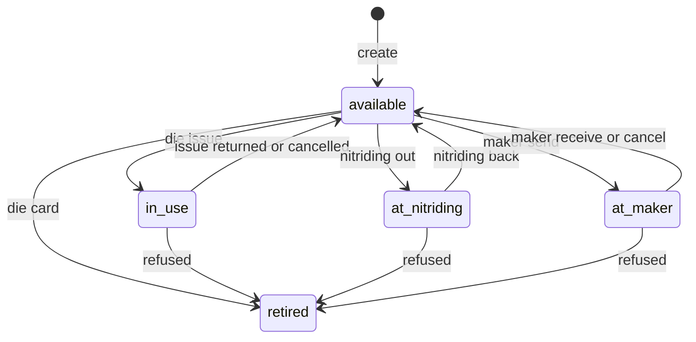
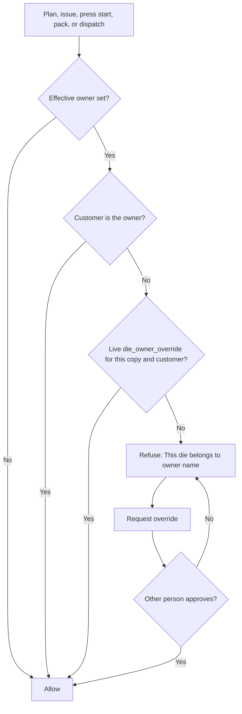

# Die room (FP-DR)

**Date:** 2026-10-24
**Module:** DR · preview slug `die-room`
**Status:** design, not built
**Reads with:** plant-modules spec P4 / P18 / §3, plan PL-4 and PL-W5, C2 IA `/dies`, AGENTS.md "Die room".

A die is a section catalogue row (`die`: 12170 Domal and its band per 12 ft). A die copy is the physical oblique (`die_instance`, code `12170-1`). This spec does not rename either table. Words coined here and marked **new**: section band, profile kind, die maker, die issue, press drawing, owner override.

Evidence cites use the shared brief's tags (`[T:L…]`, `[TF:…]`, `[S:…]`, `[ORRN:…]`). Competitor behaviour is described, not named, and not copied as labels.

---

## 1. Context

### What FourCubes needs

The die room has to tell 3,000 physical copies apart, keep each oblique number meaningful after the copy wears, and stop a customer-owned die being planned for someone else. Weight is money: orders and packs must see the copy as it last ran, not the weight it was bought at. Drawings they already have (photo, PDF, CDR, DWG) must open on the press without a second scan. A worn copy is lifted to the next band by a person, never by the software. Trial and correction trips to the die maker need a send and a return. Alloy and temper sit on the section and ride onto the press unless the order overrides them.

The buyer questions that fix this module are B2 (a second copy of a section must be allowed to add), B3 (drawings), B5 (the 8th and 10th load on the card), B6 (oblique number stays; a human lifts or adds the next copy), and B14 (customer-owned die blocked in the plant's own planning view, not only in a customer login). Report §4.3 and §6; recommendation N3 and N5.

### What the walkthrough showed

Described only. Cites are the evidence, not a spec to clone.

- One section holds several physical dies. The buyer typed a section and an oblique and mapped it the same way ORRN already does. Up to about ten copies, including a lighter reserve. A list of 3,000 was asked about and not shown. [T:L53-L78] [TF:A1] [TF:B1]
- Adding a second die under an existing section was rejected. The toast named section, wall thickness, weight range, length, and unit — not the die number. The buyer said the add has to succeed. The spoken rule was "same section and same weight is the block." Two minutes later the same form accepted both a slash oblique and a free hyphen number. [T:L65-L72] [TF:B2] [S:12.24.11 AM] [S:12.24.39 AM]
- Weight was stored in mixed denominators on one list (`per 12 ft`, `per 1 ft`, `per metre`). Current weight, when filled, was shown three ways: per 12 ft, kg/m, and a percent against range start. Checked arithmetic: `10.333 / 10.000 − 1 = +3.3%`, `12.502 / 12.000 − 1 = +4.2%`, and `12.502 / (12 × 0.3048) = 3.418 kg/m`. Percent was shown even when the weight still sat inside the range. [S:12.26.13 AM] [S:12.32.00 AM]
- Colour on that percent: green through 8%, amber around 8–10%, red above 10%, and red above 15% if that is the plant's tolerance. Green was on screen for about +3.3%. Amber and red were described, not switched live. A later frame drew +3.3% blue under the pointer; that is hover, not a fourth band. [T:L146-L150] [TF:A2] [S:12.32.00 AM]
- The card showed a picture, cavity count, bolster, wall, a design weight, and the latest run weight. Run rows were said to appear by themselves from press entry: kg produced, recovery (output ÷ input; one row was 262.5 / 335.3 = 78.3%), speed, the same percent, a nitriding date, and remarks. The buyer asked for the 8th and 10th load. One card had a single row; another had two (2 t then 2 t). Spoken lifetime kg did not add up and is not a figure to copy. [T:L125-L143] [TF:B5] [S:12.32.00 AM] [S:12.33.22 AM]
- When a copy left 12.500 for 12.600, the number did not change. The copy stays. A person corrects it, scraps it, brings a new copy as the next oblique, or lifts this copy into the next range. An automatic lift was refused because it would hide an empty slot. [T:L168-L186] [TF:B6]
- Drawings: a photo on the section (a placeholder, not a customer's die). Upload of photo, PDF, and CDR was claimed, including download and send to a party. The buyer asked whether the drawing view the plant already has in AutoCAD lands on the section without a scan; not answered [T:L89–L91]. A button at the press opens the PDF so the operator can check it is the same die. Described as zoomable [T:L333]; whether it is to scale is unclear in the Gujarati [T:L334]. [T:L85-L92] [T:L115-L121] [T:L333] [TF:B3]
- Alloy and temper on the section (6063, overridable to T5), pushed to the press on save. The order carries the grade. [T:L187-L192]
- Die maker is a separate list. Send, return, dates, and who it was sent to were described from a menu. No date row was read out. On return the die "loads into the system." [T:L271-L272] [TF:A3]
- Customer-owned die: no lock on the plant's planning view. The suggestion was to split the section by party (`1-2-3 Surat`) even when the geometry is the same, plus a customer login that cannot see other parties. The buyer said the lock is for the plant's own view. FourCubes' site already promises a reserved die. [T:L311-L320] [TF:B14] Report §6 B14, N5.
- Press start was described as locked until the die is at the press. That gate belongs with the press console; the die room owns the issue record (FP-DR-16). [T:L300] [T:L323-L324]

### What ORRN has today

**Production (orrn.in) and this worktree's section screens.** The section catalogue is the `die` table: `series`, `section_code`, `name`, `oblique_mm`, `leg_mm`, `width_mm`, `thickness_mm`, `dimensions` JSON, `weight_min_g`, `weight_max_g` (grams per 12 ft), `status` active/archived, soft `deleted_at`. Unique on `(company_id, series, section_code)`, including soft-deleted rows. [ORRN:packages/db/src/schema/catalog.ts:10-38]

Router `die.list` / `get` / `create` / `update` / `delete` / `validateImport` / `processImport` (import cap 2,000). Create and update refuse min > max. A live collision says "A die with this series and section code already exists"; a soft-deleted collision says "A deleted die uses this code". [ORRN:packages/server/src/routers/die.ts:39-61,118-138] Permissions `die.create` / `die.update` / `die.delete` / `die.import` map to `masters.publish`. [ORRN:packages/server/src/lib/permissions.ts:26-29,211-214]

Web: `/dies` and `/dies/:id` call only `trpc.die.*`. Labels already say kg per 12 ft (`dies.form.weightMin`, `rangeHint`). The Advanced field "Oblique" is `oblique_mm`, a dimension, not the copy code. [ORRN:apps/web/src/routes/_tenant/dies.index.tsx] [ORRN:apps/web/src/routes/_tenant/dies.$id.tsx] [ORRN:packages/i18n/src/en.ts:611-647] Command palette searches `die.list` only. [ORRN:apps/web/src/shell/command-palette.tsx:173-176] No native die-room screen. No attachment column anywhere on `die`.

**c2 server only (this worktree, not on prod).** Physical copies, readings, nitriding, and tier history are built and tested. No web or native caller.

| Piece | Where | Behaviour already enforced |
|---|---|---|
| Copy | `die_instance` in `packages/db/src/schema/dies.ts` | Status `in_use` / `available` / `at_nitriding` / `retired`. Code `{sectionCode}-{seqNo}` allocated inside the insert, unique per section, never reused, `update` cannot change it. [ORRN:packages/db/src/schema/dies.ts:24-70] [ORRN:packages/server/src/routers/dieInstance.ts:217-223] |
| Card fields | `dieInstance.create` / `update` | Supplier (free text), trial kg/12 ft milli, hardness HV, life grams, FTR, status, notes. Permission `die.card` or `masters.publish`. [ORRN:AGENTS.md Die room] [ORRN:packages/server/src/routers/dieInstance.ts:45-52,91-92] |
| Reading | `die_weight_reading`, `addReading` | `kg_per_12ft_milli`, previous value captured at write, optional `press_run_id` with no FK (press run table is not in the schema). `die.reading`: press, supervisor, die_room. |
| Drift | `dieInstance.drift` | Compares milli to `weight_min_g` / `weight_max_g` directly (`in` / `above` / `below`, `offBandMilli`). Trend heavier/lighter/steady. `suggestFirst` is the lightest in-band copy that is `available` or `in_use`. No percent, no colour. [ORRN:packages/server/src/routers/dieInstance.ts:571-709] [ORRN:AGENTS.md] |
| Nitriding | `nitriding_log`, `addNitriding` | Date, HV, CR4 / CR2 / K2S / caustic open-used-close grams, close = open − used, `signed_by`. `store_txn_id` nullable, no FK yet. Does not post the store and does not change copy status. `die.card`. |
| Tier | `die_tier_change`, `proposeTier` | One pending proposal per copy. Approval kind `die_rerank`, subject = the tier-change id. `approval.decide` applies rank in the decision batch via `APPROVAL_APPLIERS.die_rerank`. Requester cannot approve. Approvers: owner, admin, manager. [ORRN:packages/server/src/lib/approvalApply.ts:39-81,122-124] [ORRN:packages/server/src/lib/permissions.ts:287] |
| List/get | `dieInstance.list` / `get` | Any member may read. List already selects the latest milli. Get returns section band, recent readings, nitriding, tier history. |

`kg_per_12ft_milli` is thousandths of a kg, which equals grams per 12 ft, the same unit as `weight_min_g` / `weight_max_g`. [ORRN:AGENTS.md]

**Already planned, not a second design.**

- P4 / PL-4: section vs copy, oblique code, tier, readings, nitriding. Server side of PL-4 is in this worktree. The plan file's checkboxes are stale; do not re-implement those procedures.
- P18 / PL-W5: die card, readings chart, nitriding log, propose tier, drift chip, on `/dies/:sectionId` and `/dies/instances/:id`. No UI yet. This spec is that UI plus the gaps below.
- P16 / PL-W4: `press_run` references the copy; a reading can name the run. The table is not migrated. Run history (FP-DR-08) and issue return rules wait on it.
- P17 / PL-7: store issues may reference a nitriding log. `store.issue` exists on c2; the nitriding row does not call it yet.
- P19: die drift report. The query is `dieInstance.drift`; the report page is the die-room board, not a new report type.
- Digest §3.3: section holds design kg/12 ft, drawing, thickness; copy holds the oblique code, tier, supplier, trial, HV, life, FTR. FTR's meaning is not confirmed — keep the letters, do not relabel. [ORRN:docs/superpowers/review/2026-10-03-architecture-digest.md:763-770,1338]
- Narration lines 31–33 promise copies, tiers, readings, the lightest in-range suggestion, and tier/nitriding on record with approval. Nitriding is signed, not approval-gated. Do not add an approval to match the narration.

**Not in the schema, and not on the unmerged drawing-URL branch.** Alloy, temper, owner customer, cavities, bolster, files, die maker, die issue, percent thresholds. `vendor` is the scrap seller; it is not a die maker. [ORRN:packages/server/src/routers/vendor.ts]

---

## 2. Feature list

| ID | Feature | User story | ORRN today | ES reference (cite) | ORRN does it better by | Priority | Depends on |
|---|---|---|---|---|---|---|---|
| FP-DR-01 | Section and permanent copy code | As the die room, I open 12170 Domal and see copies 12170-1, 12170-2, with codes the floor can say and scan. | Built prod: section CRUD and `/dies` screens [ORRN:packages/db/src/schema/catalog.ts] [ORRN:apps/web/src/routes/_tenant/dies.index.tsx]. c2 server only: copy allocate-on-insert [ORRN:packages/server/src/routers/dieInstance.ts:192-235]. Planned PL-W5 for the copy UI. | Several copies under one section; oblique typed by hand, including two formats in one sitting. Scale of 3,000 not shown. [T:L53-L78] [S:12.24.39 AM] [TF:B1] | Code is allocated, permanent, never reused, not editable. Identity is the section code plus seq, not free text. Search hits section and copy code so a large rack is findable. | Now | — |
| FP-DR-02 | Duplicate guard that still lets a second copy in | As the die room, I add another physical copy of a section without being blocked, and I am stopped only when I create the same commercial band twice, with the existing row named. | Built prod: unique `(company, series, section code)`, error names a live or deleted clash [ORRN:packages/server/src/routers/die.ts:54-61,125-138]. No band-level guard. A second copy already succeeds on c2 because it is a different table. | Add refused on section + wall + weight range + length + unit. Buyer said a new die has to add. Toast did not point at the existing row in the recording. [T:L65-L72] [TF:B2] [S:12.24.11 AM] | Section identity stays the ORRN unique key. The composite guard applies to **section bands**, not to copies, and the error names the section and the band. Length and unit are not part of the key: the band is always per 12 ft, so a second stored unit cannot sneak in as a "different" die. | Now | FP-DR-03 |
| FP-DR-03 | Several bands under one section | As the die room, I keep 8 mm and 10 mm, or 5.9–6.2 and 6.2–6.6 kg/12 ft, under one section code instead of inventing a second section. | Planned P4: one band on the section (`weight_min_g` / `weight_max_g`). Copies share it. [ORRN:packages/db/src/schema/catalog.ts:26-27] | Two dies under one section because the ranges differ (8 mm vs 10 mm; 10–12 vs 12–14 kg/12 ft). [T:L55] [T:L157-L164] [S:12.26.13 AM] | One section code for the drawing and the customer promise. Bands are explicit rows, not a second section and not a free-text die number. Pack and planning pick a band; `suggestFirst` runs inside that band. | Now | — |
| FP-DR-04 | Band per 12 ft, kg/m derived | As a planner, I always see kg per 12 ft, and kg/m only as a calculated chip, so two units cannot disagree. | Built prod: stored grams per 12 ft. c2 labels say kg/12 ft [ORRN:packages/i18n/src/en.ts:620-634]. No kg/m chip. | Same list mixed per 12 ft, per 1 ft, and per metre. kg/m matched `kg/12ft ÷ (12 × 0.3048)` when the denominator was 12 ft. [S:12.26.13 AM] [S:12.32.00 AM] | One stored unit. kg/m is display-only, same factor, 3 decimal places. Import converts once at the boundary and stores grams. | Now | FP-DR-03 |
| FP-DR-05 | Current weight from the latest reading | As the office, the weight I bill and plan from is the last drift reading, not the trial weight and not the band start. | c2 server only: latest milli on `dieInstance.list`; no denormalized column [ORRN:packages/server/src/routers/dieInstance.ts:130-131]. Nothing in orders or pack reads it. | Card showed last-run weight beside the original range. Order math on the day used the starting weight; a toggle was promised and not built. [T:L125-L133] [T:L200-L203] [S:12.32.00 AM] | No second stored "current" that can drift from the log. Order lines (FP-OP) and the pack chip read the same latest row. If there is no reading, they use the band start and the screen says so. | Now | FP-OP order lines; pack chip is FP-PK |
| FP-DR-06 | Percent drift, green / amber / red | As the die room, I see how far the latest reading sits above the band start, in the plant's colours, and I still see whether it is inside the band. | c2 server only: `in` / `above` / `below` and gram delta. No percent, no colour, no setting. [ORRN:packages/server/src/routers/dieInstance.ts:651-663] | Percent vs range start; green through 8%, amber at 8 or 10, red above 10, or above 15 if that is the plant's tolerance. [T:L146-L150] [S:12.32.00 AM] | Gram band check stays the source of truth (AGENTS.md). Percent is display. Thresholds are company settings in basis points, audited, with words as well as colour. Under band start is its own chip, not green. | Now | `company.updateSettings` [ORRN:packages/server/src/routers/company.ts:67-90] |
| FP-DR-07 | Die card | As the die room, I open a copy and see its picture, drawings, cavities, bolster, wall, trial weight, HV, life, and the latest reading. | c2 server only: `dieInstance.get` returns supplier, trial, HV, life, FTR, notes, readings, nitriding, tiers. No image, cavities, bolster, or files. Wall is `die.thickness_mm` only. [ORRN:packages/server/src/routers/dieInstance.ts:149-160] | Card fields included picture, cavities, bolster, wall, design weight, current weight. Most engineering fields were empty in the demo. [T:L125-L132] [S:12.24.11 AM] [S:12.32.00 AM] | Files live in R2 behind a tenancy check, not in D1. The card is the copy; the drawing belongs to the section so every copy shares it. FTR stays FTR. | Now | FP-DR-01 |
| FP-DR-08 | Run history from press runs | As the die room, I see every load of this copy — kg in, kg out, recovery, speed, remarks — without typing a second log. | c2 server only: readings can store a free-text `press_run_id`. No `press_run` table, so no history. [ORRN:packages/db/src/schema/dies.ts:132-133] Planned P16 / PL-W4. | Rows stacked per run from press entry. Buyer required the 8th and 10th load. One live card had one row; another had two. [T:L133-L143] [TF:B5] [S:12.33.22 AM] | No hand-kept history table to diverge from the press log. Recovery is output ÷ input from the run. Remarks are the press run's own `press_remark` and `die_remark`. The reading taken in that run sits on the same row. | Now (contract) / Next (rows, once press runs exist) | FP-PR press run close; PL-W4 |
| FP-DR-09 | Nitriding log | As the die room, I record a treatment with HV and chemical open / used / close, and the copy shows as out for nitriding. | c2 server only: log and mass-balance check, tested. No UI. Store link nullable and unused. Status is not flipped by the log. [ORRN:packages/db/src/schema/dies.ts:153-189] [ORRN:packages/server/src/routers/dieInstance.ts:407-418] Planned PL-W5, store purpose `nitriding` on PL-7. | A nitriding date column on the run row. No chemical sheet was shown. [T:L133-L137] [S:12.33.22 AM] | Close = open − used is already enforced. Optional store issue in the same batch, no negative stock. Signed by the die room. Not a second approval. | Now | PL-7 store (optional link) |
| FP-DR-10 | Tier change and band lift | As the die room, I propose a new tier, or lift a worn copy onto the next band, and a manager approves. The oblique code does not change. The old band shows the copy has left. | c2 server only: `proposeTier` + `die_rerank`. Rank only. No band move. [ORRN:packages/server/src/routers/dieInstance.ts:495-554] [ORRN:packages/server/src/lib/approvalApply.ts:39-81] | Number stays. A person lifts, corrects, scraps, or adds the next oblique. Auto-lift refused so the empty slot stays visible. [T:L168-L186] [TF:B6] | Same approval, same "one open proposal" rule, requester cannot approve. Lift is an extra column on the tier change, applied in the decision batch. Code allocation is untouched. Nothing lifts itself when the reading crosses the max. | Now | FP-DR-03 |
| FP-DR-11 | Die maker send and receive | As the die room, I send a copy out for trial or correction and book it back, with dates and the maker. | c2 server only: `supplier` free text. No maker, no trip log. `vendor` is scrap, not this. [ORRN:packages/db/src/schema/dies.ts:40] | A separate maker list; send and return dates described, not demonstrated. [T:L271-L272] | Maker is its own master, not a scrap vendor and not a fake customer. While the job is open the copy cannot be issued. Return is what brings it back to available. Document number `DM-{seq}`. | Next | FP-DR-16 (cannot issue while out) |
| FP-DR-12 | Customer-owned die | As the planner, I cannot put Bhavesh's die on Anshu's job. The block is in our planning, pack, press, and dispatch — not only in a customer login. | Absent. `customer` has no link to `die` or `die_instance`. [ORRN:packages/db/src/schema/customers.ts] | No plant-side lock. Suggested splitting the section by party, and a login that hides other parties' dies. Buyer redirected: the lock is for the plant's own view. [T:L311-L320] [TF:B14] | One owner on the section, overridable on the copy. Effective owner is enforced on plan, issue, press start, pack, and dispatch. Override is an approval a different person grants, and the error names the owner. Portal visibility is FP-PF and is not this lock. | Now | FP-OP, FP-PR, FP-PK consume the rule; columns are this spec |
| FP-DR-13 | Press drawing | As the press operator, I open the section PDF from the console and check it is the same die. | Absent. No file column. A drawing-URL field on an unmerged branch is not this design. | PDF button at the press; zoomable. Auto-import from the CAD file was not answered. [T:L115-L121] [T:L333] [TF:B3] | `die.drawing_key` is the one PDF the press reads. Upload stays `die.card`. CDR and DWG are stored and downloaded; they are not converted. The button says the drawing is not to scale. | Now | FP-PR renders the button; key and upload are this spec |
| FP-DR-14 | Alloy and temper defaults | As the die room, I set 6063 T6 on the section once. New orders and press runs take it unless someone overrides. | Absent. No alloy or temper column. [ORRN:evidence/orrn_built.md §2] | Default 6063, overridable (6063 T5), described as pushed to the press on save. [T:L187-L192] | Text on the section, not a second master this module has to wait for. The order line snapshots the text it used. Finish (anodise, PVD) stays an order attribute, not a die field. | Now | FP-OP line override; FP-PR snapshots onto the run |
| FP-DR-15 | Run the lightest in-band copy first | As the supervisor, the section page tells me which available copy is lightest and still inside the band. | c2 server only: `drift.suggestFirst`, tested. No screen. Narration already promises it. [ORRN:packages/server/src/routers/dieInstance.ts:693-708] | Not shown. Their list colour was the percent, not a "run this one" pick. | Suggestion is the lightest in-band copy, not the greenest percent and not the best tier alone. It does not auto-issue. Scoped to the band the order asked for. | Now | FP-DR-03, FP-DR-06 |
| FP-DR-16 | Issue a copy to a press line | As the die room, I issue 12170-1 to a press line. The press cannot start that copy until the issue is open, and I take it back when the run is finished. | Absent. `in_use` is a free status on `update`. `press.run` has no caller. [ORRN:packages/server/src/lib/permissions.ts:88] | Start described as locked until the die is at the press. A separate allocation page was named and not opened. [T:L300] [T:L323-L324] | One issue row, die room only. Issuing sets `in_use` in the same batch. No second "ready" flag. Return is refused while the press run is still open. | Now | FP-PR press line id and start lock |

---

## 3. Data model

No stock-ledger postings. A die copy is not a kg balance. Nitriding chemicals post only when the die room chooses a store issue (existing `store_item` ledger, purpose `nitriding`). Document series: `die_maker_job` → `DM-{seq}` (new doc type on `doc_series`, same `INSERT … ON CONFLICT` pattern as P7). Die issues have no document number; the oblique code is the identity. Readings, nitriding rows, and tier changes stay unnumbered logs.

Units: weights stay integer grams or milli-kg as already stored. New wall values that need a tenth of a millimetre use tenths. Money is not in this module.

### `die` (section) — changed

As planned, still the section. Do not rename. Keep `weight_min_g` / `weight_max_g` as the **primary band** so current drift, import, and the pack range chip keep working without a backfill.

| Column | Status | Notes |
|---|---|---|
| `alloy` | new | text, nullable, max 16. Example `6063`. |
| `temper` | new | text, nullable, max 8. Example `T6`. |
| `profile_kind` | new | `hollow` \| `solid` \| `semi`, nullable. Column name in Drizzle: `profileKind`. |
| `owner_customer_id` | new | nullable FK to `customer.id`. No `ON DELETE CASCADE`. A soft-deleted customer still owns the die. |
| `cavity_count` | new | integer, nullable, 1–32. Default copied onto a new copy when the copy field is omitted. |
| `drawing_key` | new | nullable text. R2 key of the press PDF. Press reads this and nothing else. Set and cleared only in the file batch (FP-DR-13). |
| `wall_tenth_mm` | new | integer tenths of a mm, nullable. When set, display and the band key use it. When null, the key uses `thickness_mm * 10`. `thickness_mm` stays as planned (whole millimetres). |

`oblique_mm` stays a dimension. It is not the copy code.

### `die_band` — new

A commercial band under a section besides the primary band. The primary band is **not** copied into this table.

| Column | Notes |
|---|---|
| `id`, `company_id`, `server_seq` | same shape as other plant tables |
| `section_id` | FK `die.id`, same company enforced in code |
| `wall_tenth_mm` | not null |
| `weight_min_g`, `weight_max_g` | grams per 12 ft, min ≤ max, both ≥ 1 |
| `label` | optional, max 40. Display only (`6.2–6.6`). Not identity. |
| `active` | integer 0/1, default 1. Retiring a band does not delete it. |
| `created_by`, `created_at`, `updated_at` | |

Uniqueness (partial, `active = 1`): `(company_id, section_id, wall_tenth_mm, weight_min_g, weight_max_g)`. The primary band participates: creating a `die_band` that matches the section's effective wall and `weight_min_g` / `weight_max_g` is the same conflict. No length, no unit column.

### `die_instance` (copy) — changed

As planned: `seq_no`, `code`, supplier, trial milli, HV, `life_g`, FTR, status, `tier_rank`, notes. Code rule unchanged.

| Column | Status | Notes |
|---|---|---|
| `band_id` | new | nullable FK `die_band.id`. Null means the section's primary band. |
| `owner_customer_id` | new | nullable. Null inherits `die.owner_customer_id`. A set value overrides, including an explicit plant-owned copy of an owned section — use a sentinel? No. Null means inherit. To put a plant-owned copy under an owned section, clear the section owner or split the section. Default taken: a copy cannot opt out to "plant" while the section has an owner. Say so in the form. |
| `cavity_count` | new | nullable integer. Null inherits the section. |
| `bolster` | new | text, nullable, max 40. |
| `backer_no` | new | text, nullable, max 40. |
| `sub_bolster` | new | text, nullable, max 40. |
| `corrector` | Dropped per D6 (do not build) | text, nullable, max 80. |
| `extrusion_ratio_milli` | Dropped per D6 (do not build) | integer, nullable. Thousandths (1850 = 1.850). Optional. Not used in any calculation. |
| `rack_no` | new | text, nullable, max 20. Rack slot. Not a stock `location`. |
| `received_at` | new | timestamp_ms, nullable. |
| `die_maker_id` | new | nullable FK `die_maker.id`. Does not replace `supplier`. |
| status | changed | add `at_maker`. Full set: `in_use`, `available`, `at_nitriding`, `at_maker`, `retired`. |

`update` must refuse `in_use` and `at_maker`. Those two are written only by die issue and maker jobs.

### `die_tier_change` — changed

As planned. Add nullable `from_band_id` and `to_band_id`. Both null means a rank-only change (today's behaviour). A lift sets `to_band_id`. The applier writes `die_instance.band_id` in the same batch as the rank, guarded by `decisionLanded` and company, same as the rank update. [ORRN:packages/server/src/lib/approvalApply.ts:45-81]

### `die_weight_reading`, `nitriding_log` — as planned

No new columns. `press_run_id` gains a real FK when FP-PR migrates `press_run`; until then it stays a checked text id, as the comment already says. `nitriding_log.store_txn_id` gains a FK to `store_txn` in the same change that posts the issue (column already reserved).

### `die_file` — new

| Column | Notes |
|---|---|
| `id`, `company_id`, `server_seq` | |
| `section_id` | not null |
| `die_instance_id` | nullable. Set for a photo or a correction drawing of one copy. |
| `kind` | `image` \| `pdf` \| `cdr` \| `dwg` |
| `r2_key` | not null. Layout `{companyId}/dies/{sectionId}/{fileId}`. |
| `filename` | not null, max 200. Display only. |
| `bytes` | not null |
| `press_drawing` | integer 0/1. At most one row per section with `press_drawing = 1`, and only when `kind = pdf`. That row's `r2_key` is copied to `die.drawing_key` in the same batch. |
| `created_by`, `created_at` | |

No file bytes in D1. Removing the press PDF clears `die.drawing_key` in the same batch.

### `die_maker` — new

Not `vendor`. A plant may later link the two; this spec does not.

`id`, `company_id`, `server_seq`, `name`, `name_key` (letters and digits, lower case, unique per company among live rows — same idea as vendor `nameKey`), `phone`, `city`, `notes`, `status` `active` \| `archived`, `created_at`, `updated_at`.

### `die_maker_job` — new

| Column | Notes |
|---|---|
| `id`, `company_id`, `server_seq` | |
| `number` | `DM-{seq}` from `doc_series` doc type `die_maker_job` |
| `die_instance_id` | not null |
| `die_maker_id` | not null |
| `purpose` | `trial` \| `correction` \| `repair` |
| `status` | `sent` \| `received` \| `cancelled` |
| `sent_at`, `received_at` | timestamps. `received_at` null until receive. |
| `note` | max 500 |
| `created_by`, `received_by` | |

One open (`sent`) job per copy. Partial unique on `die_instance_id` where `status = 'sent'`.

### `die_issue` — new

The die room's handoff to a press line. FP-PR owns `press_line`, the run status enum, and the start lock. This table is the lock's source. A released press run is `queued`, with `section_id` set and `die_instance_id` null, until this issue fills the copy and sets the run to `die_issued`.

| Column | Notes |
|---|---|
| `id`, `company_id`, `server_seq` | |
| `die_instance_id` | not null |
| `press_line_id` | not null. FK to `press_line.id` when that table lands (FP-PR owns it; add the FK in whichever migration lands second). Must equal the run's line when `press_run_id` is set. |
| `press_run_id` | nullable FK once `press_run` exists. Set by `issue` when the die room attaches a released run. Not written by the press router. |
| `status` | `issued` \| `returned` \| `cancelled` |
| `issued_at`, `issued_by` | |
| `returned_at`, `returned_by` | |
| `note` | max 500 |

One open issue per copy. Partial unique on `die_instance_id` where `status = 'issued'`. The copy's section must equal `press_run.section_id`. `queued` and `die_issued` are FP-PR names; die room writes only that pair, in the issue and cancel batches.

### `approval` — changed

Add kind `die_owner_override` to `approvalKinds`. No apply hook (pure sign-off; consumers read the row). [ORRN:packages/server/src/lib/approvalApply.ts:118-125]

- `subjectId` = `die_instance.id`
- `meta.attemptedCustomerId` = the other customer
- `meta.purpose` = `plan` \| `press` \| `pack` \| `dispatch` (informational; the grant is per customer, not per purpose)
- `meta.closedAt` = timestamp when a manager closes the grant; null while open

Pending unique already allows one open request per copy. Many approved rows over time are fine. A live grant is an approved row with `closedAt` null and matching `attemptedCustomerId`.

`die_rerank` is unchanged as a kind. Lift uses the same kind; the tier-change row carries the band ids.

### Company settings — changed

JSON on `company.settings`, patched by `company.updateSettings` (`settings.update`), same as `dcTolerancePct`. [ORRN:packages/server/src/routers/company.ts:67-90]

| Key | Type | Default | Meaning |
|---|---|---|---|
| `driftGreenMaxBp` | int 0–10_000 | 800 | Latest vs band start at or under this (8.00%) is green. |
| `driftAmberMaxBp` | int 0–10_000 | 1000 | Above green, at or under this (10.00%) is amber. Above is red. Must be ≥ green. |
| `defaultAlloy` | string max 16 | `6063` | Pre-fills a new section. |
| `defaultTemper` | string max 8 | `T6` | Pre-fills a new section. |

Label mapping for `profile_kind = semi` (`settings.standards.semi`, fallback solid) is FP-PF. This module only stores the kind.

### Effective owner and effective band

- **Owner** = `die_instance.owner_customer_id` if set, else `die.owner_customer_id`, else none (plant-owned).
- **Band** = the `die_band` row if `band_id` is set and active, else the section's `weight_min_g` / `weight_max_g` and effective wall.
- **Current weight** = the latest `die_weight_reading.kg_per_12ft_milli` for that copy. No cache column.
- **Percent** = `(latest − band_start) / band_start`, in tenths of a percent, rounded half up. Band start is the band's min grams. Display `+1.1%`. kg/m = `(milli / 1000) / (12 × 0.3048)`, shown to 3 decimal places. Neither number is stored.

---

## 4. Server

All procedures are company-scoped. Writes go through `atomicBatch` with an audit row. New approval hooks stay in `APPROVAL_APPLIERS` and stay guarded by `decisionLanded`. Ids are `crypto.randomUUID()`. Sequences use `nextCompanySeq`.

### Permissions

Add to `PLANT_ACTIONS` and the role map, in the existing comment style. [ORRN:packages/server/src/lib/permissions.ts:88-91,179-182]

| Action | Who | Used for |
|---|---|---|
| `die.card` | die_room (existing); `masters.publish` via `anyActionProcedure` (existing) | Card fields, nitriding, file upload, status except `in_use` / `at_maker` |
| `die.reading` | press, supervisor, die_room (existing) | `addReading` |
| `die.rerank` | die_room (existing) | Propose tier or lift |
| `die.issue` | die_room only | **new.** Issue and return. Not `masters.publish`. |
| `die.maker` | die_room | **new.** Maker master and send/receive. Create/archive of the maker master also accepts `masters.publish`. |
| `die.create` / `die.update` / `die.import` | `masters.publish` (existing) | Section, bands, alloy, temper, profile kind, section owner, section cavity default |
| `settings.update` | existing | Drift colours, default alloy and temper |

Approval kind `die_owner_override`: approvers `owner`, `admin`, `manager`, same list shape as `die_rerank`. [ORRN:packages/server/src/lib/permissions.ts:286-289] Requester cannot approve (existing `approval.decide` rule).

`die_room` does not set the owner. Ownership is a commercial commitment; `masters.publish` sets it.

### `die` router — changed

- `create` / `update` accept `alloy`, `temper`, `profileKind`, `ownerCustomerId`, `cavityCount`, `wallTenthMm`. Owner must be a live customer of this company. Clearing the owner is allowed and audited.
- `create` still conflicts on series + section code, including soft-deleted, with the existing messages.
- `list` adds `copyCount`, `ownerCustomerId`, `ownerName`, and the worst open drift tone among available copies (so the board does not N+1 the readings). Search already covers series, section code, and name; also match copy `code` via an `exists` on `die_instance`.
- `get` adds bands, files, owner, alloy, temper, profile kind, and copies (the current `dieInstance.list({ sectionId })` payload plus percent and tone).

### `die.bands` — new, on the die router

- `list({ sectionId })` — any member.
- `create` / `update` / `retire` — `die.update`. Retire sets `active = 0`. Refuse retire when a non-retired copy still points at the band. Create runs the duplicate guard (FP-DR-02) and returns `CONFLICT` with `meta.existing` = `{ sectionCode, series, wallTenthMm, weightMinG, weightMaxG, bandId | "primary" }`.

### `dieInstance` — changed and new

Existing procedures stay. Extensions:

- `create` accepts `bandId`, card extras, `ownerCustomerId` (must equal the section owner or be omitted — no opt-out), `dieMakerId`. Code allocation unchanged. Initial tier still writes an applied `die_tier_change` with reason `initial` inside the insert batch.
- `update` accepts the new card fields. Strips `code`, `seqNo`, `sectionId`, `tierRank`, `bandId`, `status: in_use`, `status: at_maker`. Band moves only through FP-DR-10. Owner on the copy, if sent, must match the section owner.
- `get` adds files, effective owner, effective band, current milli, percent, tone, band position, kg/m, produced grams (0 until press runs exist), life remaining, open issue, open maker job, pending tier change.
- `drift` accepts optional `bandId`. `suggestFirst` considers only copies on that band (null band id = primary). Each item gains `pctTenth` and `tone`: `none` \| `under` \| `green` \| `amber` \| `red`. Tone uses company settings. Band position is still `in` / `above` / `below`.
- `proposeTier` accepts optional `toBandId`. If set, `fromBandId` is the copy's current band, `toBandId` must be another active band of the same section (or null to mean "back to primary" — encode primary as the empty string? No. Use the literal `"primary"` in the input and store `to_band_id` null plus a new `to_primary` integer 0/1). Simpler: **a lift target is always a `die_band` id.** Lifting back to primary is `toBandId: null` with `lift: true`. Rank is still required. Reason still required. Refuses a second pending proposal (existing unique). Refuses `toBandId` equal to the current band. Does not change the copy until approval.
- `addNitriding` unchanged for a historical row. New `nitridingOut({ dieInstanceId, ...chemicals, hardness? })` — `die.card`. Inserts the log and sets status `at_nitriding` in one batch. Refuses if status is `in_use`, `at_maker`, or `retired`, or an issue is open. New `nitridingBack({ dieInstanceId })` sets `available` if status is `at_nitriding`.
- `runs({ dieInstanceId, limit })` — any member. Returns `[]` until `press_run` exists. Contract for FP-PR, newest first:

```
pressRunId, number, shift, startedAt, finishedAt,
inputG, outputG, accumulatedG, recoveryBp,
speedMilliPerSec | null,
pressRemark, dieRemark,
readingMilli | null, pctTenth | null,
nitridedAt | null
```

`recoveryBp` = `round(outputG * 10000 / inputG)` when `inputG > 0`, else null. `accumulatedG` is the sum of `outputG` for this copy up to and including the row. Remarks are `press_run.press_remark` and `press_run.die_remark` (FP-PR names; do not rename). Reading is the `die_weight_reading` with that `press_run_id`, if any. `nitridedAt` is the latest nitriding at or before `finishedAt`.

- `drawing({ sectionId })` — any member signed in. Returns `{ key: die.drawingKey, url }` or `{ key: null, url: null }`. URL is a signed GET, 10 minutes, company prefix checked. Press console calls this. It does not accept an arbitrary key.

### Files — new, `dieInstance.files`

Permission `die.card` (or `masters.publish`).

- `add({ sectionId, dieInstanceId?, kind, filename, bytes, body })` — body is the upload through the worker, not a browser-to-R2 URL. Limits: image 8 MB, PDF 25 MB, CDR/DWG 40 MB. Allow types `image/jpeg`, `image/png`, `image/webp`, `application/pdf`, and the CDR/DWG extensions when the browser type is empty or `application/octet-stream`. Writes R2, then the `die_file` row, in that order; a D1 failure deletes the object. `pressDrawing: true` only for PDF, clears the previous flag and sets `die.drawing_key`.
- `remove({ id })` — deletes the row and the object. If it was the press drawing, clears `die.drawing_key`.
- `url({ id })` — signed GET, 10 minutes, same company.

No AutoCAD import. Each drawing view (for example a 1×4 sheet) is its own upload. Bulk attach by file name is FP-DR-19.

### Die issue — new, `dieInstance.issues`

Permission `die.issue`.

- `issue({ dieInstanceId, pressLineId, pressRunId?, note? })` — copy must be `available`, same company, not retired, no open maker job, no open nitriding status. If `pressRunId` is set, that run must be `queued`, its `section_id` must be this copy's section, its line must equal `pressLineId`, and its `die_instance_id` must still be null. One batch: insert `die_issue` status `issued`, set the copy `in_use`, set `press_run.die_instance_id`, and set `press_run.status` from `queued` to `die_issued`. Audit `die_issue.issue`.
- `return({ id })` — issue must be `issued`. Refuses if the linked run has die-in set and die-out unset (FP-PR timestamps, P16). On success: issue `returned`, copy `available`, one batch. Does not clear a finished run's `die_instance_id` and does not move `press_run.status` backward. Audit `die_issue.return`.
- `cancel({ id })` — only when the run has not started (no die-in) and status is still `die_issued`. Copy back to `available`. If `press_run_id` is set, clear `press_run.die_instance_id` and set `press_run.status` back to `queued` in the same batch. Audit `die_issue.cancel`.
- `list({ pressLineId?, dieInstanceId?, status? })` — any member. Press start refuses unless the run is `die_issued` and an `issued` row for that copy has `press_line_id` equal to the run's line. A null `drawing_key` does not block start.

Die room does not create the press run. Release (FP-PR) creates it `queued`, with `section_id` and a line, and leaves `die_instance_id` null until `issue`.

### Die maker — new, `dieMaker` router

- `list` / `create` / `update` / `archive` — read any member; write `die.maker` or `masters.publish`.
- `jobs.send({ dieInstanceId, dieMakerId, purpose, note? })` — `die.maker`. Copy must be `available`. Allocates `DM-{seq}`, inserts `sent`, sets copy `at_maker` and `die_maker_id`, one batch. Audit `die_maker_job.send`.
- `jobs.receive({ id, note?, trialKgPer12ftMilli? })` — sets `received`, copy `available`. If `trialKgPer12ftMilli` is sent and the copy's trial is null, writes the trial. Does not write a drift reading (a trial is not a press reading). Audit `die_maker_job.receive`.
- `jobs.cancel({ id })` — only `sent`, copy back to `available`. Audit `die_maker_job.cancel`.

### Owner override — new

- `dieInstance.requestOwnerOverride({ dieInstanceId, customerId, purpose, note })` — any of `order.manage`, `press.run`, `bundle.pack`, `dispatch.create`. Subject is the copy id only. Refuses a section id. Refuses if the section is owned and no copy was picked, or if the section has no copies (`This section has no copies` — pack must not fall back to a section grant; that would cover every future copy). Inserts approval kind `die_owner_override` via `requestApprovalInsert`. Refuses if a pending one already exists (name the requester). Refuses if the customer is already the effective owner. Audit `die_owner.request`.
- `dieInstance.closeOwnerOverride({ approvalId })` — approver roles, or `masters.publish`. Sets `meta.closedAt`. Audit `die_owner.close`.
- Shared check, exported from `packages/server/src/lib/dieOwner.ts` (**new**), called by FP-OP, FP-PR, and FP-PK. Do not copy the query into each router.

```
assertDieAllowed(ctx, { dieInstanceId, customerId, approvalId? })
```

Throws `FORBIDDEN` with message `This die belongs to {owner name}` and `meta: { ownerCustomerId, ownerName, dieInstanceId, code }` unless `customerId` is the effective owner or a live grant matches. If `approvalId` is passed, that row must be the grant. Plant-owned (no effective owner) always passes.

### Audit actions (new)

`die_band.create`, `die_band.retire`, `die_file.add`, `die_file.remove`, `die_issue.issue`, `die_issue.return`, `die_issue.cancel`, `die_maker_job.send`, `die_maker_job.receive`, `die_maker_job.cancel`, `die_owner.set`, `die_owner.request`, `die_owner.close`, `nitriding.out`, `nitriding.back`.

Existing: `die.create`, `die_instance.create`, `die_instance.update`, `die_reading.add`, `nitriding.add`, `die_tier.propose`.

### What this module does not post

No `stock_ledger` rows. No bundle mutation. Store postings happen only inside the optional nitriding store issue, using the existing MRS path (`store.issue`, purpose `nitriding`, `refId` = nitriding log id) in the same batch as `store_txn_id` being set. Used grams must equal the issued quantity; otherwise the batch throws and neither row lands.

---

## 5. Screens

C2 floor rules: one primary action, large numbers, numeric keypad for weights, How-to, sticky action bar, works at 375 px, English and Hindi together (`en.ts` / `hi.ts`). Desktop is the die-room office. The 11" tablet is the die-room bench and the press console. The phone is readings, issue/return, and maker send/receive — not the engineering form.

Route conflict with plant-modules §3 (`/dies/instances/:id`): use the paths below. The instance URL was never shipped.

### Web and 11" tablet

| Route | File (when built) | Shows | Primary action |
|---|---|---|---|
| `/dies` | existing `dies.index.tsx` | Sections. Columns: section code, series, name, profile kind, primary band kg/12 ft, copy count, owner, worst tone. Search matches section and copy code (`12170-1` opens that copy). Status chips active / archived. | New section. Overflow: import CSV (existing). |
| `/dies/:id` | existing `dies.$id.tsx`, extended | Section identity, alloy, temper, profile kind, owner, primary band, other bands, drawing thumbnail, copies. Banner when `suggestFirst` is set: "Run {code} first — {kg}/12 ft, in band." | Add copy. |
| `/dies/:id/bands/new` | new | Wall and min/max kg/12 ft. Live duplicate warning before save. | Save band. |
| `/dies/copies/:copyId` | new | Die card. Header: code, section, tier, status, owner. Chips: latest kg/12 ft, kg/m, percent tone, band position (`in band` / `above` / `under`). Picture. Press-drawing button. Cavities, bolster, backer, wall, trial, HV, life vs produced, rack, FTR under Advanced. Tabs: Readings, Runs, Nitriding, Tier, Maker, Files. | Add reading on the phone-width layout; Propose tier on the bench. |
| `/dies/copies/:copyId/lift` | new | Current band, target band, proposed rank, reason. Shows the code will not change, and the old band will list this copy as lifted. | Propose lift. |
| `/dies/makers` | new | Makers and open jobs. | Send a copy. |
| `/dies/issues` | new | Open issues by press line. | Issue / Return. |

Empty: no sections → the existing "No dies yet" plus import. Section with no copies → "No copies yet. The oblique number is assigned when you add one." Copy with no readings → percent chip hidden, current weight "No reading", suggestFirst skips it. Error: toast with the server message (named duplicate, owned-by, close ≠ open − used). Pending approval: a chip on the copy, not a silent save.

Archived sections hide from pack (existing hint) and from issue. Retired copies hide unless the filter asks for them. Soft-deleted section codes stay reserved.

**Add copy** does not ask for a number. After save, the card shows `12170-4` and offers "Print rack tag" (Next, spool, not this spec's Now).

**Add reading:** numeric keypad, kg per 12 ft, one decimal. Server stores milli. Optional link to an open press run on that copy. Shows last reading beside the field.

**Files:** drop PDF, CDR, DWG, or a photo. Mark one PDF as the press drawing. CDR/DWG show filename and Download. No in-browser DWG viewer.

**Press drawing button** (also placed by FP-PR on the press console): opens the signed PDF, pinch zoom, caption "Not to scale. Read the dimensions off the drawing." Disabled with "No press drawing yet" when `drawing_key` is null. That empty state does not block press start. Die room uploads; press only reads `die.drawing_key`.

**Issue sheet:** pick an available copy (search by code) and a press line. Return is the primary action on an open issue once the run is finished; otherwise the button explains that the press has not taken the die out.

### Native phone

Die-room role tabs stay as planned: Today · Dies · Scan · Press · More. [ORRN:docs/superpowers/specs/2026-10-03-orrn-plant-modules-design.md §3]

- Dies tab: copies that need a person — above band, no reading in 30 days, `at_maker`, `at_nitriding`, open issue. Not a 3,000-row grid. Search at the top.
- Scan of an oblique code opens `/dies/copies/:copyId`.
- Reading and nitriding chemical grams use the numeric keypad. Engineering fields are read-only on the phone; edit them on the tablet or the desk.
- Issue and return are available on the phone (the die room walks the rack). Maker send/receive too.

Hardware: no scale, spool, or PLC is required to record a reading or a nitriding row. The press console (FP-PR, 11" tablet) is where the drawing button matters. A rack tag through `orrn-spool` is Next, same label path as bundle labels, content = oblique code and section, no tier (tier is not printed; digest §8.3).

### i18n

New keys under `dies.copies`, `dies.bands`, `dies.card`, `dies.issue`, `dies.maker`. The Advanced label `oblique` becomes "Oblique angle (mm)" so it cannot be read as the copy code. Hindi in the same change. Gujarati is out of scope (C2).

---

## 6. Rules and edge cases

### Copy status



`update` cannot set `in_use` or `at_maker`. A retired copy keeps its code. A new copy of that section gets the next seq, never the retired seq.

### Duplicate guard

1. Second section with the same series and section code: existing conflict, including soft-deleted. Copy create does not hit this.
2. Second band with the same section, wall tenths, min, and max: `CONFLICT`, body names the existing band. Primary band counts.
3. Second copy on an existing band: always allowed. This is the add the buyer could not complete. [TF:B2]
4. Length and unit are not inputs. A kg/m figure typed at import is converted to grams per 12 ft before the guard runs, so "0.5 kg per metre" and the same weight per 12 ft cannot both exist as bands.

### Percent and band position

Both show. They answer different questions.

- Percent uses band **start**, matching the checked figures (+3.3% on 10.333 vs 10.000, +4.2% on 12.502 vs 12.000).
- Green / amber / red use `driftGreenMaxBp` / `driftAmberMaxBp`. Defaults 800 and 1000.
- `under` when latest < start. Not green.
- `in` / `above` / `below` stay the gram comparison already in `drift`. A copy can be green and in band (+4.2% inside 12–14) or amber and above (+9.8% on a 5.900–6.200 band with a 6.480 reading).
- No reading: no percent chip. `suggestFirst` ignores it.
- `suggestFirst` does not look at colour. Lightest in-band, then best tier, then code. It never issues the copy.

### Lift and tier

```mermaid
stateDiagram-v2
  [*] --> pending: proposeTier or lift
  pending --> applied: manager approves
  pending --> rejected: manager rejects
  applied --> [*]: rank written; band written if a lift
  rejected --> [*]: copy unchanged
```



- One pending proposal per copy (rank or lift, not both).
- Approver is not the requester.
- Applied lift changes `band_id` and `tier_rank` and `tier_since`. It does not change `code` or `seq_no`.
- The old band's copy list shows the copy as "Lifted to {band} on {date}" from the tier-change row, so the slot is visibly empty. [TF:B6]
- A reading above max does not open a proposal. The board only marks the chip. The die room decides.
- Reject leaves the copy on the old band at the old rank.

### Customer-owned



- Effective owner = copy column if set, else section column.
- A copy cannot be cleared to plant-owned while the section has an owner. Split the section if the plant needs that.
- The grant is per customer and per copy, until `closeOwnerOverride`. It is not a customer-login filter. FP-PF may hide other parties' dies in a portal; that is a different table (`customer_portal_section`) and does not satisfy this rule.
- Override subject is only a die copy id. If the section is owned and no copy is picked, the screen requires a copy. If the section has no copies, pack refuses. Do not write `die_owner_override` against the section id.
- Pack and dispatch call `assertDieAllowed` with the bundle's copy and the document's customer. FP-PK owns the call site. This spec owns the function. `purpose` on a pack or dispatch grant is `pack` or `dispatch`.

### Issue

- Issue only from `available`.
- The copy's section must be the released run's `section_id`. `press_line_id` must be that run's line. The run must be `queued`. One open issue per copy.
- The issue batch sets `press_run.die_instance_id` and `press_run.status` to `die_issued`. Start refuses any other status. No second ready flag. A missing press drawing does not block start.
- Return refused while the linked run is open (die-in set, die-out unset). Return does not put the run back to `queued`.
- Cancel only before die-in, and only from `die_issued`. Cancelling clears `press_run.die_instance_id` and sets the run back to `queued`.
- Two lines cannot hold the same copy.

### Maker

- Send only from `available`. Sets `at_maker`. Issue refuses.
- Receive sets `available`. A trial weight fills `trial_kg_per_12ft_milli` only when that field is empty; it does not become the current weight.
- Purpose `trial` \| `correction` \| `repair` is a label on the job, not a status machine of its own.

### Nitriding

- Close grams = open − used, already enforced. The batch throws; it does not clamp.
- Out and back are explicit. A historical `addNitriding` does not flip status.
- Store issue is optional. If used, quantity must match used grams and the MRS posts in the same batch. Stock cannot go negative (existing store rule).
- HV on the log, when present, also sets `die_instance.hardness` in that batch (change; today the log does not touch the copy).

### Life

`life_g` against sum of press-run output grams for the copy. At or over life, the card shows "Life reached". It does not block issue. The die room retires or lifts.

### Edge cases

- First reading: `last_kg_per_12ft_milli` null, percent still computed against band start, trend `unknown`.
- Band start 0 cannot occur (`weight_min_g` ≥ 1). Percent division is safe.
- Soft-deleted section: no new copies, no new issues. Existing copies remain readable so old bundles still resolve.
- Import of a kg/m catalogue converts with `× 12 × 0.3048` into grams per 12 ft, rounded to the nearest gram, then runs the band guard. The import preview shows both figures before commit.
- `oblique_mm` on the section form is not asked for when adding a copy.
- FTR is stored and shown as "FTR". No expanded label until the owner says what it means.
- Hardness is HV, as planned. The demo's empty HRC field is not a second unit.
- Colour is never the only signal. The chip text includes the percent and the word (In band, Above, Under).

---

## 7. Merge notes

### Keep from ORRN

- `die` is the section. `die_instance` is the copy. No renames. [ORRN:AGENTS.md]
- Oblique code `{sectionCode}-{seqNo}`, allocated in the insert, permanent. Hyphen, as labels and the digest already print (`12170-1`). Not a slash, not free text.
- Grams per 12 ft as the only stored weight unit. Drift compares milli to min/max directly.
- Tier only through `die_tier_change` + `die_rerank` + `APPROVAL_APPLIERS`. One pending proposal. Requester cannot approve.
- Nitriding mass balance. `suggestFirst` = lightest in-band, not a colour rule.
- `vendor` stays the scrap seller.
- Section screens `/dies` and `/dies/:id`, import, and the kg/12 ft labels.
- FTR kept as written. Tier not printed on labels.

### Adopt from the walkthrough

- Several commercial bands under one section code (wall + range), which P4 did not model.
- Percent against band start, with plant-set green / amber / red.
- Current weight = last run, used by orders (the toggle they were promised and not given).
- Card picture, cavities, bolster, wall, and a run row per load.
- Human lift to the next band, code unchanged, empty slot still visible.
- Press PDF button. Manual upload of photo, PDF, CDR, DWG. No CAD auto-import.
- Alloy and temper defaults on the section.
- Die maker send / receive for trial and correction.
- Plant-side block on a customer-owned die. This is the gap they had no answer for.
- Die issue as the press start lock, without copying their status words.

### Do differently

- Do not use free-text die numbers. `DOMAL / 1` and `DOMAL-123` in the same form is the failure mode the allocated code prevents.
- Do not put length and unit in the duplicate key. That key existed so a weight could be stored per metre and per 12 ft as two rows. ORRN converts once and keys the band on section + wall + min + max.
- Do not block copy create on "same weight". That is the add that has to succeed. Block a second **band**.
- Do not auto-lift, and do not lift without a second person. Their rule was "a human lifts"; ORRN already has the second person.
- Do not add a ready / QC-pending / not-issued status set. Copy status plus an open issue is enough. Those words disagreed with each other on one job in the walkthrough.
- Do not split a section into `1-2-3 Surat` to fake ownership. One owner column.
- Do not treat a customer login as the ownership lock.
- Do not store kg/m, and do not store a denormalized current weight.
- Do not approval-gate nitriding. The narration overclaims. Signature is enough.
- Do not render DWG in the browser. Store and download. The press button is PDF only.
- Hardness stays HV, not HRC.

### Conflicts with existing plans

| Plan | Conflict | Resolution |
|---|---|---|
| P4 / digest §3.3: one band on the section | FourCubes runs more than one range under one section code | Keep min/max on `die` as the primary band (no backfill, drift keeps working). Extra ranges are `die_band`. Copies point at a band or at primary. |
| P18 route `/dies/instances/:id` | Never built. C2 uses short nouns. | Card is `/dies/copies/:copyId`. Section stays `/dies/:id`. |
| PL-4 `proposeTier` is rank only | B6 is a band move | Same procedure and same approval kind. Optional lift fields. Applier writes `band_id` only when the tier-change row has a target. |
| `dieInstance.update` accepts any status, including `in_use` | Issue must be the only way onto the press | `update` refuses `in_use` and `at_maker`. |
| Narration: nitriding "with approval" | Server signs and does not approve. Tests depend on that. | Leave it. Do not add a kind. |
| Unmerged drawing-URL branch | URL fields, no upload, no tenancy on the object | Ignore that branch. `die_file` + `die.drawing_key` + R2. |
| Digest gap 12 / owner Q1: hyphen vs slash, meaning of `oblique_mm` | Floor speech uses a slash | Default hyphen, already in code and on the sample label. `oblique_mm` stays a dimension; the form label changes so it cannot be confused with the code. |
| P16 press run not migrated | History and issue-return need it | `runs` returns `[]`. Return treats a null `press_run_id` as "not on a run". FP-PR owns die-in / die-out timestamps, `press_line`, `press_remark`, and `die_remark`. |
| FP-PF portal | Asked to read `profileKind` and effective owner | They may. Portal grants are their table. A grant to see a section is not an owner override. `semi` label mapping is their `settings.standards.semi`. |
| FP-PK pack | Asked for `profileType` and a section-id fallback | Column is `profileKind` (`hollow` \| `solid` \| `semi`). Kind name `die_owner_override` is adopted. Subject is the copy id only. No copies → pack refuses. They call `assertDieAllowed`. |
| FP-OP | Asked for `die_instance.customer_id`, `die_cross_party`, and `alloy_id` | Refused, and they accepted. Columns are `owner_customer_id` on both tables. Kind is `die_owner_override`. Alloy and temper are text. Their line may still offer a per-line weight toggle; the default is the latest reading, else band start, and the line says which. |
| FP-PR | Asked to own `die_issue` and `die.drawing_key` | This spec owns both. They own `press_line` and the status enum. Issue sets `press_run.die_instance_id` and moves `queued` → `die_issued` in that batch. Cancel before start reverses both. Start refuses unless `die_issued`. Press reads `drawing_key` only; null is an empty button, not a start block. `press_remark` and `die_remark` stay their names. `die.issue` is die_room only — not press, not supervisor. |

---

## 8. Demo page brief

Slug `die-room`. Fixture only, no tRPC. Client-side state in the route module so a click moves the chips. Shell is the tenant frame the preview scaffold provides. Desktop width and a 1180×820 frame (11" tablet) must both be readable. No competitor names, no competitor colours as a theme — use ORRN chips (in-band green, amber, red, plus the existing neutral type).

Parties and numbers are demo data in FourCubes' shape, not a claim about a real customer.

**Shared fixture**

- Plant: FourCubes, Surat. Press lines: Line 1, Line 2.
- Section **12170**, series **Domal**, profile kind hollow, alloy **6063**, temper **T6**, wall 1.2 mm (`wall_tenth_mm` 12), primary band **5.900–6.200 kg/12 ft**. No owner. Cavities default 2. Press drawing present (fake PDF name `12170-domal.pdf`).
- Extra band **6.200–6.600 kg/12 ft**, wall 1.4 mm, label `6.2–6.6`.
- Copy **12170-1**, available, tier 1, rack A-12, bolster `B-4`, cavities 2, trial 5.910 kg/12 ft, HV 1050, life 8,000 kg, latest reading **5.967** (+1.1% vs 5.900, in band, green). kg/m **1.632** (`5.967 / 3.6576`). `suggestFirst`.
- Copy **12170-2**, available, tier 2, latest **6.480** (+9.8%, above band, amber). kg/m 1.772. Lift pending to the 6.2–6.6 band, rank 2, reason "Web has worn; still sound for the heavier band."
- Copy **12170-3**, `at_maker`, no latest reading. Job **DM-4**, purpose correction, sent 18 Oct 2026 to **Shreeji Dies, Vatva**, not back.
- Section **31220**, series Sliding, solid, 6061 T6, band 12.000–12.500 kg/12 ft, owner **Bhavesh Traders, Ahmedabad**. Copy **31220-1**, latest 12.180 (+1.5%, in band, green).
- Other party on the block demo: **Anshu Aluminium, Rajkot**.
- Runs on 12170-1 (shown on the card, not loaded from a press router):
  - PR-18, shift A, 12 Oct 2026, in 420.000 kg, out 336.420 kg, recovery 80.1%, speed 8.5 mm/s, reading 5.940 (+0.7%), nitrided —, remark "Clean pull."
  - PR-41, shift B, 22 Oct 2026, in 510.000 kg, out 389.130 kg, recovery 76.3%, accumulated 725.550 kg, speed 7.2 mm/s, reading 5.967 (+1.1%), nitriding date 2 Sep 2026, die remark "Slight flow on the web."
- Nitriding on 12170-1: 2 Sep 2026, HV 1050, CR4 open 2,000 g / used 180 g / close 1,820 g. Signed by the die-room user.

### Screen 1 — Board

`apps/web/src/routes/_tenant/preview.die-room.index.tsx`

Layout: page header "Dies", search, then two section cards (tablet) or a table (desktop). 12170 row shows three copies with code, status, latest kg/12 ft, percent chip, band chip. Banner: "Run 12170-1 first — 5.967 kg/12 ft, in band." 31220 row shows owner "Bhavesh Traders" and one copy.

Interactions: search `12170-2` scrolls to that copy. Click a copy goes to the card route. Click "Add band" on 12170 opens an inline form; submitting wall 1.2 mm and 5.900–6.200 shows the duplicate toast "12170 Domal already has this band (1.2 mm, 5.900–6.200 kg/12 ft)" and does not add a row. Submitting wall 1.6 mm and 6.600–7.000 adds a chip locally.

Empty state is a third hidden toggle in the preview toolbar ("No copies") so the scaffold can screenshot it: section with the sentence "No copies yet. The oblique number is assigned when you add one."

### Screen 2 — Die card

`apps/web/src/routes/_tenant/preview.die-room.card.tsx`

Param or fixed id `12170-1`. Header code, Domal, tier 1, available. Chips: 5.967 kg/12 ft, 1.632 kg/m, +1.1% green, In band. Picture placeholder (a simple section outline, not a photo of a real die). Button "Open drawing" opens a panel with the caption "Not to scale. Read the dimensions off the drawing." and a fake page "12170 Domal — 1.2 mm wall". Tabs as in §5. Readings: three points (5.910 trial as a note, not a reading; readings 5.940 and 5.967) and a sparkline. Runs table uses the two rows above; recovery figures must divide exactly on screen. Nitriding tab shows the 2 Sep row. Life "726 kg of 8,000 kg".

Interactions: "Add reading" keypad, enter 6.050, chip updates to +2.5% and still green and in band; kg/m becomes 1.654. Cancel returns the fixture. "Open drawing" toggles the panel.

### Screen 3 — Lift

`apps/web/src/routes/_tenant/preview.die-room.lift.tsx`

12170-2. Left: code **12170-2** (emphasised: this will not change), current band 5.900–6.200, reading 6.480, above by 280 g, +9.8% amber. Right: target band 6.200–6.600, rank 2, reason prefilled. Primary "Propose lift". On click, the button becomes "Waiting for a manager" and a second control "Approve as manager" (preview only) applies the lift: the copy's band chip changes, the code stays 12170-2, and the primary band lists "12170-2 lifted 24 Oct 2026". Reject returns to the form.

### Screen 4 — Maker and owner block

`apps/web/src/routes/_tenant/preview.die-room.maker.tsx`

Two panels.

- Maker: DM-4, 12170-3, Shreeji Dies, Vatva, correction, sent 18 Oct, status sent. Primary "Receive". On receive, status becomes available, a trial field 5.920 kg/12 ft can be entered, and the copy leaves `at_maker`. Issue button on that copy is disabled until receive, with "Out at Shreeji Dies".
- Owner: 31220-1, owner Bhavesh Traders. A fake plan row "Anshu Aluminium, Rajkot — 12 ft" with "Put on plan". Click shows the block "This die belongs to Bhavesh Traders" and "Request override". Approve-as-manager (preview) clears the block for Anshu only. A second row for Bhavesh Traders is allowed with no override.

---

## 9. Open questions

Defaults are taken so implementation does not wait.

| # | Question | Default taken |
|---|---|---|
| Q1 | Does the die room accept hyphen `12170-1` or do they speak slash `12170/1`? Digest and labels already use the hyphen. `oblique_mm` is a dimension, not this number. | Store and print hyphen. A slash typed in search matches the same copy (`12170/1` → `12170-1`). Do not store a second format. |
| Q2 | What does FTR mean on the paper card? | Show the letters "FTR" under Advanced. Do not expand them. |
| Q3 | Is hardness on the paper card HV or HRC? | HV, as the c2 column already is. Do not store both. |
| Q4 | Can one copy of an owned section be plant-owned? | No. Null on the copy inherits. Opting out means a different section. |
| Q5 | Should a live owner override expire at the end of the shift, or stay until a manager closes it? | Stays until `closeOwnerOverride`. One grant covers plan, press, pack, and dispatch for that customer and that copy. |
| Q6 | Must nitriding always draw CR4 / CR2 / K2S / caustic from the central store? | No. The log stands alone. Store issue is optional and, when used, must match used grams. |
| Q7 | Should `die.issue` also be on the supervisor role? Press start is locked on this row, and supervisors already take readings. | Die room only, as agreed with the press spec. A supervisor who issues dies gets the die_room role. |
| Q8 | Whole millimetres on `thickness_mm` vs tenths on `wall_tenth_mm`. The die router rounds geometry to 0.1 mm and the column is an integer. | Leave `thickness_mm` alone. Card wall and the band key use `wall_tenth_mm` when set, else `thickness_mm * 10`. Do not migrate old rows. |
| Q9 | Link a die maker to a scrap vendor when they are the same party? | Not in this module. Separate masters. |
| Q10 | Per-section drift colours, or one pair for the plant? | One pair on company settings. Default 8% and 10%. |
| Q11 | Print a rack tag from spool when a copy is created? | Next, not Now. Tier is not on the tag. |
