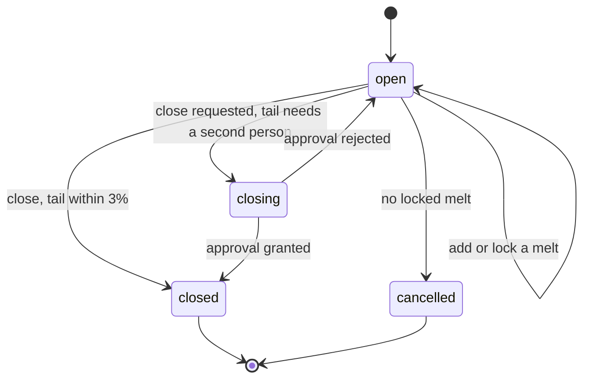
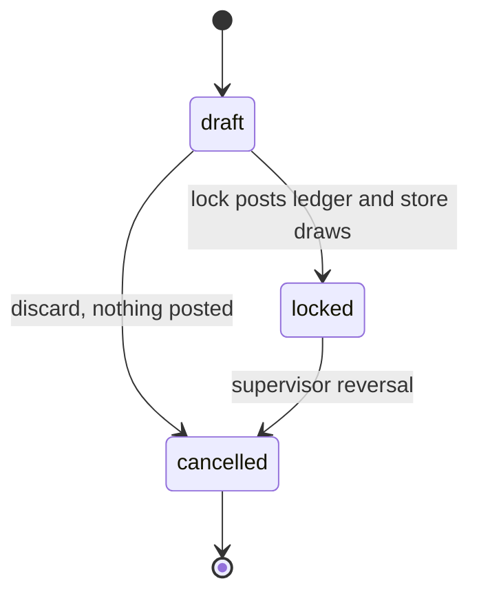

# Foundry (FP-FD) — casts, melts, billets, chemistry

> Preview retired on 2026-10-25; real route: none yet; `/preview/*` now redirects to `/preview/coming-soon?module=foundry` (built on another machine).

**Date:** 2026-10-24
**Module:** FD · **Preview slug:** `foundry`
**Status (2026-10-25):** PAUSED on the omafranky satellite (D27, hardware faults). Main holds the PL5 server (casts, melts, lots, return streams, spectro attach), the pack cast picker, the press billet ledger and the collector inbox. The furnace and alloy routers, the melt lock, the spectro verdict, the `/casts` and `/foundry/*` screens and native were built only in part on `wt/W2-FD-S` @28a5a83 (FD-01, 03, 04, 06-11, 13-15, 19; unpushed) or not at all. Known defect before it resumes: `castPressReturnsSql` returns 0.
**Words:** ORRN only. Competitor evidence is cited as what was claimed, not copied as labels.

A **cast** is a campaign of billets under one plant number (`K31`: month letter + sequence, year stored, not printed). A **melt** is one furnace cycle under that cast. A **log** is what leaves the caster (pieces, length, kg). A **billet** is the length the press charges, cut from a log or cast as that length. **Dross** is oxide skimmed off. **Burn loss** is metal that does not come back as logs, dross or iron. **LDO** is furnace oil, read in inches on the tank. **Spectro** is the spectrometer reading for one melt. **Test certificate** is a new staff print of one cast (not a tax invoice).

---

## 1. Context

### What FourCubes needs

FourCubes casts its own billets. The website says the plant has cast since 29 October 2020, runs a 6 t furnace on a 12-hour cycle, checks every melt on a spectrometer, casts 5-inch billets with a cast number, and that every bundle carries the cast number of the billet it came from (`website/index.html:79`, `:83`, `:156`, `:181`, `:186`). Standard alloys named publicly are 6063 and 6061 (`website/faqs.html:72`). Scrap comes from about 25 vendors and is graded on arrival (`website/index.html:150`).

The architecture digest makes that promise a measure: a complaint about one bundle must open one screen from bundle to die, press run, cast, spectro and scrap lots (digest §1.3 Q-04, §8.7 cast traceability). The owner's success line for the plant modules is every new bundle with a die copy and a cast (`2026-10-03-orrn-plant-modules-design.md` §1). Today that line is false in software: `bundle.cast_id` is optional text with no foreign key (`packages/db/src/schema/inventory.ts`).

A foundry day, in the plant's own sheet, is: pick the furnace, charge scrap lots and returns, note chemicals and LDO inches, record five times, weigh logs out, skim dross and iron, staple the spectro printout, and close the cast with the tail explained (digest Stage 3–5, Q-P13).

### What the competitor showed

Foundry was walked on the call and not screenshotted. Treat it as claimed (`extrusion-suite-vs-orrn.md` §2.3, §4.5; `evidence/transcript_features.md` A15; `evidence/verify_es.md` §2.3).

The operator opened a foundry screen, started a new record, and was offered a free number because plants number differently (`transcript_en.md` L390–L391). Fields named while creating: date, number, furnace, start, end, billet length (a 20 ft stick and a 19 ft stick), billet count, oil, a gross weight, a spectro PDF attached by hand, and magnesium, aluminium and silicon typed in, then a lock (`L391–L393`). Auto-import from the spectrometer was promised "shortly" (`L392`) and, earlier on the same call, described as already done (`L353`). The bundle strings show a PDF upload and a verification flag, not a live feed (`web_research.md` §6.2, `chunk-KH47EJ76.js`). Trust the screen walk: manual PDF today. The watcher is not evidenced.

The same walk asked the screen how many billets were made, how many are lying, how many are in stock, and how many are credited. Figures were not read back (`L390`). A dross weight exists in the shipped script, not in the spoken field list (`verify_es.md` §2.3). Costing was refused: purchase is not in that product, dispatch is (`L393`).

On the press, the order carries the alloy, not the cast. The operator picks the cast from long billets on the floor (`L190–L194`). Ageing and packing can show which cast was used (`L339`). That is a label on a later screen, not a ledger from the furnace back to a weighed lot.

### What ORRN has today

**Prod (`origin/prod`):** no foundry table, router, or screen. The live product starts at pack.

**c2, reserved and not implemented** (`evidence/orrn_built.md` §5, `evidence/verify_orrn.md` §3.5):

| Piece | Where | What it does not do |
|---|---|---|
| Role `foundry` | `packages/db/src/schema/tenant.ts` | No foundry screen to open |
| `cast.enter`, `cast.close` | `packages/server/src/lib/permissions.ts` | `cast.enter`: foundry, supervisor. `cast.close`: supervisor, manager. Owner holds every tenant action |
| Approval kind `cast_close` | `packages/db/src/schema/approval.ts` | Approvers: owner, admin, manager, foundry. No row is ever opened. `APPROVAL_APPLIERS` has hooks for `die_rerank` and `dc_note` only |
| Doc type `cast` | `packages/server/src/lib/docNumber.ts`, `packages/domain/src/serial.ts` `formatCastCode` | Renders `K31` / `H24`. Nothing calls it for a cast |
| `bundle.cast_id` | `inventory.ts` | Optional text. Pack does not ask for it. The label builder does not send a cast (`packages/server/src/lib/bundle-label.ts`) |
| Location `BILLET`, ledger kind `billet` | `packages/server/src/lib/ledger.ts` seed, `stock.ts` | Nothing posts a billet row |
| `prepareStoreDraws` | `packages/server/src/lib/store.ts` | Tested with purpose `melt` and `refId` = a cast id. No melt calls it |
| `purchase.scrapStock` | `routers/purchase.ts` | Readable by `cast.enter`. Balance is by scrap item + grade, not by lot |

**Already planned, not built:**

- P3 / Q-P2: a cast is a campaign with melts. One melt is a valid cast. Bundles and press runs hang off the cast (`plant-modules-design.md` P3).
- P15 / PL-5: `cast`, `melt`, `melt_input`, `melt_output`, `spectro_result`, `return_stream`. Inputs draw purchase lots and return streams. Chemicals and LDO draw store items. Outputs post logs to the billet store and dross/iron to return streams. \|in − out − burn\| within 3% warns; a manager can override with a reason. Spectro is a file or photo (≤ 1 MB in D1 now, R2 later) plus parsed values. Close-out explains the tail. Auto-import is out (Q-P7, OI-02).
- PL-5 lands after purchase (PL-6, done on c2 server) and store (PL-7, done on c2 server).
- Web PL-W3: casts list, cast detail, melt stepper, close-out. Native PL-N3: Cast/melt on the foundry phone.
- Report `reports.foundryYield` (kg in by stream, logs out, dross, burn %, LDO per tonne) and cast traceability, both in the reports task, not in PL-5.
- Five timestamps, already decided: preheat start, charging start, charging end, casting start, casting end (Q-P13).
- Nine return streams, named and not seeded: ingot, plant scrap, discard, dross ingot, bend log, hill metal, pit, tendis, dross metal (digest §8.1).

**This spec keeps that plan and changes it where the call showed a hole:** a furnace master, a manual cast number that cannot fork the series, billet length distinct from log length, nine-element chemistry with limits and pass/fail, the same attach procedure for a PDF now and a collector later, melt lock separate from cast close, and a test certificate. Cost stays a hook.

---

## 2. Feature list

ORRN today is one of: Built prod · Built c2 · c2 server only · Planned PL-n · New. "c2 server only" here means a placeholder (permission, series, column, or helper) with no foundry document.

| ID | Feature | User story | ORRN today | ES reference (cite) | ORRN does it better by | Priority | Depends on | Status (2026-10-25) |
|---|---|---|---|---|---|---|---|---|
| FP-FD-01 | Furnace master | As a manager I keep each furnace (code, name, capacity, billet diameter) so a melt names the furnace it ran on. | New | A furnace was named on the new record; no master was shown (`T:L391–L392`). | Capacity is a limit, not a label. A 6 t furnace cannot be charged past its kg. Diameter is snapshotted onto the logs so a later edit does not rewrite history. | Now | `masters.publish` | **Web built (W2-FD-W).** `/masters/furnaces`: list, add, edit capacity and billet size, retire and reactivate, seed F1; manager and above (`masters.publish`). Also in the Masters hub. |
| FP-FD-02 | Open a cast | As foundry I open a cast and get the next plant number (`K31`), or continue a number already written in the book, with the date and the alloy we are aiming at. | c2 server only (`formatCastCode`, doc type `cast`, `cast.enter`; no table). Planned PL-5 | Free number, because plants differ; date and an alloy were typed (`T:L390–L391`). | The series is the plant's own `K31`, year stored, month letter printed. A manual number is the next series value, or a legacy code that is not a month-letter number — it cannot collide with a later `K31`. | Now | PL-2 (built), FP-FD-09 | **Web built (W2-FD-W).** `/casts` (list by status, Open cast, trace box for a cast code or a bundle number), `/casts/new` (alloy picker, furnace chips, idempotent open), `/casts/$id`. |
| FP-FD-03 | Record a melt | As foundry I add a melt under an open cast: furnace, book date, alloy target, and the five times on the sheet, including start and end. | Planned PL-5 (timestamps, no furnace) | Furnace, start, end (`T:L391–L392`). One record, not a campaign. | A cast stays open across days (K31 ran 35 days and 60 t in the digest). Each cycle is a melt. Phone shows start and end large; the other three times are on the same form. | Now | FP-FD-01, FP-FD-02 | **Web built (W2-FD-W).** `/casts/$id/melt/$meltId` stepper: furnace, alloy, five times with a Now button, past-midnight roll, one save makes the draft (`new`). |
| FP-FD-04 | Charge scrap lots | As foundry I draw kg from OK kanta lots (party vs FC kg, item, grade, vendor) into the melt, and see what each lot still has. | c2 server only for the lots (`purchase_lot`, `scrapStock`). The draw is Planned PL-5 | A gross weight was typed. Purchase is not in that product (`T:L392–L393`). No lot link was claimed. | The charge is the lots, not a typed gross. The draw checks this lot's remaining kg and the grade balance at the scrap store, in the same batch. Cancelling the lot is refused once a locked melt has drawn it. | Now | PL-6 (c2 server), FP-FD-03 | **Web built (W2-FD-W).** Charge step: lots from `lots.available` with kg left on each row, an "all" button, over-remaining and duplicate checks before the server's. |
| FP-FD-05 | Charge return streams | As foundry I charge ingot, plant scrap, discard, dross ingot, bend log, hill metal, pit, tendis or dross metal back into a melt. | Planned PL-5 (`return_stream` not created) | Not shown. Dross appears only as a weight in the shipped script (`W:§6.2`). | The nine streams are a master, seeded, and the same streams receive dross and iron out. A stream cannot be charged below its ledger balance. | Now | FP-FD-03 | **Web built (W2-FD-W).** Charge step return streams with their balance; returned metal on the output step. |
| FP-FD-06 | Draw store items | As foundry I issue cover flux, other chemicals and LDO from the central store onto the melt, and I still write the tank's LDO inches. | c2 server only (`prepareStoreDraws`, purpose `melt`). Planned P15 / P17 | "Oil" was a field on the record. No store issue was claimed (`T:L392`). | Chemicals and LDO leave the store on an MRS that belongs to the melt (`store.cancel` already refuses those). Inches stay inches; they are not converted into litres. The melt cannot lock if a draw did not land. | Now | PL-7 (c2 server), FP-FD-03 | **Web built (W2-FD-W).** Chemicals step: store items (open, used, close computed) and LDO dips in inches with LDO used; MRS numbers on the locked melt. |
| FP-FD-07 | Log and billet output | As foundry I record each stick that left the caster: piece count, log length, billet length, and weighed kg. | Planned PL-5 (one logs blob: pcs, mm, kg) | Billet length and count; a 20 ft and a 19 ft stick were named (`T:L392`). | Several output lines, so 19 ft and 20 ft are not averaged. Billet length defaults from log length when they cast to length. Kg is weighed, not computed from a theoretical density. | Now | FP-FD-03 | **Web built (W2-FD-W).** Output step: log lines (pieces, length in ft, optional billet length, kg). |
| FP-FD-08 | Dross, iron, burn loss, yield | As foundry I record dross and iron, and I see burn loss and yield before I lock. Outside 3% I must write a reason. | Planned PL-5 / P15. Showcase copy only | Dross weight is in the shipped script, not in the spoken fields (`W:§6.2`, `verify_es.md`). No yield rule was claimed. | Burn is computed (in − logs − dross − iron), not a second typed number that can be made to balance. 3% warns and demands a reason; it never silently passes (Review Focus 4). Yield is log kg / metal in. | Now | FP-FD-04, FP-FD-05, FP-FD-07 | **Web built (W2-FD-W).** Running balance chip (in, out, burn kg and %, yield) on the screen; the balance note appears when the burn is outside 3 %. The server stores its own figures. |
| FP-FD-09 | Alloy limits | As a manager I set, per alloy, the min and max for Si, Fe, Cu, Mn, Mg, Zn, Ti, Cr and Al. | New. Planned spectro values are an untyped map (P15) | No limits. Three elements were typed (`T:L392`). | Pass/fail is the plant's limits, editable, not a hardcoded grade. Seed 6063 and 6061 as defaults the owner confirms (Q-FD-1). | Now | `masters.publish` | **Web built (W2-FD-W).** `/masters/alloys`: add, edit, retire, seed 6063 and 6061, limits editor in percent (ppm stored), minimum above maximum refused. |
| FP-FD-10 | Spectro reading and pass/fail | As foundry I enter the nine elements for a melt and see pass, fail or incomplete against the alloy, including aluminium as typed or as the balance. | Planned PL-5 (parsed key/values, no verdict) | Mg, Al, Si typed (`T:L392`). No pass/fail was claimed. | Nine elements, stored as integer ppm, judged against FP-FD-09. A fail is visible on the cast the press will pick. The metal can still be locked — it is already cast — but not quietly. | Now | FP-FD-09, FP-FD-03 | **Web built (W2-FD-W).** Spectro step and locked melt: the nine elements against the alloy limits with a pass, fail or incomplete verdict; typed entry with a reason and a verdict preview. |
| FP-FD-11 | Spectro file now | As foundry I attach the spectro PDF or a photo of the printout to the melt. The numbers I type are the record; the file is the evidence. | Planned PL-5 / Q-P7 | PDF attached by hand (`T:L392`, `W:§6.2`). | Same procedure the collector will call. File ≤ 1 MB in D1 now. A second attach keeps the first file; the latest numbers are current. No PDF parsing in this phase. | Now | FP-FD-10 | **Web built (W2-FD-W).** Attach a file or photo (up to about 700 kB) to a saved melt; the typed numbers stay the record. |
| FP-FD-12 | Spectro from the collector | As the plant, the spectrometer PC drops a results file and the reading attaches itself to the melt. | Planned as out (Q-P7, OI-02). Digest Stage 4 describes a folder watcher | Auto-import was both "done" and "shortly" (`T:L353` vs `L392`). The script is a PDF flag. | One attach procedure, `source: import`, idempotent on the file hash. The watcher is a client, deferred with the plant box (P1). Typed entry does not wait for it. | Next | FP-FD-11, plant collector (not this phase) | **Web built (W2-FD-W).** `/casts/inbox` (W4) plus "Attach from inbox" on the spectro step; simulated files stay dismiss-only. |
| FP-FD-13 | Lock a melt | As foundry I lock a melt. Stock moves then, and the charge and the outputs cannot be edited. | Planned PL-5 (posts on create, no lock state) | One lock on the whole record (`T:L393`). | Drafts do not move stock, so a 12-hour sheet can be filled and corrected. Lock is one `atomicBatch`: document, ledger, store draws, audit. A failed spectro requires a reason, not a block on physics. | Now | FP-FD-04 … FP-FD-08, FP-FD-10 | **Web built (W2-FD-W).** Lock button on the last step; the server's gates are listed in the person's language with a jump to the fixing step; the sheet is read-only after the lock with the correction request, approval and "Correct now". |
| FP-FD-14 | Close a cast | As a supervisor I close a cast. If the tail is outside 3%, a second person approves, and I cannot approve my own request. | c2 server only (`cast.close`, kind `cast_close`, no applier, nothing opens it). Planned PL-5 | The lock was the end of the record. No second person, no tail (`T:L393`). | Campaign close is separate from melt lock. Foundry signs the melts; supervisor or manager closes. `cast_close` gets an applier. The requester is excluded, owner included. | Now | FP-FD-13, approval applier | **Web built (W2-FD-W).** Close and cancel on the cast page (supervisor and above), reason picker `cast_tail` from the server, approval state and the `cast_close` figures in the approvals sheet. |
| FP-FD-15 | Billet stock by cast and alloy | As foundry or the press I see logs produced, kg still in the billet store, and kg already credited to press runs, per cast and per alloy. | c2 server only (location `BILLET`, kind `billet`, never posted) | The screen was asked for made / lying / in stock / credited; figures were not read back (`T:L390`). | The kg is the ledger, `item_ref` = cast id. Alloy is a join, not a second stock key. Piece counts come from output lines, not from `qty_g`. | Now | FP-FD-13. Press consumption: FP-PR | **Web built (W2-FD-W).** `/foundry/stock`: billets on hand by alloy, then cast, with finished casts behind a toggle; the cast page tail panel shows produced, used by the press and on hand. |
| FP-FD-16 | Cast number on the label | As a packer I cannot pack a new bundle without a cast, and the label prints that number. | c2 server only (`bundle.cast_id` unenforced; label variables omit cast) | Cast is chosen at the press, and a later screen can show it (`T:L192–L194`, `L339`). Not evidenced on a label. | Matches the website line (`index.html:79`, `:186`) and the digest sample label (`CAST K31`). Public QR stays `{ number, section }` — no chemistry (AGENTS.md). | Now | FP-FD-02, pack (FP-PK), spool template | **Built.** Pack cast picker and `receiptCast` (W2-FD-S); the bundle page now links its cast to the trace. |
| FP-FD-17 | Cast traceability | As a manager I open one cast, or one bundle, and see lots in, spectro, billets, press runs, bundles and customers. | Planned (digest §8.7). No report | Ageing and packing can name the cast (`T:L339`). No path back to lots or spectro was shown. | One cast page is the Q-04 report. It does not wait for a separate report build. Press and ageing rows appear when those modules write the cast id. | Next | FP-FD-13, FP-FD-16, FP-PR, FP-AG | **Web built (W2-FD-W).** Trace tab on the cast page (lots, melts with spectro, billets, runs, bundles, customers) and from a bundle page or the trace box. |
| FP-FD-18 | Test certificate | As office I print a test certificate for a cast: number, alloy, furnace, melts, spectro pass/fail, and the bundles that cite it. | New | Not shown. | Staff print only. Rates and party-vs-FC kg stay off it. A failed reading prints as fail. It is not a tax document and not a spool label. | Next | FP-FD-10, FP-FD-16 | **Web built (W2-FD-W).** `/casts/$id/certificate`: staff copy with melts, spectro against the limits, a FAIL header, no mark-as-passed, print stylesheet. |
| FP-FD-19 | Foundry yield report | As a manager I read, for a month, kg in by stream, logs out, dross, iron, burn %, and LDO inches per tonne. | Planned (`reports.foundryYield`) | Not shown. | Uses locked melts only. A draft cannot improve the month. LDO is inches per tonne of logs, not a guessed litre figure. | Next | FP-FD-08, FP-FD-06, `reports.read` | **Web built (W2-FD-W).** `/reports/foundry-yield`: by day, alloy or furnace, 92 days, CSV and print. |
| FP-FD-20 | Casting cost hook | As a manager I can later see what the charge cost, from lot rates already stored, without a finance module. | New. Purchase stores `rate_paise`; nothing prices a melt | Costing was explicitly absent (`T:L393`). | No rupee document in this phase. A read can preview charge cost from lot rates and returns "not costed" when a rate is missing. No table until the owner asks. | Later | FP-FD-04, PL-6 rates | **Web built (W2-FD-W).** Cost card on the cast page for purchase readers ("not costed" when a lot has no rate). |

---

## 3. Data model

All new tables follow plant-modules §4: `id` (text uuid), `company_id`, `server_seq`, `created_at`, `created_by`. Writes are tenant-scoped, ≤ 100 bound parameters, audited. Weights are signed integer grams. Chemistry is integer **ppm** (parts per million by weight): 0.420% Si = 4200 ppm; display percent = ppm / 10_000 to three decimals. Money, if a later cost job writes it, is paise. There is no `db.transaction()`; stock moves use `atomicBatch`.

`return_stream` was listed in plant-modules §4 and assigned to PL-5. It was never created. It lands here.

### `furnace` — new

| Column | Notes |
|---|---|
| `code` | Short, unique per company while active. Seed `F1` |
| `name` | Seed `Furnace 1` |
| `capacity_g` | Hard ceiling for metal in on one melt. Seed `6_000_000` (6 t) |
| `billet_diameter_mm` | Seed `127` (5 inch). Snapshotted onto log lines |
| `active` | A retired furnace cannot be picked. Retire only; do not delete (melts reference it) |
| `notes` | |

One row is enough for FourCubes. The master allows a second furnace without a migration.

### `alloy` — new · `alloy_limit` — new

| `alloy` | Notes |
|---|---|
| `code` | `6063`, `6061`, unique per company |
| `name` | |
| `active` | |

| `alloy_limit` | Notes |
|---|---|
| `alloy_id` | |
| `element` | `si` `fe` `cu` `mn` `mg` `zn` `ti` `cr` `al` |
| `min_ppm` | null = no minimum |
| `max_ppm` | null = no maximum |
| unique | `(company_id, alloy_id, element)` |

Seed, as editable defaults, not as FourCubes' certified spec (Q-FD-1):

| Element | 6063 min–max % | 6061 min–max % |
|---|---|---|
| Si | 0.20–0.60 | 0.40–0.80 |
| Fe | – 0.35 | – 0.70 |
| Cu | – 0.10 | 0.15–0.40 |
| Mn | – 0.10 | – 0.15 |
| Mg | 0.45–0.90 | 0.80–1.20 |
| Zn | – 0.10 | – 0.25 |
| Ti | – 0.10 | – 0.15 |
| Cr | – 0.10 | 0.04–0.35 |
| Al | remainder (no limits) | remainder (no limits) |

Temper (T5, T6) is not an alloy column. It belongs on the order line and the ageing batch. The cast carries the alloy the metal was made to.

### `return_stream` — as planned, not built

Seed the nine digest names, `code` stable (`ingot`, `plant_scrap`, `discard`, `dross_ingot`, `bend_log`, `hill_metal`, `pit`, `tendis`, `dross_metal`). `active`, `sort_order`. No expected-recovery column (that lives on `scrap_item` / `scrap_grade`).

### `cast` — as planned, changed

Planned (P3, digest §3.2): year, month, seq → `K31`; alloy; grade; status open/closed; close-out.

| Column | vs plan |
|---|---|
| `number` | as planned. Rendered code (`K31`). Unique per `(company_id, year, number)` |
| `period`, `year`, `month`, `seq` | as planned. From `nextDocNumber("cast")` |
| `number_source` | **new.** `series` or `manual` |
| `opened_on` | **new.** Book date `YYYY-MM-DD` (plant wall clock) |
| `alloy_id` | **changed** from free text to FK `alloy` |
| `grade` | as planned, optional text. Not a scrap grade. Default null. For a note such as EC; not temper |
| `status` | **changed.** `open` · `closing` · `closed` · `cancelled` |
| `tail_g`, `tail_reason` | as planned (close-out). Null until close |
| `closed_at`, `closed_by` | as planned |
| `cancelled_at`, `cancelled_by`, `cancel_reason` | **new.** Only from `open` with no locked melt |

No `furnace_id` on the cast. The furnace is per melt. A campaign can theoretically move; FourCubes has one furnace, so every melt picks F1.

### `melt` — as planned, changed

Planned: five timestamps, LDO inches, chemicals, outputs, spectro.

| Column | vs plan |
|---|---|
| `cast_id` | as planned |
| `seq_no` | **new.** 1…n inside the cast, allocated in the insert |
| `furnace_id` | **new.** Required. Digest had no furnace id; the call did |
| `melt_date` | **new.** Book date |
| `alloy_id` | **new.** Target. Warn if it differs from the cast; do not silently retarget the cast |
| `status` | **new.** `draft` · `locked` · `cancelled`. Planned PL-5 posted on create; that changes (FP-FD-13) |
| `source` | as planned P2. `typed` now. `import` reserved for the collector's timestamps, unused |
| `preheat_start_at`, `charging_start_at`, `charging_end_at`, `casting_start_at`, `casting_end_at` | as planned (Q-P13). Nullable in draft. Lock requires charging start and casting end |
| `ldo_start_inches`, `ldo_end_inches` | as planned. Integers, tank reading, not a weight. Null allowed |
| `balance_bp` | **new.** Signed basis points of burn / metal in, written at lock. 300 bp = 3% |
| `burn_g` | **new.** Computed at lock. Not typed |
| `yield_bp` | **new.** log kg / metal in, basis points, written at lock |
| `balance_reason` | **new.** Required when \|burn\| / in > 3% |
| `spectro_reason` | **new.** Required to lock with no reading, or with a fail (Q-FD-4) |
| `locked_at`, `locked_by` | **new** |
| `client_request_id` | **new.** Idempotency, ≤ 64, unique per company. Same pattern as `store_txn` |
| `cancelled_at`, `cancelled_by`, `cancel_reason` | **new** |

No gross-weight column. Gross metal in is the sum of `melt_input`. A typed gross that can disagree with the lots is rejected (merge notes).

Chemicals are not columns. They are store draws (FP-FD-06). Optional open/used/close quantities from the paper sheet are **not** stored: the MRS used-quantity is the record. If the floor still wants the tank-style open/used/close for a chemical, that is a note on the draw (`store_txn.note`, ≤ 500), not a second balance.

### `melt_input` — as planned

| Column | Notes |
|---|---|
| `melt_id` | |
| `kind` | `lot` or `return_stream` |
| `ref_id` | `purchase_lot.id` or `return_stream.id`. Opaque to the ledger; the row itself is the link |
| `kg_g` | > 0, ≤ 100 t |
| `scrap_item_id`, `scrap_grade_id` | **new** snapshot, lot lines only, so a renamed master does not rewrite the charge |
| `line` | 1…n, matches the ledger line |

A lot line is allowed only when the lot is `ok`, not cancelled, and in this company. Booking and unload lots are not metal yet.

### `melt_output` — as planned, changed

Planned shape was one logs blob plus `dross_g` and `fe_g` on the create call. Changed to lines, because one melt can drop a 20 ft stick and a 19 ft stick.

| Column | Notes |
|---|---|
| `kind` | `log` · `dross` · `fe` |
| `pcs` | log lines only, ≥ 1 |
| `log_length_mm` | log lines. Length as it left the caster |
| `billet_length_mm` | log lines. Length the press will charge. Defaults to log length when omitted |
| `diameter_mm` | log lines. Snapshot of `furnace.billet_diameter_mm` |
| `kg_g` | weighed, > 0 |
| `return_stream_id` | dross and iron lines. Default streams `dross_metal` and a dedicated iron credit — see rules |
| `line` | |

Iron is not one of the nine named streams. **New:** seed a tenth stream `fe` ("Iron"), `active`, sort after the nine. The digest ledger says "+ logs, dross, Fe"; the nine names do not include iron. Say so in masters. Do not overload `dross_metal`.

### `spectro_result` — as planned, changed · `spectro_reading` — new

Planned: file or photo plus a parsed map.

| `spectro_result` | Notes |
|---|---|
| `melt_id` | Several rows allowed. Latest non-void is current |
| `source` | `typed` · `file` · `import`. `import` is the collector (FP-FD-12); the column exists now |
| `file_name`, `mime` | null when typed only. Mime: `application/pdf`, `image/jpeg`, `image/png` |
| `body_base64` | null, or a string ≤ 1_000_000 characters (P15). R2 key replaces this later; do not add the key column until R2 exists |
| `file_hash` | sha256 hex of the decoded bytes. Unique per company when set, so the collector is idempotent |
| `al_source` | `typed` or `balance` |
| `verdict` | `pass` · `fail` · `incomplete` |
| `attached_by` | null when `source = import` and the actor is a device (later) |
| `client_request_id` | ≤ 64 |
| `voided_at` | a result is never deleted. Void keeps the file and drops it from "current" |

| `spectro_reading` | Notes |
|---|---|
| `spectro_result_id` | |
| `element` | the nine |
| `ppm` | ≥ 0, ≤ 1_000_000 |
| `min_ppm`, `max_ppm` | snapshot of the alloy limit at attach time |
| `verdict` | `pass` · `fail` · `no_limit` |

### Not migrated now

`melt_cost` and any paise column on `melt` — **new, later** (FP-FD-20). Lot `rate_paise` is already the price of the charge. A preview read computes from it and does not store.

### Columns already in the database

| Column | Verdict |
|---|---|
| `bundle.cast_id` | unchanged type (text, no FK — SQLite cannot add one to the existing column). App-enforced once FP-FD-16 is on. Points at `cast.id` |
| `stock_ledger.item_kind = billet` | as planned. `item_ref` = `cast.id`. Do not invent a billet row id; lengths live on `melt_output` |
| `stock_ledger.voucher_type` | **changed.** Add `melt` and `melt_cancel` to the drizzle enum in `stock.ts`. The SQL column has no CHECK (comment already says later stages extend it) |

### Ledger postings

Posted at melt **lock**, not at draft save. Voucher id = melt id. One `atomicBatch` with the melt update, the store draws, and the audit row.

| Line | item_kind | item_ref | location | qty |
|---|---|---|---|---|
| per lot input | `scrap_grade` | `{scrapItemId}:{scrapGradeId}` (`scrapItemRef`) | the lot's scrap store, else active `SCRAP` | − kg |
| per return input | `return_stream` | stream id | active `PLANT-SCRAP` (`wip`) | − kg |
| log kg, one line | `billet` | cast id | active `BILLET` | + sum of log kg |
| per dross / iron line | `return_stream` | that stream id | active `PLANT-SCRAP` | + kg |

Store draws are not metal lines. `prepareStoreDraws` adds MRS rows (`voucher_type` `store_mrs`) in the same batch: purpose `melt`, `refId` = cast id, `source: { type: "melt", id: meltId }`. At most 40 draws. Skip the call when nothing is drawn. Catch `isStoreDrawAbort` and `explain()`.

Cancel of a locked melt posts `melt_cancel` reversals (`reversal_of` the original rows, same voucher id) and `storeCancelRows` + `storeCancelMark` for each draw. No new document number.

Chemicals and LDO inches are outside the metal balance. A cover-flux kg is not burn loss.

### Document series

Cast numbers come only from `nextDocNumber` / `allocateDocNumbers`, period `YYYY-MM` on the company wall clock, format `formatCastCode` (`K31`). No client-built number.

Manual (FP-FD-02): the user may accept the next series number (that consumes it, `number_source = series`) or type a code that does **not** match `^[A-L][0-9]+$` (a legacy book code). That code is stored as `number`, `number_source = manual`, and the series is not advanced. A typed `K31` when the series would issue `K32` is refused — continue the book with a start setting, same idea as `settings.plSeries`, rather than punching a hole. **New setting** `settings.castSeriesStart: { period: "2026-10", start: 31 }` applied once, by `masters.publish`, only if that period has no cast yet. Default: no setting, series starts at 1.

Melts have no doc series. `seq_no` is enough. The test certificate has no number of its own; it prints the cast number.

### Doc series and approvals already named

`cast_close` stays the approval kind. Subject = cast id. `request_note` = the tail reason. `meta` carries only the cast number and the tail percent — not lot rates, not vendor names (approval.list is readable by every role; follow the dc_note rule).

---

## 4. Server

New router `foundry` in `packages/server/src/routers/foundry.ts`. Schema `packages/db/src/schema/foundry.ts`. Builders in `packages/server/src/lib/foundry.ts` (balance, ledger rows, limit verdict). Test file `plant-foundry.test.ts`, as PL-5 already names.

No new permission action. The matrix already has the verbs:

| Procedure | Action | Who (besides owner) |
|---|---|---|
| `furnaces.list` | any member | pickers |
| `furnaces.create` / `update` / `retire` | `masters.publish` | manager, admin |
| `alloys.list` | any member | |
| `alloys.create` / `limits.set` | `masters.publish` | manager, admin |
| `streams.list` | any member | |
| `casts.list` / `casts.get` | any member | press must see open casts when picking a charge. Do not hide them behind `cast.enter` |
| `casts.open` | `cast.enter` | foundry, supervisor |
| `casts.cancel` | `cast.enter` | draft campaign only |
| `melts.save` | `cast.enter` | draft upsert: times, inputs, outputs, LDO inches. No ledger |
| `melts.lock` | `cast.enter` | posts |
| `melts.cancel` | `cast.close` | reversal. Foundry does not undo a locked melt |
| `spectro.attach` | `cast.enter` | draft or locked. Does not move stock |
| `spectro.void` | `cast.enter` | drops current; file kept |
| `casts.close` | `cast.close` | supervisor, manager |
| `stock.billets` | any member | kg from the ledger; pcs from output lines |
| `casts.trace` | `reports.read` | the Q-04 payload. Cast get (any member) returns the foundry half; trace adds customers and bundles |
| `reports.yield` | `reports.read` | also exposed as `reports.foundryYield` when that router lands — one query, do not fork |
| `costs.preview` | `reports.read` | FP-FD-20. Reads lot rates. Writes nothing |

`casts.close` opens `approval` kind `cast_close` when the tail rule fails. Approvers stay `owner`, `admin`, `manager`, `foundry`. The requester cannot decide, owner included (AGENTS.md). A foundry user who did not request the close may approve — that is the digest's "foundry approves". They cannot press Close; they do not hold `cast.close`.

**Applier (new hook in `APPROVAL_APPLIERS`):** on approve, set the cast `closed` in the decision's batch, guarded by `decisionLanded` and company, same shape as `die_rerank`. On reject, set status back to `open` and clear nothing the requester typed; they may close again with a better reason. A second pending request per cast is refused by the existing unique index.

Audit actions: `foundry.cast.open`, `foundry.cast.cancel`, `foundry.melt.lock`, `foundry.melt.cancel`, `foundry.spectro.attach`, `foundry.spectro.void`, `foundry.cast.close`, `foundry.furnace.create`, `foundry.furnace.update`, `foundry.alloy.limits`. Meta carries ids and kg, not file bodies.

### `melts.lock` batch, in order

1. Read the draft, the lots, the grade balances, the stream balances, the furnace, the alloy limits. Refuse if the cast is not `open`.
2. Allocate nothing (the cast number already exists).
3. `atomicBatch`:
   - UPDATE melt to `locked` WHERE `status = draft` (so two locks cannot both post).
   - INSERT ledger lines as INSERT…SELECT from `melt_input` / `melt_output`, so they land only if the update landed. The scrap line's WHERE includes `sum(stock_ledger) >= kg` for that grade at that store, and `lot remaining >= kg` (posted FC kg minus approved bori minus already-locked draws of this lot). Both predicates sit in the write, not only in the read.
   - `prepareStoreDraws` statements, then the abort statement.
   - audit INSERT…SELECT from the melt row.
4. On `isStoreDrawAbort`, `explain()` and return the store refusal. The batch has rolled back; the melt is still draft.

`purchase` lot-cancel must be tightened in the same change: `lotCancelLeavesStockNonNegative` becomes "no locked `melt_input` of kind `lot` references this lot", as AGENTS.md already requires. A grade balance that another lot could cover is not enough.

### Balance the server stores

```
metal_in  = Σ lot kg + Σ return-stream kg
logs      = Σ melt_output kg where kind = log
dross_fe  = Σ dross kg + Σ fe kg
burn_g    = metal_in − logs − dross_fe
balance_bp = round(burn_g * 10000 / metal_in)    // 0 if metal_in = 0, and lock is refused
yield_bp  = round(logs * 10000 / metal_in)
```

Warn when `abs(balance_bp) > 300`. Lock then requires `balance_reason` (1…500 chars). This replaces P15's \|in − out − burn\| ≤ 3%. If burn is the residual, that expression is always zero and cannot warn. The 3% is on the residual itself. A negative burn (more kg out than in) warns the same way — the scale or a lot is wrong.

Furnace: refuse when `metal_in > furnace.capacity_g`. Warn on the draft when `metal_in > capacity_g * 95 / 100` (chip only).

### Tail the close computes

```
produced   = Σ locked log kg on the cast
on_hand    = ledger balance of item_kind billet, item_ref = cast id, location BILLET
credited   = − Σ negative billet rows for that cast whose voucher is not a melt
             (press runs, once FP-PR posts them; 0 until then)
tail_g     = produced − on_hand − credited
```

Until a press run exists, `tail_g` is 0 after lock and close does not need a story. When press consumption lands, a tail outside 3% of `produced` (or any negative on-hand, which the press post should already have refused) requires `tail_reason` and a `cast_close` approval. A clean tail closes in one step, no approval.

Bundles are not in the tail. A bundle is section kg after recovery; putting it in the furnace balance double-counts. The trace page shows bundle kg beside the tail so a manager can see both.

### Spectro verdict

Required elements for `pass` or `fail`: Si, Fe, Cu, Mn, Mg, Zn, Ti, Cr. Al is optional.

- Each present element with a max or min: `pass` or `fail` against the snapshotted limit.
- Present element with neither limit: `no_limit`.
- Missing required element: result `incomplete`.
- Result `fail` if any element fails.
- Result `pass` only when no element fails and none of the eight is missing.
- If Al is omitted, `al_source = balance` and `al_ppm = 1_000_000 − Σ other ppm` (floor at 0). Balance Al is stored so the certificate can print it, and it is judged only if the alloy has an Al limit (the seed does not).

Lock with `incomplete` or no result: requires `spectro_reason`. Lock with `fail`: requires `spectro_reason`. Lock with `pass`: reason null. Close does not demand a pass. The certificate and the cast picker show the verdict either way (Q-FD-4).

### Collector contract (built as a column, not a process)

`spectro.attach({ meltId, source: "import", fileName, mime, base64, values, fileHash, clientRequestId })` is the only write FP-FD-12 will use. Same 1 MB cap, same verdict, same audit. Auth stays a user session until a station credential exists (plant box, P1). Do not add a second route. The watcher is a later client.

### What this module does not post

Press consumption, discard, ends, QC rejects, pack, move. Those stay FP-PR / FP-PK / the ledger builders that already exist. This spec's contract for them:

- A press run that consumes billets posts `item_kind: billet`, `item_ref: cast.id`, location `BILLET`, negative kg, and must refuse if that cast's billet balance would go negative (PL-9 already says warn + supervisor override — keep the refusal in the INSERT WHERE; the override is a reason on the press run, not a silent negative).
- Pack writes `bundle.cast_id` to a cast that has at least one locked melt. It does not post billet kg (the press already did, or will).
- Label payload adds `cast: string` (the rendered number) in `buildBundleLabelVariables`. Empty string only for legacy bundles.

---

## 5. Screens

C2 floor rules: one primary action, large numbers, numeric keypad for kg, How-to guide, sticky bar, usable at 375 px, Hindi keys when the strings land. English plant words stay English: cast, melt, billet, kanta, LDO, spectro, dross. Routes follow plant-modules §3, extended where this spec adds a page.

Laptop sidebar group **Floor** gains Foundry. Masters group gains Furnaces and Alloys. Phone tabs for role `foundry`: Today · Cast · Scan · Stock · More (already in §3).

### Web — desktop and 11" tablet

| Route | File (when built, not this task) | Shows | Primary action | Empty / error |
|---|---|---|---|---|
| `/foundry` | `foundry.index.tsx` | Open casts first, then closed. Columns: number, opened on, alloy, furnace of the latest melt, melts, log kg, on-hand kg, yield, spectro verdict (worst melt). Filter: open / closed / alloy | Open cast | No furnace: manager sees "Add a furnace"; foundry sees "Ask a manager to add the furnace." No casts: "Open the first cast." |
| `/foundry/casts/new` | `foundry.casts.new.tsx` | Next number (live), book date, alloy, optional grade note. Manual code field, collapsed, with the rule in one line | Open cast | Alloy master empty: block, link to alloys for a publisher |
| `/foundry/casts/:id` | `foundry.casts.$id.tsx` | Header: `K31`, alloy, status, tail chip. Melts as rows (furnace, start–end, in kg, log kg, burn %, verdict). Charge and outputs of the selected melt. Spectro table. Lots with vendor, item, grade, kg. Store MRS numbers, each opening the store entry. Press runs and bundles when those ids exist | Lock melt (foundry) or Close cast (supervisor), whichever the role can do and the state allows | Load error: retry. Unknown id: not found, back to the list |
| `/foundry/casts/:id/melts/new` | `foundry.casts.$id.melts.new.tsx` | Stepper: furnace and times → charge (lots and streams, remaining kg on each row) → store draws and LDO inches → logs, dross, iron → spectro. 11" uses two columns from the charge step (sheet left, running balance right) | Save draft, then Lock on the last step | Lot picker empty: "No OK lot has kg left." Stream picker empty: "Nothing in that stream." Store item retired or short: the store refusal, not a generic failure |
| `/foundry/stock` | `foundry.stock.tsx` | Billet store. Group by alloy, then cast. Kg on hand, pcs and lengths from output lines, credited kg (0 until press). A cast with 0 kg drops to a "finished" group, not off the page | Open the cast | Location `BILLET` missing: "Billet store is not set up" — it is seeded, so this is a data error, not a wizard |
| `/foundry/casts/:id/certificate` | `foundry.casts.$id.certificate.tsx` | Test certificate, print stylesheet. Cast number, alloy, furnace, each melt's times, the nine elements with pass/fail, log pcs and lengths, bundle lines (section, pcs, kg, customer) for members only | Print | No spectro: print anyway, banner "No spectro on melt 2". Not linked from the public QR page |
| `/masters/furnaces` | `masters.furnaces.tsx` | Code, name, capacity, diameter, active | Add furnace | — |
| `/masters/alloys` | `masters.alloys.tsx` | Alloys and the nine limits, percent in, ppm stored | Save limits | — |
| `/reports/foundry-yield` | under the reports router | Month, kg in by stream and by scrap grade, logs, dross, iron, burn %, LDO inches per tonne of logs | Print / CSV | No locked melts: zeros, not an error |

Cast detail on an 11" tablet keeps the sticky Lock / Close bar and collapses the lot vendor address. It does not drop the balance chip.

### Native — phone

Foundry station, 375 px.

| Screen | Shows | Primary action |
|---|---|---|
| Cast (tab) | Open casts, number and alloy large, on-hand kg | Open cast, or open the one cast already open today |
| Melt | The draft or the locked sheet. Start and end as the big pair; the other three times behind "All times". Charge as a list of kg. Running burn % | Lock |
| Scan (tab) | A lot number (`LOT-41`) or a return stream code, added to the open draft melt | Add to charge. Unknown code: "No lot with that number." A bundle QR is refused with "That is a bundle, not a lot." Do not send lot scans through `resolve.byCode` |
| Stock (tab) | Same groups as `/foundry/stock`, one cast per card | Open cast |
| More | Furnace (read-only), alloys (read-only), guides | — |

Close cast is not on the phone primary bar for the foundry role (they lack `cast.close`). A supervisor on the phone gets Close on the cast screen, with the tail reason as a required field when the chip is amber.

Offline: not in this phase (plant-modules out of scope). The phone submits when it has a session. `client_request_id` makes a retry safe. No local foundry outbox until the floor sync scope grows past pack and dispatch.

### Hardware

| Device | This module |
|---|---|
| orrn-spool / TSC | Label variable `cast` added. The FourCubes template must print it (digest sample already has a CAST line; the payload today does not). A missing placeholder is a template fix, not a second print path. Test certificate is browser print, not a label job |
| Scale | Log kg and charge kg are typed. A scale bridge is not this module. When a bridge exists, it fills the focused kg field; the server still receives grams |
| Spectrometer | PDF or photo attach now (FP-FD-11). Folder watcher later posts FP-FD-12 to the same procedure. No serial protocol in ORRN |
| PLC | None. The furnace is not the press |

### States worth naming on every foundry screen

- **Draft** — amber. Editable. No stock effect.
- **Locked** — green if verdict is pass and burn is within 3%; amber if locked with a reason; red if verdict is fail.
- **Closing** — approval pending. Cast is still open for reading; no new melt.
- **Closed** — neutral. New melts refused. Billets may still sit in the store and may still be pressed (Q-FD-6).
- **Cancelled** — the row stays, kg reversed, number not reused.

---

## 6. Rules & edge cases

### Cast



- A cast is a campaign. Closing it means "no more melts", not "billets are gone".
- Cancel only from `open`, only with zero locked melts. Draft melts are cancelled with the cast. The series number is not given back (AGENTS.md: counters never decrement).
- Two open casts are allowed (a second alloy on a second day). The phone still offers the latest open cast first.
- Displayed number collides across years (`K31` in November 2026 and November 2027). Lookup shows both, newest first, with the year — same idea as old month-only bundle numbers. The unique key is `(company, year, number)`.

### Melt



- Lock requires: at least one input, at least one log line, charging start, casting end, casting end ≥ charging start, metal in ≤ furnace capacity, lot and stream and store checks, and a reason when burn is outside 3% or spectro is missing or failed.
- After lock, inputs, outputs, times, furnace and alloy are immutable. Spectro may still be attached (the printout often arrives after the pour). A later spectro does not repost stock.
- Cancel of a locked melt refuses if billet on-hand for the cast would go negative (a press run already took the kg) or if a store reversal would fail (`diagnoseStoreCancel`). The error names the press run or the MRS.
- A melt whose alloy differs from the cast locks only with a reason on the melt ("retarget"). It does not change `cast.alloy_id`.
- `seq_no` is allocated in the insert, unique per cast, never reused.
- Idempotent lock: the same `client_request_id` returns the first result, including `replayed`. A different body with the same id is CONFLICT.

### Charge

- Lot must be `ok`. Remaining kg = FC kg − approved bori − kg on locked melt inputs for that lot. Pending bori does not reduce remaining (it is not metal removed yet). A pending weight debit note does not block the draw; the OK rule already ran.
- Grade balance at the scrap store must also cover the draw. Both checks live in the lock write.
- One lot may be drawn by several melts until it is exhausted. One melt may draw several lots.
- Return-stream draw cannot exceed that stream's ledger balance at `PLANT-SCRAP`. Ingot bought as scrap is a lot, not the `ingot` stream. The stream is for ingot already sitting as a return.
- Dross and iron output credit `dross_metal` and `fe`. They may be charged into a later melt. They are not scrap grades.
- Store: no negative, already enforced. A melt's MRS cannot be cancelled from the store screen. Cancel the melt.
- LDO inches are not a store quantity. End < start is allowed (a refill during the cycle) and does not warn. A negative inch reading is refused.

### Chemistry

- ppm integers only. A percent field on the screen converts at the edge (`0.42` → 4200). The server rejects a value that is not an integer ppm.
- Sum of the eight non-Al elements above 1_000_000 ppm is a bad reading, refused.
- Limits edited after a result do not change the snapshotted verdict. The certificate shows the limits that were in force.
- A voided result stays downloadable for audit and is marked void on the cast page.

### Label and certificate

- Once the company has any locked melt, `settings.requireCastOnBundle` defaults on (Q-FD-5). New bundles require `cast_id` of a cast with a locked melt. Legacy bundles stay null. Turning the setting off is `masters.publish`, audited.
- The label prints the rendered number, not the internal id.
- The test certificate lists bundles and customers only for a signed-in member. `resolve.publicBundle` does not grow a cast, a spectro, or a kg field.
- A failed verdict prints as FAIL in the header. The office can still print. The page does not offer "mark passed".

### Tenancy, concurrency, caps

- Every read and write filters `company_id`. A lot, stream, furnace, alloy, or store item from another company is NOT_FOUND, not FORBIDDEN (do not confirm the id exists).
- Two locks of the same draft: one UPDATE matches, the other gets CONFLICT and posts nothing.
- Caps: input or output line ≤ 100 t (1e8 g), matching lot weights. File body ≤ 1_000_000 characters of base64. Draws ≤ 40. Reason text ≤ 500. Elements exactly the nine names; an unknown key is BAD_REQUEST, not stored in a JSON bin.
- Time zone: book dates and the cast period use `settings.timezone` (default `Asia/Kolkata`). Do not recompute a cast number if the zone changes later.

---

## 7. Merge notes

### Keep from ORRN

- Cast = campaign with melts (P3, ADR-013, Q-P2). Do not collapse to one row because the competitor had one screen.
- Number `K31` from `formatCastCode` and `doc_series`. Year stored, not printed.
- Five timestamps from Q-P13. LDO in inches. 3% as a warning with a written reason, never a silent pass (Review Focus 4).
- Append-only ledger, one batch, reversals not updates. Billet `item_ref` = cast id. Location `BILLET`.
- `prepareStoreDraws` as the only way a melt touches the store. Purpose `melt`, `refId` = cast id, source marker so `store.cancel` refuses the MRS.
- Scrap lots as they are: party kanta vs FC kanta, grade, OK before the metal exists. Foundry does not re-weigh the vendor's truck.
- `cast.enter` / `cast.close` / `cast_close` approver list, including the rule that the requester cannot decide.
- Public QR stays minimal.
- Auto spectro import stays out of the build until the plant box exists. The column `source` is the hook, not a second product.

### Adopt from the competitor, in our words

- A furnace on the melt, and start/end as the times the floor actually says out loud (the five-time sheet still stands behind them).
- More than one stick length on a melt (19 ft and 20 ft).
- A lock the operator can point at.
- Billet stock that answers made / on hand / credited — from the ledger, with figures that add up.
- A spectro file attached by hand, now.
- The cast chosen where the billets are, which we already planned at the press. The order keeps the alloy; the cast is not pretended at order entry.

### Do differently

- No free gross weight. It cannot be reconciled to a lot. The sum of the charge is the gross.
- No free cast number that can collide with next month's series. Manual means "legacy code" or "accept the next number". Continuing the book is a period start setting.
- Nine elements and a verdict, not three typed fields and a flag.
- Do not tell the plant auto-import is done. The attach procedure is ready; the watcher is not.
- Lock a melt (stock) and close a cast (campaign) are different acts, with a second person only on an unexplained tail.
- Cost is not a module. Rates already sit on the lot. A preview is enough until the owner asks for a stored cost.
- Chemistry never goes on the public bundle page, even though the website says we can tell a customer what went in. That conversation is the test certificate, signed in, or a PDF the office sends. The QR URL stays dull on purpose.

### Conflicts with the existing plan, and the resolution

| Plan | Conflict | Resolution |
|---|---|---|
| PL-5 `melts.create` posts immediately | A 12-hour sheet would move stock on the first save, and a correction would be a reversal | Draft, then `melts.lock` posts. PL-5's single create splits into save + lock |
| PL-5 has no furnace | The call named one; digest Stage 3 did not | `furnace` master, required on the melt |
| PL-5 one logs blob | Two lengths in one pour | `melt_output` lines; `dross_g` / `fe_g` become lines |
| P15 \|in − out − burn\| ≤ 3% | If burn is the residual, the check is identically zero | Warn on \|burn\| / in > 3%. Update the PL-5 test sentence to match |
| P15 chemicals as open/used/close on the melt | Store already has the MRS, and a second balance will drift | Used qty is the MRS. Open/close is a note if they still write it |
| Q-P7 / OI-02 manual only | The website says every melt is checked; the competitor promised a feed | Manual file + typed numbers now. `source: import` on the same procedure. Watcher stays Phase-7-adjacent, with the plant box, not in PL-5 |
| `cast_close` has no applier | Close cannot be finished by `approval.decide` | Add the hook. Do not invent a new kind |
| `bundle.cast_id` optional forever | Website and M6-style success line | Required for new bundles after the first locked melt, setting-gated. Pack implements the check; this spec owns the rule |
| Digest "grade" on the cast | Scrap grade is a different ladder | Optional text, not an FK. Temper stays off the cast |
| Nine return streams, ledger also says Fe | Iron has nowhere to land | Tenth seeded stream `fe` |
| PL-9 press may override a negative billet balance | A silent override recreates the "no account of billets" problem the call described | Refusal in the INSERT WHERE. Override is a reason stored on the press run, visible on the cast trace. Spec for FP-PR should follow this sentence |
| Reports task owns `foundryYield` | Two queries will diverge | One function in `lib/foundry.ts`, called by `foundry.reports.yield` and later by `reports.foundryYield` |

---

## 8. Demo page brief

Fixture only. No server calls. Slug `foundry`. Four screens. Shell is the tenant preview frame (gallery nav, not a live router change).

Plant voice: FourCubes, Surat, 24 Oct 2026. Furnace F1, 6 t, 127 mm. Alloy 6063 unless noted. Section on the certificate: **12170 Domal**, band 1.650–1.850 kg per 12 ft (fixture band, not a measured die). Customers and vendors below are the ones already in `apps/server/src/dev-seed.ts`.

### `preview.foundry.index.tsx` — `/preview/foundry`

Casts list, desktop and a 11" width in the frame.

- Header: Foundry. Primary button **Open cast**. Chip: F1 · 6 t · 5 inch.
- Open row: **K31** · 24 Oct 2026 · 6063 · F1 · 1 melt · in 6,150 kg · logs 5,860 kg · on hand 5,860 kg · yield 95.3% · spectro **Pass**. Status Open.
- Closed row: **H24** · 18 Aug 2026 · 6061 · F1 · 2 melts · logs 11,400 kg · on hand 860 kg · yield 94.1% · spectro **Fail** on melt 2 (Fe). Status Closed.
- Clicking K31 goes to the cast screen. **Open cast** opens a sheet (client state): next number **K32**, date 24 Oct 2026, alloy 6063, button confirms and adds a draft row. No network.
- Empty state is a toggle in the corner for the demo ("No casts") so the gallery can show it: copy "Open the first cast."

### `preview.foundry.cast.tsx` — `/preview/foundry/cast`

Cast K31, melt 1, draft until the visitor locks it.

- Times: preheat 06:00, charging 07:10–08:40, casting 14:20–17:05. Furnace F1.
- Charge:
  - LOT-41 · K.D. Metals, Rajkot · imp belling · A · 4,820 kg
  - LOT-44 · Jay Ambe Scrap Co., Rajkot · soft cable · A+ · 1,150 kg
  - Plant scrap · 180 kg
  - Store: Cover flux 12 kg (MRS-18), LDO inches 42 → 37 (no litre conversion)
- Output: 48 billets · log length 12 ft · billet length 12 ft · 5,860 kg. Dross 96 kg. Iron 18 kg.
- Balance chip: in 6,150 · out 5,974 · burn 176 kg · **2.9%** · inside 3% · yield 95.3%.
- Spectro: Si 0.420, Fe 0.180, Cu 0.020, Mn 0.030, Mg 0.520, Zn 0.010, Ti 0.020, Cr 0.010, Al 98.790 (balance). All inside the 6063 seed limits. File chip "spectro-K31.pdf · attached". Verdict Pass.
- Primary **Lock melt**. On press: status flips to Locked, a line appears "Posted 5,860 kg to the billet store", button becomes disabled. Second press does nothing (idempotent in the fixture).
- A second control, labelled for the gallery, "Show a 4.8% burn", swaps dross to 0 and turns the chip amber with a required reason field. Lock stays disabled until the reason has text.

### `preview.foundry.stock.tsx` — `/preview/foundry/stock`

- 6063 · K31 · 48 pcs · 12 ft · 5 inch · **5,860 kg** on hand · 0 credited.
- 6061 · H24 · 6 pcs left · 12 ft · **860 kg** on hand · 10,540 kg credited (caption: "credited when the press run is logged").
- Tapping K31 returns to the cast screen.
- After the visitor has locked on the cast screen, the K31 card shows a small "Locked just now" — same fixture, shared client state if the preview frame allows it; otherwise the stock page simply shows the locked numbers and does not depend on the other page.

### `preview.foundry.certificate.tsx` — `/preview/foundry/certificate`

Print layout, not a form.

- Title: Test certificate. Cast **K31**. Alloy 6063. Furnace F1. 24 Oct 2026. Verdict Pass.
- Spectro table as on the cast screen, limits in a quiet column.
- Logs: 48 × 12 ft × 5 inch, 5,860 kg.
- Bundles that cite it:
  - 26J1842 · 12170 Domal · 12 ft · 21 pcs · 143.20 kg · 1.720 kg/12 ft · Royal Aluminium, Rajkot · PO 31
  - 26J1843 · 12170 Domal · 12 ft · 18 pcs · 124.60 kg · 1.735 kg/12 ft · Tejura & Sons, Morbi · PO 31
- Footer: "Staff copy. Not a tax invoice." Button **Print** calls `window.print()` and hides the preview chrome in print CSS.
- Gallery toggle "Fail Fe" swaps the header to FAIL and Fe to 0.410% (over the 0.35 seed max) so the red state is visible without a second route.

---

## 9. Open questions for the owner

Defaults are what this spec builds if nobody answers.

| # | Question | Default taken |
|---|---|---|
| Q-FD-1 | Are the seeded 6063 / 6061 limits the ones the spectrometer is judged against, or does the foundry have its own sheet? | Seed the ranges in §3. Manager can edit before go-live. Al stays remainder (no limit). |
| Q-FD-2 | Is a manual cast number a free field every melt, or only a way to continue the book? | Series only, plus `settings.castSeriesStart` for the month go-live happens, plus a legacy code that is not a `K31`-shaped number. A typed `K31` does not punch a hole in the series. |
| Q-FD-3 | Does the furnace have its own kanta weight, separate from the sum of lots? | No. Gross = sum of the charge. A disagreeing furnace weight would be a second source of truth. |
| Q-FD-4 | Can a melt lock with no spectro, or with a fail? | Yes, with a written reason. The metal is already cast. Close is not blocked on a pass. The certificate and the cast list show the fail. |
| Q-FD-5 | When does a new bundle require a cast? | After the first locked melt, on by default. A publisher can turn it off. Legacy bundles stay blank. |
| Q-FD-6 | Does closing a cast freeze the billets? | No. Close means no more melts. Press may still consume what is on hand. A closed cast with kg left stays on the stock page. |
| Q-FD-7 | Should LDO inches convert to litres and issue the store item automatically? | No. Inches are the tank reading. An LDO store draw is a separate, optional MRS in litres. |
| Q-FD-8 | How many furnaces, and is 127 mm right for the 5-inch billet? | One furnace, F1, 6 t, 127 mm, seeded. Diameter is editable before the first lock; after that it is a snapshot on the log line. |
| Q-FD-9 | Is iron a return stream of its own? | Yes. Tenth stream `fe`, beside the nine already named. Dross credits `dross_metal`. |
| Q-FD-10 | Who may approve a cast close? | Keep the list already in code: owner, admin, manager, foundry. Supervisor requests; foundry may approve if they did not request. Requester excluded. |
