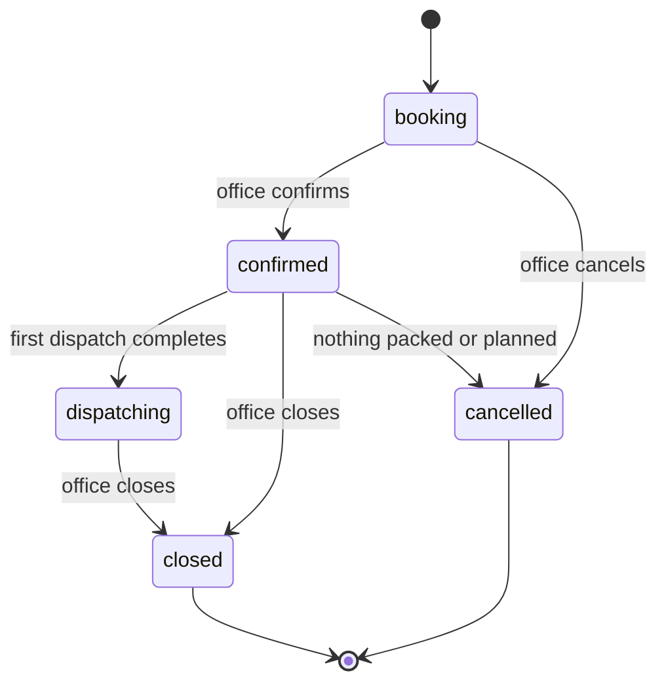
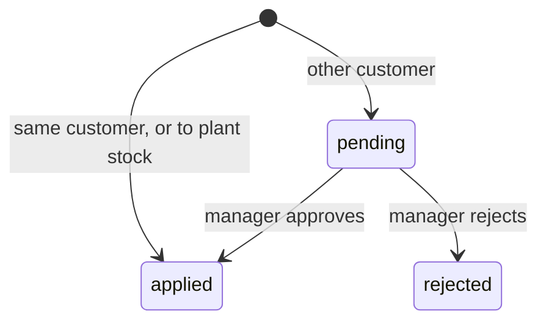
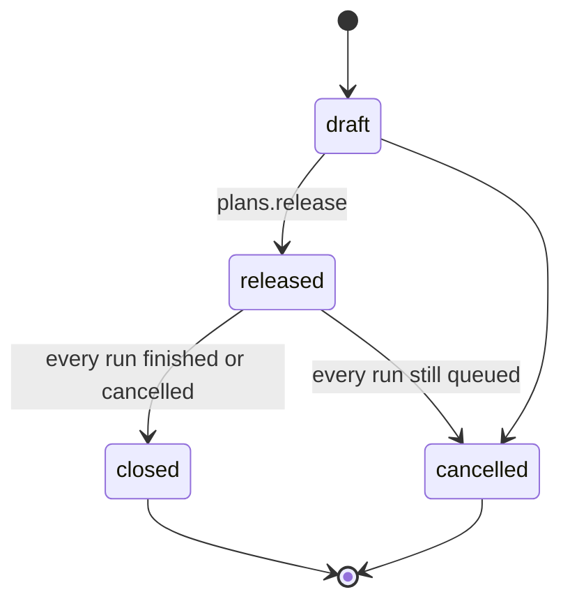

# Orders and planning — design spec

> Preview retired on 2026-10-25; real route: `/orders`, `/orders/new`, `/orders/$id`, `/orders/plan`.

**Status (2026-10-25):** built (W1 and W2); see the Status column. Routes: `/orders`, `/orders/new`, `/orders/$id`, `/orders/plan`, `/orders/plan/$id`; reports under `/reports/orders`.

Date: 2026-10-24 · Module: OP · Preview slug: `orders` · Builds on: `2026-10-03-orrn-plant-modules-design.md` (P13, §4), plan PL-8 / PL-11, digest Stage 15 and §8.1. Evidence cites are to the 2026-10-24 competitive call (`T:L`, `S:`, `shots_A`, `shots_B`, report §4 and §6). This spec uses ORRN words only. "Die" is the section catalogue row (`die`). "Die copy" is the physical oblique (`die_instance`). "Customer PO" is the party's purchase order. It is never an internal press document.

PL-8 is the implementation task. Where this spec and PL-8 differ, this spec wins. The differences are listed in Merge notes.

## 1. Context

### What FourCubes needs

The office books work against the customer's PO, not against a made-up in-house party. The buyer said so on the call: leftover after a part load stays visible on that PO, and only then moves [T:L248][report §6 B11]. A part load is normal. Eight tonnes pressed, 6.7 t on the truck, 1.3 t left in the yard must still show on that PO, and the next party with the same die and length must be able to see it [T:L241-L248][report §6 B10]. Planning must cover only what is not already in stock [T:L216][report §6 B8]. The planner loads the press by die, across parties, and chooses which dies go for the next 24 hours, not every open line [T:L289-L298][report §4.2]. Order kg must be computable from the copy's current weight, not only from the start of the band [T:L200-L203][report §6 B7]. The office must be able to hold bundles or move them to a named party [T:L376][report §6 B20]. A rate per kg is wanted by some plants and not by others; when it is on, dispatch shows a value, not a tax invoice [T:L388-L389].

The order file this replaces is ORDER FILE DINESH.xlsx (digest Stage 15). About 40 customers after dedupe. Quote method on the plant site is per kilo, with the section weight per 12 ft agreed up front.

### What the competitor showed

Described only. Cites are the evidence, not names to copy.

- A customer order with a free-text number, a party, a date, and lines. Each line has a die, a cut length (shown in feet), pieces and kg, and an alloy and temper that can differ from the die master [S:12.34.41 AM][S:12.35.07 AM][shots_A].
- Kg is usually pieces × length × the start of the weight range. Worked examples: 30 pcs × 18 ft × 1 kg/ft = 540 kg; 50 × 10 ft × 13 kg/ft = 6,500 kg [S:12.34.41 AM][shots_A]. One 12 ft line on screen was 20 kg light of that rule (2,500 vs 2,520), and the screen did not say which lines were theoretical [shots_A][report §8.3]. Reverse calculation from kg was spoken, not shown [T:L204-L208].
- Current weight was not used. The vendor said a toggle could be added if the plant phoned; three live presses use the starting weight on purpose [T:L200-L203][report §6 B7].
- A strip of ordered, planned, produced, ready, dispatched and balance, in kg and pcs [S:12.34.41 AM][S:12.55.22 AM]. Balance = ordered − dispatched − in stock (4,850 − 150 − 100 = 4,600): what is still to make, not what the party is owed. The planable remainder is a second figure (348 kg). The 150 kg dispatched is bundles 10/1 (24 ft) and 10/2 (18 ft); the order's extruded kg is 4,601. [S:12.55.22 AM] A status pill can read produced when the pieces are zero [shots_A].
- A tracking strip and a dispatch history on the order, and percent-complete on the phone [T:L211-L215][T:L275-L279][S:12.55.22 AM].
- Leftover after a short load was booked to an in-house party (the plant's own name in speech, a different party on the settings form). The buyer rejected that [T:L246-L248][S:1.28.26 AM][report §7].
- Transfer between orders was described. The result was not on screen [T:L249-L253][T:L376].
- A prompt for the next order of the same die and length was described [T:L246-L247]. Planning the remainder (100 ordered, 50 already run, next plan allows 50) was stated, not exercised on the 8 t case [T:L216-L218][report §6 B8].
- A planning screen that batches several order lines onto one press for a date range, grouped by die. Across lengths for one party was on screen. Across customers was spoken [S:12.43.27 AM][S:12.58.47 AM][T:L294-L298][report §4.2]. The unplanned remainder was a different number from the commercial balance (29 pcs / 348 kg still to plan, against a commercial balance of 240 pcs / 4,600 kg) [S:12.44.58 AM][shots_A].
- Release is a subset: 10 or 20 dies so one 24-hour shift runs through, with urgent and priority [T:L289-L292][S:12.58.47 AM]. A warning that the same dies also sit on another party's PO was claimed; the label on screen showed one party [T:L301-L309][report §6 B13].
- The press received the plan already filled in [T:L333]. The buyer then asked that a customer-owned die not be planned onto another party, on the plant's own screen, not on a customer login [T:L311-L320][report §6 B14]. The competitor had no such lock.
- A price toggle, example ₹425/kg, and a per-kilo total at dispatch if a price was entered. No accounting [T:L388-L389].
- Print and Excel on the order; a plan report on the phone [S:12.34.41 AM][shots_B].

Weight units on that product were mixed (`KG/12'`, `KG/1'`, `KG/1m`) [S:12.26.13 AM]. ORRN does not copy that.

### What ORRN has today

**Prod and c2, built.** Pack, stock, dispatch and packing lists. `bundle.poNumber` and `bundle_group.purchaseOrderRef` are optional free text, printed on the label. No balance, no lifecycle [report §6 B11][inventory.ts]. Dispatch can hold bundles already on that dispatch (`draft → reserved → completed`) and refuses an unknown, held, dispatched or void serial. It cannot hold an arbitrary set from stock onto a party, and it cannot move ownership [report §6 B20][dispatch.ts]. Customer has name, phone, email, billing and shipping address, `taxId`. No kg tolerance, no price, no aliases [customers.ts][digest row 23].

**c2 server only.** `order.manage` is a permission with no caller (`office`, `manager`; owner and admin hold every plant action) [permissions.ts]. `bundle.sales_order_line_id` is an unenforced text column; the comment says the table arrives later [inventory.ts]. `analytics.customerSummary.openOrders` is hardcoded null until PL-8 [analytics.ts][AGENTS.md]. Latest kg/12 ft per copy is `die_weight_reading.kg_per_12ft_milli` (grams per 12 ft, same unit as `die.weightMinG` / `weightMaxG`). Nothing computes an order weight from it [dieInstance.ts][report §6 B7]. `dispatch_overdraw` is an approval kind with no sales-order subject yet [approval.ts]. Doc type `so` is already in `docTypes`, prefix `SO`, financial-year period, format `SO-{seq}` [docNumber.ts][series.ts]. Lengths are stored in mm (`lengthFromInput`, `MM_PER_FOOT = 304.8`). Weights are integer grams.

**Planned, not built.** P13 / PL-8: `sales_order` + `sales_order_line` (section, kg/12 ft target, cut length, pcs, kg, finish text including `6061`), status `booking / confirmed / dispatching / closed`. Produced = bundles linked to the line. Dispatched = completed dispatch items. Baki = ordered − dispatched, in kg and pcs, never negative (plan Review Focus 5). Pack suggests the oldest open line for the same customer and section. Over-dispatch beyond customer kg tolerance needs `dispatch_overdraw`. PL v2 prints PO numbers from the lines. PL-11: `ordersRunningLate` (baki, order date older than 15 days) and `reports.orderBalance`. Digest Stage 15 adds a header PO number, finish AND / PVD / 6061, and a line cast. Digest §8.1 also lists customer kg tolerance and a price list, neither of which has a column. ADR-002 marks the sales order as the only shared-edit (outbox) table. P1 does not build the plant box in this phase, so there is one writer.

**Not planned before this spec.** A press plan, a weight-basis choice, alloy and temper as their own fields, a plant-stock owner, reallocation, a ready-stock prompt, and a rate on the line.

### Already planned, and the contracts this spec consumes

- Die room owns `die.alloy` and `die.temper` (text, nullable), `die.owner_customer_id`, `die_instance.owner_customer_id`, and approval kind `die_owner_override`. Current weight is the latest reading. No denormalized weight column. This spec reads those and snapshots alloy, temper and the basis onto the line.
- Platform owns `company.settings` flags `priceOnSalesOrder` (bool, default off), `dieRequiredOnSalesOrder` (bool, default on), `dieBands` (bool, default on). A portal session may create one customer's sales order in `booking` only. Portal lines name the catalogue die and never pick a copy or a tier. Office adds the copy or tier before confirm. This spec does not add other settings keys.
- Press owns `press_line` and `press_run`. Die issue is the die-room table `die_issue`; the press only checks it. This spec owns `press_plan`, `press_plan_die` and `press_plan_line`. Release is by catalogue die, not by copy. The die room picks the copy at issue time. Nothing is written to the PLC. No `press_queue_job` and no `press_queue_cut`.
- Ageing stores optional `sales_order_line_id` on a trolley row and exposes `ageing.forOrder({ salesOrderId })`. This spec does not rename `sectionId` or `cutLengthMm`.
- Pack and dispatch keep the PL-8 link: `bundle.sales_order_line_id`, suggested line, `dispatch_item` to the line, `dispatch_overdraw`. `bundle_transfer` columns are `bundleId`, `fromSalesOrderLineId`, `toSalesOrderLineId`, `reason`, `approvalId`. No stock-ledger posting. Pack refuses to scan an unassigned legacy bundle onto a dispatch until a transfer assigns it.

## 2. Feature list

| ID | Feature | User story | ORRN today | ES reference (cite) | ORRN does it better by | Priority | Depends on | Status (2026-10-25) |
|---|---|---|---|---|---|---|---|---|
| FP-OP-01 | Sales order against the customer PO | As office, I book a party's PO as a sales order so every kg still owed stays on that PO. | Planned PL-8. Prod and c2 have a free-text PO on the bundle only. | A customer order with a party, a date and lines; the buyer said the PO number is the unit of truth [S:12.34.41 AM][T:L248]. | The PO is the document. The number comes from the SO series. Status follows documents, not a pill. A portal booking stays `booking` until office confirms. | Now | PL-8 | **Built.** orders.create/update/confirm; /orders, /new, /$id |
| FP-OP-02 | Line: die, copy or tier, alloy and temper, cut length | As office, I put each length on its own line, name the die, optionally pin a copy or a tier, and override alloy and temper. | Planned PL-8 has section, cut length, pcs, kg, finish text. No copy, no alloy. | Line shows die, length in feet, and an alloy/temper different from the die master [S:12.35.07 AM][shots_A]. | One die, one band, copies are `die_instance`. Length is stored in mm and shown in mm or ft/in. Alloy is not stuffed into finish. The line snapshots the text it used. | Now | FP-OP-01, die copy (c2) | **Built.** orderLineInput (copy/tier/alloy/temper/cut); lines-editor |
| FP-OP-03 | Pieces and kg, either way | As office, I type pieces or kg and the other fills in, including pieces from a kg the party wrote on the PO. | New | Kg usually comes from pieces × length × range start [S:12.34.41 AM]. Reverse from kg was spoken, not shown [T:L204-L208]. One line on screen did not match the formula and was not labelled [shots_A]. | One integer-gram formula in `@orrn/domain`. The side the clerk typed is the commitment. The rounding gap is shown. Theoretical and weighed kg are never the same unlabelled number. | Now | FP-OP-02, FP-OP-04 | **Built.** orders.quote/quoteMany (no client sums); live quote |
| FP-OP-04 | Weight basis | As office, I see kg at the copy's current weight and at band start, and I can lock the line to either. | New. Latest kg/12 ft per copy is c2 server only. | Order kg uses range start. Current weight was a promise, not a control [T:L200-L203][S:12.34.41 AM]. | Default is the latest reading when the copy has one, else band start, and the line says which. Both figures stay on the line. A later reading does not move baki unless office refreshes it. | Now | FP-OP-02, die weight readings (c2) | **Built.** weight basis, repriceWeight; detail |
| FP-OP-05 | Baki in kg and pcs | As office, I see ordered, planned, pressed, aged, packed, in stock, dispatched and balance, and balance never goes below zero. | Planned PL-8 (ordered, produced, dispatched, baki). | A six-column strip whose two balances disagree, and whose balance subtracts yard stock (4,850 − 100 − 150 = 4,600) [S:12.55.22 AM][S:12.34.41 AM]. | Balance is ordered minus dispatched, floored at zero (PL-8). The other columns are counted from plans, press cuts, ageing rows, bundles and dispatch items. A pill cannot say pressed when nothing was pressed. | Now | FP-OP-01, PL-8, PL-9, ageing, pack, dispatch | **Built.** orders.balance/strip; pressed now from logged runs; baki-strip (the review fixes of W2-FIXES-A are merged) |
| FP-OP-06 | Order timeline | As the owner, I open one sales order and see when it was booked, confirmed, planned, pressed, aged, packed, dispatched and moved. | New. Analytics has dispatch history only. | A tracking strip and a dispatch history were described; percents were read off a phone list [T:L211-L215][T:L275-L279]. | Each row is a real document. There is no percent that can read 88% while the strip disagrees. | Next | FP-OP-05 | **Built.** orders.timeline; timeline (the review fixes of W2-FIXES-A are merged) |
| FP-OP-07 | Leftover stays on the PO | As office, after a part load I still see the remaining kg and pcs on that PO, in stock, for the next vehicle. | Partial. Leftover bundles stay `available` with whatever PO string they were packed with. No order to hang them on. | Extra kg was booked to an in-house party. The buyer rejected that [T:L241-L248][report §6 B10, B11]. | The remainder stays on the sales order it was packed against. Balance is that remainder. No second document is created just to hold stock. | Now | FP-OP-01, FP-OP-05 | **Built.** close/cancel with baki reason; close sheet |
| FP-OP-08 | Reallocate to another sales order | As office, I move leftover bundles to another party's sales order, and the move is recorded. | New | Transfer between orders was described; the result was not shown [T:L249-L253][T:L376]. | `bundle_transfer` is append-only, plus an audit row. Cross-customer moves need a second person. The packing list can still show the original PO. No ledger posting. | Now | FP-OP-07, PL-8 line link | **Built.** orders.reallocate + reallocateDecision; reallocate-sheet (the review fixes of W2-FIXES-A are merged) |
| FP-OP-09 | Plant stock | As office, I can hold material no party wants as plant stock, without inventing a customer. | New | In-house stock was a customer row, and the name did not match between speech and the form [T:L246-L247][S:1.28.26 AM][report §7]. | Plant stock is an owner, not a customer. It does not appear in the customer list, the leaderboard, or GST. Legacy bundles with a null line and no transfer are unassigned, not plant stock. | Now | FP-OP-08 | **Built.** orders.plantStock; take-stock-sheet, stock filter |
| FP-OP-10 | Ready-stock prompt | As office, when a new line matches die and length already in the yard, I am offered those bundles before I plan more. | New | A popup for the next order of the same die and length was described [T:L246-L247]. Planning should skip what is already stock [T:L216][report §6 B8]. | The prompt names the owning PO or plant stock, in kg and pcs. Accepting it is a transfer, not a silent credit. Another party's stock is not hidden inside a fake customer. | Now | FP-OP-08, FP-OP-09 | **Built.** orders.matchStock; stock-sheet |
| FP-OP-11 | Press plan grouped by die | As the planner, I pick open lines and see them grouped by die across customers, so one die change serves every party that needs it. | New. Digest says tomorrow's plan is picked from what is still due. No table. | Several lines were batched per die; across customers was spoken, across lengths for one party was on screen [S:12.43.27 AM][S:12.58.47 AM][T:L294-L298][report §4.2]. | Grouping is by the catalogue die, which cannot be duplicated. Each party's PO, length and balance stay visible inside the group. The copy is not guessed here. | Next | FP-OP-05, FP-OP-07 | **Built.** plans.create/candidates/update/get/list/cancel/close; /orders/plan, /plan/$id |
| FP-OP-12 | Shift window and priority | As the planner, I choose which dies go to the press for the next 24 hours and put them in order, including an urgent flag. | New | Release is a subset so one 24-hour shift runs through, with urgent and priority [T:L289-L292][S:12.58.47 AM]. | The window is at most 24 hours on the company clock (two named shifts, Q-P8). Priority is an order, not a colour. A die already in stock is not offered as planable. | Next | FP-OP-11 | **Built.** window <= 24 h, urgent; plan-board |
| FP-OP-13 | Hand off to the press | As the press operator, I start from a released plan and do not retype the die, the lengths or the parties. | Planned PL-9 starts a typed run. No plan. | The press screen received the plan already filled in [T:L333][S:12.58.47 AM]. | Release opens a `press_run` in `queued` with `plan_id` and `press_plan_die_id`. The copy stays empty until `die_issue`. Nothing is written to the PLC. | Next | FP-OP-12, PL-9, FP-PR | **Built.** plans.release queues press_run per die (<=100 params); plan-detail |
| FP-OP-14 | Price on the line, value on dispatch | As office, I can record ₹/kg on a line when the company wants it, and see the value of a dispatch. | New. ₹/kg exists only on scrap lots (`ratePaise`). | A price toggle, example ₹425/kg, and a total at dispatch if a price was entered. No accounting [T:L388-L389]. | Off unless `priceOnSalesOrder` is on. Floor roles never see the rate. Value uses weighed kg, not theoretical kg. It is not a tax invoice (P12). | Next | FP-OP-01, dispatch complete | **On branch.** `wt/W4-NEXTROWS` @b3fdf1c7 (not merged yet): `dispatch.getDispatch.value` from order-line rates (only with `order.price` and `priceOnSalesOrder`), value card on the dispatch |
| FP-OP-15 | Other party's open lines on the same die | As the planner, when I release one party's urgent lines, I am shown which of those dies also sit on another open PO, with that party's balance. | New | A comma list was claimed; the label on screen showed one party [T:L301-L309][report §6 B13]. | The warning is computed from open lines at release. It names both parties and the balance. It is not a label that can be stale. | Next | FP-OP-12 | **Built.** plans.openLinesForDies + warnings; other-lines |
| FP-OP-16 | Customer-owned die stays with that party | As the planner, I cannot put a customer-owned die on another party's plan unless a manager has allowed that copy and that customer. | New. No owner on the die or the copy. | No lock. The buyer asked for it on the plant's planning view, not on a customer login [T:L311-L320][report §6 B14]. | Effective owner is the copy's owner, else the die's. Release is blocked without an approved `die_owner_override`. The pack guard is the pack spec's (report N5). | Next | FP-DR owner columns, FP-OP-12 | **Built.** owner gate in plans.create/update/release; owner flag on lines |
| FP-OP-17 | Hold stock against a line | As office, I link a chosen set of available bundles to an open line so they stay in the yard but belong to that PO. | Partial. Dispatch can hold bundles already on that dispatch. It cannot hold an arbitrary set from stock onto a party. | Hold or transfer to a named party was asked; the result was not seen [T:L376][report §6 B20]. | Hold links the bundles to the line and leaves them `available`. Transfer to another party is FP-OP-08. The two are not the same button. | Next | FP-OP-08, FP-OP-09 | **Built.** orders.hold/release/holds; held_for_order scan refusal; components/hold-sheet (order detail) |
| FP-OP-18 | Orders running late | As the owner, Today shows lines with balance whose order date is older than 15 days. | Planned PL-11 | A phone list showed percent complete, not age [T:L275-L276]. | Uses balance, not a percent. The 15-day rule is the one already in PL-11. | Next | FP-OP-05, PL-11 | **Built.** orders.late (Q7 expected date); late chip |
| FP-OP-19 | Print and export | As office, I print the sales order and the shift die list, and export the order book. | New. The documents package prints packing lists. | Print and Excel were on the order; a plan report was on the phone [S:12.34.41 AM][shots_B]. | Same documents package and company header. One weight unit. The shift list has no rate. The order print omits the rate unless the caller holds `order.price`. | Next | FP-OP-01, FP-OP-12 | **On branch.** `wt/W4-NEXTROWS` @b3fdf1c7 (not merged yet): order sheet, shift die list and order book export (`@orrn/documents` order-sheet), print + Excel on order, plan and book |

Rows added by the competitive re-pass (2026-10-24, `.fp-build/inputs/competitive-repass.md`); they were not in the table above.

| ID | Feature | User story | Priority | Depends on | Status (2026-10-25) |
|---|---|---|---|---|---|
| FP-OP-20 | Order book at a glance | As the owner on my phone, and office on the web, I open Orders and see, for each open sales order, one kg bar showing where it is (dispatched, in stock, pressed not packed, planned not pressed, not planned), a labelled dispatched %, and a header strip of open orders, ordered kg, in stock, dispatched and baki. | Now | FP-OP-05 (`orders.balance`), customer city | **Built.** lib/orderBook.ts one SQL for rows+totals; bookTotals/bookCities; order-bar, filters |
| FP-OP-21 | Press plan and press summary on the phone | As the owner away from the plant, I open today's press plan on my phone (dies, cut lengths, pcs planned vs pressed, each run's state) and yesterday's press summary, read-only. | Next | FP-OP-11, FP-PR-05, FP-PR-18 | **On branch.** `wt/W4-NEXTROWS` @b3fdf1c7 (not merged yet): `plans.phone` and the read-only phone view of the plan and day summary (web under 820 px, native Press tab) |

## 3. Data model

Every new table has `id` (uuid text), `company_id`, `server_seq`, `created_at`, `created_by`, as in plant-modules §4. Writes are tenant-scoped. Status changes use a write predicate (the row is still in the expected status), not a read followed by a blind update.

Legend: **as planned** = P13 / PL-8 / digest Stage 15, unchanged. **changed** = planned, and this spec changes the shape. **new** = not in those documents.

### `sales_order` — changed (P13)

| Column | | Notes |
|---|---|---|
| `number` | as planned | From `nextDocNumber(..., "so")`. Format `SO-{seq}`, financial-year period. Never built on the client. |
| `customer_id` | as planned | Required. One customer. Portal sessions cannot change it after create. |
| `po_number` | as planned | The customer's PO. Required to confirm. Optional while `booking`. Unique among non-cancelled orders for that customer (`company_id`, `customer_id`, `po_number`). A repeat warns and blocks confirm, it does not create a second open PO. |
| `status` | changed | `booking`, `confirmed`, `dispatching`, `closed`, `cancelled`. P13 had no `cancelled`. Digest names Confirm / Dispatch / Booking map to `confirmed` / `dispatching` / `booking`. |
| `order_date` | new | Company wall-clock date, stored as ms. Late-order age uses this, not `created_at`. |
| `expected_date` | new | Optional. Printed. Not a plan window. |
| `finish` | changed | Header default for new lines: `none`, `anodise`, `pvd`. P13 put `6061` in this set. `6061` is an alloy (digest Stage 15). It is not a finish. |
| `note` | as planned | |
| `source` | new | `office` or `portal`. Portal rows are created in `booking` only. |
| `confirmed_at`, `confirmed_by` | new | Set on confirm. |
| `closed_at`, `closed_by`, `close_reason` | new | `close_reason` required when balance remains. |
| `cancelled_at`, `cancelled_by`, `cancel_reason` | new | |

There is no plant-stock sales order and no customer row standing in for the plant.

### `sales_order_line` — changed (P13 / PL-8)

PL-8's `{ sectionId, kgPer12ftMilli?, cutLengthMm, pcs?, kgG, finish?, note? }` still works. The columns below are added. `sectionId` and `cutLengthMm` do not get new names (ageing and pack match on them).

| Column | | Notes |
|---|---|---|
| `section_id` | as planned | FK to `die`. Required. The die. |
| `die_instance_id` | new | Optional pin to a copy. Not required for planning. When `settings.dieRequiredOnSalesOrder` is on (default), confirm requires this or `tier_rank`. |
| `tier_rank` | new | Optional. "A copy of this tier or better." Mutually exclusive with a pinned copy in the form; the server stores whichever was set. |
| `cut_length_mm` | as planned | Whole mm. Entry accepts mm, or feet + inches, via `lengthFromInput`. Display via `formatLength`. |
| `qty_basis` | new | `pcs` or `kg`. Which side the clerk committed. |
| `pcs` | as planned | Whole pieces. Required. Zero is rejected. |
| `kg_g` | as planned | Ordered grams. The commitment. See the formula below. |
| `implied_g` | new | Grams implied by pcs × length × the locked basis. Equals `kg_g` when `qty_basis` is `pcs`. The gap is `kg_g − implied_g` when the clerk typed kg. |
| `weight_basis` | new | `copy_current` or `band_start`. |
| `kg_per_12ft_milli` | changed | The locked basis, grams per 12 ft. PL-8 had this as an optional target. Here it is the snapshot used for the formula, always set. |
| `band_start_milli` | new | `die.weightMinG` at save. Kept so the other figure does not move when the catalogue is edited. |
| `copy_milli` | new | Latest reading at save, or null when the copy had none. |
| `reading_id` | new | The `die_weight_reading` row used, or null. |
| `basis_note` | new | Set when the line wanted current weight and fell back (`no reading yet`). |
| `alloy`, `temper` | new | Text snapshots. Copied from `die.alloy` / `die.temper` (die-room columns) and overridable. Not FKs. Empty is allowed on a booking line; confirm requires both once the die has them, and requires the clerk to type them if the die has neither. |
| `finish` | changed | `none`, `anodise`, `pvd`. Copied from the header. Line may override. |
| `rate_paise` | new | ₹ per kg, in paise, same unit as `purchase_lot.rate_paise`. Null unless `priceOnSalesOrder` is on. Floor procedures omit it. |
| `note` | as planned | |

No `cast_id`. Digest Stage 15 puts cast on the line. The cast is known at the press and on the bundle. Storing it here would go stale. See open questions.

Ordered grams, in `@orrn/domain` (new helpers `orderGrams` and `orderPieces`, used by server, web and native):

```
divisor = MM_PER_FOOT * 12 * 10 = 36576
orderGrams(pcs, cutLengthMm, basisMilli) = round(pcs * cutLengthMm * basisMilli * 10 / 36576)
orderPieces(kgG, cutLengthMm, basisMilli) = round(kgG * 36576 / (cutLengthMm * basisMilli * 10))
```

`basisMilli` is `die.weightMinG` for `band_start`, or the latest `die_weight_reading.kg_per_12ft_milli` for `copy_current`. Example: 30 pcs, 18 ft (5486 mm), band start 12.000 kg/12 ft (12000) → 540000 g. That is the 540 kg case, in ORRN units. A 12 ft line at 1.650 kg/12 ft for 200 pcs is 330.000 kg at band start and 334.400 kg at a reading of 1.672.

When `qty_basis` is `pcs`, `kg_g = implied_g = orderGrams(...)`. When `qty_basis` is `kg`, `kg_g` is `kgToG` of what the clerk typed, and `pcs` is `orderPieces`. The screen shows the implied kg of those pieces and the difference, and the clerk can nudge pieces by one before save.

A later reading does not recompute the line. `orders.repriceWeight` (office, audited) writes a new snapshot. If `qty_basis` is `pcs`, `kg_g` moves. If `qty_basis` is `kg`, `kg_g` stays and `pcs` is recomputed. Baki uses `kg_g`, not a live reading.

When `settings.dieBands` is off, the form hides the band and does not offer `band_start`. The basis is the reading, or `weightMinG` labelled "section weight" when there is no reading. The column is still filled.

### `customer.kg_tolerance_bp` — new column, planned in digest §8.1

Integer basis points of ordered kg. Default 0 (exact). 50 = 0.5%. PL-8's over-dispatch rule uses this. There is no company-wide settings key (platform owns settings flags; this default lives on the column).

### `bundle_transfer` — new

The commercial move of a bundle between owners. Pack/dispatch call it; this spec defines it. Not a stock move. No `stock_ledger` row.

| Column | Notes |
|---|---|
| `bundle_id` | Required. Bundle must be `available`. Reserved, dispatched and void are rejected. |
| `from_sales_order_line_id` | Nullable. Null means it was not on a line (plant stock or unassigned). |
| `to_sales_order_line_id` | Nullable. Null means plant stock. |
| `reason` | Required. |
| `approval_id` | Set when the move waited on `order_reallocate`. |

Append-only. Never update or delete a row (same rule as the ledger: a correction is a new transfer the other way).

**Plant stock** (new term) is a bundle whose `sales_order_line_id` is null and whose latest `bundle_transfer` has a null `to_sales_order_line_id`. A legacy bundle with a null line and no transfer is **unassigned**. It still has its free-text `po_number`. The stock prompt may offer it, labelled with that text, and linking it writes the first transfer. It is not shown as plant stock and it is not a customer.

### `press_plan` — new

The term "press plan" is already in the digest ("tomorrow's press plan is picked from what is still due"). The table is new.

| Column | Notes |
|---|---|
| `number` | New doc type `press_plan`, prefix `PP`, financial-year period, format `PP-{seq}`. |
| `status` | `draft`, `released`, `closed`, `cancelled`. |
| `press_line_id` | Nullable FK to the press spec's `press_line`. FourCubes has one press; null means that press. |
| `window_start`, `window_end` | ms. Length at most 24 hours. Default is the next 24 hours aligned to the company shift clock (Q-P8: Day 08:00–20:00, Night 20:00–08:00), so the window covers two named shifts. |
| `note` | |
| `released_at`, `released_by` | Set on release. |

### `press_plan_die` — new

One catalogue die on this plan. Not a copy. The die room picks the copy later.

| Column | Notes |
|---|---|
| `press_plan_id` | |
| `section_id` | FK to `die`. Unique per plan. |
| `sort_order` | Priority. Lower runs first. |
| `urgent` | Bool. Sorts ahead of non-urgent at the same decision; `sort_order` still wins if the planner sets it. |

No `die_instance_id` on this row.

### `press_plan_line` — new

| Column | Notes |
|---|---|
| `press_plan_id`, `press_plan_die_id` | The line's die must equal the plan-die's `section_id`. |
| `sales_order_line_id` | Required. The line must be on a `confirmed` or `dispatching` order. |
| `cut_length_mm` | Copied from the sales-order line at add. Not edited here. A length change is a sales-order edit, which drops the draft plan line. |
| `pcs`, `kg_g` | The qty released to the press. Must be ≤ planable (Rules). |
| `preferred_die_instance_id` | Nullable copy pin copied from the sales-order line. Informs die issue. Does not set `press_run.die_instance_id`. |

Grouping by die across customers is a query on these rows, not a stored parent besides `press_plan_die`.

### Press rows this spec asks the press spec to carry

Owned by the press spec. Named here so the handoff has one shape.

- `press_run.plan_id` → `press_plan.id`
- `press_run.press_plan_die_id` → `press_plan_die.id`
- `press_run.section_id` set at release
- `press_run.press_line_id` copied from `press_plan.press_line_id` at release
- `press_run.die_instance_id` null until `die_issue`
- `press.runs.start({ pressPlanDieId })` is the press procedure. It refuses unless an open `die_issue` exists and the run status is `die_issued`.
- `press_run.status` includes `queued` (PL-9 starts a run immediately; `queued` is the change)

This spec does not add `press_queue_job` or `press_queue_cut`. The press reads `press_plan_line` for the cut lengths.

### Columns read, not owned

- `die.alloy`, `die.temper`, `die.owner_customer_id`, `die_instance.owner_customer_id` — die-room spec.
- `bundle.sales_order_line_id` — already on the table (PL-8). Pack sets it when the suggested line is accepted.
- `dispatch_item` gains `sales_order_line_id` — as planned in PL-8. Pack spec owns the column. This spec's baki query reads it.

### Ledger

No stock-ledger postings. Pack, move, void and dispatch already post. A transfer changes ownership, not location or kg. A press plan changes no stock. Order kg is a commitment, not a voucher.

### Doc series

| Doc | | Format |
|---|---|---|
| Sales order | as planned | doc type `so`, `SO-{seq}`, FY period |
| Press plan | new | doc type `press_plan`, `PP-{seq}`, FY period |
| Press run | as planned | `PR-{seq}`, allocated at release by the press series, not by this spec's series |

Add `press_plan` to `docTypes` and `TYPE_PREFIX`. A transfer has no document number (the locked column list has no `number`). Period rule is unchanged: financial year for everything except bundle and cast.

## 4. Server

File `packages/server/src/routers/salesOrder.ts` for `orders.*` (PL-8's file). File `packages/server/src/routers/pressPlan.ts` for `plans.*`. Transfers live on `orders.reallocate` and `orders.hold` and write `bundle_transfer`. All mutations: permission check, tenant scope, ≤100 bound parameters (chunk line and bundle arrays), `atomicBatch` for the document rows plus the audit row, `clientMutationId` accepted so a native retry is idempotent (the `mutation` table already exists; PL-8 should be the first orders caller).

### Permissions

Style of `packages/server/src/lib/permissions.ts`.

| Action | Who | What |
|---|---|---|
| `order.manage` | office, manager (exists) | Create and edit sales orders, confirm, close, cancel, hold, reallocate within the same customer, refresh weight basis. |
| `order.plan` | office, manager (**new**) | Create and release a press plan. |
| `order.price` | office, manager, accountant (**new**) | Set and read `rate_paise`. Procedures omit the field unless the caller holds this and `priceOnSalesOrder` is on. |
| `reports.read` | already includes accountant, supervisor, viewer | `orders.list`, `orders.get`, `orders.balance` only. No rates. |
| `press.run` | press, supervisor | `plans.get` and `plans.list` for released plans only. Cannot release. |

Owner and admin hold every plant action, as today. A portal session is not `order.manage` and never holds `order.price`. It may call `orders.create` and `orders.lines.add` only, forced `source: "portal"`, `status: "booking"`, `customerId` fixed. A portal line sets `sectionId` and must not set `dieInstanceId` or `tierRank`. It cannot confirm, price, reallocate, hold or plan. The platform spec names the portal permission; this router rejects the other procedures for that session.

### Procedures

`orders.create({ customerId, poNumber?, orderDate, expectedDate?, finish?, note?, source? })` → `order.manage`, or portal as above. Allocates `SO-{seq}`.

`orders.update({ id, poNumber?, expectedDate?, finish?, note? })` → `order.manage`. Refused when `closed` or `cancelled`. Changing `poNumber` rechecks uniqueness.

`orders.confirm({ id })` → `order.manage`. Predicate: status is `booking`. Requires `poNumber`, at least one line, each line's pcs, kg, cut length, alloy and temper, and (when `dieRequiredOnSalesOrder`) a copy or a tier. Runs the owner check (FP-OP-16) when a copy is pinned. Writes `confirmed_at`.

`orders.close({ id, reason? })` → `order.manage`. From `confirmed` or `dispatching`. Reason required when balance &gt; 0. Does not move bundles. They stay on the closed line until reallocated, and the stock prompt still finds them.

`orders.cancel({ id, reason })` → `order.manage`. From `booking`, or from `confirmed` when nothing is packed, planned, pressed or dispatched. Reason required.

`orders.lines.add` / `orders.lines.update` / `orders.lines.remove` → `order.manage`. Remove refused when any bundle, plan line or dispatch item points at the line. Update of `cutLengthMm` or `sectionId` refused when a non-cancelled plan line points at it (ageing and the plan match on those). A booking line may be incomplete; a confirmed line may not.

`orders.quote({ sectionId, dieInstanceId?, cutLengthMm, pcs?, kgG?, weightBasis? })` → `order.manage`. No write. Returns both bases, the derived side, `impliedG`, and the gap. The form calls this on every keystroke debounce; the server is the authority at save.

`orders.repriceWeight({ lineId, weightBasis })` → `order.manage`. Audited. Refused when the line is on a released plan (cancel the plan line first) or when dispatched kg already exceeds the new `kg_g` (that would need `dispatch_overdraw`, and this procedure does not grant it).

`orders.matchStock({ sectionId, cutLengthMm, customerId })` → `order.manage`. Returns available bundles of that die and length, grouped by owner: this customer's open lines, other customers' open lines (PO number, balance), plant stock, unassigned (legacy PO text). Does not return reserved, dispatched or void. Used by the prompt (FP-OP-10) and by the planable check.

`orders.hold({ lineId, bundleIds, reason })` → `order.manage`. Links `available` bundles to the line. Writes a `bundle_transfer` from the previous owner. Bundles stay `available`. Cross-customer source goes through `order_reallocate` instead of landing immediately. Refused when die or length does not match the line.

`orders.reallocate({ bundleIds, toLineId | "plant", reason })` → `order.manage`. Same-customer, or to plant stock: applied in the same batch. Cross-customer: writes the approval and does not move the bundles until it is approved. `toLineId` must match die and length, or the server rejects. Plant stock clears `sales_order_line_id`.

`orders.get({ id })` / `orders.list({ status?, customerId?, search?, limit, cursor })` / `orders.balance({ customerId? })` → `order.manage` or `reports.read`. List is paged like `customer.list` (limit max 100). Search matches number, PO number and customer name.

`orders.balance` keeps the PL-8 names and adds the strip. Per line:

| Field | Meaning |
|---|---|
| `orderedG`, `orderedPcs` | The line commitment (`kg_g`, `pcs`). |
| `producedG`, `producedPcs` | PL-8 name. Non-void bundles linked to the line, including dispatched. |
| `dispatchedG`, `dispatchedPcs` | Completed dispatch items linked to the line. Weighed kg, not theoretical. |
| `bakiG`, `bakiPcs` | `max(0, ordered − dispatched)`. Never negative. |
| `plannedG`, `plannedPcs` | Sum of `press_plan_line` qty whose plan is `draft` or `released` and whose `press_run` is not finished and not cancelled. |
| `pressedG`, `pressedPcs` | Logged press cuts for the line (press spec query), minus aged and minus `produced`. Floored at 0. |
| `agedG`, `agedPcs` | From `ageing.forOrder`: loaded + in oven + held + released, not the packed figure (that would double-count bundles). |
| `packedG`, `packedPcs` | Linked bundles still in the plant (`available` + `reserved`). |
| `inStockG`, `inStockPcs` | Linked bundles with status `available`. The held part of packed is `packed − inStock`. |
| `overG`, `overPcs` | `max(0, producedG − orderedG)`. The extra that stays on the PO. Not a negative balance. |

`planableG = max(0, orderedG − dispatchedG − packedG − plannedG − pressedG − agedG)`. Stock already in the yard is not planned again (FP-OP-12, report B8).

`plans.create({ pressLineId?, windowStart, windowEnd, note? })` → `order.plan`. Allocates `PP-{seq}`. Rejects a window longer than 24 hours or in the past by more than the open shift.

`plans.lines.add({ planId, salesOrderLineId, pcs, kgG })` → `order.plan`. Plan must be `draft`. Qty ≤ `planableG`. Creates the `press_plan_die` for that section if needed. Copies `cut_length_mm` and `preferred_die_instance_id`.

`plans.dies.order({ planId, dieIdsInOrder, urgentIds })` → `order.plan`. Sets `sort_order` and `urgent`.

`plans.release({ planId })` → `order.plan`. Predicate: `draft`, at least one die, every line ≤ planable at release time (rechecked inside the batch). Inserts, in the same batch, one `press_run` per `press_plan_die` with status `queued`, `plan_id`, `press_plan_die_id`, `section_id`, `press_line_id` copied from the plan, `die_instance_id` null, number from doc type `press_run`. Lengths stay on `press_plan_line`. Does not insert a die issue and does not write a queue-cut copy. Does not write the PLC. Returns the FP-OP-15 warning (other open POs on those dies) on the result; the warning does not block. The FP-OP-16 owner check does block unless an approved `die_owner_override` exists (subject = the preferred copy id, `meta.attemptedCustomerId` = the line's customer).

`plans.cancel({ planId, reason })` → `order.plan`. From `draft`, or from `released` when no linked run has left `queued`. Cancelling a released plan cancels those queued runs in the same batch (press spec's cancel predicate). A started run cannot be cancelled here.

`plans.close({ planId })` → `order.plan` or the press finish path. When every linked run is finished or cancelled, the plan closes. Office may close early with a reason; leftover plan qty returns to planable.

`plans.get` / `plans.list({ status?, from?, to? })` → `order.plan`, or `press.run` for released and closed only.

`dispatch.linkItem` and the suggested line stay as PL-8, with one change: suggest the oldest open line for the same customer, die and cut length; if none, the oldest open line for the same customer and die. Over-dispatch beyond `kg_tolerance_bp` still requires `dispatch_overdraw` (approvers owner, admin, manager; requester cannot approve). Within tolerance, complete is allowed and `bakiG` floors at 0. The overage is `overG`, not a negative.

`dispatch.get` adds `valuePaise` only when the caller holds `order.price` and the setting is on. Per item, `round(bundle.weightG * line.ratePaise / 1000)`, summed. Items whose line has no rate are counted as `rateMissing` and excluded from the sum. This is a value figure. It does not create an invoice (P12).

`orders.print({ id })` and `plans.print({ id })` build a snapshot in `packages/documents` (new templates, same header rules as the packing list). CSV export is `orders.export` and `reports.orderBalance` (PL-11) reading the same balance query.

### Approvals

| Kind | | Approvers |
|---|---|---|
| `dispatch_overdraw` | as planned | owner, admin, manager |
| `order_reallocate` | **new** | owner, admin, manager. Subject is the pending transfer. Meta: from line, to line, bundle ids, kg. Requester cannot approve. |
| `die_owner_override` | die-room spec | Subject is the copy id. Meta includes `attemptedCustomerId`. OP inserts the row and will not release until it is approved for that copy and that customer. OP does not add `die_instance.customer_id` or a `die_cross_party` kind, and does not change this kind's approver list. |

### Audit

Same batch as the write. Actions: `order.create`, `order.update`, `order.confirm`, `order.close`, `order.cancel`, `order.line.add`, `order.line.update`, `order.line.remove`, `order.hold`, `order.reallocate`, `order.weight.refresh`, `plan.create`, `plan.release`, `plan.cancel`, `plan.close`. Subject types: `sales_order`, `sales_order_line`, `press_plan`, `bundle_transfer`. Meta carries the ids and the kg, not a copy of the whole order.

### What this module does not write

The stock ledger. The PLC. A tax invoice. A customer row for plant stock. A die issue. An ageing row.

## 5. Screens

Web routes follow the C2 map. Sales group in the sidebar: Orders, Dispatch, Customers. Press plan is a secondary action on Orders, not a new top-level item. Command palette entry "Press plan". Phone tabs for office, manager, owner and admin stay as plant-modules §3: Today · Dispatch · Scan · Orders · More. The planning board is not a phone screen. The 11" tablet uses the web app (C2 icon rail, sidebar in landscape ≥1024). Strings go in `en.ts` and `hi.ts`. Gujarati is out of scope (report N9).

Floor rules from C2: one primary action, large numbers, numeric keypad for pcs and kg, How-to guide, sticky action bar, usable at 375 px. Rates are not on a floor screen.

No spool, scale, printer or PLC on this module. Print is the documents package (browser print or download), not a label job. The shift list is a sheet the supervisor can take to the press desk. It is not a bundle label.

### `/orders` — `orders.index.tsx`

Desktop and 11" tablet. List of sales orders. Columns: number, customer, PO, status, order date, balance kg, balance pcs. Balance chip uses the baki colour already used for late work on Today (text plus icon, not colour alone). Filters: status, customer, search. Empty: "No sales orders yet" and primary "New sales order". Error: the list error already used on Dispatch, with retry. Forbidden: the standard no-access screen.

Primary action: New sales order. Secondary: Press plan, Export (if `reports.read`).

Phone (`apps/native/app/(tabs)/orders/`): the same list, one order per row, balance in kg under the PO number. No export. No press plan.

### `/orders/new` — `orders.new.tsx`

Customer (search, same control as new dispatch), PO number, order date (default today), expected date, finish default, note. Then lines. A line is: die (search on series and section code), optional copy or tier (required to confirm when the setting is on; the copy picker shows code, tier, current kg/12 ft, band, and owner), cut length (mm, or ft + in, defaulting to the company unit), alloy and temper (prefilled from the die, editable), pieces and kg with a basis toggle.

The pieces field and the kg field are both editable. The last one touched is `qty_basis`. The other updates from `orders.quote`. Under the pair: "330.000 kg at band start 1.650 · 334.400 kg at copy 12170-1 now 1.672 · using current". If there is no reading: "No reading yet — using band start". When `dieBands` is off, the toggle is hidden.

If `orders.matchStock` returns bundles, a sheet opens before save: "In stock for this die and length" with groups (this PO, other POs, plant stock, unassigned). Each row is kg, pcs, owner. Actions: Hold on this line (FP-OP-17), Leave them, Plan only the rest. Holding a cross-customer group explains that a manager must approve, and does not pretend the bundles have moved.

Empty line state: "Add a die". Error on save: field errors inline (duplicate PO, zero pcs, missing temper). Sticky primary: Save. Confirm is a second step on the detail screen, not on this form, so a half-entered PO can sit in `booking`.

Phone: the same form, one line at a time, numeric keypad. The stock sheet is full screen. The planning board is not offered.

### `/orders/$id` — `orders.$id.tsx`

Header: `SO-14`, customer, PO, status, dates, finish. Primary action depends on status: Confirm (booking), Close (confirmed or dispatching), Reallocate (when in-stock kg &gt; 0). Cancel is in the overflow.

Baki strip, eight figures, each in kg and pcs: Ordered, Planned, Pressed, Aged, Packed, In stock, Dispatched, Balance. In stock is labelled as part of packed ("1,300 kg in stock · 0 held"), not as an extra pile. Over, when non-zero, is a ninth chip: "1,300 kg over, still on this PO". A one-line note under the strip: balance is ordered minus dispatched, and it does not go below zero. Loading: skeleton strip. Error: retry on the strip only; the header still shows.

Lines table: die, copy or tier, cut length, alloy/temper, basis, pcs, kg, balance. A line with a gap between typed kg and implied kg shows the gap in the kg cell ("8,000 kg typed · 7,992 kg at 1,332 pcs"). Rate column only for `order.price` when the setting is on.

Timeline (FP-OP-06): a vertical list built from confirm, plan release, press run, ageing, pack, dispatch and transfer. Each row is a document link. Empty: "Nothing has moved yet." Phone: the strip becomes a two-column grid; the timeline is below the lines; edit of a line opens a sheet.

Reallocate sheet: pick available bundles on this order (default all in stock), destination (another open line of the same die and length, or Plant stock), reason. Cross-customer destination shows "Waits for a manager" and does not clear the bundles from this PO until approved.

States: closed order is read-only except Reallocate of leftover. Cancelled is read-only. Forbidden if the caller has neither `order.manage` nor `reports.read`.

### `/orders/plan` — `orders.plan.tsx`

Desktop and 11" landscape. Not on the phone. The phone Orders tab links "Open the press plan on a tablet" and does not render the board.

Two panes. Left: open lines with `planableG` &gt; 0, search, filter by customer. Each card is die, customer, PO, cut length, planable kg and pcs, and a warning if the die or a copy is owned by someone else. Right: the draft plan. Dies in priority order. Inside each die, the lines across customers. Empty right pane: "Choose lines from the left. One die groups every party that needs it."

Primary: Release to the press. Disabled until at least one die is on the plan. Window control: start and end, default the next 24 hours, hard stop at 24 hours. Urgent toggle per die. Drag to reorder dies (buttons on the tablet, not drag-only).

Before release, a confirm sheet lists the dies in order, the parties inside each, and FP-OP-15 warnings ("12170 also open on Anshu, balance 1,300 kg"). Owner blocks are errors, not warnings, with a link to request `die_owner_override`. Suggested copy (lightest in-band, die-room `drift.suggestFirst`) is shown as text ("Die room would issue 12170-1") and is not a choice that locks the run.

Empty left pane: "Nothing left to plan. Open lines are in stock or already on a plan." Error: the release error names the line that exceeded planable, because someone packed or planned it between read and write.

Released plan (`/orders/plan/$id`, same file with the id): read-only. Shows queued runs, whether a die issue exists (read from the press spec), and the shift list print. Cancel is available only while every run is still `queued`.

### Hardware

None. The shift list print does not go through orrn-spool. Scale weight is a pack concern. The press PLC is not written (digest: nothing is written to the press PLC).

## 6. Rules and edge cases

### Sales order



`dispatching` is stored, set in the same batch as the first dispatch complete, so the list filter does not join. It is not a pill the office picks. Closing does not dispatch and does not free the PO number (uniqueness ignores only `cancelled`). A closed order with leftover still owns those bundles until a transfer.

Confirm is refused without a PO number, without lines, or with a line missing pcs, kg, length, alloy or temper. When `dieRequiredOnSalesOrder` is on, each line needs a copy or a tier. When it is off, the die (`sectionId`) is enough and the planner's release is still by die.

A portal row cannot leave `booking` except by an office confirm or an office cancel.

### Weight and quantity

- Pieces are whole numbers ≥ 1. Kg commitment is integer grams ≥ 1. Cut length is whole mm ≥ 1.
- The formula in §3 is the only conversion. Web and native display the server quote; they do not ship a second formula.
- Band start is `weightMinG`. Current is the latest reading of the pinned copy, or of the lightest in-band copy when no copy is pinned (`drift.suggestFirst`). No reading → band start, `basis_note` set.
- Refreshing the basis is audited. It is refused on a released plan line and refused when dispatched kg would then exceed ordered kg.
- Theoretical kg (`implied_g`) and the commitment (`kg_g`) are both stored. Dispatch and baki use weighed kg and `kg_g` respectively. They are never added together.

Worked line: die 4521, band 12.000–14.000 kg/12 ft, copy 4521-1 last reading 12.300. 30 pcs × 18 ft. Band start = 540.000 kg. Current = 553.500 kg. Default basis is current, because a reading exists. The line shows both.

Reverse: the party wrote 8,000 kg, 12 ft, basis 12.000 kg/12 ft. `orderPieces` gives 667 pcs (implied 8,004 kg) or the clerk nudges to 666 (implied 7,992 kg) and keeps 8,000 kg as the commitment. The gap stays visible. Balance uses 8,000 kg.

### Baki

Balance = ordered − dispatched, floored at 0. Review Focus 5. An over-dispatch within tolerance completes; beyond tolerance it waits on `dispatch_overdraw`. Either way the strip shows 0 balance and any extra as over, not as −200 kg.

The strip is not a sum. Ordered, planned and balance are commitments. Pressed, aged, packed and dispatched are where material is. In stock is the available part of packed. Physical kg can exceed ordered. That excess stays on the PO (FP-OP-07).

Worked leftover: SO-12, ordered 8,000 kg, pressed and packed 8,000 kg, dispatched 6,700 kg, 1,300 kg `available` on the line. Balance = 1,300 kg. Planable = 0. The next vehicle for this PO takes the 1,300 kg by a normal dispatch. No plant-stock row is created. The next party's new line for the same die and length gets the prompt, naming SO-12 and the PO, not a customer called after the plant.

### Transfer and plant stock



Bundles do not move while `pending`. Reject leaves them on the source line. Only `available` bundles transfer. A bundle on a draft dispatch (reserved) must be removed from that dispatch first. Dispatched and void never transfer.

Plant stock is not a sales order and not a customer. Reports that group by customer omit it, except the stock prompt and the order-balance report's "Plant stock" section. Unassigned legacy stock is a third group until the office links it or marks it plant stock (a transfer with null destination and reason "opening"). Pack will not scan an unassigned bundle onto a dispatch until that transfer exists.

The packing list keeps the original PO on the line that was packed. A later transfer does not rewrite that PO. The transfer itself has no series number; the audit row and the from-line are the record.

### Press plan



Release checks, inside the batch:

- Window ≤ 24 hours.
- Each plan line ≤ planable, computed with this plan's own qty excluded so a retry does not double-count.
- Die owner: effective owner is `die_instance.owner_customer_id` of the preferred copy if set, else `die.owner_customer_id`. If that owner is missing or is the line's customer, release proceeds. If the preferred copy's effective owner is another customer, an approved `die_owner_override` must exist with subject = that copy id and `meta.attemptedCustomerId` = the line's customer. If the die is owned by another customer and no copy is pinned, release is refused until office pins the copy the exception is for. Otherwise the release fails and names the party.
- Other open lines on the same die are returned as warnings (FP-OP-15), including lines not on this plan. The warning names customer, PO and balance. It does not block. The planner already saw it on the confirm sheet.

Release inserts queued `press_run` rows (including `press_line_id` from the plan) and stops. It does not pick a copy, does not open a die issue, and does not write the PLC. `press.runs.start({ pressPlanDieId })` is refused by the press spec until an open `die_issue` exists and the run is `die_issued`. `preferred_die_instance_id` is a hint, not the issued copy. Pressed kg on the strip comes from logged cuts. It does not reduce balance. Balance moves only when a dispatch completes.

A second draft plan cannot take the same planable kg. Planable subtracts other non-cancelled plans.

Customer-owned die case: the die is owned by one party. Another party's line for that die cannot be released onto a plan until office pins a copy and a manager approves `die_owner_override` for that copy and that customer, or the line is moved to the owning party. The office can still book the line. Pack's guard (report N5) is the backstop if a bundle is packed without a plan.

### Price

When `priceOnSalesOrder` is off, a non-null `rate_paise` is a bad request, and no screen shows the field. When it is on, office and manager set it, accountant reads it, and every other role gets the line without the field even if they can see the order. Dispatch value uses weighed grams. A missing rate does not zero the dispatch; it is reported as missing. No tax, no invoice number, no e-way bill.

### Late orders

`dashboard.today` `ordersRunningLate` (PL-11) is lines with `bakiG` &gt; 0 whose `order_date` is older than 15 days, on orders that are `confirmed` or `dispatching`. Closed and cancelled are excluded even if leftover bundles remain.

## 7. Merge notes

**Keep from ORRN**

- Doc series `so` / `SO-{seq}` / financial year. Gap on a failed batch is acceptable (AGENTS.md).
- Baki = ordered − dispatched, never negative. Names `orderedG`, `producedG`, `dispatchedG`, `bakiG` and the pcs twins.
- `order.manage`, `dispatch_overdraw`, pack's suggested line, `bundle.sales_order_line_id`.
- One weight unit (grams per 12 ft) and length in mm.
- One die, one band, copies as `die_instance`. No duplicate die numbers to tell lines apart.
- Tally stays the invoice of record (P12). A line rate is not an invoice.
- Maker-checker: the requester does not approve their own reallocation or over-dispatch.
- Append-only stock ledger. This module does not post it.
- One writer for sales orders in this phase (P1). Procedures take `clientMutationId` so a later outbox (ADR-002) can replay them. Do not build the plant-box outbox now.
- Customer-owned die as a commercial rule (the plant site already promises the die stays with the party). The column is the die-room spec's; the plan gate is here.

**Adopt from the competitor, in ORRN words**

- A line that carries die, length, pieces and kg together, with alloy and temper overridable.
- Both directions of the pieces/kg calculation, including from a kg the party wrote down.
- A current-weight basis, which they only promised.
- A strip that shows where the material is, not only ordered and dispatched.
- A press plan that groups several parties' lines under one die, then releases a shift-sized subset with priority and urgent.
- A prompt when a new line matches stock of that die and length.
- An optional rate, off by default, with a value on dispatch.
- Print of the order and of the shift list.

**Do differently**

- Leftover stays on the PO. Plant stock is an owner, not a customer, and not a sales order named after the plant.
- Release is by catalogue die. The die room picks the copy at issue time, using the lightest in-band suggestion. The planner does not lock a copy onto the run.
- Status comes from documents. There is no status that says pressed when the pieces are zero.
- The weight basis is locked at save. Both figures remain visible. A later drift does not silently move the commitment.
- Theoretical kg and weighed kg are labelled. The formula is one function, not a per-line accident.
- Cross-customer transfer needs a second person. Their transfer was undescribed past the button.
- Customer-owned die is blocked on the plant's own plan. They had no lock, and the buyer was asking about this screen, not about a customer login.
- The other-party warning is computed at release from open lines. It is not a free-text label.
- No second queue table. Queued `press_run` rows point at `press_plan`.
- Units do not vary by row. Dates use the company timezone, not a US numeric date.

**Conflicts, and the resolution**

| Conflict | Resolution |
|---|---|
| P13 finish includes `6061`. Digest notes `6061` is an alloy. | Finish is `none` / `anodise` / `pvd`. Alloy and temper are text snapshots. Q-P4 (no job-work flow yet) still holds. |
| P13 baki is only ordered, produced, dispatched. The call needs planned, pressed, aged, packed, in stock. | Keep the PL-8 names. Add the extra fields. Do not rename `bakiG`. |
| PL-8 suggest line is customer + section. | Prefer customer + die + cut length, else customer + die. |
| Digest line includes cast. | Not stored on the line. Cast lives on the press run and the bundle. |
| Digest status words Confirm / Dispatch / Booking vs P13. | Use P13's words, plus `cancelled`. |
| ADR-002 outbox vs P1 (no plant box). | Cloud is the only writer. Idempotent procedures. No outbox table in this phase. |
| Die-room contract: order kg uses current weight. This task also asks for a band-start toggle. | Default `copy_current` when a reading exists, else `band_start`, and the line says which. The toggle remains. `dieBands` off hides band start. |
| Press spec: release by section, copy stays null until die issue. An earlier note asked for a queue-cut copy. | No `press_queue_cut`. `press_plan_line` is what the press reads. `press_plan_die` is a catalogue die, not a copy. `press_run.die_instance_id` null at release. |
| Floor spec: plant stock is a null `sales_order_line_id`. Legacy bundles already have a null line. | Plant stock requires a `bundle_transfer` with a null destination. Legacy null with no transfer is unassigned. |
| Platform `dieRequiredOnSalesOrder` default on. Press does not want the planner to lock the copy. | The setting binds the sales-order line (copy or tier before confirm). It does not set `press_run.die_instance_id`. The pin is copied to `preferred_die_instance_id` for the die room. |
| Report N5 pack guard vs this plan gate. | Both. Plan gate here. Pack and dispatch guard in the pack spec, same owner columns. |
| Multi-press on the competitor. Digest assumes one press. | `press_line_id` nullable. No press-line master in this spec. |
| Price list on the customer (digest §8.1). | Not in this module. Rate is typed on the line when the setting is on. |
| PL-11 late orders and order-balance report. | They read this spec's balance query. They do not define a second baki. |

## 8. Demo page brief

Slug `orders`. Fixture only, no tRPC. Four screens. Client state lives in the route module so a refresh resets it. Use `@orrn/ui` and the tenant shell the preview scaffold provides. Desktop width 1280 and a 1180-wide frame for the 11" tablet. No phone layout required on these four pages beyond the list collapsing to one column under 768.

Shared fixture:

- Company unit inch, timezone Asia/Kolkata. `priceOnSalesOrder` off. `dieBands` on. `dieRequiredOnSalesOrder` on.
- Die `12170` Domal, series `DOMAL`, band 1.650–1.850 kg/12 ft, alloy `6063`, temper `T6`. Copies: `12170-1` tier 1, current 1.672 kg/12 ft, no owner; `12170-2` tier 2, current 1.710, owner Bhavesh Engineering.
- Die `4521`, band 12.000–14.000 kg/12 ft, alloy `6063`, temper `T6`. Copy `4521-1`, current 12.300 kg/12 ft, no owner.
- Customers: Bhavesh Engineering, Rajkot. Anshu Alloys, Ahmedabad. Kg tolerance 0.
- SO-12, Anshu Alloys, PO `AN-1842`, confirmed, order date 12 Oct 2026. One line: die `4521`, copy `4521-1`, 12 ft, 667 pcs, commitment 8,000.000 kg, basis current (the reading used at booking was 12.000 — show basis band start 12.000 so the 8,000 kg is exact: 667 pcs is the reverse-calc display, commitment stays 8,000 kg). Dispatched 6,700.000 kg. In stock on the line: 1,300.000 kg, 108 pcs, 12 ft, status available. Balance 1,300 kg. Planable 0.
- SO-14, Bhavesh Engineering, PO `BH-2026-118`, booking. One line started: die `4521`, 18 ft, 30 pcs. Band start 540.000 kg. Current 553.500 kg. Default basis current. Not confirmed.
- Open planable line on SO-18, Bhavesh, PO `BH-2026-121`, confirmed: die `12170`, 12 ft, 200 pcs, 334.400 kg at current 1.672, nothing packed. Planable = ordered.
- Open planable line on SO-19, Anshu, PO `AN-1901`, confirmed: die `12170`, 14 ft, 80 pcs. Planable = ordered.
- Plant stock: die `12170`, 12 ft, 40 pcs, 66.880 kg at 1.672, no customer. Unassigned legacy: one bundle, die `12170`, 12 ft, 10 pcs, PO text `OLD-PO-77`, no transfer.
- Draft press plan PP-3, window tonight 20:00 to tomorrow 20:00, empty until the demo interaction fills it.

### `preview.orders.index.tsx` — `/preview/orders`

Landing. Title "Orders". Subtitle "Balance still to dispatch". Table of SO-12, SO-14, SO-18, SO-19. Chips: SO-12 balance 1,300 kg / 108 pcs, status Dispatching; SO-14 Booking; SO-18 and SO-19 Confirmed with full balance. Primary "New sales order" goes to the new screen. Row click goes to the detail screen (only SO-12 and SO-14 have detail; others toast "Preview stops at SO-12 and SO-14"). Secondary "Press plan" goes to the plan screen. Empty state is not the default; a segment "Closed" shows the empty copy "No closed sales orders". No error state required.

### `preview.orders.new.tsx` — `/preview/orders/new`

Title "New sales order". Customer select with the two Gujarat customers, default Bhavesh Engineering. PO field empty. One line composer defaulted to die `4521`, copy `4521-1`, 18 ft, empty pcs and kg.

Interactions, client-side:

- Type 30 pcs. Kg becomes 553.500 and the caption shows 540.000 at band start and 553.500 at current. Toggle "Band start". Kg becomes 540.000. Toggle back.
- Clear pcs, type 540 kg. Pieces become 29 (implied 535.950 kg at current) with the gap shown, and a nudge ±1. This is the reverse calc.
- On blur of the die/length pair, open the stock sheet: "1,300 kg of 4521 at 12 ft is on Anshu Alloys, PO AN-1842. Not this length." and, for a second demo line the user can switch to 12 ft, the sheet matches SO-12 exactly: "1,300.000 kg · 108 pcs on PO AN-1842 (Anshu Alloys). Hold needs a manager — it is another party's PO." Buttons: Hold (shows a pending-approval chip, does not remove the kg from SO-12), Leave them, Plan only the rest. Also list plant stock 66.880 kg of 12170 at 12 ft, and unassigned `OLD-PO-77`, so the three owners are visible. Switch the line die to `12170` and length to 12 ft to see those two groups.
- Save writes the booking into the fixture list and navigates to the detail route with a toast "Saved as booking. Confirm when the PO number is filled."

### `preview.orders.$id.tsx` — `/preview/orders/SO-12`

Use the param `SO-12` (and `SO-14` if the new screen saved into it; otherwise SO-14 is the booking detail). Title "SO-12". Customer Anshu Alloys, PO AN-1842, status Dispatching.

Baki strip with the 8,000 / 0 planned / 0 pressed / 0 aged / 1,300 packed / 1,300 in stock / 6,700 dispatched / 1,300 balance figures, kg and pcs. Caption: "Balance is ordered minus dispatched. It does not go below zero. 1,300 kg is still on this PO."

Timeline: Booked 12 Oct · Packed 14 Oct (8,000 kg) · Dispatched 18 Oct (6,700 kg, vehicle GJ-03-T-4412) · In stock since 18 Oct (1,300 kg).

Primary "Reallocate". Sheet lists the 1,300 kg, destination select: Plant stock, or Bhavesh SO-14's 12 ft line if the fixture has one, else "Bhavesh Engineering — new line, 12 ft". Reason required. Choosing Bhavesh shows "Waits for a manager" and, on submit, an Approvals chip "Pending · order reallocate · 1,300 kg". The strip does not move. A second button "Apply as manager" (demo only, labelled so) moves the kg: SO-12 balance becomes 0, over chip clears, and a timeline row "Moved to Bhavesh" appears. Choosing Plant stock applies immediately: the strip's in-stock falls to 0, balance falls to 0, and a note "1,300 kg is plant stock, not a customer" appears. Reset control in the corner restores the fixture.

SO-14 detail, if opened: status Booking, primary Confirm, disabled until PO `BH-2026-118` is shown as filled (it is). Confirm flips the chip to Confirmed and adds a timeline row. Weight-basis caption visible on the 18 ft line.

### `preview.orders.plan.tsx` — `/preview/orders/plan`

Title "Press plan". Window "Tonight 20:00 – tomorrow 20:00 · 24 h". Left pane: SO-18 Bhavesh 12170 12 ft 200 pcs / 334.400 kg; SO-19 Anshu 12170 14 ft 80 pcs; SO-14's 4521 line only if confirmed in the fixture, otherwise a static confirmed line "SO-15 Bhavesh, 4521, 18 ft, 30 pcs / 553.500 kg, planable". Do not offer SO-12 (planable 0); it appears in a collapsed "Already in stock" group so the B8 rule is visible.

Right pane starts empty. Adding both 12170 lines groups them under one die card "12170 Domal" with two party rows. Adding 4521 makes a second card. Urgent on 12170 sorts it first. Reorder buttons swap the two dies.

Release opens the confirm sheet: dies in order, parties inside 12170 (Bhavesh and Anshu), warning "12170 is also the die on these lines — you are releasing both parties" (they are both on the plan, so the warning instead fires a footnote "Copy 12170-2 is owned by Bhavesh. Die room cannot issue that copy to Anshu."). Suggested copy text: "Die room would issue 12170-1 (lightest in band)." Release does not ask the planner to pick the copy. On confirm, the plan number PP-3 shows as Released, and a queued-run row appears per die with "Copy not issued yet". Cancel returns it to draft only if the demo has not pretended a start.

No rate field on any of the four screens (`priceOnSalesOrder` is off). A small caption on the detail screen: "Rates are off for this company."

## 9. Open questions for the owner

Defaults already taken. None of these block the build.

- **Q-OP-1.** When a copy has a reading, new lines lock to that current kg/12 ft, and band start stays a per-line choice. [default: current if a reading exists, else band start, both figures shown. Matches the call and the die-room contract. The quote "agreed up front" is the band-start toggle, not the default.]
- **Q-OP-2.** One press. `press_line_id` stays null until a second press exists. [default: one press]
- **Q-OP-3.** Moving bundles to another customer's PO waits for a manager. Moving within the same customer, or to plant stock, does not. [default: yes]
- **Q-OP-4.** Alloy and temper are text, snapshotted from the die, not a master table. [default: text. Display values in the demo are 6063, 6061, T5, T6.]
- **Q-OP-5.** Old bundles with a PO string and no sales order are unassigned, not plant stock, until the office links them. [default: yes]
- **Q-OP-6.** Office may create a sales order on the phone. The press plan is desktop and 11" tablet only. [default: yes]
- **Q-OP-7.** Rates stay off until a plant admin turns `priceOnSalesOrder` on. [default: off, platform flag]
- **Q-OP-8.** Closing a sales order that still has balance needs a reason and no second person. [default: reason only]
- **Q-OP-9.** Printed SO numbers stay `SO-{seq}` per financial year, so `SO-1` can recur next April. [default: keep P7. Do not put the year in the number.]
- **Q-OP-10.** The sales-order line does not store a cast. [default: cast stays on the press run and the bundle]
- **Q-OP-11.** A press plan covers at most 24 hours, two named 12-hour shifts. Named shifts themselves stay Q-P8. [default: 24 h window]
- **Q-OP-12.** Customer kg tolerance defaults to 0 (exact) on each customer, not a company setting. [default: 0]
- **Q-OP-13.** A portal booking cannot be confirmed by the customer. Office confirms. [default: yes, platform contract]
