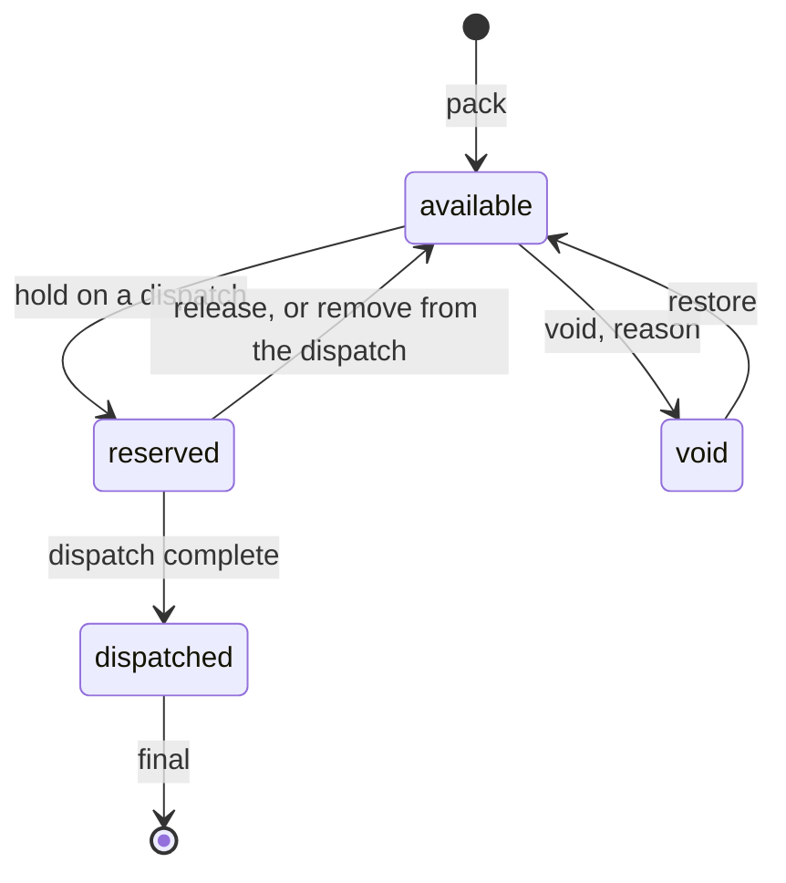
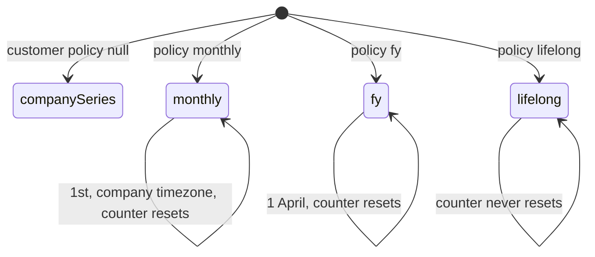
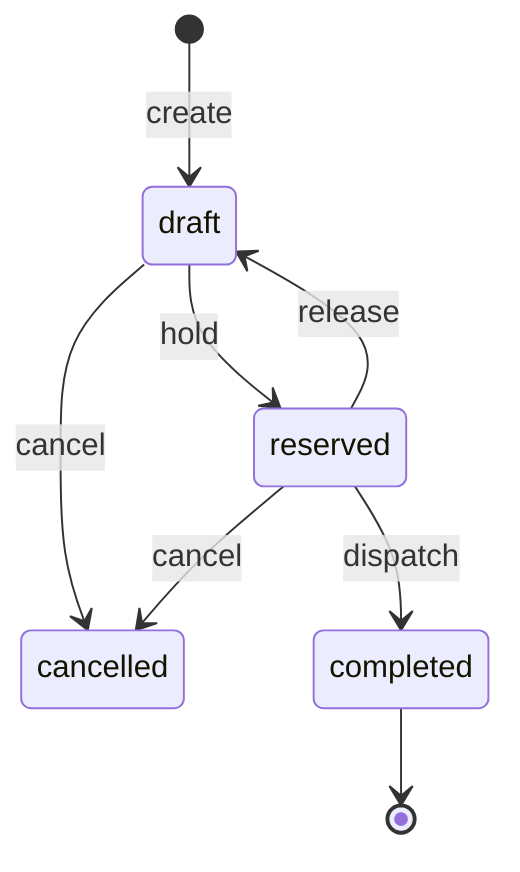

# Pack, stock and dispatch — design spec

Date: 2026-10-24 · Branch: `wt/FP` (off `redesign/c2`) · Module: FP-PK · Status: draft for owner review

This spec covers packing a bundle, yard stock, and dispatch through the packing list. It uses orrn words only: die (the section), die copy, drift reading, cast, ageing batch, pack, bundle, sales order, baki, packing list (PL), dispatch, scale. The scrap weighbridge stays **kanta**. The device at the packing bay is a **scale**, not a kanta. New words, marked where they appear: **party bundle number**, **plant stock**, **unassigned**, **re-cut**.

Preview slug: `floor`. Feature ids: `FP-PK-nn`.

## 1. Context

### What FourCubes needs

A packer at the bay should pick the ageing trolley line that just came out, see the sales order, die and cut length already filled, enter pieces, take the weight from the scale, and print the label. The label carries the bundle number the party keeps in their book, the die, length, pieces, kg, cast, sales order, and the BIS standard plus CM/L licence for hollow or solid. Some parties restart that number on the 1st, some on 1 April, some never. Stock is looked up by die, length and bundle, and a bundle can move from one sales order to another, or back to plant stock, with a record of who did it. A die a customer owns must not be packed or dispatched for someone else unless a manager allows it. At the gate, scanning the QR fills the dispatch with that bundle's kg; a vehicle that is over its capacity warns and still lets the clerk proceed. The packing list the party receives is sorted by section, has a line per bundle, a hollow/solid summary, can join more than one dispatch, can hide the original sales order, and a reprint keeps the copy that was already sent.

Those asks are on the 2026-10-24 call: scale fills the weight, packer enters pieces only [T:L351]; party-based number reset on the 1st or on 1 April [T:L364–L365]; packing list with each bundle and a section sort [T:L361–L364]; scan into dispatch, van capacity spoken as 1.5 t with a warning above 2 t, proceed anyway [T:L358–L360]; original-order column can be turned off, branding off, Excel [T:L367–L370]; transfer between orders, or hold [T:L373–L376]; leftover must stay against the purchase order, not a fake in-house customer [T:L248]; a customer-owned die must not be used for other parties in the plant's own view [T:L311–L318]. Report actions N5–N8 are the same four gaps [R:extrusion-suite-vs-orrn.md §9.1].

### What the call showed

Described, not copied.

- Pack starts from a completed ageing trolley line. Picking the line fills customer order, die, length and section. A second path picks the order by hand. On the frame, length at pack was 18 ft, from the trolley's 18 ft line. The weight was typed and no band check fired (bundle 10/2: 6.67 kg/12 ft on a 10–12 die) [S:1.10.13 AM][S:1.20.25 AM]. Pieces and a scale-weight field (typed, 0.0), optional rejects with their own weight, a shortcut to discard the pieces still on the trolley, a section drawing with zoom, a logo toggle, and one save-and-print button that stays disabled at 0 pieces [S:1.10.31 AM] [S:1.10.38 AM]. No label was printed on the call [T:L345].
- The scale does not fill the field. The vendor said integration needs a circuit change on the indicator, load cell kept, about a month and a half, after press data [T:L352–L354]. The "no circuit change" reading in N8 is an inference, not something said on the call.
- Stock list groups by die and length, with kg, pieces and bundle count, plus a rejections tab that was not opened [S:1.24.05 AM]. Transfer and a popup of leftover stock were claimed; the screen dropped before a result [T:L373–L377].
- Dispatch scan, vehicle warning, combined list and Excel were claimed. The list that was on screen has a hollow summary (2 bundles, 10 pcs, 150 kg) and two bundle lines (number, section, hollow, alloy, length, original order, pcs, kg, kg per piece) [S:1.20.25 AM] [T:L362–L366]. Both lines are the same order, so a combined list was not proved. Section sort was asked and not shown [T:L362].
- Sticker standards sit on the company profile: solid IS 733 with one CM/L, hollow IS 1285 with another. Help text says they print on stickers. No sticker image shows them [S:1.33.41 AM].
- Bundle reset on that profile is one company dropdown, set to monthly. Yearly, financial year and lifelong were spoken after a reconnect, not opened, and not per party [S:1.28.26 AM] [T:L385].

The three-step "pick die, then weight, then kg per 12 ft" line heard on the call was a leaked orrn voice-over. Nobody reacted. Do not treat it as a requirement from the other product [T:L254–L259].

### What orrn has today

**Prod** (`origin/prod`, live on orrn.in). Pack is `/receipts/new`: die, quantity, weight, length, PO, CSV/JSON import. Save, then a separate Print label button (`spool.printBundleLabel`). Stock aggregates by die; the bundle list shows length and PO but does not group by length or order. Dispatch is draft → reserved → completed, with screens, and no ledger rows. Packing list PDF, QR PDF and Excel exist. `packingList.regenerate` deletes the list and writes a new code from live data; prod shows the button. No scan screen, no vehicle, no scale, no BIS line, no per-party numbers. Serials are `BG-{seq}-B{n}` only.

**c2** (this worktree). The same flows are `RouteStub`s. `/receipts*` redirects into `/pack`. Cutting over before the C2 web pack/stock/dispatch screens and the native screens would hide what prod already does [R:2026-10-03-orrn-c2-redesign.md Tasks 20–22, 29].

Server, no screen calling it:

- `bundle.createReceipt` (`bundle.pack`) stores integer grams, computes `kgPer12ftMilli` with `kgPer12ft` (`packages/domain/src/units.ts`), posts `+` bundle kg at the yard in the same `atomicBatch` as the session and the audit row (`packages/server/src/routers/bundle.ts`, `packages/server/src/lib/ledger.ts`). Weight is typed. Max 200 rows. A company that has yards must pass `locationId`.
- Bundle status `available | reserved | dispatched | void`. The bundle router only voids and restores an available bundle. Reserve and dispatch are owned by the dispatch router (`packages/domain/src/status.ts`).
- `stock.move`, `stock.balance`, `stock.byLocation`. Ledger voucher types include `pack`, `move`, `void`, `restore`, `dispatch`. Rows are insert-only. Locations Y1–Y6, BILLET, SCRAP, STORE, PLANT-SCRAP are seeded. No screen.
- `dispatch.create / addBundle / addBundlesBySerial / reserve / unreserve / complete / cancel`. Complete posts `−` kg and writes the packing list. `bundleBlockReason` refuses a serial that is unknown, held (naming the dispatch code), dispatched or void (`packages/server/src/lib/bundleHold.ts`). No wrong-order rule. No vehicle columns on `dispatch` (`packages/db/src/schema/dispatch.ts`).
- Packing list code is `PL-{companySeq}`, not the plant book. Snapshot is serial, die, qty, weight, length, totals (`packages/documents/src/packing-list/snapshot.ts`). `dispatch_item.groupLabel` is a manual label, not a section sort. Unique on `dispatchId`, so one list per dispatch, and regenerate deletes it (`packages/server/src/routers/packingList.ts`).
- `doc_series` keys on `(company, doc_type, period)`. Bundle period is the company-timezone month; financial year (1 April) is already the period for PL, SO and the other books (`packages/server/src/lib/docNumber.ts`). Plant numbers `26I4086` when `settings.bundleNumbering === "plant"`. Not gapless: a failed write leaves a gap. Not per customer. Not on prod.
- QR contract, planned and partly built: `https://{host}/b/{bundleNo}` (spec P8). `resolve.byCode` accepts plant numbers, old month-only numbers, legacy cuids and `BG-` serials. `/b/$serial` is a thin page.
- Label variables today: length, PO, quantity, serial, series, uuid, weight, kg/12 ft, weight each (`packages/server/src/lib/bundle-label.ts`). No cast, no sales order code, no standard, no licence, no logo flag.
- orrn-spool prints TSPL2 over TCP to the printer port (default 9100) (`orrn-spool/internal/core/printer_manager.go` `connect`). Queue, retry, templates, `{{var}}` substitution, AI layout. No serial, USB, scale or Bluetooth code. The digest's scale note is phone-side RS-232, not a spool reader (`docs/superpowers/review/2026-10-03-architecture-digest.md` hardware row for the scale).

### What orrn already plans

Plant-modules spec `docs/superpowers/specs/2026-10-03-orrn-plant-modules-design.md`:

- P5/P6 ledger and locations. Pack posts `+` kg; dispatch complete posts `−` kg. Built on c2 server (PL-3).
- P7 document series, including PL `PL/{FY}/{seq}` from `settings.plSeries`. Bundle monthly is the default (Q-P1). Built for company-level series (PL-2). Packing lists still use the sync cursor, not this series.
- P8 QR = bundle number only.
- P12 dispatch gains vehicle no, driver name/phone, transporter, PL number, PO numbers. Not built. `vehicleNo` today exists only on a scrap lot.
- P13 `sales_order` + `sales_order_line`. Line id is `sales_order_line.id`. Stable fields from the orders spec: `sectionId` (the die), `cutLengthMm`, optional `dieInstanceId`. Baki names stay `orderedG`, `producedG` (non-void linked bundles), `dispatchedG`, `bakiG` = max(0, ordered − dispatched), plus the piece twins. Do not rename `plannedG`, `pressedG`, `agedG`, `packedG`, `inStockG`. Not built (PL-8).
- P16 `ageing_batch` + `ageing_row`. Not built (PL-9). The ageing spec owns the row. Remaining is computed on the server as `pcs − packed_pcs − scrap_pcs − rework_pcs`. `pcs` stays the loaded count. Pack reads that remaining. It does not subtract on the client, and it does not write `scrap_pcs` or `rework_pcs`.
- PL-8 packing list v2 columns: Sr, Bundle no, Section, Item, Weight kg, Cut ft, Cut in, Pcs, kg/12 ft, Range /12', PO, plus header (GSTIN, addresses, vehicle, driver, invoice no). This spec extends that snapshot; it does not replace it.
- PL-W7 pack shows the suggested open line; dispatch header and PL v2 view. PL-N2 native pack. C2 redesign §3 already draws `/pack`, `/stock`, `/dispatch`, `/b/$serial` and the scan sheet. Those routes are stubs.

Count and phantom (`count_session`, PL-10) stay in that plan. This spec does not redesign them.

## 2. Feature list

| ID | Feature | User story | ORRN today | ES reference (cite) | ORRN does it better by | Priority | Depends on |
|---|---|---|---|---|---|---|---|
| FP-PK-01 | Pack from an ageing trolley | As a packer, I pick a trolley line and the sales order, die and cut length are already filled, then I enter pieces and weight and print the label. | New. Prod pack is a typed receipt. c2 `/pack` is a stub. `bundle.salesOrderLineId` and `castId` are empty text columns. | Pick a completed trolley line; order, die and length fill in. A hand path picks the order. Length on screen need not match the aged length [S:1.10.13 AM] [T:L343–L344]. | Same atomic batch as the ledger and the trolley's packed pieces, so the trolley cannot be over-packed. A length change is an explicit re-cut, not a silent mismatch. Plant stock is not a fake customer. | Now | FP-AG `ageing_row`; FP-OP sales order line; PL-3 ledger |
| FP-PK-02 | Scale weight through orrn-spool | As a packer, I enter pieces only. The stable scale reading becomes the bundle kg. If I type a weight, I give a reason. | New. Every weight in orrn is typed. Spool has no scale driver. Digest mentions RS-232 on the phone, not a reader [R:architecture-digest.md scale row]. | Buyer asked for the scale to fill the weight [T:L351]. Vendor: circuit change, load cell kept, ~1.5 months, not started [T:L352–L354]. Field on screen is typed [S:1.10.31 AM]. | Read the indicator's serial/USB frames in the Go service already on the packing network. No indicator circuit change for a scale that already streams. Override is audited. N8. | Now | orrn-spool; FP-PK-01 |
| FP-PK-03 | Live kg/12 ft and drift | As a packer, I see kg per 12 ft and whether it sits in the die's band before I print. | c2 server only. `kgPer12ftMilli` is stored at pack from typed weight (`bundle.ts`). Band is in/above/below on the die copy, no screen. Green/amber on a plant screen is showcase copy. | Not shown. The list's "wt avg" is kg per piece [S:1.20.25 AM]. The kg/12 ft lines on the call were the leaked voice-over [T:L254–L259]. | One unit (grams per 12 ft), computed with the shared formula, checked against the section band and the latest drift reading, before the label prints. | Now | Section band (built); FP-DR drift reading |
| FP-PK-04 | Label with QR, cast, sales order, standard | As a packer, the label shows bundle number, die, length, pieces, kg, cast, sales order, and the BIS standard plus CM/L for hollow or solid. The QR opens the bundle. | Partial. Prod prints a label after save. Variables omit cast, sales order, standard, licence. QR payload is whatever the template encodes. | Standards and licence numbers are a company setting, said to print on stickers; no sticker was shown [S:1.33.41 AM]. QR scan into dispatch was claimed [T:L358–L359]. | QR stays the bundle number only (P8), so a reprint never leaves a stale kg in the code. Standard and licence are snapshotted at pack from platform settings, per hollow/solid. | Now | FP-PF `settings.standards`; FP-FD cast code; FP-PK-07 |
| FP-PK-05 | Branding on or off | As a clerk, I print the label and the packing list with or without the plant logo. | New. No logo flag on the label variables or the PL snapshot. | Logo toggle on the pack screen, on in the shot [S:1.10.38 AM]. One click for a plain slip, claimed [T:L369]. | The choice is snapshotted on the print job and on each PL revision, so a later settings change does not rewrite a list already sent. | Now | FP-PK-04; FP-PK-13 |
| FP-PK-06 | Printer path | As a plant, labels print on the LAN spool we already run. A small plant without a packing computer can be evaluated for a Bluetooth printer later. | Built spool: TCP to port 9100, queue, retry, templates. No Bluetooth. | Bluetooth sticker printer claimed, 800–900 labels a day at two or three sites; no print was shown [T:L345–L346]. | FourCubes already has a TSC on the LAN. Keep that path. Do not block N8 on a second radio stack. | Later | orrn-spool |
| FP-PK-07 | Party bundle numbers | As office, I set each customer to restart bundle numbers monthly, on 1 April, or never. | c2 server only, company-level. `doc_series` unique is `(company, type, period)`. Prod is `BG-` only. Q-P1 default is monthly. | Buyer: some parties restart on the 1st, some on 1 April, so numbers must be per party [T:L364–L365]. Shown control is one company dropdown, monthly [S:1.28.26 AM] [T:L385]. | Same `doc_series` engine, scoped per customer, IST/FY rules already tested. The scan serial stays company-unique, so two parties can both be on "1" without a clash at the gate. N6. | Now | PL-2 `doc_series` |
| FP-PK-08 | Stock by die, length and bundle | As office, I see in-stock kg and pieces by die and cut length, and open the bundles. | Built prod, by die only. c2 stock routes are stubs. `bundle.stockSummary` groups by die. `analytics.stockAgeing` has no screen. | List by section, die, length and order, with kg, pieces, bundles [S:1.24.05 AM] [T:L373]. | Ledger balance must match the bundle rows (PL-3 test). Length grouping is a query, not a second stock number. | Now | PL-3; FP-PK-01 |
| FP-PK-09 | Transfer between sales orders and plant stock | As office, I move bundles from one sales order to another, or back to plant stock, and the record says who and why. | New. Hold exists only for bundles already on a dispatch (`dispatch.reserve`). No transfer document. | Transfer to another order claimed; screen dropped [T:L374–L376]. Buyer rejected booking the leftover to an in-house customer [T:L248]. | Plant stock is a null line after an explicit transfer, not a customer row and not a legacy blank. Transfer does not move kg. A cross-customer move needs `order_reallocate`. | Now | FP-OP; FP-PK-08 |
| FP-PK-10 | Customer-owned die block | As a manager, a die a customer owns cannot be packed or dispatched for anyone else unless I approve it. | New. No owner column. No pack or dispatch guard. | Buyer: the plant's own view must not use that party's die for someone else [T:L311–L318]. No lock was shown. N5. | Block is on the server, names the owner, and the override is the existing approval table. Effective owner is the die copy if set, else the section. | Now | FP-DR `owner_customer_id`, `profileKind` |
| FP-PK-11 | Dispatch by QR scan | As a gate clerk, I scan bundle labels onto a dispatch that already has the customer, vehicle and transporter. | Built prod, no scan screen. c2 server: `addBundlesBySerial` and hold reasons; dispatch screens are stubs. No vehicle or transporter on the dispatch. | Scan QR, dispatch shows that bundle's weight, keep scanning [T:L358–L359]. Transporter selected for the load [T:L359]. Claimed, not performed. | Scan refuses a bad serial and names the dispatch that holds it, before the truck is loaded. Vehicle and driver are the fields PL-8 already planned. | Now | `bundleHold`; `resolve`; PL-8 header; FP-PK-04 |
| FP-PK-12 | Vehicle capacity warning | As a gate clerk, I am warned when scanned kg passes the vehicle's capacity, and I can still go on if I say why. | New. Outbound dispatch has no capacity. | Van spoken as 1.5 t, warning above 2 t, proceed anyway [T:L359–L360]. Claimed. | The warning uses the kg already on the bundles, not a second weighing. Reason is stored on the dispatch. It does not block the scan. | Now | FP-PK-11 |
| FP-PK-13 | Packing list v2 | As a clerk, I send a section-sorted list with a line per bundle, a hollow/solid summary, optional original sales order, and I can join dispatches. A reprint keeps the copy I already sent. PDF and Excel. | Built prod, narrow. c2 `groupLabel` is manual. Regenerate deletes and renumbers (`packingList.ts`). PDF and Excel exist for that narrow snapshot. | Summary plus bundle lines shown [S:1.20.25 AM]. Section sort asked [T:L362]. Original order can be hidden [T:L367]. Combine claimed, not proved [T:L362]. Excel claimed [T:L370]. N7. | Revisions, not overwrite. Sort is by section, not a hand label. PL number comes from the plant book (`doc_series` type `pl`) and does not jump on a reprint. | Now | PL-2; PL-8 columns; FP-PK-05; FP-PK-07 |
| FP-PK-14 | Rejects at pack | As a packer, I set aside damaged pieces with a weight, and I can hand the pieces still on the trolley back to ageing as scrap. | New. No reject columns. Inbound scrap purchase is a different flow. | Reject pieces and a manual weight, plus a shortcut to discard the rest, shown [S:1.10.31 AM]. Rejections tab on stock, not opened [S:1.24.05 AM]. | Good kg posts at the yard; reject kg posts at plant scrap. Trolley pieces stay in one formula, so remaining cannot drift from what was packed. | Now | FP-PK-01; FP-AG `scrap_pcs` |
| FP-PK-15 | Scan block | As a gate clerk, a scan tells me why a bundle cannot go on this dispatch: unknown, held, dispatched, void, wrong customer, or a die owned by someone else. | c2 server only for unknown, held, dispatched, void. No wrong-customer rule. No screen. | Not shown. | The reason names the holder or the owner. The clerk does not discover the double-load at the party. | Now | FP-PK-10; FP-PK-11 |
| FP-PK-16 | Stock age | As a manager, I see how long bundles have sat, in the same buckets the server already computes. | c2 server only. `analytics.stockAgeing` buckets 0–15, 16–30, 31–60, 60+ days. No caller. | A dead-stock nav item exists; the page was not opened [S:1.24.05 AM]. | Buckets already match the plant-modules report. This is a screen on that query, not a new count. | Later | PL-A1 |

## 3. Data model

Weights stay integer grams. Lengths stay integer millimetres. New tables follow the plant-modules rule: `id`, `company_id`, `created_at`, `created_by`, `server_seq`. Writes are tenant-scoped. Ledger rows are insert-only.

### Reused as planned

| Name | Spec | This module |
|---|---|---|
| `sales_order`, `sales_order_line` | P13, PL-8 | Pack links the bundle. Dispatch items link the line. Baki math stays PL-8. |
| `ageing_batch`, `ageing_row` | P16, PL-9, FP-AG | Pack does not write the row. It calls `drawAgeingRow` (good pieces pass `bundleId`; pack-time rejects omit it). `ageing.split` stays default off. |
| `cast` | P15, PL-5, FP-FD-16 | `bundle.castId` already exists. After the first locked melt, `requireCastOnBundle` (default on) requires a cast that has a locked melt. Pack copies it from the trolley line when the line has one. |
| `die_instance`, `die_weight_reading` | P4, PL-4 | Optional at pack. Drift chip reads the latest reading. |
| `location`, `stock_ledger` | P5, P6, PL-3 | Unchanged voucher set, plus `pack_reject` below. |
| `doc_series` type `pl` | P7, PL-2 | First issue of a packing list takes `nextDocNumber(..., "pl")`. Revisions do not. |
| Dispatch vehicle, driver, transporter text | P12, PL-8 | Kept as the snapshot. Transporter master is new (below). |
| `approval` kind `dispatch_overdraw` | PL-1, PL-8 | Unchanged. Over-dispatch past baki still needs it. |

`bundle.salesOrderLineId`, `castId`, `dieInstanceId`, `locationId`, `kgPer12ftMilli` already exist. They stay app-enforced where the comment says SQLite cannot add the foreign key.

### Changed

**`bundle`**

| Column | | Notes |
|---|---|---|
| `ageing_row_id` | new | App-enforced text, same style as `cast_id`. Null on a hand pack. |
| `packed_sales_order_line_id` | new | The line at pack time. Never updated. Original-SO column reads this. |
| `sales_order_line_id` | as planned | Current allocation. Null after a transfer whose `toSalesOrderLineId` is null means plant stock. A legacy null with no transfer row is unassigned, not plant stock. |
| `party_no` | new | Party bundle number. Equals `serial` when the customer has no policy. |
| `recut` | new | Integer 0/1. Set when pack length ≠ the ageing row's cut length. |
| `weight_source` | new | `scale` or `manual`. |
| `weight_override_reason` | new | Required when source is `manual` and a scale node is configured. Null otherwise. |
| `reject_pcs`, `reject_weight_g` | new | On the session row's sibling, not on the good bundle. See `pack_reject` below. |
| `bis_standard`, `cml_no` | new | Snapshot of the resolved pair at pack time, not a live lookup. Hollow reads `settings.standards.hollow`, solid reads `solid`, semi reads `standards.semi` if set, otherwise `solid`. |
| `show_logo` | new | Integer 0/1, the branding choice for this bundle's label. |

`serial` stays the company-unique scan key. Unique `(company_id, serial)` does not change. QR keeps using `serial` (P8).

**`bundle_group`** (the packing session)

| Column | | Notes |
|---|---|---|
| `ageing_batch_id` | new | App-enforced. Set when every row in the session came from one batch. Null on a mixed or hand session. |
| `die_instance_id` | new | Optional session default. |

Session code stays the sync cursor (`BG-000001`). It is not the party number and not the PL number.

**`customer`**

| Column | | Notes |
|---|---|---|
| `bundle_number_policy` | new | `monthly`, `fy`, `lifelong`, or null. Null inherits the company series (party number = serial). |

**`doc_series`**

| Column | | Notes |
|---|---|---|
| `scope` | new | Text, not null, default `''`. `''` is the company series. A customer id is that party's series. |

Unique index changes from `(company_id, doc_type, period)` to `(company_id, doc_type, period, scope)`. The old unique is dropped in the same migration. This is the same class of index change as the membership unique in PL-1, and it is called out because plant-modules otherwise forbids index drops. Existing rows get `scope = ''` and keep their counters.

Period for a party series: `YYYY-MM` when policy is monthly (resets on the 1st, company timezone, already `docPeriod`); financial year `2026-27` when policy is `fy` (resets 1 April, already `financialYear`); constant `life` when policy is `lifelong`.

Party number format, new, printed large on the label and as Bundle no on the PL:

- monthly: same plant format as the company serial (`26J12`), from that customer's counter.
- fy: `{fy}/{seq}` (`2026-27/12`).
- lifelong: unpadded seq (`4086`).

Company serial format does not change (`26J4086` or `BG-`). Two customers may both hold party number `26J1`. Scan uses `serial`, so the gate is never asked which party.

**`dispatch`**

| Column | | Notes |
|---|---|---|
| `vehicle_no`, `driver_name`, `driver_phone` | as planned (P12) | |
| `transporter_id` | new | Nullable FK to `transporter`. |
| `transporter_name` | changed vs P12 | P12 stores free text. This stores the master name as a snapshot so a later rename does not rewrite a sent PL. |
| `vehicle_capacity_g` | new | Integer grams. Null means no warning. |
| `capacity_override_reason` | new | Required to complete when scanned kg exceeds capacity. |

**`dispatch_item`**

| Column | | Notes |
|---|---|---|
| `sales_order_line_id` | as planned (PL-8) | The line this dispatch is fulfilling. |
| `group_label` | keep | Optional hand label. Not the sort key. PL v2 sorts by section, then length, then party number. |

**`packing_list`**

| Column | | Notes |
|---|---|---|
| `dispatch_id` unique | changed | Drop the unique. A list can cover several dispatches, and a dispatch can have older revisions. |
| `code` | changed | First issue uses `nextDocNumber(..., "pl")` (`PL/2026-27/4501` from `settings.plSeries`). Today the code is `PL-{syncSeq}` (`packingList.ts`). Revisions keep this code. |
| `revision` | new | Integer, starts at 1. |
| `supersedes_id` | new | Previous revision. Null on revision 1. |
| `show_branding`, `show_original_so` | new | Snapshotted. |
| `combined_into_id` | new | Set on a per-dispatch list when a combined list replaces it as the party-facing document. The row is kept. |

**`packing_list_line`**: add `party_no`, `length_mm` already exists, `kg_per_12ft_milli`, `profile_kind`, `packed_sales_order_code` (text snapshot), `sales_order_code` (current). `group_label` stays but the writer fills it with the section code so old readers still group.

**`die.profileKind`**: not this spec's column. Die room owns `hollow | solid | semi`, nullable. Pack reads it. Do not add `profileType`.

**`die.owner_customer_id`, `die_instance.owner_customer_id`**: die room owns the columns. Pack reads effective owner = copy column if set, else section column. Null means no block.

**`company.settings.standards`**: platform owns `{ solid, hollow, semi: { standard, cml } }`. `semi` is optional. Pack snapshots the resolved pair onto the bundle. Do not add a second standards store, and do not read settings again at reprint.

**`approval.kind`**: `die_owner_override` is defined by the die-room spec. Subject is the die copy id only. Meta must include `attemptedCustomerId` and `purpose` (`pack` or `dispatch`). Approver roles match `die_rerank` (manager, admin, owner). The requester cannot approve. A section id is never a subject. `order_reallocate` is defined by the orders spec. Pack does not define it. A cross-customer transfer stores that approval's id on the transfer row.

### New

**`transporter`**: `name`, `phone`, `active`. Masters. A vehicle is not a master; the truck changes per load. Vehicle no and capacity live on the dispatch.

**`bundle_transfer`**: one row per bundle. Columns are only those the orders spec owns: `bundleId`, `fromSalesOrderLineId`, `toSalesOrderLineId`, `reason`, `approvalId`. No document series and no `XFER-` code. Null `toSalesOrderLineId` is plant stock. Null `fromSalesOrderLineId` is a first assignment of an unassigned bundle, or a move out of plant stock. Does not change `serial`, `party_no`, or `packed_sales_order_line_id`. Updates `bundle.sales_order_line_id` only. No ledger rows.

**`pack_reject`**: one row per reject entry on a session. `group_id`, `ageing_row_id` nullable, `die_id`, `pcs`, `weight_g`, `reason`. Not a bundle. Stock rejections list reads this table.

**`packing_list_dispatch`**: `packing_list_id`, `dispatch_id`. Unique pair. A combined list has two or more rows. A single-dispatch list has one.

### Ledger postings

| Event | Rows | Voucher |
|---|---|---|
| Pack good bundle | `+` bundle kg at the yard location | `pack` (as planned). Voucher id = bundle group id. |
| Pack reject with a weight | `+` reject kg at PLANT-SCRAP | `pack_reject` (new voucher type). Voucher id = `pack_reject.id`. |
| Reject with pieces and no weight | no kg row | The `pack_reject` document still exists. |
| Discard remaining on the trolley | no pack ledger row | Ageing writes `scrap_pcs`. Pack does not. |
| Move yard | `−` / `+` (as planned) | `move` |
| Void bundle | reversal of its pack row (as planned) | `void` |
| Transfer between sales orders or to plant stock | no kg row | Allocation only. The audit row and `bundle_transfer` are the record. |
| Dispatch complete | `−` bundle kg at the location (as planned) | `dispatch` |
| Dispatch cancel after complete | not allowed (as planned) | |

`stock.balance` for bundle items must still equal the bundle projection. A transfer test asserts the balance does not change.

### Document series

| Doc | Key | Format | When it advances |
|---|---|---|---|
| Bundle serial | `scope ''`, monthly | `26J4086` or legacy `BG-` | Every bundle, as today |
| Party bundle number | `scope = customer id`, period from that customer's policy | see above | Only when the customer has a policy |
| Packing list | `scope ''`, FY | `PL/{FY}/{seq}` from `settings.plSeries` | First issue only. Revisions reuse the code |
| Transfer | none | no series number | Not a `doc_series` type. The row id is the record. |
| Dispatch code | unchanged | today's dispatch code | Unchanged. It is not the PL number |

## 4. Server

Routers stay tenant-scoped. Mutations are `actionProcedure`. Stock writes go through one `atomicBatch` with the document, the ledger rows and the audit row. Numbers come only from `nextDocNumber` / `allocateDocNumbers`. `allocateDocNumbers` gains an optional `scope` (default `''`) so every current caller stays on the company series.

### Procedures

**`bundle.createReceipt`** (`bundle.pack`) — extend, do not add a second pack procedure.

Input adds, all optional except where a rule below says otherwise: `ageingRowId`, `salesOrderLineId`, `dieInstanceId`, `castId`, `recut`, `showLogo`, `weightSource`, `weightOverrideReason`, and per row the same weight and pieces as today. `dieId` and `lengthMm` may be omitted when `ageingRowId` is set; the server copies them from the row. A hand pack (no trolley) still requires `dieId` and length, as today. `castId` is required when `requireCastOnBundle` is on (default on once the company has a locked melt, FP-FD-16). The cast must be one with a locked melt. The trolley path copies the row's cast; the hand path must pick one.

Same batch:

1. Read server remaining (`pcs − packed_pcs − scrap_pcs − rework_pcs`). Refuse if the pieces that leave the trolley would pass it. Do not trust a client subtraction.
2. Call `drawAgeingRow` for the good pieces (with `bundleId`) and again for the reject pieces (no `bundleId`). That is the only write to `packed_pcs`. Do not write `scrap_pcs` or `rework_pcs`.
3. Owned-die check (FP-PK-10). If the effective owner is set and no die copy is selected, refuse "Pick the die copy". If the section is owned and it has no copies, refuse "This section has no copies". Otherwise refuse, or require an approved `die_owner_override` whose subject is the die copy, whose `attemptedCustomerId` is the sales order's customer, and whose `purpose` is `pack`.
4. Allocate serials as today. If the customer has a bundle policy, also allocate `party_no` from that scope. If not, `party_no = serial`.
5. Snapshot `bis_standard` / `cml_no` from the resolved standards pair (semi falls back to solid when `standards.semi` is blank). Store the strings. Reprint does not re-read settings.
6. Compute `kgPer12ftMilli` on the server. Ignore any client-sent figure.
7. Post `pack` rows. Post `pack_reject` rows when reject weight is present.
8. Audit `bundle.receipt.create` with `weightSource`, whether a re-cut was set, the ageing row id, and the cast id.

**Label variables.** `buildBundleLabelVariables` gains `cast` (rendered number, for example `K31`), `partyNo`, `salesOrder`, `bisStandard`, `cmlNo`, `showLogo`. QR content stays `https://{host}/b/{serial}`. The public `/b` page stays number and section. No chemistry.

**`bundle.previewLine`** (`bundle.pack`, query). Given `ageingRowId` or (`dieId`, `salesOrderLineId`), return the prefill: customer, sales order code, die, band, cut length, cast id if the row has one, die copy if the row has one, server remaining pieces, effective owner, profile kind, and the line's `bakiG` / `baki` pieces. Does not write.

**`bundle.void` / `transitionStatus`** — when a voided bundle has `ageing_row_id`, the same batch calls `drawAgeingRow` to return that bundle's pieces (not below 0) and posts the existing void reversal. Restore draws them again and refuses if that would pass remaining.

**`scale.reading`** (`bundle.pack`, query). Proxies to the plant's spool: `{ grams, stable, at, nodeId }`. Stable means five frames within 20 g and no change for one second (defaults; Q-PK-3). A missing node or a stale frame (`at` older than 3 s) returns `{ stable: false }` and does not throw. The pack screen may still save with a manual reason.

Spool side, new, in the Go service: config `scale.device` (OS serial/USB path) and `scale.baud`. A reader goroutine parses a continuous ASCII frame (a number, optional unit, CR/LF). No write to the indicator. HMAC on the reading route, same machine auth as print jobs. No Bluetooth in this phase.

**`stock.byDieLength`** (any member, query). Available and held bundles grouped by `die_id`, `length_mm`, optional `sales_order_line_id`. Returns bundles, pieces, kg, held count. This is the screen query. `stockSummary` stays for callers that only need the die total.

**`stock.rejections`** (any member, query). `pack_reject` rows, newest first, filter by die and day.

**`bundle.transfer`** (`bundle.transfer`, new action). One row per bundle, max 100 per call, chunked. No shared series code. Columns as the orders spec: `bundleId`, `fromSalesOrderLineId`, `toSalesOrderLineId`, `reason`, `approvalId`. Refuses dispatched, void, and a bundle held on a dispatch (name the dispatch code). Refuses a target line whose `sectionId` does not match the bundle's die. A cross-customer target requires an approved `order_reallocate`; its id is `approvalId`. An owned-die mismatch also requires `die_owner_override` with purpose `dispatch`. Audit `bundle.transfer` with from-line, to-line, count, kg. No ledger rows. An unassigned bundle stays off a dispatch until this transfer assigns it.

**`dispatch.create` / `update`** — accept the P12 header plus `transporterId`, `vehicleCapacityG`. Snapshot `transporter_name` on write.

**`dispatch.addBundle` / `addBundlesBySerial`** — keep the hold reasons. Add:

- unassigned: `salesOrderLineId` is null and there is no transfer row with null `toSalesOrderLineId` for this bundle. Refuse "Not assigned to a sales order". Office transfers it first.
- wrong customer: the bundle's current sales order customer ≠ the dispatch customer, and the bundle is not plant stock;
- owned die: effective owner ≠ dispatch customer, unless an approved `die_owner_override` matches copy + customer + purpose `dispatch`;
- plant stock (null line after a transfer to null) may be added; the item stores the dispatch's suggested line when the die and length match, else the clerk picks. The PL shows no original sales order when `packed_sales_order_line_id` is null.

`dispatch.scan` already aliases `dispatch.addBundle` for plant roles. The scan sheet calls `addBundlesBySerial`. Do not add a parallel procedure.

**`dispatch.complete`** — unchanged ledger posting. If `sum(weight_g) > vehicle_capacity_g`, require `capacityOverrideReason` on the input and audit `dispatch.capacity_override`. Then issue the packing list (below) if none exists.

**`packingList.create`** — on complete, or manual for a completed dispatch that has no current list. Code from `nextDocNumber(..., "pl")`. Snapshot v2 (below). Revision 1.

**`packingList.regenerate`** (`packingList.regenerate`) — insert revision n+1, same code, `supersedes_id` = previous, rebuild snapshot from live bundles. Do not delete. `byDispatch` returns the highest revision that includes that dispatch and has no newer revision. `get` by id returns that revision, including an old one.

**`packingList.combine`** (`packingList.combine`, new action). Two or more completed dispatches, same customer. New PL code, revision 1, rows in `packing_list_dispatch`. Sets `combined_into_id` on each dispatch's previous current list. Refuses a mix of customers.

**`transporter.list / create / update`** (`masters.publish` to write, any member to list).

**`customer.update`** gains `bundleNumberPolicy`. Changing it does not renumber existing bundles. Audit `customer.update` already exists; include the policy in the meta.

**`ageing.discardRemaining`** and **`drawAgeingRow`** are owned by FP-AG. Pack calls them inside the receipt batch. Discard writes `scrap_pcs` only and must not double-count pieces already drawn. `drawAgeingRow` is the only increment of `packed_pcs`. Rejects omit `bundleId`. `ageing.split` stays default off. This spec does not define those bodies.

### Permission actions

Existing, unchanged holders (`packages/server/src/lib/permissions.ts`):

| Action | Roles |
|---|---|
| `bundle.pack` | packer, supervisor, manager, admin, operator |
| `bundle.void` | supervisor, manager, admin, operator |
| `stock.move` | operator, packer, supervisor, office |
| `dispatch.scan` | operator, packer, supervisor, office, manager, admin |
| `dispatch.complete` | supervisor, office, manager |
| `packingList.regenerate` | holders of `dispatch.complete` |
| `order.manage` | office, manager |
| `masters.publish` | manager, admin |

New:

| Action | Roles | Notes |
|---|---|---|
| `bundle.transfer` | supervisor, office, manager, admin | Not the packer. A packer must not reassign a party's material. |
| `packingList.combine` | same as `packingList.regenerate` | |

`die_owner_override` approvers: manager, admin, owner. Requester cannot approve (same rule as `die_rerank`).

Gate rule, unchanged from the digest: the packer and the operator scan; a supervisor or office completes. C2 open question Q4 default (a) stands.

### Approvals and audit

| Case | Gate |
|---|---|
| Owned die, other customer, at pack or dispatch or transfer | `die_owner_override`. Subject = die copy id only. Meta: `attemptedCustomerId`, `purpose`. No copy selected: "Pick the die copy". Owned section with no copies: "This section has no copies". Never a section id. |
| Dispatch kg past the sales order line's baki | `dispatch_overdraw`, as planned. Not this spec's new kind. |
| Scale typed while a node is configured | Reason on the bundle. No second person. Audit inside `bundle.receipt.create`. |
| Capacity exceeded | Reason on complete. No second person. Audit `dispatch.capacity_override`. |
| Transfer | Reason on the row. Cross-customer also needs `order_reallocate` (orders spec) stored in `approvalId`. Owned-die gate still applies on top. |

Audit actions written: `bundle.receipt.create`, `bundle.transfer`, `bundle.void` (existing), `dispatch.capacity_override`, `packingList.regenerate` (meta gains `revision` and `previousId`; it already stores `previousId`), `packingList.combine`, `die_owner_override` via the approval router.

Packed-today on Today uses the production-day window platform owns (shift 1 start, else midnight through `dayWindow`). This spec does not define a second day boundary.

## 5. Screens

C2 shell: phone tabs Today, Pack, Scan, Stock, Dispatch. Tablet icon rail. Laptop sidebar. Touch targets 44 px, primary actions 56 px on a phone, sticky bottom bar. Copy in `en` and `hi` when the screens are built. Gujarati is FP-PF, not this spec. How-to sheets stay the ten C2 guides; pack and dispatch guides gain one step each for the scale and the capacity warning when those screens land.

The packing bay at FourCubes is an 11 inch tablet on the web app, landscape, at `/pack/new`. The phone is the gate: scan and dispatch. Native uses the same flows; printing management stays web-only, as C2 already says.

### Web

**`/pack`** — sessions, today first (production-day window). Columns already in `en.ts`: session, die, section, bundles, kg, packed by, when. Empty: "No packing sessions yet" and Start a packing session. Primary: New packing session.

**`/pack/new`** — stepper. Step 1 is the source, not a blank die search.

1. **Source.** Search ageing rows with remaining pieces > 0, newest batch first. A row shows trolley, die, cut length, remaining pieces, sales order, customer. Pick one: sales order, die, cut length, cast and die copy fill and lock. Clear returns to the search. Secondary: "No trolley" opens the hand path (die search, cut length, sales order line). The hand path is how a bundle is packed when ageing was not recorded.
2. **Bundles.** One open card: Pieces (keypad) and Weight. Weight shows the scale reading when `stable` is true, labelled "From the scale", and is not an editable field until the packer taps "Type the weight". That sheet asks for kg and a reason. Live kg/12 ft under the card, with a chip: in band (green), above, or below (amber), using the section `weightMinG`/`weightMaxG` and, when a die copy is set, the latest drift reading's grams off band. Running remaining on the trolley. Optional reject pieces and reject kg, collapsed. Section drawing, when the die room has one, with zoom; otherwise the section code and the band. Logo switch, default from the last session. Sticky bar: totals and Review. Save & print stays disabled at 0 pieces or 0 kg.
3. **Review.** Totals, list, Save & print labels if a spool printer is ready, else Save. Success lands on `/pack/$id` with the print result. A failed label stays on the session with Reprint, as the C2 copy already says.

**`/pack/$id`** — session header, bundles, Reprint, Print all. No edit of weight after the label has printed successfully. A correction is void and pack again (the void restores trolley pieces).

**`/stock`** — Sections | Lengths | Bundles. Sections is today's die total. Lengths is FP-PK-08: die, cut length, bundles, kg, held chip. Bundles is `/stock/bundles`. Search die or section. Empty: "No stock yet. Bundles show up here after packing."

**`/stock/$dieId`** — lengths of that die, then the bundles of the selected length. Status chips. Actions on a selection: Transfer, Hold on a dispatch (opens a draft dispatch for that customer, or adds to one already building). Hold uses `dispatch.reserve` after add. It is not a new status.

**`/b/$serial`** — hero by status, facts including party number, serial, kg/12 ft, band, cast, sales order, original sales order if different, yard. Actions: Add to dispatch, Transfer, Reprint, Void / Restore. Public signed-out page stays the P8 minimum (section, kg, pieces, status). No party book data while signed out.

**`/dispatch`** — Building, Held, Dispatched, Cancelled. Row: code, customer, ship date, bundles, kg.

**`/dispatch/new`** — customer, ship date, transporter, vehicle no, capacity (tonnes in the field, stored as grams), driver, notes. Create opens Build.

**`/dispatch/$id`** — stepper Build, Hold, Dispatch, as C2. Build: Scan bundles (continuous), paste serials, search. Each added row shows serial, party number, kg, and a pop. A scan that crosses capacity paints the sticky total amber and the warning "Over the vehicle capacity". It does not reject the scan. Remove still works. Hold and Dispatch as today. Dispatch confirmation includes the capacity line. If over, the confirm sheet requires a reason before it calls complete. Success opens the packing list on this route (C2: old `/packing-lists/$id` redirects here).

Packing list on that route: header (company, customer, PL no, revision, date, vehicle, transporter, totals). Hollow / solid / semi summary. Table sorted by section, then length, then party number, with a subtotal per section. Columns of PL-8, plus profile kind in the summary rather than instead of a column. Original sales order column when the toggle is on. Actions: Download PDF, Download Excel, Share on native, Branding, Original sales order, Regenerate (manager and office), Combine (pick other completed dispatches of this customer). Regenerate confirms that the previous revision is kept. An old revision is a chip "Revision 1" that opens read-only.

**`/printing`** — existing stub. Add a scale row: node, last reading, stable or not. No new route. Bluetooth is not on this page until FP-PK-06 is built.

**`/settings` Company** — bundle policy is not here. It is on the customer. Standards are platform's settings screen; this spec only displays the snapshotted line on the label preview.

**`/customers/$id`** — add Bundle numbers: Monthly, Financial year (1 April), Lifelong, or Same as the plant. Hint shows the next number that policy would print.

### Native

Tabs already named in C2: `(tabs)/pack`, `scan`, `stock`, `dispatch`.

- Pack on a phone is the same three steps, one card, thumb on pieces and on Type the weight. The 11 inch tablet uses the web page; native pack is the fallback when the tablet is down.
- Scan is the camera. From a dispatch, continuous add. Torch, haptic on a good add, a spoken-length reason on a refusal (the `en.ts` scan strings already cover held, void, dispatched; add wrong customer and owned die).
- Stock is the length list, not a dense table.
- Dispatch build is scan-first. Capacity warning is a banner, not a dialog, until the clerk taps Dispatch.
- Reprint uses the spool. Queue read-only, as C2 says.

### Hardware

| Device | Where | Behaviour |
|---|---|---|
| Scale | Serial or USB into the packing computer that runs orrn-spool | Continuous frames. Spool publishes the latest stable grams. The tablet polls `scale.reading`. The indicator is not modified. |
| TSC label printer | LAN, TCP 9100, reached only from the spool | Unchanged. Job id is the idempotency key (ADR-007). |
| Phone camera | Gate and pack floor | Reads the QR. A wedge scanner on the laptop still works because the serial field keeps focus (C2 scan). |
| Bluetooth printer | Not at FourCubes | FP-PK-06. Do not buy one for this plant. |

Failure: scale silent → Type the weight, reason required, pack continues. Printer silent → bundle is saved, label stays queued, Reprint when the printer returns. That split is deliberate. Weight must not wait on paper, and a missing label must not roll back the stock posting.

## 6. Rules and edge cases

### Bundle

Void of a reserved or dispatched bundle stays refused. Cancel of a completed dispatch stays refused. Both match the domain table today.

A packing session may mix lengths only on the hand path, via the existing "different length" control. A trolley session is one ageing row. A second row is a second session. That matches how the bay works: one trolley line, many bundles, then the next line.

Re-cut: a same-piece shorter or longer cut sets `recut` and stores the new `length_mm` on the bundle. Ageing does not change the row's cut length. `packed_pcs` still increases 1:1. A cut that changes the piece count is an ageing split into sibling rows before pack. This spec does not invent that split on the bundle. Until the split exists, pack refuses.

Pieces above server remaining: refuse the whole submit. No partial write.

Reject pieces leave the trolley through `drawAgeingRow` with no `bundleId`. They do not become a bundle. Their kg, if entered, posts at PLANT-SCRAP. Discard remaining calls `ageing.discardRemaining`, which writes `scrap_pcs` only, and does not run inside the piece draw.

Label printed, then a wrong weight: void (restores trolley pieces) and pack again. No silent edit. The digest's "no edit after the label" rule stands.

### Party numbers

Changing policy mid-period does not renumber stickers already on bundles. The next pack uses the new counter. A gap in `doc_series` is still possible if the write fails after allocate; do not reuse the number (current `docNumber` rule).

The number the party sees is `party_no`. The number in the QR is `serial`. When policy is null they are equal, so FourCubes' own book is unchanged (`26I4086`, Q-P1).

### Owned die

Effective owner = `die_instance.owner_customer_id` if the copy is set and that column is set, else `die.owner_customer_id`. Null: no block.

Block at pack when the sales order customer ≠ owner. Block at scan when the dispatch customer ≠ owner. Block at transfer when the target line's customer ≠ owner. Message names the owner ("This die belongs to Surat Aluminium"). Override subject is the die copy id only. It is not a permanent waiver. A second customer needs a second approval. No copy picked: "Pick the die copy". Owned section with no copies: "This section has no copies". Do not write an approval against the section id. A section grant would cover every future copy.

Plant stock has no customer. Packing an owned die into plant stock is blocked the same way. The owner is a customer, and plant stock is not that customer. Unassigned is not a destination. A transfer to null is the only way a bundle becomes plant stock.

### Dispatch and capacity

Scan result, in order: not found; ambiguous (resolver already returns candidates; the sheet lists them); void; dispatched; held by {code}; unassigned; wrong customer; owned die; already on this dispatch; added. A warning is not a refusal. Capacity is a warning.

Capacity uses the sum of `weight_g` on the dispatch after the add. Compare to `vehicle_capacity_g`. Null capacity: no warning. The spoken example (1.5 t van, warn above 2 t) is a per-vehicle number the clerk types, not a hard-coded van table. Proceed is allowed. Complete without a reason while over is refused.

Wrong customer, unassigned, and plant stock: an unassigned bundle is refused until a transfer assigns it. A plant-stock bundle may be scanned onto a dispatch. The item links the open line of that die and length when one exists. If several lines match, the clerk picks. The original sales order column stays blank because `packed_sales_order_line_id` is null.

### Packing list

Sort: section code, then length, then party number. Subtotal per section. Summary: bundle count, pieces, kg for hollow, solid and semi. Omit a kind that has zero bundles. Alloy and temper print when the section has those columns (die room). Until then the snapshot field is null and the column is hidden, not a column of dashes.

Original sales order column reads `packed_sales_order_line_id`. Default on. Toggle off hides it on that revision. Branding off hides the logo and the tagline. The legal name and address stay, so the party can see who shipped. A list with no sender is not a document.

Combine only within one customer. Two dispatches, one PL code, one revision series. The earlier per-dispatch lists remain, marked combined into the new code.

Regenerate never deletes. Revision 1 is still fetchable after revision 2. PDF and Excel render the snapshot of the revision asked for, not the live bundles. That is the lock N7 asks for. A correction after the party has the PDF is a new revision, not an overwrite.

PL number does not advance on regenerate. It advances on first issue and on combine (combine is a new document).

### Edge cases

| Case | Rule |
|---|---|
| Scale jumps between two weights | Not stable. Field stays empty. Packer types a reason or waits. |
| Scale reads 0 | Stable 0 is not a weight. Save stays disabled. |
| Packer enters 0 pieces | Save disabled. |
| Two packers, one trolley line | The `packed_pcs` check is in the batch. The loser gets "Not enough pieces left on the trolley". |
| Bundle held, then a transfer | Transfer refuses until the bundle is removed from the dispatch. |
| Transfer to a line of a different die | Refuse. Length may differ; the target line's die must match. |
| Legacy `BG-` label at the gate | Resolver already accepts it. Party number may be null; the PL prints the serial in the Bundle no column. |
| Old cuid QR | Resolver accepts it once `legacy_bundle_map` has the row (PL-12). Not this spec's import. |
| Company still on legacy numbering | Serial stays `BG-`. A customer policy still allocates a party number. QR stays the serial. |
| `semi` profile | Summary has a semi row. Label snapshots `standards.semi` if set, otherwise the solid pair. |
| Standards not filled in | Resolved pair is empty. Label omits the line. Pack is not blocked. |
| Complete with no printer | Dispatch completes. PL PDF still downloads. Label reprint is separate. |
| Regenerate of a combined list | New revision of that combined code. Member dispatches are not split back out. |

## 7. Merge notes

**Keep from orrn**

- Append-only ledger posted in the same batch as the document and the audit row. A transfer must not grow a second stock figure.
- `doc_series` allocate, company timezone, financial year on 1 April, no reuse after a gap.
- Plant serial `26I4086` as the company default (Q-P1) and as the QR payload (P8, ADR-005).
- LAN spool, TCP 9100, queue, retry, templates, AI layout. FourCubes already prints this way.
- `bundleBlockReason` naming the holding dispatch.
- Dispatch state machine and "packer scans, supervisor completes".
- C2 routes and the pack stepper's two inputs (weight and pieces), once step 1 is the trolley.
- PDF and Excel exporters. Extend the snapshot; do not add a third file format.
- Prod screens until the c2 routes are real. Do not ship the `RouteStub` cutover first (C2 tasks 20–22, native task 29, report N1).

**Adopt from the call**

- Trolley line as the pack source, with a hand path.
- Pieces typed, weight from the scale, print with save.
- Per-party restart: monthly, 1 April, or never.
- Stock by die and length, then the bundles.
- Transfer off a sales order without inventing a customer to hold the kg.
- Owned-die block on the plant's own screen, not only on a customer login.
- Scan to fill the dispatch, vehicle, capacity warning that can be passed.
- PL: section sort, bundle lines, hollow/solid summary, original sales order toggle, branding off, combine, Excel.

**Do differently**

- Party number and scan serial are two fields when a customer has a policy. The call's `10/2` style collides across parties. The QR must stay unique.
- Plant stock is a null sales order line. The buyer rejected an in-house customer for leftovers [T:L248]. Do not add that customer.
- Scale reader sits in orrn-spool on the packing computer. The digest's phone RS-232 adapter is the fallback sketch, not the build. No indicator circuit change is the design; it is still an inference about the indicator FourCubes has (Q-PK-2).
- Bluetooth is not the FourCubes path. The LAN printer already runs.
- Packing list revisions keep the old snapshot. Today's `regenerate` deletes. That showcase line ("frozen") is already known to be false. This spec makes the first revision retrievable, which is the true claim.
- Re-cut is explicit. The call showed 18 ft packed from a 12/24 ft trolley with no flag. Ageing's piece count stays honest only if the length change is marked and the piece ratio is not guessed.
- Branding off removes logo and tagline, not the sender's name.

**Conflicts with existing plans**

| Plan | Conflict | Resolution |
|---|---|---|
| PL-8 PL columns | 11 columns, no summary, no revision, no combine | Keep the 11 columns. Add the summary block, the toggles, and revisions on top. PL-8's header (vehicle, driver, PO, invoice no) still lands here. |
| PL-8 transporter as free text | This spec adds a master | Store `transporter_id` plus a snapshot name. PL-8's text field is that snapshot. |
| P7 / Q-P1 monthly company numbers | Per-party series | Company series unchanged. Party series is an extra scope key. Customers with a null policy see no change. |
| `doc_series` unique | New `scope` column forces an index drop | Called out in §3. Same class as the PL-1 membership index change. |
| C2 `/pack/new` step 1 is die and defaults | Trolley source | Step 1 becomes source. Steps 2 and 3 stay. |
| C2 packing list grouped by `groupLabel` | Section sort | Writer sets `group_label` to the section code so an old client still groups. Sort key is section, length, party number. |
| `packing_list.dispatch_id` unique | Revisions and combine | Drop the unique. `byDispatch` returns the current revision. |
| PL code `PL-{seq}` | Plant book `PL/{FY}/{seq}` | New lists use `nextDocNumber` type `pl`. Existing rows keep their old codes. No renumber. |
| Digest QR carries only the bundle number | Label must show kg, cast, standard | Those are printed text. The QR string does not change. |
| FP-AG remaining | Pack must not subtract on the client | Read server remaining. The only `packed_pcs` write is `drawAgeingRow` (rejects omit `bundleId`). Discard is `ageing.discardRemaining` (`scrap_pcs` only). `ageing.split` stays default off. `bundle.recut` is this spec's flag for a same-piece length change. |
| FP-DR owner subject is a die copy | A section can be owned with no copy picked | Screen requires a copy. No copies: refuse. No section-scoped approval. |
| FP-PF standards | Label must not invent a second store | Read `settings.standards`. Semi falls back to solid when blank. Snapshot the resolved pair. |
| FP-OP transfer | Null line meant two things | Plant stock is null only after a transfer to null. Legacy null is unassigned. Cross-customer transfer stores `order_reallocate` on `approvalId`. No ledger posting. |
| FP-FD-16 cast on the bundle | Pack can save with a null `castId` today | After the first locked melt, `requireCastOnBundle` (default on) requires a cast with a locked melt. Label variable `cast` is the rendered number. Public page stays number and section. |
| C2 Q4 who completes a dispatch | Unchanged | Default (a): scan only for the packer. |

## 8. Demo page brief

Slug `floor`. Registry row already points at this file. Replace the landing stub. Do not add a second registry. Literal English on these pages. No `trpc`, no save toast. `PreviewFrame` supplies the notice bar and the h1.

Fixtures, shared by all four pages (module-level const in the landing file, imported by the children):

- Plant: FourCubes, Rajkot. Production day started 08:00.
- Die: `12170` Domal, hollow, band 2.20–2.80 kg per 12 ft. Die copy `12170-1`. Latest drift reading 2.54 kg per 12 ft, in band. A second die `18440` Domal, solid, band 1.10–1.40 kg per 12 ft, owned by Surat Aluminium.
- Customers: Surat Aluminium (policy monthly, next party number `26J14`); Shreeji Metals, Ahmedabad (policy financial year, next `2026-27/8`); plant stock is not a customer.
- Sales order `SO-2026-27/18` for Surat Aluminium, line 12 ft of 12170, ordered 8,000 kg, dispatched 6,700 kg, baki 1,300 kg.
- Ageing batch `K31` trolley 2, row remaining 86 pieces at 12 ft, cast `K31`.
- Bundles already packed: `26J4086` / party `26J12`, 12 ft, 21 pcs, 52.40 kg, on `SO-2026-27/18`, yard Y2; `26J4087` / party `26J13`, same line, 18 pcs, 44.10 kg; `26J3901` / party `2026-27/7`, 16 ft of 18440, 30 pcs, 48.00 kg, plant stock (a transfer to null already exists); `26J2200`, 18440, packed for Shreeji, die owned by Surat Aluminium.
- Dispatch `DN-1044` building for Surat Aluminium. Transporter Patel Roadlines, vehicle `GJ-03-AB-1842`, capacity 2,000 kg. Two bundles already scanned, 96.50 kg.
- PL `PL/2026-27/4501` revision 1, not yet sent.

**Landing — pack station**

- File: `apps/web/src/routes/_tenant/preview.floor.index.tsx`
- Route: `"/_tenant/preview/floor/"` URL `/preview/floor`
- `featureIds`: `FP-PK-01`, `FP-PK-02`, `FP-PK-03`, `FP-PK-04`, `FP-PK-05`, `FP-PK-14`
- Layout: `PreviewFrame` title "Pack". Stepper at step 2 (Bundles), source chip above it: trolley 2, 12170 Domal, 12 ft, Surat Aluminium, `SO-2026-27/18`, 86 pieces left. Open card: Pieces `21`, Weight `52.40 kg` with a "From the scale" chip. kg/12 ft `2.50`, chip "In band". Small line: drift on `12170-1` is 2.54, this bundle 2.50. Logo switch on. One collapsed reject row at 0. Sticky bar: 1 bundle, 21 pcs, 52.40 kg, Review. Links to the other three screens in the frame actions (Button asChild, `to` cast `as never`).
- Interactions, client state only: tap "Type the weight" opens a sheet (kg and reason). Saving the sheet flips the chip to "Typed" and shows the reason. Toggle the logo. Increment reject pieces; remaining on the trolley drops by good + reject. At 0 pieces the primary button is `disabled`. A "Stable" / "Waiting" segment on the weight chip toggles the scale state so the demo can show both. Do not navigate away on the primary button; show the review list in place (stepper moves to step 3, still the same file).

**Dispatch scan**

- File: `apps/web/src/routes/_tenant/preview.floor.dispatch.tsx`
- Route: `"/_tenant/preview/floor/dispatch"` URL `/preview/floor/dispatch`
- `featureIds`: `FP-PK-11`, `FP-PK-12`, `FP-PK-15`, `FP-PK-10`
- Layout: dispatch header (Surat Aluminium, `DN-1044`, Patel Roadlines, `GJ-03-AB-1842`, 2,000 kg). `ScanField`. Two rows already added. Sticky total 96.50 kg of 2,000. A third ghost row explains the next scan.
- Interactions: Enter in `ScanField` cycles a fixed script, one serial per submit: `26J4086` adds (pop, total rises); the same serial again says "Already in this dispatch"; `26J2200` refuses "This die belongs to Surat Aluminium"; `26J1001` (no sales order line, no transfer) refuses "Not assigned to a sales order"; then a serial `26J4088` of 1,950 kg that crosses 2,000 kg adds, banner "Over the vehicle capacity", total amber. A "Held by DN-0991" serial refuses with that code. No network.

**Packing list**

- File: `apps/web/src/routes/_tenant/preview.floor.list.tsx`
- Route: `"/_tenant/preview/floor/list"` URL `/preview/floor/list`
- `featureIds`: `FP-PK-13`, `FP-PK-05`, `FP-PK-07`
- Layout: PL header, revision chip "Revision 1". Summary table: hollow 2 bundles, 39 pcs, 96.50 kg; solid 0 hidden. Lines sorted by section: 12170 Domal 12 ft, party numbers `26J12` and `26J13`, original sales order `SO-2026-27/18`. Toggles: Branding, Original sales order. Buttons: PDF, Excel, Regenerate, Combine. PDF and Excel do not download a file; they set a line of status text "Preview only".
- Interactions: branding off hides a logo block and leaves "FourCubes, Rajkot". Original sales order off drops that column. Regenerate opens a dialog; confirm appends a revision chip "Revision 2" and keeps "Revision 1" as a button that shows the same rows read-only with a "Sent copy" banner. Combine opens a sheet listing one other completed dispatch (`DN-1040`, same customer, one 18440 line) and, on confirm, adds that line under a solid summary row.

**Stock**

- File: `apps/web/src/routes/_tenant/preview.floor.stock.tsx`
- Route: `"/_tenant/preview/floor/stock"` URL `/preview/floor/stock`
- `featureIds`: `FP-PK-08`, `FP-PK-09`
- Layout: segmented Sections | Lengths | Bundles, default Lengths. Two length rows for 12170 (12 ft, 2 bundles, 96.50 kg) and one for 18440 (16 ft, 1 bundle, 48.00 kg, chip "Plant stock"). Selecting the 12 ft row opens the two bundles. Transfer button opens a sheet: target "Plant stock" or "Shreeji Metals, SO-2026-27/22", reason. Plant stock confirms in state, the row chip changes to "Plant stock", and the kg total does not change. There is no transfer number. Shreeji does not complete: the sheet says "Needs a reallocation approval" and leaves the row where it was.

Empty and error, on the landing page only, behind a segment no visitor hits by default: a "Scale silent" state (weight empty, Type the weight enabled) and a "Trolley empty" empty state. Enough for the demo; do not build a fifth route.

## 9. Open questions for the owner

Defaults taken, in brackets. None of them block the spec.

- **Q-PK-1** When branding is off, do the legal name and address stay on the packing list? [Yes. Logo and tagline go. A list with no sender is not a document.]
- **Q-PK-2** Does the FourCubes packing scale already stream ASCII on serial/USB, or does the indicator need the circuit change the other vendor described? [Assume it streams. Confirm the model before the spool reader is built. If it does not stream, FP-PK-02 waits on hardware and the pack screen keeps Type the weight.]
- **Q-PK-3** Stable reading: five frames within 20 g, unchanged for one second. [Those numbers. Adjust after one shift on the real indicator.]
- **Q-PK-4** Party monthly format: plant style `26J12` from that customer's counter, not `10/2`. [Plant style, so the floor already knows the glyph. The scan serial stays `26J4086`.]
- **Q-PK-5** Capacity overrun: reason on complete, no manager approval. [Reason only. The clerk at the gate is the person who can see the truck.]
- **Q-PK-6** Semi standard when `standards.semi` is blank. [Platform contract: snapshot the solid pair. Not an open choice.]
- **Q-PK-7** Section owned, and that section has no die copies yet. [Refuse. "This section has no copies." No approval against the section id. A section grant would cover every future copy.]
- **Q-PK-8** Discard remaining from the pack screen calls `ageing.discardRemaining` (`scrap_pcs` only). Good pieces and pack-time rejects both go through `drawAgeingRow`; rejects omit `bundleId`. [That split. Ageing owns the row writes. Pack owns `bundle.recut`.]
