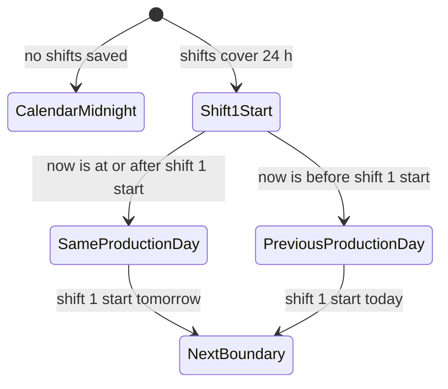
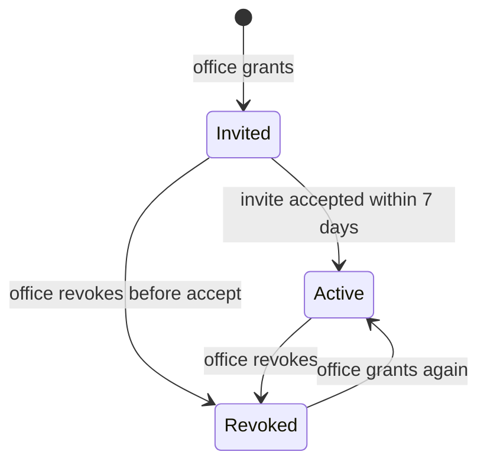
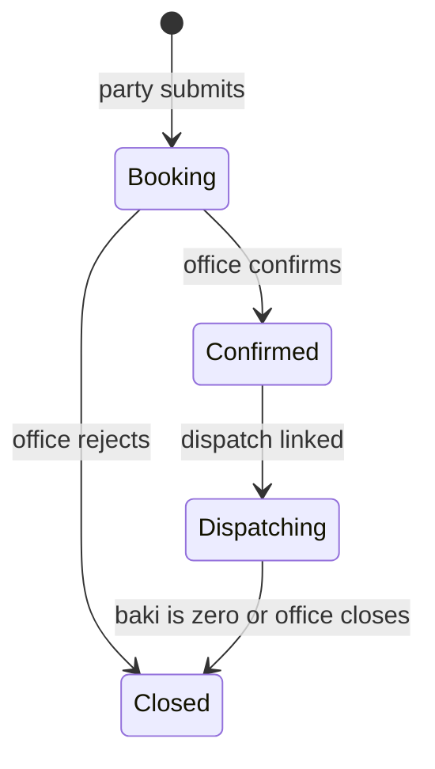
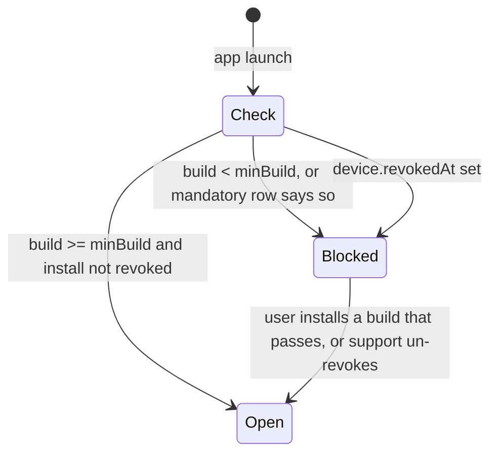
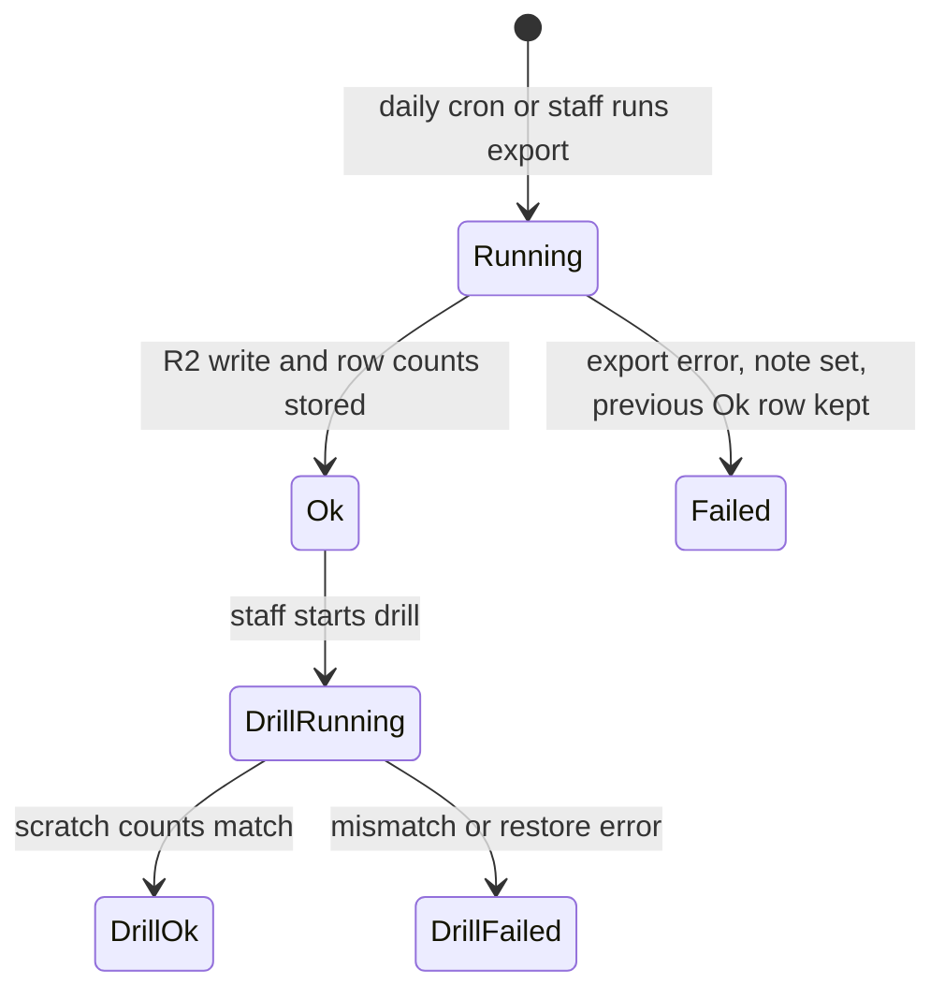
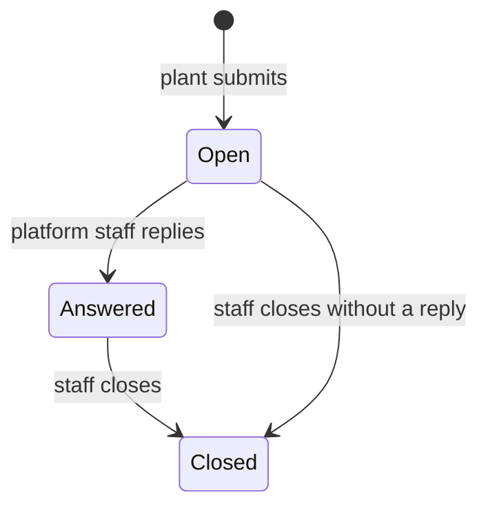

# ORRN platform — design spec

> Preview retired on 2026-10-25; real route: `/today`, `/settings` (Devices tab: `/settings?tab=devices`), `/portal`.

**Status (2026-10-25):** built (W1, W2, W3 and W4); see the Status column. Routes: `/today`, `/settings`, `/audit`, `/approvals`, `/guides`, `/admin/*`, and the party portal under `/portal`.

Date: 2026-10-24 · Module: PF · Preview slug: `platform` · IDs: `FP-PF-nn`

Builds on: `2026-10-03-orrn-c2-redesign-design.md` (shell, `/today`, `/settings`, guides) and `2026-10-03-orrn-plant-modules-design.md` (P9 roles, P10 plant switch, P11 deferred PIN, P19 7 am summary, `company.settings` keys). Plant facts: `docs/superpowers/review/2026-10-03-architecture-digest.md`. Vocabulary: `AGENTS.md` and `packages/i18n/src/en.ts`.

This spec covers the plant's own house: who can sign in, what they are allowed to do, how the production day is cut, which bought modules and commercial switches are on, what a party can see, how the phone app is shipped, how the database is copied, and which language the floor reads. It does not redesign pack, press, foundry, or sales-order maths. Those specs consume the contracts named here.

Citations in the feature table describe what the competitor showed. They are not names to copy.

## 1. Context

### What FourCubes needs

FourCubes is one press, about 150 t and 3,500 bundles a month, Surat, tenant host `fourcubes.orrn.in` (digest §10.1, §A.2). The floor works in Gujarati. The architecture digest already treats that as an acceptance test: a new packer trains for half a day in Gujarati on the real floor, then packs unaided (Q-06), and floor labels stay in Gujarati or Hindi while keeping the plant's English words — die, cast, PL, kanta (digest §1.2, §8.8, §O.1).

The buyer on the 2026-10-24 call also needs the office to add people without a seat cap, to turn commercial behaviour on or off without a code change (die band visible or not, price on the sales order or not, a die required on the line or not), and to print the BIS standard and the CM/L licence number on stickers and quality certificates. A party should be able to sign in, see only its own dies and copies, place a sales order, and look at baki and dispatches without phoning the plant. Support has to be a written contact, not "Lalu just phones".

Leftover stock is not a platform setting. The buyer rejected booking leftover onto an order named FourCubes and restated that production follows the customer's PO (`[T:L248]`, report B11). That rule belongs to the orders spec. This spec does not add an in-house customer pointer.

### What the competitor showed

Described, not copied.

- A party login was claimed, not performed: the same link as the plant, the party sees only the dies assigned to it ("5 out of 100"), and an order they place lands in the plant's list (`[T:L49-L51]`, `[T:L315-L316]`, `[T:L386]`, `[TF:A4]`). The create-user form was opened for a party; the party session was not. Mobile work orders were described as view-only from home (`[T:L273-L274]`). Report L3 and evidence gap 5 mark the portal as claimed, not shown (`[TF:E9]`).
- Company profile held the sticker facts in one scroll: solid standard IS 733 with a CM/L number, hollow standard IS 1285 with another, an in-house stock customer, a bundle-serial reset, and named shifts (`[S:1.28.26 AM]`, `[S:1.33.41 AM]`). Help text said the standards and CM/L numbers print on stickers and quality certificates. No printed sticker was shown.
- Shifts were Day 08:00–20:00 and Night 20:00–08:00, with the note that shift 1 starts the 24-hour production day (`[S:1.28.26 AM]`). Packing and ageing screens said "A Shift" / "A" instead (`[S:1.10.13 AM]`, `[S:1.09.20 AM]`). The shift editor was named, not exercised (`[T:L381]`, `[TF:A16]`).
- Three commercial switches were flipped live: die band on or off (off collapses a range to one weight; off for a plant that sells one section and one or two dies), price on the order (₹/kg, then a dispatch total; off means no total), and die required beside the section on order create (`[V:short3 0:03]`, `[V:short3 0:18]`, `[T:L388-L389]`).
- Off-network sign-in used a 6-digit email code. Devices on listed plant IP ranges or a DDNS hostname skipped that code. A router heartbeat key sat on the same form and was readable during the demo (`[S:1.28.26 AM]`, report §3.1). The report marks that as a misconfiguration risk.
- Users: unlimited, claimed twice (`[T:L386-L387]`). A per-menu view/create/update/delete list was described as on screen; the matrix was not opened (`[V:short3 0:00]`). A customer login is created from that same user screen.
- Android only: a signed APK on the vendor's own certificate, not a store listing (`[T:L335-L336]`). An in-app release table had flavor, build code, a mandatory flag, and a minimum build. Recent rows for the live flavor were optional; every minimum build was 1, so nothing forced a current user up (`[V:short3 0:42]`). iOS was not mentioned (`[TF:A19]`). Recommended device: an 11-inch tablet the plant buys (`[T:L231-L235]`).
- Backup: a cloud-folder path on the company form, spoken as "not in one place" so a VM failure does not lose the data (`[T:L385-L386]`, `[S:1.28.26 AM]`). No restore was shown.
- Language: English on every screen shown (`[S:1.24.05 AM]`).
- Support: one company number, a named person, "24/7" with the caveat that they do not really have emergencies, screen explanations, and a four-day turnaround when something has to be built (`[T:L396-L397]`). Price and yearly maintenance were deferred. The buyer asked about maintenance (`[T:L394-L396]`).
- A home dashboard was under construction (`[T:L236]`).

### What ORRN has today

Prod and `redesign/c2` differ. Where this spec says "c2", the screen or the procedure is on this branch and not on prod.

| Surface | Prod | c2 (this branch) |
|---|---|---|
| Sign-in | Email + password, magic link, authenticator-app TOTP on web and native (`packages/auth/src/index.ts` `twoFactor()`, `apps/web/src/shared/components/sign-in-form.tsx`) | Same |
| Second factor skipped by IP | Absent. No IP-range check in `packages/auth` or `packages/server`. Spool `lastHeartbeatAt` is a print-node heartbeat, not a login bypass | Absent |
| Roles | 5: owner, admin, manager, operator, viewer | 13, one matrix in `packages/server/src/lib/permissions.ts` (`ROLE_ACTIONS`, `can`, `APPROVER_ROLES`), used by `actionProcedure` and by `<Can>` on web and native. Pinned in `packages/server/test/plant-roles.test.ts` |
| Unlimited users | No seat cap in schema. `company.plan` is free text and is not a limit | Same |
| Team screen | Members, invites (7-day token, `packages/server/src/routers/invite.ts`) | `/settings/members` redirects. `/settings` is a `RouteStub` (`apps/web/src/routes/_tenant/settings.tsx`) even though `company.updateSettings`, `membersList`, `membersUpdateRole`, `membersRemove` exist |
| Who may change settings | `settings.update` is owner and admin only (manager is filtered out of that legacy action). `users.manage` is admin (owner holds every tenant action) | Same |
| Last owner | `company.ts` `assertAnotherOwnerExists` refuses to demote or remove the only owner | Same |
| Impersonation | Time-boxed grant, 5–480 min, default 30, web-only, bannered, `impersonatorId` on the audit row (`packages/server/src/routers/platform/impersonation.ts`, `AGENTS.md`) | Same. A valid grant wins over `x-orrn-company` |
| One user, many plants | One company per user | `membership` unique on `(user, company)`, `company.switch`, `auth.me.memberships`. No switcher UI (P10, PL-1) |
| Modules | `company.modules` text JSON, set by platform staff (`platform/companies.ts`) | A non-empty list hides nav items, palette hits, and the scan entry (`apps/web/src/shell/nav-items.ts`). Allowed nav modules are only `customers`, `dies`, `bundles`, `dispatches`. Empty list means every module is on. Server mutations do not read the list |
| Settings keys actually written | — | `lengthUnit` (`mm` \| `inch`), `timezone`, `bundleNumbering` (`plant` \| `legacy`), `plSeries`, `dcTolerancePct`. Audited as `company.settings.update`. `shifts` is named in the plant-modules spec and is not in the zod input |
| Customer as a login | `customer` is a master (`packages/db/src/schema/customers.ts`: name, phone, email, addresses, `taxId`). No `userId`, no password, no membership. `customerRouter` is staff CRUD | Same. No portal route |
| Today | Prod dashboard is the old home | `dashboard.today` is a real company-scoped query (`packages/server/src/routers/dashboard.ts`): packed bundles and kg, dispatched kg, stock by status, open dispatches, today's packing sessions, failed print jobs. Day boundary is calendar midnight in `settings.timezone`, else `Asia/Kolkata` (`dayWindow` in `packages/server/src/lib/dayWindow.ts`). `/today` is a `RouteStub` |
| Languages | No i18n package | `en` and `hi` (`packages/i18n/src/core.ts`), key parity in `parity.test.ts`, device key `orrn.locale`. Pre-paint script in `apps/web/index.html` accepts only `en` and `hi`. Native `app.json` locales and `expo-localization` list the same two. No Gujarati |
| Guides | — | 10 role-filtered topics (`packages/i18n/src/guides/types.ts`). Index at `/guides` lists them and opens a sheet. `/guides/$slug` is a `RouteStub` |
| Devices | `device` table (`packages/db/src/schema/sync.ts`): platform, os, app version, install id, `pushToken`, `lastSeenAt`. No router inserts a row. `pushToken` is never written | Same |
| App distribution | Expo app, Android drawer on prod. No `eas.json`, no `expo-updates`, no `runtimeVersion` | `app.json` declares iOS and Android `in.orrn.app`, tablet supported. Still no EAS profile, no OTA, no minimum-version gate. Store release is out of the C2 redesign scope |
| Backups | None in application code. D1 Time Travel is a Cloudflare feature, not an ORRN runbook | Same. Plant-modules spec §8 lists "backups beyond D1 Time Travel" as out of that phase |
| Audit | Rows written (actor, impersonator, action, subject, JSON meta). No list procedure. `auditRetentionDays` defaults to 180 and is never read. `AGENTS.md` forbids an audit-pruning cron unless explicitly requested | c2 writes more action types. Still no viewer. Platform plan/module changes, impersonation grant create/revoke, and staff changes are not audited |
| Customer-owned die | Absent | Die-room spec owns `die.owner_customer_id` and `die_instance.owner_customer_id`. Not in this branch yet |

### What ORRN already plans

- P9 / PL-1: the 13 roles and the approval kinds. Built on c2 server. Web approvals inbox is not this spec (plant-modules web phase).
- P10 / PL-1: many plants per person, `company.switch`, `auth.me.memberships`. Server built. Switcher UI is PL-W10, not built. This spec specifies the switcher (FP-PF-17).
- P11: PIN login on a paired station phone is designed and deferred. Email login continues. This spec does not build PIN. It is the reason not to skip the second factor by IP (FP-PF-08, FP-PF-18).
- P19 / PL-11: 7 am daily summary is the Today screen plus a printable page. `dashboard.today` is the seed. This spec composes it per role and moves the window off midnight once shifts exist (FP-PF-05, FP-PF-15).
- `company.settings.shifts` is already named in plant-modules spec §4. Press and ageing both store `shift_id` = `shifts[].id`. This spec defines the shape, including `seq`.
- C2 settings tabs already planned: Company (name read-only, length unit, timezone), Team, Printing, Data. This spec adds tabs. It does not remove those four.
- C2 guides library is planned as real pages. The index shipped early; the slug page did not.
- Report N9 (Gujarati floor screens), N10 (Android distribution with a minimum-version gate), N11 (D1 export to R2 and a restore drill) are the Now items. L3 (a party status page) is the seed of the portal; this spec makes it a booking portal, not a second ERP. G1 (written support contact) and G2 (unlimited users, no seat cap) are the commercial constraints. X8 (audit viewer) is included so "who voided this bundle" has a screen. L7 (plant switcher) is the missing half of P10.

## 2. Feature list

| ID | Feature | User story | ORRN today | ES reference (cite) | ORRN does it better by | Priority | Depends on | Status (2026-10-25) |
|---|---|---|---|---|---|---|---|---|
| FP-PF-01 | Party portal | As a party, I sign in and see only the dies and copies FourCubes has granted me, never another party's. | New. `customer` is a master with no login | Claimed: party login on the same link, only assigned dies visible, other parties' dies hidden. Create form opened; party session not opened (`[T:L49-L51]`, `[T:L315-L316]`, `[T:L386]`, `[TF:A4]`) | Grant is an explicit row, not a shared password on the customer master. A party is not one of the 13 roles, so they cannot inherit a floor action. Effective die owner (die-room columns) hides a copy even if someone grants the section by mistake | Next | PL-8 sales order exists to show; die-room owner columns | **Built.** portal.* (portalProcedure, party logins, misses NOT_FOUND); portalEnabled consumed; _portal layout, /portal, /dies |
| FP-PF-02 | Party places a sales order | As a party, I place a sales order for a granted die. It lands as booking. The office confirms it. I cannot set the rate. | New. No `sales_order` table on this branch (planned PL-8) | Claimed: the order lands in the plant's list for planning (`[T:L50-L51]`, `[T:L386]`) | Status stays `booking` until office confirms. The party names the catalogue die, not the copy. Confirm, when `dieRequiredOnSalesOrder` is on, needs a die copy or a tier. Rates stay hidden unless `priceOnSalesOrder` is on and the caller holds `order.price`; the portal never holds that action | Next | FP-PF-01, PL-8, FP-PF-06 | **Built.** portal.orders.create via orders.create; /portal/orders/new |
| FP-PF-03 | Party sees baki and dispatches | As a party, I see ordered, dispatched, and baki on my sales orders, and the dispatches that carried them. | New | Claimed progress percentages and a drill into dispatch history; figures were read off a list, not a second login (`[T:L275-L279]`, `[TF:A4]`) | Baki is the planned definition (ordered − dispatched, kg and pcs), never a second meaning of "balance". Another party's dispatch is `Not found` | Next | FP-PF-01, PL-8 | **Built.** portal.orders/dispatches; /portal/orders, /dispatches |
| FP-PF-04 | Packing list and test certificate | As a party, I download the packing list and a test certificate for my completed dispatch. | New. PL PDF is generated client-side from a snapshot for staff. No test certificate | Quality-certificate help text on the company form; no certificate file shown (`[S:1.33.41 AM]`). PL itself is a pack concern | The certificate snapshots the BIS pair that was in force, so a later settings edit does not rewrite a sent certificate. Number comes from `doc_series`, not a typed string | Next | FP-PF-03, FP-PF-09, packing-list snapshot (pack spec) | **Partial.** `test_certificate` with revisions, `/portal/certificate/$id`, staff "Issue test certificate"; cast chemistry shows pending until the foundry lane produces verdicts |
| FP-PF-05 | Named shifts and the production day | As the plant admin, I name the shifts. Shift 1's start is the production day, including overnight. | Planned. `settings.shifts` named in the plant-modules spec, not in `company.updateSettings`. `dashboard.today` uses calendar midnight | Day 08:00–20:00 and Night 20:00–08:00 shown; shift 1 starts the production day. Floor screens used a different label (`[S:1.28.26 AM]`, `[S:1.10.13 AM]`) | One list, stable ids, no overlap, 24 h covered. Press, ageing, pack, and Today all read the same window. Bundle month letters stay on the calendar month | Now | None. Press and ageing store `shift_id` | **Built.** shifts in updateSettings; productionDay; shifts-tab |
| FP-PF-06 | Commercial switches | As the plant admin, I turn die bands, price on the sales order, and "die required" on or off. The server enforces each one. | New as flags. Band lives on `die.weightMinG` / `weightMaxG`. No sales order yet | Three switches flipped live; band off collapses a range to one weight; price off removes the dispatch total; die required beside the section on order create (`[V:short3 0:03]`, `[T:L388-L389]`) | The plant admin flips them (`settings.update`). Bought modules stay with platform staff. "Die required" means office confirm needs a die copy or a tier, not a second section field. A phone call is not required to hide a band | Now | PL-8 consumes the flags when orders land. Flags can ship first | **Built.** commercial switches, audited; modules-tab |
| FP-PF-07 | Bought modules enforced | As platform staff, I set the modules a plant bought. Nav and server both refuse a module that is off. | Partial c2. `modules[]` hides nav, palette, and scan. Mutations ignore it. Settings page is a stub | Per-plant switches, including "this plant does not sell by range", without a code fork (`[T:L388]`, `[V:short3 0:03]`) | One codebase, no per-plant app id. Empty list still means all on, so today's tenants do not lock themselves out. Server check matches the nav | Now | None | **Built.** moduleGate ROUTER_MODULE + APPROVAL_KIND_MODULE; modules-tab, nav |
| FP-PF-08 | Second factor stays TOTP | As a plant admin, I cannot paste an IP range that skips the second factor, and I never see a router secret on the company form. | Built prod and c2. Authenticator TOTP. No IP bypass | Email code skipped inside listed ranges; heartbeat key readable on the company form (`[S:1.28.26 AM]`) | TOTP is already phishing-resistant relative to an email code. Skipping it by source IP is rejected. Floor convenience is a paired station and a PIN (FP-PF-18), not a weaker second factor | Now | None. PIN itself is Later | **Built.** TOTP; login/totp |
| FP-PF-09 | BIS standard and CM/L | As the plant admin, I set the standard and CM/L for solid, hollow, and semi. Labels and certificates print the pair that matched the die's profile kind. | New. `die` has no profile kind. No standard fields in settings | IS 733 / IS 1285 and two CM/L numbers on the company form, help text says they print on stickers and certificates. No sticker shown (`[S:1.33.41 AM]`) | Profile kind lives on the die (die-room column). The pair is snapshotted onto the bundle at pack and onto the certificate, so history does not follow a later edit. Blank CM/L is allowed; a real label does not invent a licence number | Now | Die-room `die.profileKind`. Pack spec prints the snapshot | **Built.** company.standards per profileKind; standards-tab |
| FP-PF-10 | Users and the 13 roles | As the plant admin, I invite as many people as the plant needs, each with one of the 13 roles, and I cannot remove the last owner. | Built c2 server (13 roles, invite, last-owner guard). Prod has 5 roles. Team UI is a redirect onto a stub | Unlimited users claimed (`[T:L386-L387]`). Per-user, per-menu create/update/delete described; matrix not opened (`[V:short3 0:00]`) | One tested matrix, not a per-user grid that drifts from the server. Unlimited means no seat column. A party login is FP-PF-01, not a fourteenth role | Now | PL-1 (done on c2) | **Built.** membersList/UpdateRole/Remove; 13 roles; settings team-tab, party logins |
| FP-PF-11 | App distribution and devices | As a floor lead, I see which phones are on an old build. A build below the minimum cannot open the floor. | New. `device` rows are never written. No EAS, no `expo-updates`, no minimum build. One app id `in.orrn.app` already | Signed APK, in-app release table with a mandatory flag that was not used to force the live flavor up (`[T:L335-L337]`, `[V:short3 0:42]`). iOS absent | One app id, not a flavor per plant. The gate is server-side, so a sideloaded APK is blocked too. iOS TestFlight is in the same pipeline. Device list shows version and last seen | Now | None | **Built.** release.check/list, device.register, app_release; devices-tab, /admin/releases |
| FP-PF-12 | Backup and restore drill | As the owner, I see when yesterday's data was copied and when a restore into a scratch plant last succeeded. | Absent. Plant-modules §8 deferred anything beyond D1 Time Travel | A folder path on the company form; spoken as stored elsewhere; no restore shown (`[T:L385]`, `[S:1.28.26 AM]`) | ORRN runs the copy to R2. The plant never pastes a bucket path or sees a secret. A drill into a scratch tenant is the acceptance, not a field that exists | Now | None | **Built.** backup_run, cron 21:30 UTC; backup-tab, /admin/backups, docs/RESTORE_DRILL.md |
| FP-PF-13 | Gujarati | As a packer, I use the floor in Gujarati, with die, cast, PL, kanta, and baki left in the plant's words. | Partial c2. `en` + `hi` with parity tests. No `gu`. Prod has no i18n | English on every screen shown (`[S:1.24.05 AM]`). Neither product had Gujarati (report N9) | Same key-parity test as Hindi, so a missing string cannot ship. Company default plus the device choice. Floor screens first, matching Q-06 | Now | None | **Built.** floor Gujarati: `GU_FLOOR_NAMESPACES` (floor, settings, approvals, die room, dies, nav, errors, status, dispatch, bundle, orders words) complete and pinned by `gu.test.ts`; office namespaces and guide texts outside the floor flows fall back to English by design; native-speaker review is open (Q48) |
| FP-PF-14 | Guides, support, release notes | As a new packer, I open the guide for this screen. As the owner, I see who to call and what changed in the last app build. | Partial c2. Guide index works; slug page is a stub. No support contact. No release notes | Named phone support, verbal, caveated, four days when something must be built (`[T:L396-L397]`). No in-app guide was shown | Guides are role-filtered and already written for ten jobs. Support is a contact card plus a request row, not a promise painted on a slide. Release notes are the same text as the update gate | Now | FP-PF-11 for the notes source | **Built.** `/guides` with 35 SOP guides in en and hi (gu for the 9 floor flows), support tab and `/admin/support`; release notes under Settings > About (`release.notes`) |
| FP-PF-15 | Today, per role | As each role, I open Today and see the production day's numbers and the one next action I am allowed to take. | c2 server only. `dashboard.today` exists. `/today` is a stub. Window is midnight, not a shift | Home dashboard under construction (`[T:L236]`). A wide production report was a separate page | One query, slices gated by `can()`, so a packer does not receive baki or rates. Viewers get numbers and no tiles, as C2 already specified. Production day follows FP-PF-05 | Now for the four KPIs and permission tiles that exist today. Station tiles (press, cast, baki) appear when those modules land | FP-PF-05 for the window. PL-11 for the printable 7 am page | **Built.** dashboard.today per role, 4 KPIs, production day; /today (the review fixes of W2-FIXES-A are merged) |
| FP-PF-16 | Audit viewer | As the owner, I answer "who voided this bundle" without asking support to read the database. | Partial. Rows written, no list API. Retention column unread. Pruning cron forbidden | An audit route was claimed in the competitor's bundle, not opened (report §3.1) | The viewer reads rows the server already writes, including `impersonatorId`. It does not delete them. Platform actions that skip audit today start writing it | Next | None for the viewer. Useful once pack void is on a screen | **Built.** audit.list/forSubject; /audit |
| FP-PF-17 | Plant switcher | As an accountant in two plants, I switch plant from the header. Each plant keeps its own role. | c2 server only. `company.switch` and `memberships` on `auth.me`. No UI | Not shown. One login was not described as many plants | Already specified in AGENTS.md: the header is a choice, never authority. Impersonation still wins. Cache clears on switch | Next | PL-1 (done) | **Built.** plant switcher in the header (`company.switch`, hidden when impersonating or with one plant) |
| FP-PF-18 | Station PIN | As a packer on a shared tablet, I enter a PIN on a paired station instead of an email code. | Planned P11, explicitly deferred. Not built | Not shown. Their floor convenience was the IP skip (FP-PF-08) | PIN is per person, on a paired device, and locks. It does not weaken TOTP for office roles signing in from outside | Later | P11, OI-06. Not a Now build | **Missing.** Later (deferred, OI-06): own account on any phone is the rule (Q33) |

## 3. Data model

No platform feature posts a `stock_ledger` row. A portal sales order is the planned `sales_order` document (PL-8); ledger movement stays on pack and dispatch. Audit rows are the platform's record of change.

Weights stay integer grams. Money stays integer paise. Shift times are minutes from local midnight, not strings. New tables follow the plant-modules plan: `id` text uuid, `company_id` not null with a `(company_id, …)` index, `server_seq` where the table is tenant data a client might sync, `created_at`. Platform-global tables (`app_release`) have no `company_id`.

### `company.settings` keys

| Key | Status | Shape |
|---|---|---|
| `lengthUnit`, `timezone`, `bundleNumbering`, `plSeries`, `dcTolerancePct` | As built | Unchanged. `bundleNumbering` and `plSeries` stay the numbering engine (PL-2). This spec only surfaces them on the Company tab |
| `shifts` | As planned (plant-modules spec §4). Shape is new here | `{ id, name, seq, startMin, endMin }[]`. `id` uuid, stable. `seq` starts at 1. `startMin` / `endMin` integers 0–1439. Shift `seq = 1` starts the production day. Press and ageing store `shift_id` = `id` |
| `dieBands` | New | boolean, default `true`. Off hides the band and the band-start weight basis. Orders spec owns that display |
| `priceOnSalesOrder` | New | boolean, default `false`. Rates stay hidden unless this is on and the caller holds `order.price` (orders spec action). Portal never holds `order.price` |
| `dieRequiredOnSalesOrder` | New | boolean, default `true`. On means office confirm requires a die copy or a tier. Off means confirm may proceed without either. Portal booking always names the catalogue die and never picks the copy |
| `portalEnabled` | New | boolean, default `false` |
| `standards` | New | `{ solid?: Pair, hollow?: Pair, semi?: Pair }` where `Pair = { standard: string, cml: string }`. Both strings trimmed, max 40. Empty string means unset |
| `locale` | New | `"en"` \| `"hi"` \| `"gu"`, default `"en"`. Company default only. Device key `orrn.locale` wins when set |

`shifts` is not a table. Press runs need a stable id, which the JSON object already has. A table would duplicate `company.settings`, which the plant-modules spec already named as the home.

### `company.modules`

As built (column exists). Changed: the allowed set grows, and the server enforces it.

Allowed values, lower-cased on write: `customers`, `dies`, `bundles`, `dispatches`, `orders`, `foundry`, `press`, `ageing`, `store`, `purchase`. Unknown strings are rejected. Empty array still means all on (companies created before modules existed, and the waitlist bootstrap which writes `modules: []`).

Platform staff set this list (`platform.company.manage`). Plant admin sees it read-only. Commercial switches (FP-PF-06) are not modules.

### `die.profileKind` and owners

Owned by the die-room spec, read here. Locked names:

- `die.profileKind`: `"hollow"` \| `"solid"` \| `"semi"`, nullable.
- `die.owner_customer_id`: section default, nullable.
- `die_instance.owner_customer_id`: nullable override. Null inherits the section.
- Effective owner = copy column if set, else section column.

This spec does not add those columns. Labels resolve `settings.standards[profileKind]`, and if `semi` is unset they use `solid`.

### `customer_portal_user` (new)

A party login. Not a `membership`, not a `CompanyRole`.

| Column | Notes |
|---|---|
| `id`, `companyId`, `serverSeq`, `createdAt` | Standard |
| `customerId` | FK `customer`, restrict delete |
| `userId` | FK `user` |
| `status` | `active` \| `revoked` |
| `createdBy` | Staff user who granted it |

Unique `(companyId, userId)` and `(companyId, customerId, userId)`. A user may hold portal rows in several plants. A user must not also hold a `membership` in the same company (grant returns `BAD_REQUEST`). Revoke sets `status`, it does not delete the row.

### `customer_portal_section` (new)

Which catalogue dies (`die.id`, the section) this party may see and order, beyond dies they own.

| Column | Notes |
|---|---|
| `id`, `companyId`, `customerId`, `dieId`, `createdBy`, `createdAt` | |
| Unique | `(companyId, customerId, dieId)` |

Visibility rule is in §6. This table is not an ownership lock. The die-room columns are the lock. Pack and dispatch keep enforcing the lock; the portal only hides.

### `invite` (changed)

Add `kind`: `"member"` \| `"portal"`, default `"member"`. Add nullable `customerId`. A portal invite requires `kind = "portal"`, a `customerId`, and `portalEnabled`. `role` stays required for member invites; portal invites store `role = "viewer"` only as a non-null placeholder and the accept path must not create a membership. Prefer a migration that makes `role` nullable for `kind = "portal"` so a portal invite cannot be accepted as a viewer by an old client. Accept path branches on `kind`.

Expiry stays 7 days.

### `device` (changed)

Columns already exist. Add `revokedAt` (nullable timestamp). No station, no pairing QR (that is FP-PF-18). `pushToken` may be written when the client has one; this spec does not send pushes (report X7 is out of scope).

New writer: `device.register` on native launch and on web session start for browser sessions the plant wants listed. Web rows use `platform = "web"`.

### `app_release` (new, no `companyId`)

| Column | Notes |
|---|---|
| `id` | |
| `platform` | `android` \| `ios` |
| `version` | User-facing, e.g. `1.4.0` |
| `buildNumber` | Integer, monotonic per platform |
| `channel` | `production` \| `floor`. `floor` is the signed-APK sideload channel. `production` is Play internal track and TestFlight |
| `mandatory` | If true, every install below `minBuild` is blocked |
| `minBuild` | Integer. The gate blocks `buildNumber < minBuild` when this row is the newest published row for that platform and channel, or when any published row has `mandatory` and a higher `minBuild` |
| `notes` | Short text, shown on the gate and on About. Same string in the release, not a second CMS |
| `apkUrl` | Nullable. R2 URL for the floor APK. Null on iOS |
| `publishedAt` | |

One app id: `in.orrn.app`. No per-plant package name. No flavor column.

### `backup_run` (new)

| Column | Notes |
|---|---|
| `id`, `startedAt`, `finishedAt` | |
| `companyId` | Null only for a platform-wide job marker. Tenant-visible rows are per company |
| `kind` | `export` \| `drill` |
| `status` | `running` \| `ok` \| `failed` |
| `bytes` | Nullable until finished |
| `r2Key` | Not returned to the tenant |
| `note` | Failure reason or drill result. No secrets |

A drill row's `note` records the scratch company id and the source export id. The scratch company is a real `company` with `status = "suspended"` and a name prefix `restore-drill-`, created by platform staff, not by the plant.

### `support_request` (new)

| Column | Notes |
|---|---|
| `id`, `companyId`, `userId`, `createdAt` | |
| `screen` | Path the person was on, max 200 |
| `body` | Max 2 000 characters |
| `status` | `open` \| `answered` \| `closed` |
| `reply` | Nullable text, set by platform staff |

Not a document series. Not an approval.

### `test_certificate` (new)

| Column | Notes |
|---|---|
| `id`, `companyId`, `dispatchId`, `createdAt`, `createdBy` | |
| `number` | From `nextDocNumber`, new doc type `cert` |
| `revision` | Integer, starts at 1 |
| `snapshot` | JSON. Frozen. See §6 |

Unique `(companyId, number)`. A regenerate inserts a new revision and keeps the old row. It does not overwrite.

### Doc series

Extend the planned `nextDocNumber` union with `cert`. Period is the FY in `Asia/Kolkata` (same as PL). Format: `TC/{FY}/{seq}` with FY `2026-27`. Prefix is fixed. It is not a plant-editable book (unlike `plSeries`).

No other new series. Support requests and backup runs are not numbered documents.

### Audit

Existing `audit_log`. New action strings, all via `auditInsert` inside the same `atomicBatch` as the change:

- `company.settings.update` (already) — include the new keys.
- `portal.user.grant`, `portal.user.revoke`, `portal.section.grant`, `portal.section.revoke`.
- `portal.order.create` — meta is sales-order id and customer id, not kg or rate (same restraint as `approval.list`).
- `device.revoke`.
- `app_release.publish` — `companyId` null, actor is platform staff.
- `backup.export`, `backup.drill` — platform actor; tenant id in meta.
- `support_request.create`, `support_request.reply`.
- `platform.company.modules.update` and `impersonation.grant.create` / `revoke` — these skip audit today. Start writing them. Meta for a grant is company id, ttl, reason. Never the session token.

Do not add a pruning cron (`AGENTS.md`). `auditRetentionDays` stays a filter default on the viewer, not a delete.

## 4. Server

All tenant procedures keep deriving `companyId` from the session. Portal procedures derive `customerId` from `customer_portal_user`, never from the input. A miss is `Not found`, including a real row that belongs to another party or another plant.

### Settings

`company.updateSettings` (`settings.update` — owner, admin) gains optional fields:

- `shifts` — replace the whole array. Validate §6 before write.
- `dieBands`, `priceOnSalesOrder`, `dieRequiredOnSalesOrder`, `portalEnabled` — booleans.
- `standards` — partial object. Omitted kinds are left as stored. A kind set to `{ standard: "", cml: "" }` clears it.
- `locale` — enum.

`lengthUnit`, `timezone`, `bundleNumbering`, `plSeries`, `dcTolerancePct` stay. The mid-month numbering guard stays. Audit meta keeps `{ changed, previous }` for the patched keys only.

`company.getSettings` is the existing company read on `auth.me` plus a dedicated query if `me` must not carry the full standards block. Standards are not secret. Shifts are not secret. Do not put spool keys or backup `r2Key` on this payload.

### Modules

`platform.companies.update` already writes `modules`. Change: reject unknown module names; audit `platform.company.modules.update`.

New helper `assertModule(ctx, module)` used at the start of every mutation whose nav item has a `module`, and of the plant routers when they land (orders, foundry, press, ageing, store, purchase). If `modules` is non-empty and does not include that name, `FORBIDDEN` with "That module is not on for this plant". Reads of masters the floor needs (a packer resolving a die) stay allowed when `bundles` is on even if `dies` is off — the die pick inside pack is part of bundles. A direct `die.create` still requires `dies`.

Nav `NavModule` union grows to the same allowed set. Items with no `module` (Today, guides, settings, printing) stay visible when the role allows them.

### Portal

New `portalProcedure`: session user, active `customer_portal_user`, company `active`, `portalEnabled`. No `can()` check. Impersonation does not enter this procedure. A platform admin who needs to see the portal signs in as a demo portal user, or reads the plant as owner through the existing grant. Do not add a "impersonate this party" header.

| Procedure | Effect |
|---|---|
| `portal.me` | Customer name, granted sections, locale |
| `portal.sections` | Dies and copies the visibility rule allows. Copies include oblique code, latest kg/12 ft, band only if `dieBands` |
| `portal.orders.list` | This customer's sales orders: status, lines, ordered / dispatched / baki kg and pcs. Rate omitted. The portal does not hold `order.price` |
| `portal.orders.create` | Inserts `sales_order` status `booking` (planned P13) for this customer only. Each line names a granted catalogue die (section). The party does not send a copy id. Rate is rejected if present. Audit `portal.order.create` |
| `portal.dispatches.list` | Completed dispatches for this customer. Draft and held are hidden |
| `portal.packingList.get` | Snapshot for a completed dispatch of this customer. Same shape the staff PL screen uses |
| `portal.certificate.get` | Latest revision snapshot, or `Not found` |
| `portal.today` | Open orders, baki kg, last completed dispatch. No plant KPIs |

Office confirms a booking with the planned `order.manage` procedures (orders spec). The portal has no confirm, no cancel of a confirmed order, no reallocation.

`portal.manage` (new action: office, manager, admin; owner holds it) procedures on the staff router:

- `portal.users.grant` — creates the invite (`kind = "portal"`) or links an existing user. Refuses if that user has a membership in this company.
- `portal.users.revoke`
- `portal.sections.grant` / `revoke`

### Shifts helper

`productionDayWindow(settings, now)` in `packages/server/src/lib/dayWindow.ts`, beside `dayWindow`. If `shifts` is missing or empty, it returns `dayWindow`. Otherwise the window is `[boundary, next boundary)` where boundary is `seq = 1`'s `startMin` on the company timezone wall clock. If the current wall-clock minute-of-day is before that start, the window opened yesterday.

`dashboard.today`, pack's packed-today count, and the press daily summary call this helper. `monthStartMs`, FY rollover, and bundle month letters keep using calendar midnight. A bundle packed at 02:00 still belongs to the calendar month of that instant.

`shiftAt(settings, now)` returns the shift whose `[startMin, endMin)` contains the wall-clock minute, wrapping when `endMin <= startMin`. Press spec uses it to suggest `press_run.shift_id`. The client does not compute the suggestion as authority.

### Standards on the label

This spec stores the pairs. The pack spec snapshots the resolved pair onto the bundle at pack time. Certificate generation reads the bundle snapshots on the dispatch, not the live settings, so a dispatch of mixed kinds can show both pairs. If a bundle has no snapshot (legacy stock), the certificate uses the live pair and marks the line `standard as of issue`, not `as packed`.

### Distribution

| Procedure | Who |
|---|---|
| `release.check` | Public. Input: `platform`, `buildNumber`, `channel`. Returns `{ blocked, minBuild, latest, notes, apkUrl }`. No company data |
| `device.register` | Company session or portal session. Upserts on `(companyId, installId)`. Refuses if `revokedAt` is set (`FORBIDDEN`) |
| `device.list` | `users.manage` (admin, owner). Portal devices included, labelled with the customer name |
| `device.revoke` | `users.manage`. Sets `revokedAt`. Does not delete |

`platform.release.publish` (new platform action, `super_admin` and `admin`, not `support`): inserts `app_release`, audits. Notes required, max 500 characters. `minBuild` cannot exceed `buildNumber`.

EAS (implementation, not a tenant setting):

- `eas.json` profiles `production` (Play internal track, iOS TestFlight) and `floor` (signed Android APK uploaded to R2, URL stored on the release row).
- `expo-updates` with `runtimeVersion` policy `appVersion`, channel matching the profile.
- The JS update is not a substitute for the gate. Native still calls `release.check` before the tab bar. A mandatory native bump cannot be skipped by an OTA.

iOS App Store listing stays out of scope (C2 redesign). TestFlight internal is in scope.

### Backups

Platform worker, daily, per `active` company: export that company's rows to R2. Exclude `spoolApiKeyWrapped`, auth secrets, `two_factor` secrets, session rows, invite `tokenHash`, and any wrapped key. Include settings, masters, documents, ledger, audit.

`platform.backup.run` (new platform action, same staff roles as release publish): starts an export now, or a drill. A drill restores yesterday's export into a new suspended scratch company and checks row counts for `customer`, `die`, `bundle`, `dispatch`. It does not restore into the live company. Result is a `backup_run` row.

`backup.status` (`settings.update`): latest export time, status, bytes, and latest drill time and status for this company. No `r2Key`, no download URL. The plant cannot restore itself.

Runbook (this section is the runbook; do not add a second document):

1. Confirm the latest `backup_run` of kind `export` for the company is `ok` and finished after yesterday's last shift.
2. `platform.backup.run` kind `drill` creates `restore-drill-{date}` suspended.
3. Compare counts. A mismatch is `failed` with the table name in `note`.
4. Leave the scratch company suspended. Do not point a spool at it. Do not impersonate it in a demo.
5. Quarterly is the acceptance bar (report N11). The button is available any day.

### Support and audit

| Procedure | Who |
|---|---|
| `support.request` | New action `support.request`, every company role including viewer. Inserts `support_request` |
| `support.mine` | The caller's own rows |
| `platform.support.list` / `reply` | New platform action `platform.support.reply` for reply; list is `platform.company.manage` |
| `audit.list` | New action `audit.read`: owner, admin, manager. Paginated, company-scoped, filter by subject, actor, action, and `from`/`to`. Default `from` is `auditRetentionDays` ago. Meta is returned as stored except keys the approval list already strips for non-purchase readers (weights and rates on `dc_note`). Never add a delete |
| `audit.forSubject` | Same action. Used by the bundle and dispatch screens later. Cap 50 |

### Approvals

No new approval kind. Portal orders do not need a second person; office confirm is the gate, and it is the orders spec's transition, not an `approval` row. Settings changes are audited, not approved. A backup drill is a platform action, not a plant approval.

### Permission additions

Add to `packages/server/src/lib/permissions.ts` and to the plant-roles test:

| Action | Roles besides owner |
|---|---|
| `portal.manage` | office, manager, admin |
| `audit.read` | admin, manager |
| `support.request` | all 13 roles |
| `platform.release.publish` | platform `super_admin`, `admin` |
| `platform.backup.run` | platform `super_admin`, `admin` |
| `platform.support.reply` | platform `super_admin`, `admin`, `support` |

`support` platform role can reply to a plant and cannot publish a release or run a drill. That matches the existing split (support cannot impersonate).

## 5. Screens

C2 shell. Desktop and 11-inch tablet (820 px) get the same routes; the tablet uses the same two-column settings form, not a separate app. Phone uses native for the floor and a read-only settings summary. Settings mutations stay on web, including the tablet browser. That matches the competitor's split (phone views, tablet operates) without forbidding a packer from packing on the phone — packing is not a settings action.

Hardware: these screens do not talk to `orrn-spool`, a scale, a printer, or a PLC. Printer status stays on `/printing`. The competitor's router heartbeat is not a device we register. A phone in the device list is the Expo install, not a gateway.

### Web — plant

`/settings` keeps the `tab` search param the stub already validates. Tabs:

| Tab | Who | What |
|---|---|---|
| Company | `settings.update` to edit; others with settings nav see it read-only | Name read-only, timezone, length unit, company default locale, `bundleNumbering`, `plSeries`. Existing guards |
| Shifts | `settings.update` | List of shifts, add, rename, change times, reorder so a different shift is seq 1. Primary: Save. Empty: "Add Day and Night to define the production day." Error: overlap or a gap, named |
| Standards | `settings.update` | Three pairs: solid, hollow, semi. Help: printed on the label and the test certificate; blank CM/L prints no licence line. Empty state is the blank form, not an error |
| Modules | Read-only for the plant. Edit on `/admin/companies/$id` | Bought modules, and the four commercial switches (those are editable here by `settings.update`) |
| Team | `member.invite` / `member.updateRole` / `member.remove` / `users.manage` | Members, role, invite, last-owner error inline. Portal grants are a second list on this tab: party, email, status, sections. Not mixed into the role dropdown |
| Devices | `users.manage` | Install, person or party, platform, version, last seen, Revoke. Empty: "No phone has signed in yet." |
| Backup | `settings.update` | Last export, last drill, both with time and ok/failed. No path field, no download. Error state: failed, with "Contact support" and no stack trace |
| Support | Any role that can open settings, plus a link from the shell for everyone | Contact card (name, phone, hours, languages — platform config, not editable here). Ask form. Own requests |
| About | Anyone who can open settings | Last eight `app_release` notes for the native app, and the web build. Language toggle lives in the shell, not only here |
| Printing, Data | As C2 already planned | Unchanged |

Primary actions are one per tab (Save, Invite, Revoke, Ask). Destructive Revoke confirms with the device's last-seen time.

`/today` replaces the stub. Header: greeting, production-day date ("Production day 24 Oct, from 08:00"), not the calendar date alone when they differ. KPI blocks from `dashboard.today`: kg packed, bundles packed, kg dispatched, in stock. Action tiles by `<Can>`, as C2 specified (Pack, Dispatch, Stock, Guides; viewers get no tiles). Extra tiles, each hidden unless the slice came back:

- Office / manager: open sales orders and baki kg (when orders exist).
- Accountant: dispatches completed today with no invoice number (`invoice.link`).
- Press: this shift's run, or "No run this shift".
- Foundry: open casts.
- Die room: copies outside the band.
- Admin: pending approvals count.
- Packer: today's sessions and failed print jobs (already in the query).

Empty company: the C2 "Start here" checklist (add a die, add a customer, pack, connect a printer). Error: the query failed, retry, no fake zeros.

`/guides/$slug` replaces the stub with the same sheet content as a page (title, when, steps, problems), in the active locale. Unknown slug: not-found. A guide outside the role: not-found, not a teaser.

Plant switcher: header control when `memberships.length > 1`. Calls `company.switch`, clears the query cache, lands on `/today`. Hidden during impersonation (the banner is the only exit).

`/admin/companies/$id` Plan & modules tab already exists in the C2 IA. It gains the allowed-module checklist and stops being a free-text list. New platform pages: `/admin/releases` (publish a build, set min build, notes) and `/admin/backups` (run export, run drill, last results per company). Support replies live on `/admin/requests` only if that page is still the waitlist — it is. Use `/admin/support` so a plant question is not a waitlist row.

### Web — party

New route group, not under the membership guard. Paths:

- `/portal` — party's Today: open orders, baki kg, last dispatch. Empty: "No order yet" and Place order if they have at least one granted die.
- `/portal/dies` — granted sections and copies. Band hidden when `dieBands` is off. A copy owned by someone else is absent, not greyed.
- `/portal/orders/new` — die (granted only), cut length, pcs or kg. Rate not on the form. Submit creates booking. Success names the order number and says the office will confirm.
- `/portal/orders/$id` — lines, status, baki. No plant nav, no other customers, no stock of the plant.
- `/portal/dispatches/$id` — bundles on that dispatch, Download packing list, Download test certificate. Certificate missing: the button is absent, not a broken file.

11-inch tablet: same pages, larger type on the order form. Phone browser: the portal is usable (view and place). Native portal is the better phone surface.

### Native

- Language switch (`apps/native/components/language-switch.tsx`) gains Gujarati. `app.json` locales and `expo-localization` `supportedLocales` include `gu`.
- Before tabs, `release.check`. Blocked state is a full screen: notes, the required build, and a button to the store or the APK. No dismiss.
- `device.register` on launch. A revoked install shows the blocked screen, not the tabs.
- Settings on the More screen: language, app version, sign out. Team, shifts, standards, and backup are "Open on the web" links, not forms.
- Portal session: tabs are Today, Orders, Dies. No Scan, no Pack, no plant stock. Place order is allowed on the phone; the competitor's view-only mobile order is the wrong default for a party who is not on the floor. Dispatch download uses the share sheet.
- Station PIN (FP-PF-18) is not on this build. The sign-in screen stays email + password + TOTP for staff.

## 6. Rules and edge cases

### Production day

Rules:

- Default when the plant has not saved shifts: Day 08:00–20:00 (`seq` 1) and Night 20:00–08:00. The settings screen offers that pair as the empty-state action, not as a silent write. Until they save, Today uses midnight. The demo fixture has already saved them.
- One to four shifts. Names required, unique per company, max 40 characters.
- No overlap. Union must equal 24 hours. A gap is `BAD_REQUEST` naming the missing minutes. Touching endpoints (Night ends at 08:00, Day starts at 08:00) is not an overlap: the start minute belongs to the shift that starts there.
- Reorder changes `seq` only. Ids do not change, so existing `press_run.shift_id` values stay valid. Deleting a shift that any press run references is `BAD_REQUEST`. Rename is free.
- Changing shift 1's start does not rewrite yesterday's packed kg. It changes the window from the next read onward.
- A press run started before the boundary and still open stays on the shift it was started with. `shiftAt` is a suggestion at start, not a rewrite at midnight.

### Portal visibility

A party sees a section if either:

- a `customer_portal_section` row exists for that customer and die, or
- the effective owner of at least one copy of that die is this customer.

A copy is hidden when its effective owner is a different customer. The section still shows if another copy is visible. An owned copy is visible even without a grant. A grant does not override a foreign owner on a copy: the party sees the section's other copies, not the owned one. That is the die-room lock, applied to the read.

Placing an order requires a grant or ownership on that section, and `portalEnabled`. A revoked portal user gets `FORBIDDEN` on the next call, and the client signs them out.

A portal order:

The states after `booking` are the planned sales-order machine (P13: booking / confirmed / dispatching / closed). This spec only creates `booking`. The party sees later states and cannot move them.

Rate: if `priceOnSalesOrder` is off, or the caller does not hold `order.price`, the payload omits the rate. The portal never holds `order.price`, so a party never sees or sets ₹/kg. A party request that includes a rate is `BAD_REQUEST`, not silently stored. Office sets the rate only when the flag is on and the caller holds `order.price`.

`dieRequiredOnSalesOrder`: owned as a confirm rule by the orders spec. On (default) means office confirm requires a die copy or a tier. Off means confirm may proceed with neither. Portal booking does not use this flag to drop the section: a party line always names the catalogue die, and never a copy. When die bands are off, order entry hides the band and does not take a band-start basis; the orders spec owns that display. This flag does not compute current weight.

### Commercial switches and modules

- Switches apply on the next request. No "phone us to deploy".
- A module that is off returns `FORBIDDEN` on its mutations even if the role would allow them. Reads used inside an on module follow §4.
- Turning `portalEnabled` off does not delete grants. It blocks new sessions and new orders. Existing booking rows stay for the office.
- `dieBands` off does not rewrite `weightMinG` / `weightMaxG`. It only changes what order entry and the portal are allowed to show.

### Second factor

- Staff sign-in stays email + password or magic link, then authenticator TOTP when enrolled. No email OTP. No Google login. No IP, CIDR, or DDNS exception.
- There is no settings field for a gateway key. Support who need a plant view use impersonation (time-boxed, bannered, audited).
- A remembered browser is a Better Auth session, not a network trust. It does not skip the first TOTP on a new browser.
- Floor shared-tablet friction is FP-PF-18, later. Until then the tablet uses the same sign-in as the office. That is a known gap, accepted so the second factor is not weakened to match the competitor.

### Certificates and standards

- CM/L and the standard text are plant-entered. The spec does not ship FourCubes' real licence numbers, and it does not copy the numbers that were on the competitor's demo form.
- Blank CM/L: label and certificate omit the licence line. They do not print a placeholder.
- Unknown `profileKind` (null on a legacy die): certificate uses solid's pair and the line says the profile kind was not set. Pack should refuse a new bundle on a die with null `profileKind` once the column exists; that guard is the pack spec's, called out here so it is not forgotten.
- Regenerate keeps the previous revision. The party downloads the latest. Staff can open older revisions from the dispatch, same idea as a locked packing list.

### Distribution gate

- The gate fails closed: if `release.check` cannot be reached, a previously allowed build may open for 24 hours from the last successful check (stored on device). After that, blocked, with a retry. A build that has never checked in cannot skip the gate.
- Un-revoke is a new register after `revokedAt` is cleared by `users.manage`. Revoke is not permanent deletion.
- OTA (`expo-updates`) may move JS inside the same `buildNumber`. It must not clear a block.

### Backup

A failed export does not delete the previous object. The settings card shows the last Ok and, if newer, the failed attempt.

### Support request

No severity timer in the product. The contact card carries the written hours and the response wording the owner approves (G1). The product does not page anyone.

### Locale

- Resolution: `orrn.locale` on the device if it is a known locale, else `settings.locale`, else `en`.
- Gujarati falls back to English for a missing key, same as Hindi (`createI18n`).
- Plant words kept in Latin inside Gujarati strings: die, cast, PL, kanta, baki, kg. The digest requires this (§8.8).
- `{count:one|other}` may use the same Gujarati phrase in both slots. The parity test checks keys, not grammar.
- `apps/web/index.html` pre-paint must treat `gu` as a stored locale or the first paint flashes English.
- Display type for `gu` follows Hindi: no tight Latin tracking (`displaySetting`).

### Today

Viewers receive the four KPIs and nothing else. A role without `analytics.view` still sees Today KPIs — C2 already promised numbers to viewers, and `dashboard.today` is not behind `analytics.view`. Do not move it behind that action or the packer loses "kg packed today".

Slices that include a rate require `priceOnSalesOrder` and `order.price`. The packer slice has kg and pcs only. The portal Today never includes a rate.

## 7. Merge notes

Keep:

- The 13-role matrix, `can()`, `APPROVER_ROLES`, and the last-owner guard. Do not replace them with a per-user create/update/delete grid. The competitor described that grid and did not open it. A grid would fork `plant-roles.test.ts` and drift from the server.
- Authenticator TOTP, magic link, email + password, 7-day invites, time-boxed impersonation, and the rule that the company header is a choice, not authority.
- `company.modules` empty-means-all, so existing tenants and the waitlist bootstrap keep working.
- `dayWindow` for calendar months, FY, and bundle month letters. Production day is an additional window, not a replacement.
- Guide topics and the role filter. Finish the slug page; do not rewrite the ten topics.
- `audit_log` as append-only. No pruning cron.
- One app id `in.orrn.app`. iOS and Android from the same Expo app.
- C2 settings tabs Company, Team, Printing, Data, and the `/settings?tab=` param.

Adopt, in ORRN form:

- Named shifts whose first start cuts the production day (FP-PF-05).
- Commercial switches the plant admin can flip, enforced on the server (FP-PF-06).
- BIS pair per profile kind, snapshotted, not live-joined forever (FP-PF-09).
- A party login that can place a booking and read baki (FP-PF-01–04), which is more than report L3's read-only page and less than a second ERP.
- A release table with a minimum build that is actually enforced (the competitor's mandatory flag was unused on the live flavor).
- A backup the plant can see succeeded, with a drill (FP-PF-12).
- Gujarati beside en and hi (FP-PF-13).
- A written support card (FP-PF-14), which is the product face of G1.

Do differently:

- No email OTP, no IP/CIDR bypass, no DDNS hostname, no router heartbeat key on a company form. The print-node heartbeat stays a spool concern and is not a login feature.
- No per-plant Android package name and no per-plant flavor. Push, when it is built (report X7), routes by `device` row, not by a forked application id.
- No S3 path field. The plant does not choose the bucket.
- No in-house customer setting. Leftover stays on the sales order (buyer, `[T:L248]`). Orders spec owns reallocation. If a demo needs a name for unsold stock, it is available bundles, not a fake party called FourCubes.
- No Google sign-in.
- Portal users are not a fourteenth `CompanyRole`. Adding `customer` to `companyRoles` would grant them every `LEGACY_VIA_PLANT` path that says `"all"` and would force every matrix test to grow a column that must stay empty.
- Party mobile is allowed to place a booking. View-only mobile orders were a competitor limitation, not a FourCubes requirement.
- Audit retention is a viewer filter, not a delete, despite the column existing. This matches `AGENTS.md` and overrides any reading of `auditRetentionDays` as a cron.

Conflicts with existing plans, and the resolution:

| Plan | Conflict | Resolution |
|---|---|---|
| Plant-modules §8 "backups beyond D1 Time Travel" out of scope | N11 and this module require them | This spec lifts that one line. The rest of §8 (plant box, PLC, GST calls, WhatsApp) stays out |
| P11 PIN deferred | Floor tablets will feel the TOTP the competitor skipped | Accept the friction in Now. Do not reopen P11 inside FP-PF-08. FP-PF-18 remains Later |
| C2 settings is four tabs | This spec adds tabs | Extend the same route. Do not create `/settings/shifts` as a second IA |
| C2 store release out of scope | N10 needs a pipeline | TestFlight and Play internal (or a signed APK) are in. Public store listing stays out |
| L3 "read-only customer status, Later" | The module brief asks for place-SO, baki, PL, certificate | Build the booking portal as Next, after PL-8. Do not block N9–N11 on it |
| `dashboard.today` uses midnight | Shifts cut the day at 08:00 | Switch that query to `productionDayWindow` when shifts are saved. Do not change `monthStartMs` |
| Die-room owner columns and `profileKind` including `semi` | This spec needs them for portal hide and for the certificate | Die-room spec owns the columns. This spec owns `customer_portal_section` and `settings.standards`, including optional `semi` falling back to `solid` |
| Press `press_run.shift_id` | Must match settings ids | This spec owns the JSON shape. Press spec owns the column. Ids are uuids and survive rename |
| Ageing `shift_id` | Oven screen must not invent a second shift code | Same `shifts[].id`. `seq` is not printed as a shift name |
| Pack snapshots standards onto the bundle | Two sources if both look up settings live | Pack writes the resolved pair at pack time. Certificates prefer that snapshot |
| Orders flags | Orders spec must not coin other settings keys | `dieBands` (default on; off hides the band and the band-start basis), `priceOnSalesOrder` (default off; rates also need `order.price`), `dieRequiredOnSalesOrder` (default on; confirm requires a die copy or a tier), `portalEnabled`. No other order settings keys |
| G2 price and seat caps | Unlimited users is an expectation | No seat column. Pricing stays outside this spec |
| Impersonation acts as owner | Could be misread as a way to see one party | It shows the whole plant, which is correct for support. It is not a portal session |

## 8. Demo page brief

Slug `platform`. Fixture only, client-side, inside the tenant shell. No tRPC. Four screens.

Files:

- `apps/web/src/routes/_tenant/preview.platform.index.tsx` — landing, owner's Today.
- `apps/web/src/routes/_tenant/preview.platform.settings.tsx` — shifts, switches, standards, backup.
- `apps/web/src/routes/_tenant/preview.platform.portal.tsx` — party view.
- `apps/web/src/routes/_tenant/preview.platform.devices.tsx` — devices and the update gate.

Shared fixture (module-local, not a seed write):

- Plant: FourCubes, Surat, timezone `Asia/Kolkata`. Production day starts 08:00.
- Shifts: Day `08:00–20:00` seq 1, Night `20:00–08:00` seq 2.
- Die: series Domal, section `12170`, band 5.900–6.100 kg per 12 ft (`weightMinG` 5900, `weightMaxG` 6100). Profile kind solid. Copies `12170-1` (latest 5.967 kg/12 ft, in band) and `12170-2` (latest 6.240, over band). A second die, hollow, section `8840`, series Domal, owned by the other party, must not appear in the portal.
- Parties: Bhavesh Traders, Surat (portal user). Anshu Aluminium, Rajkot (staff-only; the portal must not show this name).
- Sales order for Bhavesh: Domal 12170, 12 ft, ordered 8,000 kg, dispatched 6,700 kg, baki 1,300 kg. Status dispatching. This is the call's 8 t / 6.7 t / 1.3 t case, as a sales order, not as an in-house FourCubes order.
- Dispatch `PL/2026-27/18`, completed, vehicle on the header, one bundle `26I4086`, 143.20 kg, 24 pcs, 12 ft, cast K31.
- Standards on the fixture: solid IS 733, hollow IS 1285, semi blank. CM/L values `CM/L-0000112170` (solid) and `CM/L-0000112171` (hollow). These are demo stand-ins, not a real licence and not the numbers on the competitor's form. The settings screen labels them "Demo licence — replace before print".
- Switches default: die bands on, price off, die required on, portal on.
- Devices: a tablet `in.orrn.app` 1.4.0 build 14, last seen this production day, packer; a phone build 9, below min build 12, blocked.
- Backup card: export ok yesterday 02:10 IST, 48 MB; drill ok 12 Oct into a scratch plant.
- Locale fixture dictionary, enough for the toggle, not a full `gu.ts`: Today `આજે`, Day `દિવસ`, Night `રાત`, Settings `સેટિંગ્સ`, Dispatch `ડિસ્પેચ`, Stock `સ્ટોક`. Leave die, PL, kanta, baki, kg in Latin.

Landing (`/preview/platform`):

- Owner Today. Production-day caption "Production day 24 Oct, from 08:00". KPIs: kg packed, bundles, kg dispatched, in stock. Tiles: Pack, Dispatch, Orders (baki 1,300 kg on Bhavesh). A clock control "Pretend it is 07:30" moves the caption to the previous production day without changing the calendar date. Language toggle en / hi / gu swaps the chrome strings only.
- Layout: C2 page header, KPI row, tiles. At 375 px the KPIs stack. At 820 px and up they sit in one row.

Settings (`/preview/platform/settings`):

- Tabs Shifts, Modules, Standards, Backup. Shifts table with the two rows and an overlap error if the user drags Night to start at 07:00 while Day still ends at 20:00 — simulate by a "Make them overlap" control that shows the inline error and disables Save.
- Modules: die-bands switch. Off replaces "5.900–6.100" with one weight and hides the band-start basis on a sample order line. Price switch reveals `₹425/kg` on the staff sample only; the portal screen still hides it. Die-required switch on: a Confirm control refuses until the fixture attaches copy `12170-1` or a tier; off, Confirm succeeds on the section alone.
- Standards: the three pairs, demo CM/L labelled as stand-ins. Semi shows "Uses solid until set".
- Backup: the two status lines. No path input. A "Run drill" button sets the card to running, then ok, client-side.

Portal (`/preview/platform/portal`):

- Signed in as Bhavesh Traders. Header says the party name, not FourCubes' plant nav. Dies: only Domal 12170 and copy `12170-1`. `12170-2` shows as over band if bands are on; `8840` is absent. Baki 1,300 kg on the order. Download PL and Download certificate buttons toast "Fixture PDF" and do not call the network. A "Try Anshu's die" control shows the not-found empty state.
- Place-order control adds a second line (catalogue die Domal 12170, 12 ft, 20 pcs, no copy) as booking and shows "Office will confirm". No rate field, even when the settings screen has price on.

Devices (`/preview/platform/devices`):

- Table of the two installs. The phone row is blocked. A full-screen gate preview ("Build 9 is below the minimum, 12") with the release note "Floor: Gujarati pack labels" and no dismiss. Revoke on the tablet row moves it to revoked and shows the same class of block. Language toggle is present so the gate can be read in Gujarati chrome.

Interactions are all `useState` on the fixture. Do not import server routers. Do not write `localStorage` except the existing `orrn.locale` key if the shell toggle already does that — the preview toggle should stay local to the preview so it does not change the reviewer's plant language.

## 9. Open questions for the owner

Defaults are what the build uses if the owner does not answer.

1. May a party place a sales order, or only read? Default: place, status booking, office confirms, party cannot set ₹/kg.
2. Does a party enrol authenticator TOTP? Default: no. Email and password via the 7-day invite. Staff keep TOTP.
3. Skip the second factor on the plant network? Default: no. No IP list, no router key. Shared-tablet PIN stays deferred (P11).
4. FourCubes shift times? Default: Day 08:00–20:00 starts the production day, Night 20:00–08:00. Offered as the empty-state fill, not written until Save.
5. Must shifts cover 24 hours with no gap? Default: yes. One to four shifts.
6. Which BIS pair covers semi-hollow? Default: solid's pair until `standards.semi` is filled.
7. What are FourCubes' real CM/L numbers? Default: blank in production. Demo stand-ins never print on a real label. The owner types the real numbers before the first labelled dispatch.
8. Gujarati in the first ship? Default: Today, pack, scan, dispatch, stock, settings chrome, and the portal. Office reports follow. Plant words stay in Latin.
9. Public App Store and Play Store listings? Default: no. Play internal track plus a signed APK, and TestFlight. One app id.
10. May the plant download its own backup? Default: no. They see status. Support runs the drill into a scratch plant.
11. Delete audit rows after 180 days? Default: no. The viewer defaults to that window. No pruning cron.
12. Can one email be both staff and a party in the same plant? Default: no.
13. Who is the named support contact, phone, and hours (G1)? Default: the card renders the platform-config fields; until they are set, the card says support hours are not published yet. The demo uses an obvious stand-in number, not FourCubes' public plant line.
14. Company default locale for a new FourCubes user? Default: Gujarati (`settings.locale = gu`) once the dictionary passes parity. Device choice still wins.
