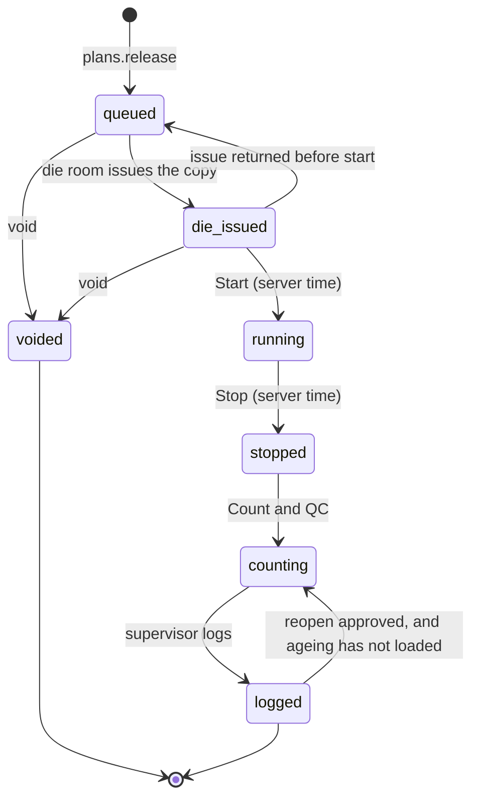

# orrn press — design spec

Date: 2026-10-24 · Module: PR · Preview slug: `press` · Worktree: `wt/FP` (branch `wt/FP` off `redesign/c2`).

Builds on `2026-10-03-orrn-plant-modules-design.md` (P2, P16, P19, §5 ledger), plan tasks PL-9 and PL-11, and digest Stage 8–9. Orders handoff is FP-OP (`press_plan`, `press_plan_die`, `press_plan_line`, `plans.release`). Die-room handoff is FP-DR (`die_issue`, `die.drawing_key`). Billet stock is FP-FD (`item_kind` `billet`, `item_ref` = cast id, location `BILLET`). Shifts are `company.settings.shifts` as agreed with the platform spec. Ageing (FP-AG) reads logged `press_run_line` rows and does not mutate them.

Vocabulary is ORRN's. "Die" means the section catalogue row. "Die copy" means `die_instance`. A **press line** is a physical press (new). A **press run** is one loading of one copy on one line. **Baki** stays ordered − dispatched. **Pressed** is the new word for good kg and pieces logged against a sales order line before packing.

## 1. Context

### What FourCubes needs

The press is where a cast becomes cut lengths, and where a typed recovery can be made to look better than the metal. The buyer on 2026-10-24 agreed that an 80–85% recovery sheet is not believable when the billets have no account [T:L355-L356]. Ansh asked whether operators will log live or fill paper at shift end, because the press man changes every day [T:L326]. The plant casts its own billets and the operator, not the order, knows which cast is on the floor [T:L192-L194]. The office wants to see the order move when the press finishes, without hiding leftover that has not left on a truck (the 8 t produced / 6.7 t loaded case [T:L241-L248]).

FourCubes has one press today [R:architecture-digest.md:390]. Onboarding already asks for a press count (`company.presses` in `packages/i18n/src/en.ts`) and nothing stores it. A second press must not be a schema change.

### What the competitor showed

Described, not copied.

- A press-line master with a name and a tonnage, and a selector between two lines [S:12.58.47 AM]. Demo tonnages are not FourCubes' press.
- A queue fed from the planning board: release a die group or a single cut length onto a line, with priority and reorder [S:12.57.22 AM][S:12.58.47 AM][S:1.01.29 AM]. A shift-sized release was described as the point (10–20 dies, not the whole plan) [T:L289-L292].
- An 11-inch tablet at the press, bought by the plant [T:L231-L235]. One job, large type, shift on screen, a button that opens the section drawing [S:12.58.57 AM][T:L118-L121].
- Start locked until the die room issues the die [S:12.58.57 AM][T:L323-L324]. Minutes earlier the schedule called the same job ready [S:12.58.47 AM]. Those are two gates that do not share a row [R:extrusion-suite-vs-orrn.md §4.4, open question 9].
- A closed sequence, claimed and not clicked through: start and stop on the server clock, then the operator counts rejects and does QC, and only then a log asks for the cast, the billet count and the billet length [T:L324-L329]. The runs report for that plan was empty [S:12.56.47 AM].
- Die history with one row per load: input kg, output kg, recovery (78.3% = 262.5 / 335.3), speed, a press remark and a die-operator remark [S:12.32.00 AM][S:12.33.22 AM][T:L136-L143]. The buyer required the 8th and 10th load as rows, not a summary [T:L138].
- A landscape production report. "17 to 18 columns" is speech [T:L234]. The opened sheet was empty; visible headers were run time, billet specs, input, ram speed, finish, and a clipped output header [S:12.56.47 AM]. The column count was not verified on screen.
- Offline: a draft counter at zero, and the floor screen refusing to save when the link is down [S:12.54.00 AM][S:12.58.57 AM]. That sends the shift back to paper, which is the behaviour Ansh was worried about [T:L326][R:extrusion-suite-vs-orrn.md §8].
- PLC capture, threshold alerts and an accountability flag were described as not built [T:L353-L358].

### What ORRN has today

**Prod** (`origin/prod`): no press table, no press router, no press action. Packing, stock, dispatch and the section catalogue are live. Showcase copy calls press "coming next".

**c2** (this worktree):

- Actions `press.run` and `qc.enter` exist. `press` and `supervisor` hold both (`packages/server/src/lib/permissions.ts`). No procedure uses them for a run.
- `die_weight_reading.press_run_id` is an unbound text column. The comment says the press run table arrives later (`packages/db/src/schema/dies.ts`).
- `nextDocNumber` already allocates `press_run` as `PR-{seq}` on the financial-year period (`packages/server/src/lib/docNumber.ts`).
- `mutation` exists (unique on company, device, `clientMutationId`) and no router writes it (`packages/db/src/schema/sync.ts`).
- `die_instance` statuses are `in_use | available | at_nitriding | retired`. There is no issue document. `drift.suggestFirst` returns the lightest in-band copy (c2 server, tested).
- Approval kinds are `dc_note`, `cast_close`, `die_rerank`, `dispatch_overdraw`, `phantom_void`. The requester cannot approve their own request. No press kind.
- No `packages/db/src/schema/press.ts`, no `routers/press.ts`, no `/press` route. Native Press tab is not in `apps/native/app/(tabs)`.

**Already planned:**

- P16: `press_run`, `press_downtime`, `press_run_line`, `reason_code`, `qc_entry`. Typed billets, downtime reasons, discard and ends, recovery computed, ledger − billets and + discard/ends/rejects to Plant Scrap [R:plant-modules-design.md:32, §5].
- P2: every telemetry field is nullable and typed today, with `source: typed | telemetry | import`.
- PL-9: `press.runs.start / dieOut / downtime.add / lines.add / finish`, QC and ageing in the same task. Finish posts the ledger and computes recovery = good kg / billet kg. Negative billets warn, supervisor can override [R:plant-modules.md:122-128].
- PL-11: `dashboard.today.pressedToday { kgG, recoveryBp, downtimeMin }` and `reports.production` (kg pressed, recovery, by die/section, downtime Pareto) [R:plant-modules.md:138-144]. Web PL-W4 is the run board. Native PL-N4 is the press run board.
- Digest Stage 8: one press, operator and supervisor sign, die in/out, downtime from a code list, footer discard and ends, cut lines with recovery. Stage 9: pieces × length ≤ pressed length when pressed length is known. Phase 7 (not this phase): read-only PLC at 1 Hz, billet = one ram stroke, idle > 10 min = downtime, auto billet count within 2% of the operator (Q-09). Nothing is ever written to the PLC (ADR-006) [R:architecture-digest.md:111, 386-425].
- Q-P8 default shifts Day 08:00–20:00, Night 20:00–08:00. Q-P9: reason lists are seeded and editable. P1 and spec §8 leave the PLC collector out of the current phase.

This spec does not reopen ageing, packing, or the planning board. It consumes a released plan and a die issue, and it leaves a logged run that ageing can load.

## 2. Feature list

| ID | Feature | User story | ORRN today | ES reference (cite) | ORRN does it better by | Priority | Depends on |
|---|---|---|---|---|---|---|---|
| FP-PR-01 | Press lines | As a manager I record each press so a queue and a run belong to a line. | New. Onboarding asks for a count; digest assumes one press [R:architecture-digest.md:390]. | A line master with tonnage, and a selector between two lines [S:12.58.47 AM]. | One table, not a hard-coded pair. FourCubes seeds one line. Tonnage stays empty until the plant names it. | Now | `masters.publish` |
| FP-PR-02 | Queue per line | As the press I see only the jobs my line was given, in the order the planner released. | New. PL-8 is orders and baki, not a release. | Release of a die group or one cut length onto a line, with priority and reorder [S:12.57.22 AM][S:1.01.29 AM][T:L289-L292]. | The release **is** the press run (`queued`, `PR-{seq}`). There is no second "ready" flag. | Now | FP-OP `plans.release`, PL-8 |
| FP-PR-03 | Press station | As the operator I run the shift from one large-type screen on an 11" tablet at the press. | Planned PL-W4 / PL-N4. No route. | One-job floor screen, shift, today's totals; 11" tablet, plant buys it [S:12.58.57 AM][T:L231-L235]. | Same tenant shell as the office, Hindi included, no per-plant app build. The phone tab is the same station, narrower. | Now | FP-PR-05 |
| FP-PR-04 | Die-issue gate | As the die room I issue a copy to a line. The press cannot start until that issue is open. | Absent. PL-9 start sets the copy `in_use` with no issue. | Start locked until the die room issues the die [S:12.58.57 AM][T:L323-L324]. Schedule and floor screen disagreed [S:12.58.47 AM]. | One `die_issue` row (FP-DR). Queue and station read it. `press` cannot issue. | Now | FP-DR `die.issue` |
| FP-PR-05 | Run state machine | As a supervisor I see a run move only forward, and I can see which step it is on. | Planned PL-9 as start / die-out / finish. QC is not a gate. | Claimed sequence, not walked: start, stop, count and QC, then log [T:L327-L329]. Runs sheet empty [S:12.56.47 AM]. | Count, QC and the billet log are gates on the same run. A void before log posts no ledger row. | Now | FP-PR-04 |
| FP-PR-06 | Server-time start and stop | As the owner I trust the running minutes. | Planned die in/out timestamps (PL-9). | Claimed server clock; skew of milliseconds, not seconds [T:L324-L325]. | While online the client clock is a witness, not the record. | Now | FP-PR-05 |
| FP-PR-07 | Billets by cast and length | As the operator I record which cast and which billet length went in. | Planned as one count and one kg on the run's cast (PL-9). Length is not a column. | Log asks for cast, billet count and billet length; the operator picks the cast [T:L192-L194][T:L328]. | One row per length. The server sums them. The order does not carry the cast. | Now | PL-5 cast, FP-FD billet stock |
| FP-PR-08 | Pieces by cut length | As the operator I enter pieces and weighed kg for each cut length after the stop. | Planned `press_run_line` (PL-9). | Combined pieces and kg per cut length on the job card [S:12.58.57 AM]. | Lines are what ageing loads, frozen after log. Good kg is weighed, not a theoretical the operator picks. | Now | FP-PR-05, FP-AG |
| FP-PR-09 | Rejects with reason codes | As the operator I record reject kg against a reason, or I record that QC found none. | Planned `qc_entry` (PL-9), not a gate on the run. | Claimed: count rejects and do QC before the log opens [T:L327-L328]. | "Checked, none" is a row. A missing row cannot log. Reason comes from the master. | Now | `reason_code` (PL-9), FP-PR-05 |
| FP-PR-10 | Butt and ends | As the operator I weigh the butt and the cut ends. | Planned `discard_g` and `ends_g` (P16). Digest glosses discard as the butt [R:architecture-digest.md:1336]. | Butt and cutting scrap are field names in the bundle, not a walked screen [W:§6.2]. | Both post to Plant Scrap in the same batch as the billet draw. Neither is typed into the recovery figure. | Now | Plant Scrap stream, FP-PR-11 |
| FP-PR-11 | Server-computed recovery | As the owner I see a recovery the tablet cannot overwrite. | Planned as a number `finish` computes (PL-9). No table, so nothing rejects a client-sent percentage. | History shows output ÷ input, 78.3% [S:12.33.22 AM]. 80–85% sheets with no billet account were the complaint [T:L355-L356]. | `recovery_bp` is written only by the server. Input of zero stores null, never 0% and never a default. A client percentage is ignored. A test locks the formula. | Now | FP-PR-07, FP-PR-08 |
| FP-PR-12 | Downtime with reason codes | As the operator I start and stop a stoppage and pick a reason. | Planned `press_downtime` (PL-9). The code list itself is unspecified [R:architecture-digest.md:416]. Q-P9 seeds one. | Breakdown counts were described as future PLC data, not a typed list [T:L354-L356]. | Typed now. Minutes come from server times. "Other" needs a note. Overlaps are rejected. | Now | `reason_code` |
| FP-PR-13 | Operator, relief, and shift | As a supervisor I see who started, who took over, and which shift, without the timer resetting when the press man changes. | Planned operator and supervisor (PL-9). No relief. Shift names are a setting (Q-P8). | Shift chip on the floor screen [S:12.58.57 AM]. Press man changes daily [T:L326]. | Handover does not restart the run. `shift_id` is `company.settings.shifts[].id`. Shift 1 starts the production day, not midnight. | Now | Platform shifts setting |
| FP-PR-14 | Drawing at the press | As the operator I open the section drawing to confirm the copy and read the dimensions. | Absent. No drawing on the section. | A button on the floor screen opens the section PDF [S:12.58.57 AM][T:L118-L121]. | The press only reads `die.drawing_key` (FP-DR). It cannot upload or replace the file. A missing file does not lock start. | Now | FP-DR `die.drawing_key` |
| FP-PR-15 | Remarks on the die card | As the die room I read the press remark and the operator remark on that load, beside the drift reading. | c2 server only: unbound `press_run_id`, no remark columns [ORRN:packages/db/src/schema/dies.ts:132-133]. | History columns for a press remark and a die-operator remark; rows stack per load [S:12.32.00 AM][T:L136-L143]. | Remarks live on the run (`press_remark`, `die_remark`) and join on `press_run_id`. The die room does not re-key them. | Now | FP-DR card, FP-PR-05 |
| FP-PR-16 | Pressed on the sales order | As the office I see pressed kg and pieces on the order as soon as the run logs. Baki does not move. | Planned PL-8: produced = bundles, baki = ordered − dispatched. No press link. | Order rollup includes a produced stage before stock and dispatch [S:12.55.22 AM][T:L278]. | Pressed is a query over logged cuts, not a counter. Baki waits for dispatch, so metal still in the plant stays visible. | Now | PL-8, FP-OP |
| FP-PR-17 | Press report | As a manager I print a landscape report of logged runs, 17 columns, for a date range. | Planned PL-11 `reports.production`. | Empty sheet shown; 17–18 columns spoken [T:L234][S:12.56.47 AM]. | Every column is a stored fact or a server calculation. Ram speed is absent until telemetry, so it cannot be typed onto the sheet. | Now | FP-PR-11, PL-11 |
| FP-PR-18 | Daily press summary | As the owner I read yesterday's kg, recovery and stops on Today and on one printable page. | Planned PL-11 `pressedToday` and P19's 7 am page. | Not shown. Their home dashboard was under construction [T:L236]. | The day opens at shift 1's start. Recovery uses the same basis points as the run. | Now | FP-PR-17, platform shift 1 |
| FP-PR-19 | Offline-tolerant entry | As the operator I keep moving a run when the link drops. The server still owns the times when the outbox lands. | New behaviour. `mutation` exists and is unused. LAN-first offline is out of the plant-modules phase [R:plant-modules-design.md:97]. | Floor screen blocks save when offline [S:12.58.57 AM]. Draft counter not exercised [S:12.54.00 AM]. | The shift is not sent back to paper. Skew over 2 minutes needs a supervisor. Duplicate taps return the first result. | Next | FP-PR-06, `mutation` |
| FP-PR-20 | Override approvals | As a manager I approve a disputed time or a reopen. A short billet book is a written reason, not a negative stock row. I cannot approve my own request. | c2 server approvals exist for other kinds. PL-9 names a supervisor override for negative billets and no approval kind. | Accountability flags were described as future [T:L357-L358]. | Time and reopen use the existing `approval` table. A billet shortfall never posts a negative row (FP-FD). The reason sits on the run and on the cast trace. | Now | PL-1 `approval`, FP-FD |
| FP-PR-21 | Press data collector | As the plant I have a cabin device read the PLC and post billet rows beside the typed run. | Planned Phase 7, explicitly not in this phase (P1, spec §8). Read-only [R:architecture-digest.md:111]. | Described as in progress, not shown [T:L353-L354]. | An orrn-spool-style process: disk buffer, HTTPS ingest, typed row stays the record until Q-09 (within 2%). Nothing is written to the PLC. | Later | OI-01, OI-05, FP-PR-07 |
| FP-PR-22 | Threshold alerts | As a supervisor I am told when container temperature, billet temperature or pressure leaves its band. Continuing needs a reason. | Absent. | Described as not built [T:L357-L358]. | The alert does not stop the press (we never write to it). Continuing is an approval with a reason, not a silent flag. | Later | FP-PR-21 |

## 3. Data model

All new tables follow the plant rule: `id` text uuid, `company_id`, `created_at`, `created_by`, `server_seq`. Writes are tenant-scoped, audited, and at most 100 bound parameters. Weights are integer grams. Lengths are integer millimetres. Times are `timestamp_ms`. A client never sends `recovery_bp`.

`plans.release` (FP-OP) is the only insert of a `queued` run. It does not insert a second cut table. The released lengths stay on `press_plan_line`. This spec owns `press_line`, `press_run`, `press_run_line`, `press_billet_use` and `press_downtime`.

### `press_line` — new

Digest and FP-OP assume one press. The master is still worth having: onboarding already asks for a count, and a second line must not migrate the run table.

| Column | Notes |
|---|---|
| `code` | Stable, unique per company. FourCubes seed: `P1`. |
| `name` | Floor name. Seed: `Press 1`. |
| `tonnage_t` | Integer tonnes, nullable. Empty until the plant says. Do not copy a demo tonnage. |
| `status` | `active` \| `retired`. |
| `sort` | Integer. |

One active line is a valid plant. Retire is blocked while a run on that line is not `logged` or `voided`.

### `press_run` — as planned, changed

As planned (P16, digest Stage 8, PL-9): shift, operator, supervisor, cast, die copy, die in/out times, billets, discard, ends, sign-off, `source: typed | telemetry | import`.

Changed from PL-9:

- The run is created at release, not at start. Status starts at `queued`.
- Billets are rows (`press_billet_use`), not a single `{ count, kgG }` on finish. The finish blob cannot record length.
- `die_instance_id` is null until the die room issues a copy. PL-9 set `in_use` inside start. That flip moves to `die.issue` (FP-DR).
- Recovery is not an argument of close.

| Column | New / changed | Notes |
|---|---|---|
| `number` | as planned | `PR-{seq}`, FY period, allocated at release. Never reused. |
| `plan_id` | new | FK to FP-OP `press_plan`. Null only for a run opened without a plan (not in this phase). |
| `press_plan_die_id` | new | FK to FP-OP `press_plan_die` (one section on the plan, not a copy). One non-void run per plan die. |
| `press_line_id` | new | FK `press_line`. Copied at release from `press_plan.press_line_id`. If that is null and the company has one active line, use it. If null and there are two active lines, release refuses. |
| `section_id` | new | The section (`die` catalogue row). Set by release. |
| `die_instance_id` | as planned, changed | Null until issue. Must be a copy of `section_id`. |
| `status` | new | `queued` \| `die_issued` \| `running` \| `stopped` \| `counting` \| `logged` \| `voided`. |
| `shift_id` | changed | Id from `company.settings.shifts[]` (`{ id, name, startMin, endMin }`). Not a free A/B code. Suggested from server time at start; stored as a snapshot. |
| `operator_id` | as planned | Set at start. The signed-in user, or a press-role user picked on a shared tablet. |
| `relief_operator_id` | new | Set by handover. Does not clear `started_at`. |
| `supervisor_id` | as planned | Required at close. |
| `cast_id` | as planned, changed | Null until counting. The operator picks a cast that still has kg at `BILLET`, including a closed cast (FP-FD: close means no more melts, not "billets are gone"). A spectro fail on that cast is a chip, not a block. The order does not carry the cast. |
| `started_at`, `stopped_at` | changed | Server clock, written in the transition batch. Null before that transition. |
| `tapped_start_at`, `tapped_stop_at` | new | Device clock, witness only. Null when the tap was online. |
| `time_unconfirmed` | new | True when an offline tap disagrees with the server apply time by more than 2 minutes. Blocks close until `press_time` is approved. |
| `discard_g`, `ends_g` | as planned | Butt and section ends. UI label for discard is **Butt**. Column name stays `discard_g`. |
| `reject_g` | changed | Snapshot at log, sum of run-linked `qc_entry.reject_g`. |
| `input_g`, `input_weighed_g`, `good_g` | new | Snapshots at log. `input_g` is what the ledger posts. `input_weighed_g` is what the operator weighed, equal to `input_g` unless the book was short. `good_g` = sum of lines. |
| `recovery_bp` | changed | Integer basis points, server-written at log, null until then. Not a client column. |
| `balance_g` | new | `input_g − good_g − discard_g − ends_g − reject_g`, stored at log so the report does not re-derive it after a later master change. |
| `pressed_length_mm` | as planned | Optional. The pieces × length check runs only when this is set (PL-9). |
| `press_remark`, `die_remark` | new | These names are the die-card contract. Empty string is stored as null. |
| `source` | as planned | `typed` until FP-PR-21. |
| `billet_short_reason` | new | Null, or 1–500 characters. Required only when `input_weighed_g` > `input_g`. Visible on the cast trace. Never an excuse to post a negative billet row. |
| `voided_at`, `void_reason_code_id`, `void_note` | new | Set only from `queued` or `die_issued`. |

`die_weight_reading.press_run_id` becomes a real nullable FK (changed: it was unchecked text). No remark columns on the reading. The card joins the run.

### Plan rows this spec reads — FP-OP owns them

Not copied into a `press_queue_cut` table.

`press_plan_die`: `section_id`, `sort_order`, `urgent`. No `die_instance_id`. The die room picks the copy.

`press_plan_line`: `press_plan_die_id`, `sales_order_line_id`, `cut_length_mm`, `pcs`, `kg_g`, `preferred_die_instance_id` nullable. The preferred copy is a hint on the station, next to the lightest in-band copy. Issue may pick another copy of the same section.

Pulling a job back is a void of the run while it is still `queued` or `die_issued`, done by the planner's release-cancel (FP-OP) through `press.runs.void`.

### `press_run_line` — as planned

`press_run_id`, `cut_length_mm`, `pcs`, `kg_g`. `kg_g` is the weighed good output for that length (typed now, scale later at pack, not here).

Added: `press_plan_line_id` FK. The operator's actual line points at the plan line it fulfils. One plan line has one actual line. Extra pieces beyond the plan line stay on that actual line; they are not moved onto an in-house customer.

Frozen after `logged`. FP-AG loads these rows and refuses a run that is not `logged`. `pcs`, `cut_length_mm`, `kg_g`, and the run's `cast_id` and `die_instance_id` do not change after log except through a reopen that ageing has not yet consumed.

### `press_billet_use` — new

Replaces the PL-9 finish blob. Changed, not a rename of a planned table: the planned shape cannot store length.

| Column | Notes |
|---|---|
| `press_run_id` | FK. |
| `cast_id` | Must equal `press_run.cast_id`. |
| `length_mm` | Billet length. UI offers feet; stored mm via `parseLength` and `MM_PER_INCH`. |
| `count` | Integer ≥ 1. |
| `kg_g` | Weighed input for this length. Required. Zero is rejected. |
| `source` | `typed` \| `telemetry` \| `import`. |

Cap 10 rows per run (a cast's logs are a handful of lengths). Over the cap, the call rejects rather than splitting the voucher.

### `press_downtime` — as planned

`press_run_id`, `start_at`, `end_at` nullable, `reason_code_id`, `note` nullable. Times are server times. One open row per run. `note` required when the reason is `other`.

### `reason_code` — as planned

Kinds already planned: `downtime`, `qc_reject`, `void`, `reprint`. No new kind in this phase. Threshold reasons (FP-PR-22) add kind `threshold` later.

Seed (Q-P9 default, editable under Masters):

- Downtime: `die_change`, `billet_wait`, `breakdown`, `power`, `no_order`, `die_correction`, `quality_hold`, `other`.
- QC reject: `dimension`, `surface`, `bend`, `crack`, `short_length`, `other`.

`other` without a note is rejected on the server.

### `qc_entry` — as planned, changed

As planned: cast, die copy, reject kg, reason code, remark. Changed: `press_run_id` nullable FK. A run cannot log without at least one row linked to it. Zero rejects is a row with `reject_g = 0` and a null reason. A positive reject requires a reason.

Run-linked rows post to the ledger at close, not at insert, so a correction during `counting` does not double-post. A `qc_entry` with null `press_run_id` still posts on create, as PL-9, for a QC station entry that is not part of a run.

### `die_issue` — FP-DR owns the table

Consumed, not redefined. Columns this spec relies on: `die_instance_id`, `press_line_id` (FK to `press_line` once both tables land), `press_run_id` nullable, status `issued` | `returned` | `cancelled`. Permission `die.issue` is `die_room` only. One open issue per copy. Issuing sets the copy `in_use` and, when `press_run_id` is set, sets that run's `die_instance_id` and moves `press_run.status` from `queued` to `die_issued` in the same batch. Cancel before start clears the copy on the run and returns status to `queued`. This spec does not give `die.issue` to `press` or `supervisor`. A null `drawing_key` is an empty button, not a start block.

### `die.drawing_key` — FP-DR owns the column

Nullable text, R2 key of the drawing the press opens. The press does not write it. A fuller file set (`die_file`) is the die room's; the station reads `drawing_key` only.

### Later tables (not in the Now migration)

`press_sample` and `press_alert` arrive with FP-PR-21 and FP-PR-22. Naming them here so the collector does not invent a second schema: sample rows are `press_run_id`, `billet_no`, `cast_id`, `pressure`, `speed_mm_s`, `container_temp_c`, `billet_temp_c`, `cycle_s`, `dead_s`, `is_historical`, `source = telemetry`. Alerts are `press_line_id`, `tag`, `value`, `threshold`, `at`, `reason_code_id` nullable, `approval_id` nullable. No raw 1 Hz samples in D1 (digest: ~1.7M rows/day; P1 leaves that store for the plant box).

### Ledger postings

As planned (plant-modules §5), on **close only**, one voucher `press_run`. Billet rows match FP-FD: `item_kind` `billet`, `item_ref` = `cast.id`, location code `BILLET`.

| Row | Item | Location / stream |
|---|---|---|
| − `input_g` | billet, ref = `cast_id` | `BILLET` |
| + `discard_g` | Plant Scrap return stream | scrap store |
| + `ends_g` | Plant Scrap | scrap store |
| + `reject_g` | Plant Scrap | scrap store |

The billet insert is an `INSERT … WHERE` the cast's `BILLET` balance is at least `input_g`. If the WHERE matches nothing, the batch aborts and the cast does not go negative. No approval bypasses that WHERE. Good kg does not become bundle stock. Pack does that. A void before log posts nothing. A logged run is not voided; it is reopened (FP-PR-20), which writes reversal rows in the same batch that returns the run to `counting`, and only when ageing has no non-void row on its lines.

### Sales order

No new column on `sales_order_line`. **Pressed** is a query: sum of `press_run_line.pcs` and `kg_g` for logged runs, joined through `press_plan_line.sales_order_line_id`. `orders.balance` (PL-8) gains `pressedG` and `pressedPcs` beside ordered, produced (bundles), dispatched and baki. Baki is not reduced.

### Document series

`press_run` is already a doc type: `PR-{seq}`, financial year, gaps allowed. No new series. `PP-{seq}` for the plan belongs to FP-OP.

## 4. Server

Router `press` in `packages/server/src/routers/press.ts`. Schema in `packages/db/src/schema/press.ts`. Every procedure takes the tenant from context, never from the input. Every transition is one `atomicBatch` of the document change, the audit row, and — on close or reopen — the ledger rows. Idempotency: optional `clientMutationId` plus `deviceId`. When both are present the call writes `mutation` and a duplicate returns the first result. That is the Now hook for FP-PR-19; the device outbox itself is Next.

### Procedures

| Procedure | Action | What it does |
|---|---|---|
| `press.lines.list` | `press.run` or `reports.read` | Active lines, and retired if asked. |
| `press.lines.create` / `update` / `retire` | `masters.publish` | Master. Retire blocked while a run is open. |
| `press.runs.list` | `press.run` or `reports.read` | Filter `lineId`, `status`, production-day range. Press role sees its lines; reports readers see all. |
| `press.runs.get` | `press.run` or `reports.read` | Run, plan lines, actual lines, billet rows, downtime, QC, open issue, recovery if logged. |
| `press.runs.open` | called by `plans.release` only | Inserts the `queued` run (`plan_id`, `press_plan_die_id`, `section_id`, `press_line_id`, `die_instance_id` null, `PR-{seq}`). Does not copy plan lines. A second call for the same plan die is rejected if a non-void run already exists. |
| `press.runs.void` | `press.run` for the planner path via `order.manage`; supervisor may void | Only from `queued` or `die_issued`. Reason code kind `void`. Returns the issue if one is open. Posts nothing. |
| `press.runs.start` | `press.run` | Input `{ pressPlanDieId, clientMutationId?, tappedAt? }`. Finds the non-void run for that plan die. Refuses unless status is `die_issued`, an open `die_issue` matches the copy and the line, and the line has no other `running` run. Sets `started_at` to server now, `operator_id`, suggested `shift_id`. |
| `press.runs.stop` | `press.run` | From `running` only. Sets `stopped_at`. Closes an open downtime at the same instant. Does not enter `counting` by itself. |
| `press.runs.count` | `press.run` | From `stopped` to `counting`. The only forward step. |
| `press.runs.handover` | `press.run` | While `running`, `stopped` or `counting`. Sets `relief_operator_id`. Does not touch times. |
| `press.runs.downtime.start` / `.stop` | `press.run` | While `running` or `stopped` or `counting`. Reason required to start. One open row. |
| `press.runs.billets.replace` | `press.run` | Counting only. Replaces the billet rows. |
| `press.runs.lines.replace` | `press.run` | Counting only. Replaces actual lines. `kg_g` required on every line. |
| `press.runs.scrap.set` | `press.run` | Counting only. `discardG`, `endsG`, both ≥ 0. |
| `press.runs.qc.replace` | `press.run` | Counting only. At least the zero-reject row before close. |
| `press.runs.reading` | `die.reading` | Counting only. Writes `die_weight_reading` with `press_run_id`. |
| `press.runs.remarks` | `press.run` | Counting only. Sets `press_remark` and `die_remark`. |
| `press.runs.close` | `press.close` | Counting → logged. See gates below. |
| `press.runs.reopen` | `press.close` to request; `approval.decide` to apply | Creates `press_reopen`. Applied only by a manager who is not the requester, and only if ageing reports no non-void row on the lines. |
| `press.runs.drawing` | `press.run` | Returns a read URL for `die.drawing_key`, or `{ empty: true }`. |
| `press.report` | `reports.read`, or `press.run` limited to today and the caller's lines | The 17-column sheet. |
| `press.summary` | `reports.read` | Production-day totals for Today and the printable page. |
| `orders.balance` extension | `order.manage` or `reports.read` | Adds `pressedG`, `pressedPcs`. Owned by the orders router; this spec defines the query. |

`press.runs.start` takes `pressPlanDieId`, not a bare run id. The station has the run; the server resolves the plan die on that run. One non-void run per plan die, so the lookup is unique.

### Close gates

Close runs in one batch and rejects the whole batch if any gate fails.

1. Status is `counting`.
2. Signed-in user holds `press.close` (supervisor, manager, admin; owner holds every tenant action).
3. `supervisor_id` is that user.
4. `cast_id` set. Every billet row matches it. `input_g` > 0. Each row has `count` ≥ 1 and `kg_g` > 0.
5. At least one `press_run_line`, each with `pcs` ≥ 0 and `kg_g` ≥ 0, and `good_g` > 0. A line with pieces and zero kg is rejected (that is an unweighed length, not a recovery).
6. At least one `qc_entry` for the run. Positive reject kg has a reason. `other` has a note.
7. `good_g` ≤ `input_g`. There is no approval that writes a percentage. The supervisor corrects the weights.
8. If `pressed_length_mm` is set, sum of `pcs × cut_length_mm` ≤ `pressed_length_mm`. Otherwise the check is skipped (PL-9).
9. The `BILLET` balance for the cast covers `input_g`. The insert's WHERE enforces it. If the weighed kg is higher, close returns the on-hand figure and stays in `counting` until the operator sets `input_g` to that figure, stores the weighed kg on `input_weighed_g`, and writes `billet_short_reason`. Recovery uses the posted `input_g`. The trace shows both numbers and the reason.
10. `time_unconfirmed` is false, or an approved `press_time` covers this run.
11. Open downtime is closed.
12. The copy still has an open issue for this line. Close returns the issue (`returned`) unless another `queued` run on the same line names the same copy, in which case the issue stays open and that run moves to `die_issued` in the same batch.

Then the batch writes snapshots, `recovery_bp`, ledger rows, the die-copy status (`available` if the issue was returned), and the audit row `press_run.close`.

Recovery:

```
recovery_bp = round(good_g * 10000 / input_g)   // integer, half away from zero
```

Display is one decimal from the basis points (`7835` → `78.4`). The UI does not divide the raw kg again. Input of zero never reaches this line. A payload field `recoveryBp` is stripped; a test posts one and asserts the stored value matches the formula.

`balance_g` outside 2% of `input_g` warns on the close screen and is stored. It does not block. The 2% is a setting default (`press.balanceWarnBp = 200`), not a second recovery.

### Permissions

New actions, same style as `PLANT_ACTIONS`:

| Action | Roles | Comment in the source |
|---|---|---|
| `press.close` | supervisor, manager, admin | log a press run, or request a reopen |
| `die.issue` | die_room | owned by FP-DR; listed here so the press matrix names the gate |

`press.run` stays with `press` and `supervisor`. It does not include close. A press operator can start, stop, count and hand over. The supervisor signs the log. That is the digest's "op + supervisor sign" [R:architecture-digest.md:391].

`press` does not gain `reports.read`. Today's totals on the station come from `press.runs.list`. The 17-column sheet for other days or other lines is `reports.read`.

### Approvals

New kinds on `approval.kind`:

| Kind | Who requests | Who approves | Rule |
|---|---|---|---|
| `press_time` | the sync of an offline tap, or a supervisor correcting a time | supervisor, manager | Required when \|server apply − device tap\| > 2 minutes. There is no `press_billet_overdraw` kind. A short book is `billet_short_reason` on the run, and the ledger WHERE still refuses a negative. |
| `press_reopen` | supervisor or manager (`press.close`) | manager, admin | Refused with CONFLICT if any non-void `ageing_row` references the run's lines. Apply writes ledger reversals and returns the run to `counting`. Clears `recovery_bp` and the snapshots. |

`press_threshold` is added with FP-PR-22, not now. Approver roles follow the existing map in `permissions.ts` (owner is not listed because owner holds everything). Deciding twice is `BAD_REQUEST`, as PL-1.

### Audit

One row per transition, same transaction: `press_run.open`, `press_run.void`, `press_run.start`, `press_run.stop`, `press_run.count`, `press_run.handover`, `press_run.close`, `press_run.reopen`, `press_downtime.start`, `press_downtime.stop`, `press_line.create`, `press_line.retire`. Meta carries the before/after status and, on close, `input_g`, `good_g`, `recovery_bp`. No recovery figure is accepted from the client into meta.

### Reports (PL-11, extended)

`reports.production` and `press.report` are the same query. `dashboard.today.pressedToday` stays `{ kgG, recoveryBp, downtimeMin }` and adds `byLine[]`. The production day is the window from shift 1's `startMin` to the next shift 1 start, in the company timezone, not midnight.

Press report columns, in order, landscape:

1. Run no
2. Production day
3. Shift
4. Press line
5. Operator (relief in the same cell if set)
6. Section (code and series, e.g. `12170 Domal`)
7. Die copy (`12170-1`)
8. Orders (customer short name and SO number, from the cuts)
9. Cut lengths (actual pcs and kg per length)
10. Cast
11. Billets (count × length, input kg)
12. Started – stopped (server, company timezone)
13. Running minutes, net of downtime
14. Downtime minutes and the reason codes
15. Good kg and pcs
16. Butt + ends + rejects kg
17. Recovery %

Ram speed is not a column until FP-PR-21. A typed speed would be the fudge the report exists to stop. Finish stays on the sales order line; it is not a press fact.

CSV uses the same 17 columns. Print is the browser print of this page, not a spool label. The press does not print bundle labels.

### Later ingest (FP-PR-21)

`press.telemetry.ingest` accepts a batch from a plant device authenticated as a collector (same device pairing idea as spool, not a user PIN). It inserts `press_sample` rows with `source = telemetry` and never updates a typed `press_billet_use`. A shift comparison (typed count vs sample count) is a report row. The typed count stays the ledger until a manager marks the shift accepted and the counts are within 2% (Q-09). The collector does not write to the PLC. Protocol waits on OI-01. Where the device sits waits on OI-05. No MQTT in this phase (P1).

## 5. Screens

C2 floor rules: one primary action, large numbers, numeric keypad for weights and pieces, sticky action bar, How-to, Hindi and English, usable at 375 px and at 11" (~834–1194 px) and at 1280. The station uses the existing `@orrn/ui` tokens at a larger type step. It is not a separate theme package.

Hardware at the press, this phase: an 11" tablet on the web station, or the phone Press tab. No printer (labels are pack, via spool). No scale (butt and ends are typed kg; the scale bridge is a pack concern). No PLC. The die oven and the log heater have no fields in the digest and get none here.

### Web

| Route | Who | What it shows | Primary action | Empty / error |
|---|---|---|---|---|
| `/press` | press, supervisor | Today's lines. Each card: name, running run or "idle", queue depth, today's good kg. | Open the line. | No lines: "Add a press line" for a publisher; others see "Ask a manager to add the press." |
| `/press/lines` | masters publishers; others read | Line master. Code, name, tonnage, status. | Add line. | Tonnage blank is a valid saved state, not an error. |
| `/press/lines/:id` | press, supervisor | The queue: `queued` and `die_issued` runs, then the running run, then today's logged runs. Each card: `PR-n`, section, copy or "Not issued", customers, cut lengths, pcs / kg released. | Open the run. | Empty queue: "Nothing released to this line." Link to the plan for someone who holds `order.manage`. |
| `/press/runs/:id` | press, supervisor | The station. See states below. | The one forward step the status allows. | Lost run: not-found, back to the line. Conflict (someone else started it): reload, do not overwrite. |
| `/press/report` | reports readers; press role sees today on their lines only | 17 columns, landscape print stylesheet. Filters: production day range, line, shift. | Print. | No logged runs: the header and an empty table, not a fake zero recovery. |
| `/reports/production` | reports readers | Same query as `/press/report`, from the reports hub (PL-W9). | Print / CSV. | Same empty state. |

Station states on `/press/runs/:id`:

- **Queued.** Section, cuts, customers, band in kg per 12 ft, lightest in-band copy as a hint (read-only, from `drift.suggestFirst`). Banner: "Die not issued. Start is locked." Drawing button if `drawing_key` is set; otherwise "No drawing on this section." No start button.
- **Die issued.** Copy code (`12170-1`), who issued it, when. Primary: **Start**. Shift shown, changeable before start only.
- **Running.** Elapsed time from `started_at`, corrected on each refresh (poll every 10 s; there is no subscription channel in the server today). Primary: **Stop**. Secondary: start downtime, handover. Drawing still available.
- **Stopped.** Started, stopped, elapsed, downtime list. Primary: **Count & QC**.
- **Counting.** Stepper, one step on screen: billets (cast picker, length, count, kg), then pieces by cut length (pcs and weighed kg), then butt and ends, then rejects, then remark and optional drift reading. Primary on the last step: **Log run**, shown only to `press.close`. Others see "Waiting for the supervisor to log." Recovery is shown as a preview computed by a dry-run of the same formula (`press.runs.preview`) and labelled "not saved". The saved figure appears only after log.
- **Logged.** Read-only summary, recovery, balance warning if over 2%, link to the die copy. Primary for a manager: **Request reopen**, hidden when ageing has loaded the lines.
- **Voided.** Reason, who, when. No actions.

Offline banner (Next, FP-PR-19): "Saved on this tablet. Will sync." Never "entries cannot be saved." Until that ships, a failed save stays on the form with the typed values and a retry. The Now client must not clear the form on a network error.

### Native

Press role's phone tabs stay the plant-modules set: Today · Press · Scan · Dies · More.

| Screen | Path | What |
|---|---|---|
| Line picker | `apps/native/app/(tabs)/press/index.tsx` | Same cards as `/press`. One line skips the picker and opens the queue. |
| Queue | `apps/native/app/(tabs)/press/line/[id].tsx` | Queue cards. Pull to refresh. |
| Run | `apps/native/app/(tabs)/press/run/[id].tsx` | Same states as the web station. Keypad for kg and pcs. Drawing opens in a full-screen viewer. |
| Report | not a phone tab | The 17-column sheet is the tablet and the laptop. The phone shows today's three numbers (kg, recovery, downtime) on the line card. This matches the contradiction in the competitor's own advice (a wide sheet both "impossible" and "shown" on a phone [T:L234][T:L284]) by not pretending the sheet fits. |

Scan on the press tab resolves a die-copy code and opens the queued run for that copy, or says the copy is not issued to this line. It does not start the run.

### Today

`dashboard.today` gains the PL-11 `pressedToday` tile: kg, recovery, downtime minutes, and a line each if there is more than one line. Tap opens `/press/summary` (printable, same numbers, production day in the header). The 7 am page (P19) includes this block. WhatsApp delivery stays out of scope.

## 6. Rules & edge cases

### State machine



Downtime is not a state. It is a row while the run is `running`, `stopped` or `counting`.

There is one die gate. `die_issued` is written in the same batch as `die_issue`. The queue chip and the station banner both read `press_run.status` plus the issue id. There is no "ready" column.

One `running` run per line. A second start on that line is `CONFLICT`.

A copy with an open issue cannot be issued again (FP-DR, one open issue per copy). Start also checks `die_issue.press_line_id = press_run.press_line_id` and `die_instance.section_id = press_run.section_id`. A copy that is `at_nitriding` or `retired` cannot be issued; that rejection belongs to FP-DR, and start treats a missing issue as locked.

### Compared with the sequence that was described

Their sequence, claimed and not walked [T:L327-L329][S:12.58.57 AM]:

1. No die at the press → start locked.
2. Start and stop write two times from the server clock.
3. Operator counts rejects and does QC.
4. Only then the log asks for cast, billet count and billet length.
5. If the link is down, the save is refused.

ORRN keeps 1–4 and changes the mechanism:

- The lock is a row (`die_issue`), so the queue cannot say ready while the station says locked.
- Times are server times while online. Offline taps (Next) land through `mutation` and do not become the record until a supervisor confirms a skew over 2 minutes. Their screen sends the operator back to paper [S:12.58.57 AM].
- Recovery is not a field on the log. Their history percentage is output ÷ input typed onto the card [S:12.33.22 AM]. Ours is `round(good_g * 10000 / input_g)`, stored once, ignored if the client sends it. Zero billets cannot become 0% or 80%.
- Overrides go through `approval`, and the requester cannot approve. Their accountability flag was a promise [T:L357-L358].

### Edges

- **Handover.** Relief sets `relief_operator_id`. `started_at` stays. The report names both.
- **Cast picked late.** Start does not need a cast. Close does. The picker lists casts with kg at `BILLET`, heaviest first, including a closed cast. A spectro fail is a chip on the row. It does not block the pick (FP-FD).
- **Two lengths, one cast.** Two `press_billet_use` rows. Input is the sum. A second cast on the same run is rejected; the operator stops and the supervisor voids only if the run has not started. After start, the wrong cast is corrected during counting, before log.
- **Short billet book.** Close refuses if `input_g` would take `BILLET` negative. The error names the on-hand kg. The supervisor does not get an approval that posts the difference. They either wait for foundry to lock the missing kg, or they post only what the book has and write `billet_short_reason`. That reason is on the run and on the cast trace. It is not a silent negative [FP-FD §4].
- **Good kg above input.** Close rejects. No approval writes `recovery_bp`. Fix the weights.
- **Unweighed length.** A line with `pcs` > 0 and `kg_g` = 0 is rejected. The theoretical kg from the latest reading is shown beside the field (`pcs × cut_length_mm / (144 × MM_PER_INCH) × kg_per_12ft_milli`, grams) and is not copied into `kg_g` by the server. That stops a weight-setting fudge from becoming the recovery [T:L356].
- **Balance.** Butt, ends and rejects are not subtracted a second time inside recovery. They sit in `balance_g`. Over 2% warns.
- **Zero QC.** A missing QC row cannot log. A zero-reject row can.
- **Downtime overlap.** A second open row is rejected. A downtime outside `[started_at, stopped_at]` after stop is rejected. While running, the open row may extend to "now".
- **Other without a note.** Rejected.
- **Pieces × length.** Checked only when `pressed_length_mm` is typed.
- **Issue returned while running.** Refused. Stop first. After log, return is automatic unless the next queued run on the line is the same copy.
- **Wrong section issued.** FP-DR rejects it. The run stays `queued`.
- **Press role calls `die.issue`.** `FORBIDDEN`.
- **Client sends `recoveryBp`.** Stripped. Tested.
- **Reopen after ageing.** `CONFLICT`. The lines stay frozen. Ageing owns the loaded pieces.
- **Reopen before ageing.** Reverses the ledger, clears snapshots and `recovery_bp`, status `counting`. The issue is not re-opened automatically; the die room issues again if the copy left the line.
- **Number gaps.** A voided release keeps `PR-n`. The next release gets the next number.
- **Production day.** A run started at 00:30 belongs to the previous production day if shift 1 starts at 08:00. The summary uses that boundary.
- **Shared tablet.** PIN login stays off (P11). The signed-in user is the default operator. Handover covers a change of person without a new login. A supervisor must be the signed-in user to log; they take the tablet or the operator's save waits in `counting`.
- **Customer-owned section.** If FP-OP or FP-DR adds an owner on the section, release must not put another customer's cuts on that run. The press does not add a second lock. It runs what was released.
- **Idempotent taps.** Start twice with the same `clientMutationId` returns the first `started_at`. It does not move the clock.

## 7. Merge notes

**Keep from ORRN**

- Typed-first, `source` on every row the PLC would later fill (P2). The collector never writes the PLC (ADR-006).
- `PR-{seq}` on the financial year. Do not add a monthly press number.
- Grams, basis points, millimetres, `atomicBatch`, tenant scope, ≤100 parameters.
- Baki = ordered − dispatched (P13). Pressed is a new query, not a redefinition of baki or of produced (bundles).
- Recovery formula direction from PL-9 (good kg / billet kg), made non-writable.
- QC and ageing stay their own tables. This spec adds `press_run_id` on `qc_entry` and freezes `press_run_line` for FP-AG.
- `die_weight_reading.press_run_id` is the join the die card already expected.
- Approvals: requester ≠ approver, decide-twice rejected.
- Hindi strings in `en.ts` and `hi.ts` for every new label. Gujarati is still out of scope.
- One press at FourCubes is a seed row, not a schema assumption.

**Adopt from the competitor, in our words**

- A line master, a per-line queue, a station on an 11" tablet, a drawing button, a die-issue lock, a forward-only sequence, server times, cast and billet length at the log, rejects before log, a wide press report, remarks on the die history.
- The complaint about inflated recovery, answered with a server figure and a required billet weight rather than with a PLC promise.

**Do differently**

- One issue row, not a schedule flag plus a station flag.
- Offline outbox instead of a hard block. Next, not Now, but Now already accepts `clientMutationId` so Next is not a migration.
- No typed ram speed on the report.
- No in-house customer for over-press. Extra pieces stay on the sales order line as pressed above the release. Pack decides the bundle's order. The buyer rejected booking leftover to a plant-named order [T:L248].
- Close is a supervisor action (`press.close`), not the operator's last tap.
- QC scrap for a run posts at close, not at `qc.create`. Standalone QC still posts on create.

**Conflicts with existing plans**

| Plan | Conflict | Resolution |
|---|---|---|
| PL-9 `start` sets `in_use` and takes the cast | Issue must precede start; cast is picked at count | `die.issue` sets `in_use`. Start checks the issue. `press.runs.open` creates `queued`. PL-9's `dieOut` becomes the return inside close, plus FP-DR's return before start. |
| PL-9 finish blob `{ count, kgG }` | Length is required | `press_billet_use` rows. Finish's blob is not implemented. |
| PL-9 recovery computed inside finish from client kg | Client can still shape the inputs, but not the percentage | Keep the formula. Reject `good_g > input_g`. Strip `recoveryBp`. Test it. |
| PL-9 negative billets "supervisor override" | A silent negative recreates the unaccounted-billet sheet | No negative post. `INSERT WHERE` on `BILLET`. Shortfall is `billet_short_reason` on the run, visible on the cast trace (FP-FD). |
| PL-9 QC posts on create | Double-post if the operator edits | Run-linked QC posts at close. |
| Digest "one press" and FP-OP's first note of one press | A line master is this module's job | `press_line`. `plans.release` sets `press_line_id`. A plant with one line never sees a selector. |
| P13 produced = bundles | Office needs to see the press before pack | Add pressed. Do not change produced or baki. |
| P1 / spec §8: no PLC this phase | FP-PR-21 is the same work, later | No collector in the Now migration. Ingest shape is specified so it is not redesigned. |
| FP-OP `press_plan_die` / `pressPlanDieId` | The queue must not be a second table | Release inserts `press_run` only (`press_plan_die_id`, `section_id`, `die_instance_id` null). Lengths stay on `press_plan_line`. Start takes `pressPlanDieId`. No `press_queue_cut`. |
| FP-DR `die_issue.press_line_id` as text until this table exists | Both specs land together | The press migration creates `press_line` and adds the FK. |
| Ageing load | Reopen would invalidate loaded pieces | `press_reopen` returns CONFLICT while any non-void `ageing_row` points at the lines. |

## 8. Demo page brief

Fixture only. No server calls. Client-side state in the route module. Slug `press`. Four screens. Copy is English; labels match the i18n keys the real screens will use.

Realistic values: section **12170 Domal**, band **1.850–2.100 kg per 12 ft**, copy **12170-1** latest reading **1.920 kg per 12 ft**. Second copy **12170-2** on the rack, not issued. Customers **Patel Extrusions, Surat** (SO-18) and **Kutch Aluminium, Rajkot** (SO-19). Cast **K31**. Line **P1 / Press 1**, tonnage blank. Shift **Day**, 08:00–20:00. Operator **Raju**, supervisor **Mahesh**. These people are fixture names, not a staff list.

Coherent metal, so the preview recovery matches the formula:

- Released: 12 ft × 80 pcs (SO-18) and 14 ft × 40 pcs (SO-19).
- Actual good: 12 ft × 80 pcs × 153.6 kg, and 14 ft × 36 pcs × 80.6 kg. Good = **234.2 kg**, 116 pcs.
- Billets: 18 × 20 ft, **310.4 kg**, cast K31.
- Butt 28.5 kg, ends 12.1 kg, rejects 4.2 kg (reason `surface`).
- Recovery = round(234200 × 10000 / 310400) = **7545** basis points → **75.5%**. Do not type 75.5 into a field; compute it in the fixture the same way.
- Balance = 310.4 − 234.2 − 28.5 − 12.1 − 4.2 = **31.4 kg** (about 10%), so the warning chip shows.

A second run, **PR-41**, section 12170, status `queued`, copy not issued, for the lock banner. The counting run is **PR-42**.

### `/preview/press` — `apps/web/src/routes/_tenant/preview.press.index.tsx`

Line board. One card, Press 1, "PR-42 counting", queue 1, today 0 kg logged (PR-42 is not logged until the console simulates log). Primary: open the queue, which is a list under the card on this landing screen (do not add a fifth route). Queue rows: PR-42 (counting, 12170-1 issued) and PR-41 (queued, "Die not issued"). Tap a row navigates to the console with that run in the search string. Empty state is not the default; a toggle in the fixture drawer shows "Nothing released" for screenshots.

### `/preview/press/console` — `preview.press.console.tsx`

11" frame (max width 1100 px, large type, sticky bar). Search `?run=PR-41` opens the lock: banner "Die not issued. Start is locked.", section 12170 Domal, band, customers, drawing button that opens a local placeholder page ("12170 Domal — drawing not on this demo file") rather than a broken URL. No start button.

Search `?run=PR-42` opens counting. A local stepper walks billets → pieces → butt and ends → rejects → remarks. Numbers above are the defaults, editable. **Start** and **Stop** are on a "show running" control that sets a fake `started_at` of today 09:12 and `stopped_at` of 11:04, labelled "preview clock", so the timer can be shown without a server. **Log run** computes recovery in the page, shows 75.5%, and flips the card to logged. It does not write baki. A line under the summary says "Pressed 234.2 kg on SO-18 and SO-19. Baki unchanged." Sending a recovery field is not possible; there is no input for it. If the visitor clears billet kg, Log run stays disabled and the copy reads "No billets, no recovery."

### `/preview/press/report` — `preview.press.report.tsx`

Landscape table, 17 columns as in §4, one logged row (PR-42) after the console has logged, otherwise the empty state "No logged runs for this day." Print stylesheet hides the app chrome. Footer: input 310.4 kg, good 234.2 kg, recovery 75.5%, downtime 18 min (`billet_wait`). A second fixture row can be toggled to show the Pareto note is not this page (Pareto stays on the summary).

### `/preview/press/summary` — `preview.press.summary.tsx`

Production day header "Day, from 08:00". Three big numbers: 234.2 kg, 75.5%, 18 min. One line, Press 1. Downtime reason `billet_wait`. Short note: "Recovery is calculated. It is not entered." Link back to the report. This is the Today tile, enlarged.

Interactions to simulate, all client-side: issue lock on PR-41, stepper and disabled log when billets are zero on PR-42, recovery appearing only after log, baki sentence, empty report, print layout at 1100 px and at 1280 px. No network, no toast that claims a save reached the server.

## 9. Open questions for the owner

Defaults in brackets. None of these block the spec.

- **Q-PR1** What is Press 1's tonnage, and is a second press planned? [Blank tonnage. One line, code P1. The table allows more.]
- **Q-PR2 (Q-P8)** Shift names and times, and which shift opens the production day? [Day 08:00–20:00, Night 20:00–08:00. Shift 1 is Day. The id lives in company settings.]
- **Q-PR3 (Q-P9)** Downtime and reject reasons? [The seeds in §3. Editable.]
- **Q-PR4** May a supervisor issue a copy when the die room is not in the plant? [No. `die.issue` is die_room only. The run waits in `queued`.]
- **Q-PR5** Unweighed good kg: block close, or allow the latest kg/12 ft figure as an estimate? [Block. The figure is shown and not stored as the weight.]
- **Q-PR6** Balance warning threshold? [2% of input kg, warn only.]
- **Q-PR7** Offline taps: confirm any skew over 2 minutes, or trust the device clock? [Confirm over 2 minutes. The outbox itself is Next.]
- **Q-PR8 (OI-01, OI-05)** PLC make, protocol, and whether the cabin has a free port? [Collector stays Later. Typed runs do not wait on this.]
- **Q-PR9** Shared tablet: does the supervisor have to be the signed-in user to log? [Yes, until PIN login is turned on (P11).]
