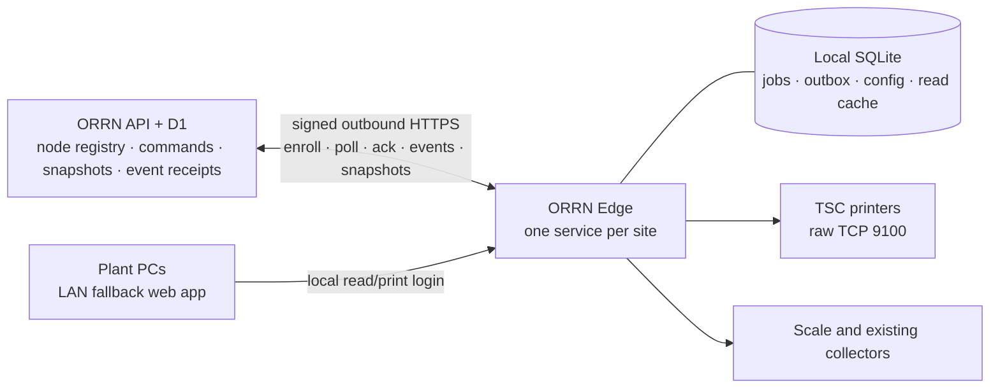

# ORRN Edge — reliable site agent design

Date: 2026-10-26
Status: design approved for specification review; not implemented
Products: ORRN control plane and ORRN Edge (successor to the current ORRN Spool agent)

## 1. Purpose

ORRN Edge is one installable service per plant site. It provides:

- reliable TSC label printing without inbound network exposure;
- cached, read-only plant data when ORRN or the site internet connection is unavailable;
- local cached-label reprints and printer tests during outages;
- a local fallback web application for plant PCs;
- native Windows Service, Linux systemd, Docker, and ARM64/Raspberry Pi deployment;
- durable recovery after process crashes, reboots, duplicate delivery, and lost acknowledgements.

The first release supports one edge node per site. A company may have multiple sites; every printer profile and command names its destination node explicitly.

### Approved boundaries

- Offline capability is **cached reads plus printing**, not offline business operations.
- Stock, sales-order, packing, dispatch, and other business writes still require ORRN online.
- Offline printing means printer tests and new reprint attempts for label jobs already cached on that node. It does not mean downloading new cloud jobs while disconnected.
- The local fallback is a LAN web application, not a desktop application or transparent failover of `orrn.in`.
- Transport is signed outbound HTTPS polling with durable outboxes. WebSockets, Durable Objects, Cloudflare Tunnel, public agent DNS, and inbound ORRN API calls are not required.

## 2. Problems being replaced

The current system couples plant availability to per-site DNS, a public certificate, a Cloudflare Tunnel, inbound ORRN requests, heartbeat enrollment, and separately installed connector software. The current native and Docker packages do not reliably complete that enrollment.

The replacement also addresses defects that packaging alone cannot fix:

- non-atomic queue claiming and unconditional recovery of in-flight jobs;
- ambiguous socket outcomes being retried as if no print occurred;
- shared concurrent printer socket reads/writes and incorrect status decoding;
- split database/runtime printer registration and pause ownership;
- volatile webhook retries and regressable cloud job status;
- arbitrary active-node selection in multi-site companies;
- native binaries without embedded assets, service integration, stable paths, or a configuration reader;
- plaintext configuration trailers and tunnel credentials that the Go program does not consume;
- immediate secret rotation that strands a node before it receives the new secret.

## 3. Non-goals for the first release

- Offline creation or modification of stock, orders, packing, dispatch, or other business transactions.
- Active-active edge nodes or automatic cache ownership transfer.
- Generic replication of ORRN database tables.
- Transparent continuation of `orrn.in` in a browser during an outage.
- AI label generation, a general printer-driver framework, or arbitrary non-TSC printer support.
- Silent self-update.
- A claim of physical exactly-once printing over raw TSC TCP.
- macOS background service packaging. macOS may remain a development target, not a supported plant appliance.

## 4. Architecture

There is no ORRN-initiated connection to the plant. Site firewalls only need outbound TCP 443 to `api.orrn.in`. The local fallback listener is a LAN service and is never exposed through ORRN.

### 4.1 Control plane

ORRN owns:

- company/site/node identity and enrollment;
- desired printer/template configuration versions;
- durable print and device commands;
- sanitized read snapshots;
- idempotent event receipts and print history;
- release metadata and version compatibility.

### 4.2 Edge agent

The agent is one versioned Go executable with:

- embedded HTML/static assets;
- pure-Go SQLite (`CGO_ENABLED=0` for release builds);
- an outbound cloud connector;
- durable command/job/event stores;
- one serialized device session per printer;
- a versioned configuration reconciler;
- an atomic snapshot/cache manager;
- separate administration and fallback HTTP listeners;
- native service lifecycle integration.

The existing TSPL2 generator, label-variable contract, scale parser/stability logic, HMAC vectors, useful UI assets, and migration concepts may be reused after their tests pass. Queue execution, printer connection ownership, cloud transport, enrollment, webhook delivery, and packaging are replaced rather than wrapped.

## 5. Enrollment and node identity

### 5.1 Create and enroll

1. A platform administrator creates a node with `companyId` and a human site label. ORRN does not create DNS or tunnel resources.
2. ORRN generates a random enrollment token, stores only its SHA-256 hash, `enrollment_issued_at`, `enrollment_expires_at`, and `enrollment_used_at`, and displays the raw token once. Tokens expire after 15 minutes and are single-use.
3. The installer prompts for the token; it is not placed in a shell command line, container environment, release binary, or log.
4. The agent calls `POST /api/edge/v1/enroll` with the raw token, agent version, operating system, architecture, and a random installation ID.
5. In one D1 transaction, ORRN validates and consumes the token, then returns `instanceId`, `nodeSecret`, `companyId`-independent display metadata, API origin, protocol version, and current config version. Company authorization is subsequently derived from `instanceId` on the server, never accepted from agent input.
6. The agent writes `node.json` with restrictive OS permissions, performs an authenticated config download and initial snapshot sync, and reports ready only after those operations succeed.

Re-enrollment of the same node preserves its local database and job-key deduplication. Re-enrollment with a different node identity is refused until the administrator explicitly resets local state.

### 5.2 Authenticated machine requests

Every request after enrollment includes:

- `Authorization: Bearer v1:<unix-ms>:<hmac>` using the existing ORRN HMAC construction over method, request URI, timestamp, and body hash;
- `X-ORRN-Node-ID: <instanceId>`;
- `X-ORRN-Edge-Version: <semantic-version>`;
- `Content-Type: application/json` when a body is present.

ORRN requires a valid signature, timestamp within the existing skew window, and replay protection. It rejects revoked nodes and checks that the requested command, snapshot, or config belongs to the authenticated node and active company. Existing unsigned heartbeat acceptance is not reused.

### 5.3 Non-stranding secret rotation

Secret rotation uses overlapping credentials:

1. ORRN stores a `pendingSecretWrapped` and monotonically increasing pending credential version while retaining the current secret.
2. Both secrets remain valid only for that node during rotation. Poll responses advertise `pending_credential_version`; a changed value triggers an immediate authenticated config fetch, which includes the pending version and new secret over TLS.
3. Before confirming, the agent durably writes the pending secret and version to the same protected node store as the current credential. Startup retains both while confirmation is incomplete.
4. The agent calls `POST /api/edge/v1/credentials/confirm` signed with the new secret and pending version. Confirmation is idempotent for that node/version, including after promotion and when the original response was lost.
5. ORRN promotes the pending secret and removes the old secret only after valid confirmation. The agent activates the confirmed credential and deletes the old one only after the success response; startup with an unconfirmed pending credential retries confirmation instead of falling back to a possibly deleted old secret.

Before confirmation, the administrator may cancel the pending rotation and the current credential remains valid. A rotation that is never downloaded or confirmed does not disable the plant.

### 5.4 Revocation

Revocation takes effect on the next online request. ORRN returns an explicit `node_revoked` response. The agent then:

- stops cloud polling and local fallback access;
- wipes cached company read DTOs and local fallback grants;
- preserves local job/audit records and unsent events for administrator diagnosis, but does not serve them through the fallback UI;
- requires explicit re-enrollment before operating again.

Revocation cannot be learned while the node is offline; the UI documents this limitation.

## 6. Cloud command contract

### 6.1 D1 command model

A new `edge_command` table owns command delivery. Each row contains:

- `id` (UUID), `company_id`, `deployment_id`, and `kind`;
- immutable `payload_json` and, where applicable, `job_key` and `payload_hash`;
- `state`: `queued`, `leased`, `accepted`, or `rejected`;
- `lease_id`, `lease_expires_at`, and `delivery_count`;
- `resolved_at`, `resolution_json`, `created_at`, and `updated_at`.

`print_log` remains the product history. `edge_command` is the delivery mechanism and does not replace print history. A print command and its `print_log` row are inserted in the same D1 transaction. `bundle.sticker_stale` clears only when the agent durably accepts the job.

Every `printer_profile` gains a required `deployment_id` for new configurations. Existing rows are assigned explicitly during migration; no unordered active-node lookup remains.

### 6.2 Commands and configuration

Command kinds in the first release are:

- `print_job`: frozen printer/template references, rendered variables, copies, label/job version, `jobKey`, and `payloadHash`;
- `test_print`: destination local printer identity and test-label payload;
- `cancel_job`: target local job identity and reason.

A retry is a new `print_job` command linked to the previous attempt; it is not redelivery of an existing command.

Printer and template administration uses desired-state configuration rather than a fragile sequence of add/update/delete commands:

- each node has a monotonically increasing `config_version`;
- the complete config contains the node’s printers, profiles, templates, schema version, and version;
- the agent validates and applies one complete version atomically, then acknowledges it;
- queued print jobs retain their frozen payload even if desired configuration later changes.

### 6.3 Polling and leases

The agent calls `POST /api/edge/v1/commands/poll` every 5 seconds while healthy. The response contains up to 10 commands plus the current `config_version`, `pending_credential_version`, and snapshot manifest version. A changed config or pending-credential version triggers an immediate config download before further command acceptance.

ORRN atomically leases each returned command for 60 seconds. Lease expiry makes the same command eligible for redelivery with the same command ID and payload. A lease is a delivery aid, not a new print attempt.

The agent polls with a 10-second request timeout. Network/server failures use capped exponential backoff from 1 to 60 seconds with jitter. A successful poll resets the interval to 5 seconds. Snapshot and configuration downloads have separate deadlines and do not block command persistence.

### 6.4 Durable acceptance

Before acknowledging any command, the agent durably stores its command ID, payload hash, and resolution in one SQLite transaction. Redelivery returns that stored resolution.

For `print_job` and `test_print`, the same transaction creates or finds the local job, enforces `UNIQUE(job_key)`, and writes the resolution event to the outbox. A different payload for an existing job key produces a terminal `rejected` resolution with reason `job_key_conflict`; it does not create or execute a job. `cancel_job` persists the target-specific resolution defined in §7.3 and never creates a new target job.

`POST /api/edge/v1/commands/ack` reports either `accepted` or `rejected` and is idempotent. ORRN stores the terminal resolution and returns it for repeated acknowledgements. A conflict rejection marks cloud print history failed with the conflict reason and leaves `sticker_stale` unchanged. Lost acknowledgements and redeliveries never create another job or device transmission.

Acknowledgements include the current lease ID. ORRN accepts the current lease or returns an already-recorded identical resolution; it never allows a stale lease to overwrite a newer resolution.

## 7. Local print execution

### 7.1 Job states

Local jobs use these explicit states:

- `accepted`: durably stored; no device transmission has begun;
- `device_open`: a worker owns the job and is opening/checking the device; no bytes have been sent;
- `transmitting`: persisted immediately before the first device write;
- `sent`: every TSPL byte was written successfully;
- `failed_retryable`: failure occurred before any bytes were sent; includes `next_attempt_at`;
- `failed_final`: validation, config, permission, or operator-final failure;
- `outcome_unknown`: transmission may have started, but its result is ambiguous;
- `cancelled`: cancelled before the first write.

Cloud UI labels distinguish **Queued**, **Accepted**, **Sending**, **Sent to printer**, **Retry scheduled**, **Failed**, **Outcome unknown**, and **Cancelled**. `sent` is never described as proof of physical printing.

### 7.2 Atomic workers

- One worker owns a printer at a time.
- A single SQL compare-and-claim moves an eligible job from `accepted` to `device_open`; affected-row count decides ownership.
- All printer status operations and job writes for that printer use the same serialized device session. Map locks alone do not protect socket I/O.
- Startup resumes `accepted`, `device_open`, and zero-byte `failed_retryable` jobs according to their retry schedule.
- Startup changes `transmitting` jobs to `outcome_unknown` with reason `process_interrupted`; it never returns them blindly to pending.
- `sent`, `outcome_unknown`, `failed_final`, and `cancelled` are terminal for automatic execution.

### 7.3 Socket outcome rules

The device writer loops until the complete TSPL payload is written.

- Error with zero bytes written: `failed_retryable` when the error class allows retry.
- Error or timeout after any bytes: `outcome_unknown`.
- Short write followed by an error: `outcome_unknown`.
- Full payload written: `sent`.
- An operator retry after `sent` or `outcome_unknown` creates a new linked attempt with a new attempt number and job key.

Cancellation resolution is persisted against the cancel command and returned identically on redelivery:

- Missing target: reject `job_not_found`.
- Already cancelled target: accept `already_cancelled` without changing the job.
- `accepted`, `device_open`, or `failed_retryable`: atomically change the target to `cancelled`, append its event, and accept `cancelled`; the worker checks state again before the first write.
- `transmitting`: reject `transmission_started`; bytes cannot be retracted.
- `sent`, `outcome_unknown`, or `failed_final`: reject `job_not_cancellable` with the current state.

Transient zero-byte failures retry with capped exponential backoff and jitter until the job succeeds, is cancelled, or requires operator intervention; there is no silent max-retry drop. Pausing a printer stops new claims without discarding queued jobs.

### 7.4 Printer protocol handling

TSC status decoding is profile-driven and fixture-tested. The TA220 profile covers both the documented four-byte status form and the one-byte reply observed from the Fourcubes device. Status checks and print transmission cannot interleave. Status timestamps update only on a genuine device response; failed checks do not update `last_seen_at`.

Print counters have one owner and increment once per completed device attempt, not once in both manager and queue code.

## 8. Durable events and print history

Every command acceptance/rejection, job transition, config acknowledgement, local test, and offline reprint creates an event in the local SQLite outbox before the related command is acknowledged where applicable. Every local job-state transition and its corresponding outbox event commit in the same SQLite transaction, including crash-recovery transitions, cancellation, and counter updates.

Each event has:

- `event_id` (UUID), `deployment_id`, aggregate/job ID, sequence, kind, payload, and `occurred_at`;
- `created_at`, `next_attempt_at`, `attempt_count`, and `acknowledged_at`.

`POST /api/edge/v1/events` accepts a bounded ordered batch. ORRN stores `edge_event_receipt(event_id, deployment_id, response_json, received_at)` and applies the event in the same D1 transaction. Duplicate event IDs return the stored original response without reapplying the event.

Status transitions are monotonic. Delayed `accepted` or `device_open` events cannot regress `sent`, `failed_final`, `outcome_unknown`, or `cancelled`. Failed retry scheduling is represented separately from terminal failure.

Unacknowledged events survive restarts and outages. Acknowledged transport events may be pruned; durable local job/audit history remains.

### 8.1 Offline reprints

The fallback app may reprint only a label job already present in the node’s local runtime store. Cloud print-history snapshots do not include label variables and cannot be used to reconstruct labels.

Reprint sources are limited to jobs in `sent`, `outcome_unknown`, `failed_final`, or `cancelled` state with their frozen printable payload and destination configuration intact. `accepted`, `device_open`, `transmitting`, and `failed_retryable` jobs are not eligible; the operator must wait for a terminal state or cancel the active attempt first. The UI warns that reprinting `sent` or `outcome_unknown` may produce another physical label.

An offline reprint:

- creates a new local attempt linked to the original job;
- records the local operator, reason, original job, and actual local timestamp;
- uses a new local reprint job key so deduplication does not suppress it;
- emits an `offline_reprint` event for later insertion into ORRN print history;
- performs no stock, order, packing, dispatch, or bundle mutation.

Frozen printable payloads and local job/audit records are retained for every reprint-eligible job in the first release; there is no automatic payload pruning. Only acknowledged transport events may be pruned. A job whose payload or destination is unavailable is shown as history without a reprint action.

## 9. Read-cache snapshots

### 9.1 Why snapshots instead of a delta feed

ORRN has row versions but no complete commit-safe change feed. Existing sequences can have commit-order gaps, hard deletes have no tombstones, and derived read DTOs change when related rows change. The first release therefore uses complete sanitized snapshots. It does not present `company_sequence` as a replication log.

### 9.2 Snapshot sections

Snapshots are independently coherent per read section:

- `stock`: server-projected bundle/list rows, stock summary, locations, status/kind totals, and band verdict inputs needed by the read UI;
- `orders`: order-book and order-detail read DTOs, line balances, produced/dispatched/baki figures, and required customer/die display fields; all prices and rate fields are excluded;
- `dies`: die list/detail DTOs, copy/band metadata, owner/customer display fields, and file metadata only; R2 contents and credentials are excluded;
- `print_status`: sanitized queue/history DTOs without label variables or agent internals;
- `company_format`: timezone, units, numbering/display settings, and company display name.

Each section is built from one D1 read transaction and the existing server-side projection logic. Source rows are loaded in bounded query sets, never through per-row D1 queries. There is no claim of cross-section point-in-time consistency. The UI shows a separate **Cached as of** timestamp for each section.

### 9.3 Manifest and chunks

A manifest contains:

- `schemaVersion`, `companyId` verified against the authenticated node, and ordered section descriptors;
- per-section `snapshotId`, `generatedAt`, `contentSha256`, and `recordCount`;
- ordered chunks with `sequence`, `sha256`, and `recordCount`;
- a completeness marker and minimum supported agent version.

Chunks are UTF-8 JSON, at most 1 MiB each. ORRN stores complete snapshot metadata and chunks in D1, so R2 is optional. The latest two complete generations per company/section are retained, and generations are not deleted until at least 24 hours old. An agent can therefore finish a slower download after a newer snapshot appears.

ORRN caches generated snapshots for 60 seconds per company/schema version. Agents request the manifest every 60 seconds and download only sections whose `snapshotId` changed. Snapshot generation is throttled and observable; Fourcubes-scale data is a required performance fixture.

### 9.4 Agent application

The agent downloads chunks into staging storage, verifies sequence, completeness, record counts, SHA-256, schema compatibility, and company/node binding before applying anything.

For each changed section, one SQLite transaction replaces the previous generation and updates its applied manifest. Readers continue to see the old complete generation until commit. Corrupt, missing, partial, or incompatible snapshots are rejected without emptying or partially updating the live cache.

Local cache records use section/entity keys, sanitized JSON DTOs, sort keys, and summary records suitable for bounded list queries. JSON1 indexes support the small set of filters exposed by the fallback UI; arbitrary local analytics are out of scope.

## 10. Local fallback and administration

### 10.1 Listeners

Two listeners have different route sets:

- `127.0.0.1:8081`: local setup, fallback-user administration, diagnostics, read-only desired-config display, printer tests, and the fallback UI;
- configurable LAN listener, default `:8080`: authenticated fallback UI only, with no node-admin, enrollment, secret, update, or configuration routes.

On a VM, administrators use SSH port forwarding to reach the loopback admin listener. Docker publishes the fallback port deliberately and never publishes the admin listener by default.

### 10.2 Local accounts

The privileged installer/CLI bootstraps a local administrator by prompting for an admin password or generating a one-time bootstrap secret shown once. Passwords are never supplied on a process command line. Every administration route requires an authenticated administrator session; loopback reachability alone is not authorization. An authenticated administrator then creates site-local fallback users. Fallback passwords/PINs are unique to the edge node, bcrypt-hashed, and never copied from ORRN accounts. Roles are:

- `viewer`: cached reads and local print status;
- `printer`: viewer plus cached-label reprint and printer test.

The node secret is never sent to a browser. Fallback sessions are `HttpOnly`, `SameSite=Strict`, and limited to the LAN listener. The security boundary is the plant LAN; the first release does not add a local certificate authority.

Admin and fallback mutations require a CSRF token and validated Origin/Host headers in addition to their session. First-run setup routes are disabled after administrator bootstrap.

### 10.3 Fallback screens

The first release provides:

- connection and per-section cache freshness;
- stock list/detail and stock summary;
- order list/detail without prices;
- die list/detail without drawing-file downloads;
- local and cloud print history clearly separated;
- printer health, test print, and cached-label reprint for `printer` users;
- explicit read-only/offline banners and no business-write controls.

Local runtime status is authoritative for jobs executed on that node. Cloud `print_status` is labeled separately as cached cloud history.

## 11. Service and package design

### 11.1 Shared executable

All targets use the same immutable versioned executable and embedded assets. Release builds stamp `main.Version`; no `dev` binary is eligible for production download.

Configuration and data never depend on the process working directory. Machine credentials are read from `node.json`, not environment variables or an executable trailer.

### 11.2 Windows

- Binary: `orrn-edge-windows-amd64.exe` in `%ProgramFiles%\ORRN\Edge`.
- State: `%ProgramData%\ORRN\Edge`.
- `orrn-edge.exe install` prompts for enrollment, installs and starts a Windows Service, and configures restart recovery.
- `orrn-edge.exe uninstall` removes the service but preserves state by default.
- `orrn-edge.exe run` supports foreground diagnostics; `doctor` produces a redacted diagnostic report.
- Upgrades stop the service, stage the verified binary, retain the previous binary, start the service, and roll back if health does not become ready.

### 11.3 Linux and Raspberry Pi

- Binary: `/usr/local/bin/orrn-edge` for `linux/amd64` and `linux/arm64`.
- Config: `/etc/orrn-edge`; state: `/var/lib/orrn-edge`.
- A dedicated `orrn-edge` system user owns state and credentials.
- A systemd unit starts after network availability, restarts on failure, and uses explicit absolute paths.
- The installer prompts for the enrollment token, verifies artifact SHA-256, runs migrations through normal service startup, and performs a health check.

### 11.4 Docker

The same binary is packaged in `linux/amd64` and `linux/arm64` images. A persistent volume holds `/var/lib/orrn-edge`. The one-time enrollment token is supplied through a mounted `0600` file and removed after exchange; it is not persisted in Compose environment configuration. The container runs with a restart policy and publishes only the intended fallback port.

### 11.5 Updates

Rerunning the installer is the first-release update mechanism. It:

- downloads or accepts an immutable versioned artifact;
- verifies TLS origin and SHA-256;
- preserves enrollment and SQLite state;
- takes a consistent pre-upgrade SQLite backup;
- uses expand-only migrations compatible with both the new and previous binary (N and N-1); destructive cleanup waits for a later release that no longer supports rollback;
- retains the previous binary;
- performs service-aware restart and health verification;
- restores the previous binary on failed health verification.

No automatic updater is advertised. Code signing/notarization requires separate signing credentials and is not claimed by this design.

## 12. Health, logs, and diagnostics

Initial readiness requires a writable database, valid node identity, completed initial configuration, and a complete initial snapshot for every required section; an empty but complete section counts. Subsequent starts and upgrade health checks require the last known-good configuration and one complete cached generation per section. Cloud reachability is reported separately; an internet outage does not make a previously initialized node unready for local fallback printing.

Health exposes independent states for:

- process/readiness;
- database and free storage;
- cloud connection and last successful poll;
- config version and last acknowledgement;
- snapshot version/error per section;
- each printer and active job;
- outbox depth and oldest unacknowledged event.

Structured logs include node, command, job, event, config, and snapshot IDs. They exclude node/enrollment secrets, authorization headers, local passwords, and label payloads. A redacted support bundle contains versions, recent errors, queue statistics, sync status, and service logs without company DTO contents.

A full or unwritable database causes new local acceptance to stop, health to become degraded, and existing state to remain intact. The agent never silently drops work to recover.

## 13. ORRN product changes

- Existing tenant procedure names and permissions remain where practical, but synchronous agent calls become durable command operations.
- Print actions initially return **Queued**, not **Sent** or **Printed**.
- Printer lists/status read the latest agent-reported snapshots; config acknowledgements, not button clicks, set pushed/ready timestamps.
- Queue/history displays add accepted, sending, sent, retry scheduled, and outcome-unknown semantics without losing existing filters.
- Platform node creation no longer provisions Cloudflare Tunnel/DNS resources or displays tunnel tokens.
- Install/download flows produce the real service packages described here.
- Scale and existing collector presence remain compatible; scale reads use agent-reported state instead of an inbound ORRN call.
- Browser A4 label fallback, QR format, label variables, template versions, payload hashes, job keys, and explicit reprint attempts remain compatible.

Temporary legacy routes may coexist only for the Fourcubes migration. After cutover, all callers move to the new command/event contracts and obsolete tunnel provisioning, patched binary trailers, unsigned heartbeat aliases, and inbound `SpoolClient` paths are removed.

## 14. Failure requirements

| Failure | Required result |
|---|---|
| Command lease expires after agent crash | Same command and job key return; original local job is recovered |
| Acknowledgement is lost | Redelivery returns the original acceptance; no second job/transmission |
| Process dies before first write | Job resumes according to its durable state |
| Process dies after transmission state begins | Job becomes `outcome_unknown`; no blind retry |
| Socket fails with zero bytes | Retryable failure with persistent next-attempt time |
| Socket fails after any bytes | `outcome_unknown`; operator must choose a new attempt |
| Event upload is duplicated or delayed | ORRN deduplicates and never regresses terminal state |
| Snapshot is corrupt or incomplete | Previous complete section remains active |
| Hard delete occurs in ORRN | Entity disappears in the next complete section snapshot |
| Internet or ORRN is down | Cached reads and local cached-label printing continue; both outboxes persist |
| Node is revoked | Next online response disables fallback and wipes read cache/grants |
| Disk is full or unwritable | Stop new acceptance, preserve state, report degraded health |
| Service is killed by OS | Native recovery restarts it; migrations/reconciliation complete before readiness |

## 15. Verification and release gates

### 15.1 Contract and concurrency tests

- Duplicate poll, lease expiry, acknowledgement replay, and event replay across process restarts.
- Concurrent workers cannot claim one job twice.
- Existing job key plus different payload is rejected, including insert races.
- A stale lease cannot overwrite a newer resolution.
- Conflict rejection and every cancellation target state persist and replay an identical resolution without device transmission.
- Terminal states cannot regress.
- Cross-company access, tampered company IDs, revoked nodes, expired enrollment tokens, and token reuse are denied.
- Rotation works before and after new-credential confirmation; an unconfirmed rotation never disables the node.

### 15.2 Printer tests

- A fake TSC device covers connection refusal, offline/error status, short writes, reset, timeout, partial status, and slow responses.
- Fixtures cover documented four-byte and observed TA220 one-byte statuses.
- Fault injection proves zero-byte retry versus post-byte `outcome_unknown` behavior.
- Process kill tests cover every job transition.
- Real Fourcubes TA220 labels are inspected for geometry, variables, QR/barcode content, and copy count before cutover.

### 15.3 Cache tests

- Missing/corrupt chunks, wrong company, wrong schema, and incomplete manifests never replace the active generation.
- Hard deletes and derived-DTO changes converge on the next full snapshot.
- Stock/order/die DTOs match the ORRN read projections for a Fourcubes-scale fixture.
- Prices, secrets, authorization data, R2 credentials, and label variables are absent from sanitized snapshot sections.
- The previous cache remains usable throughout a failed download and a 30-minute network outage.

### 15.4 Package and service tests

- Windows VM: install, enroll, service start/stop/restart, recovery, upgrade, rollback, uninstall with state preservation, and reboot.
- Linux VM: systemd installation, permissions, reboot, upgrade, rollback, and persistent state.
- Docker amd64/arm64: health, persistent volume, enrollment-token removal, and restart.
- ARM64 smoke passes before Pi deployment.
- Every released artifact reports its actual version and matches its published SHA-256.

### 15.5 End-to-end acceptance

The release is not complete until all of these are observed:

1. A fresh Windows install enrolls without DNS/tunnel setup and survives reboot.
2. A fresh Linux/Docker install does the same.
3. ORRN queues a Fourcubes label; the agent accepts it and the real TSC produces the expected label.
4. Killing the agent during a simulated ambiguous write produces `outcome_unknown`, not an automatic duplicate.
5. A 30-minute internet outage preserves cached stock/orders/dies and permits a local cached-label reprint.
6. Reconnection uploads local events once, delivers queued cloud commands once per logical attempt, and refreshes snapshots.
7. Secret rotation completes without downtime.
8. Fourcubes production cutover passes while legacy BarTender remains available as fallback.

## 16. Fourcubes migration

1. Deploy additive ORRN tables, endpoints, and asynchronous UI states while leaving legacy routes temporarily callable.
2. Install ORRN Edge on agni CT 130. Verify enrollment, config, snapshots, service recovery, and TSC status without enabling cloud print commands.
3. Enable only the Fourcubes test printer profile. Print through `orrn.in`, inspect the physical label, and verify event/history behavior.
4. Test local cached-label reprint and cache reads during a controlled outage.
5. Run crash, restart, duplicate-delivery, rotation, corrupt-snapshot, and upgrade/rollback drills.
6. After human sign-off, route Fourcubes production printing to the new node. Legacy BarTender remains available as fallback.
7. Remove obsolete spool/tunnel paths only after callers are migrated. Stop the old spool without changing legacy BarTender or VM 181.
8. Later, back up the stopped agent state consistently, restore it on ARM64 Pi hardware, and repeat printer/outage checks before retiring CT 130.

## 17. Implementation sequence

1. Freeze versioned protocol schemas and migration ownership.
2. Build the self-contained executable, SQLite foundation, service lifecycle, and diagnostics.
3. Add enrollment, credential rotation, D1 command leases, agent acceptance, and durable events.
4. Replace printer execution and protocol handling with the new state machine.
5. Add desired-state config, snapshots, local cache, and fallback UI.
6. Add Windows/Linux/Docker/ARM64 packages and upgrade/rollback behavior.
7. Run all release gates, then perform the Fourcubes migration.

Each stage ships with its tests and documentation. No stage claims production readiness from compilation or container health alone.
